<!-- SECTION: backend.overview | status: DRAFT-UNVERIFIED -->
## 1. Overview

**Responsibility.** `notes_api` is the single backend service for a team note-taking product. [stories.md EP-002, EP-003, EP-004; requirements.md BR-013] It is responsible for:

1. **Application API.** Create, read, edit, pin and unpin, tag, archive, unarchive and search team notes, published as an OpenAPI document. [stories.md EP-002, EP-003, EP-004; requirements.md BR-012]
2. **Email one-time-code login (CR-123).** A caller requests a one-time code for an email address. The service emails the code. The caller verifies it and receives a credential. This is an **additional** sign-in method. The existing authentication is unchanged. [feedback.md CR-123; feedback.md preflight answer on login method]
   - Code expiry, resend limits and lockout after wrong codes apply. [feedback.md CR-123; requirements.md BR-020 to BR-028; stories.md US-004-03]
   - **All previous numeric limits are withdrawn.** The values in BR-020, BR-021, BR-022, BR-024, BR-025, BR-026, BR-027 and BR-028, and in the matching passages of US-004-03 and US-006-06, are not used in this document. [feedback.md CR-123] Recorded as `CON-BE-014`.
   - The three re-decisions are blocking: `Q-BE-008` (resend count and window), `Q-BE-009` (code expiry period), `Q-BE-010` (wrong-code threshold and lock duration). [feedback.md CR-123]
   - Login is an interface change. Consumers must adapt. [feedback.md CR-123; requirements.md NFR-015, NFR-016]
3. **EU data-residency compliance.** Provisioning `notes_api`'s database, compute and backups in approved EU regions. Gating deploys on a residency check. Generating a compliance report. Enforcing a launch gate. Alerting on post-launch region drift. [stories.md EP-001; requirements.md BR-001 to BR-004, NFR-001 to NFR-004]

**Not responsible for.**

- Rendering any user interface. The web-app surface (EP-006) is a separate run. This document defines only the API that surface consumes. [stories.md EP-006]
- Attachment and file-upload endpoints. [requirements.md BR-014]
- Any real-time channel (WebSocket, SSE, polling push). [requirements.md BR-015]
- Mobile-specific endpoints. [stories.md US-005-01, US-005-04]
- Logging and classifying stakeholder feature requests. This is a product-management process. [requirements.md BR-017; stories.md US-005-06]
- Any login method other than email one-time code and the existing authentication. The existing method is not named in any supplied input. `GAP-BE-085`.

**Revision contents.**

- **CR-123 (this change request).** Email one-time-code login, as above. Note, tag, search and residency behaviour is carried forward unchanged from the approved revision. [feedback.md CR-123]
- **CR-112 (retained).** Notes carry a boolean `pinned` flag, default `false`, settable on create and via PATCH, returned in note responses. Pinned notes sort first in list and search results. Interface change. [requirements.md BR-018, BR-019, NFR-014; feedback.md CR-112]
- **Label discrepancy.** The change request is headed `CR-123`. The approved revision labels the same login content `CR-119`. Other inputs use `CR-113`, `CR-114`, `CR-115`, `CR-116` and `CR-118` for the login and interface notes. The content is the same. This document uses `CR-123`. Recorded as `CON-BE-017`, with the older labels in `CON-BE-013`, `CON-BE-015`, `CON-BE-005`, `CON-BE-008` and `CON-BE-009`.
- **Design input.** The `design_brief` input supplied contains acceptance-criteria files (AC-001-*, AC-002-*), not visual design. Those criteria are cited as `AC-`. No Figma input is connected. Backend `spec_mode` is `NOT-APPLICABLE`.
- **Corrupted-passage note (withdrawn).** The prior revision recorded login-limit text pasted into unrelated sentences (`CON-BE-016`). On re-reading the supplied text, the cited passages (AC-001-02-02, US-003-03, US-005-02, NFR-006) read cleanly. The only login-limit text found is in BR-020 to BR-028, US-004-03 and US-006-06, which are withdrawn as above.

**Stack.** Node.js 20, Express, PostgreSQL 16, hosted on AWS. [platform.md; feedback.md preflight answers] The approved revision specifies AWS SES for transactional email. CR-123 names no transport. `ASM-BE-027`. The approved revision specifies reuse of the application's existing session or token mechanism. The preflight answers do not restate it. `ASM-BE-028`. No ORM, migration tool or other library is named by any input. `GAP-BE-089`.

**Run mode.** `RUN-CONTEXT` declares `bootstrap`. feedback.md supplies the approved revision as the baseline and instructs the run to keep what CR-123 does not touch. `ASM-BE-026`.

**Identifier continuity.** New identifiers continue from the highest observed in the approved revision. None is reused. New in this run: `GAP-BE-093` to `GAP-BE-098`, `ASM-BE-040` to `ASM-BE-041`, `CON-BE-016` to `CON-BE-018`, `Q-BE-011`. Carried forward: `GAP-BE-004`, `GAP-BE-005`, `GAP-BE-007`, `GAP-BE-041` to `GAP-BE-052`, `GAP-BE-071` to `GAP-BE-082`, `Q-BE-004`, `HANDOFF-BE-002` to `HANDOFF-BE-004`. Where a carried item's text is needed and is not in the supplied material, this document says so.

**Preflight resolution.** Email login is additive, not a replacement. [feedback.md] This closes the replacement question. It does not close `GAP-BE-085`, because the existing login method is still unnamed.

**Open blocking questions.**

- `Q-BE-003`: who may verify and receive access.
- `Q-BE-005`: the AWS region from which email is sent, and the residency of email transmission.
- `Q-BE-008`: resend count and window. Re-decision required by CR-123.
- `Q-BE-009`: code expiry period. Re-decision required by CR-123.
- `Q-BE-010`: wrong-code threshold and lock duration. Re-decision required by CR-123.
- `Q-BE-007` (degradable in the approved revision, carried as blocking): default is that verification is refused during a lock, and sending remains subject to the resend limit. `DRAFT-UNVERIFIED`. Its resend limit is undetermined until `Q-BE-008` is answered.
- `Q-BE-011` (degradable): whether the 6-digit code length in BR-029 stands. Default: it stands, because CR-123 withdraws limits and does not name code length. `ASM-BE-040`.

**Open Critical contradictions.**

- `CON-BE-003`: registration scope against the shared-workspace default. Touches an authorisation rule.
- `CON-BE-006`: email transmission against BR-001. Touches a PII path, because the email address is personal data sent through a transport whose region is unknown.
- `CON-BE-010`: lock counting. Consecutive wrong codes (BR-027) against cumulative wrong codes (BR-022, BR-025). CR-123 says "repeated wrong codes", which fits either reading. Changes a lock state machine.

**Halting.** The orchestrator decides whether to halt. The open blocking questions and Critical contradictions above are the halt conditions. This document records the work completed. Sections that depend on them are marked `DRAFT-UNVERIFIED` or `BLOCKED` in place.

<!-- /SECTION: backend.overview -->
<!-- SECTION: backend.domain-model | status: DRAFT-UNVERIFIED -->
## 2. Domain model

Three sub-domains are evidenced: the **note-taking domain** (Note, Tag), the **login domain** (User, OTP challenge, send attempt, login lock) and the **residency-compliance domain** (InfraResource, DriftAlert). The login domain is revised in this change request. [feedback.md CR-123] No input relates these sub-domains beyond "notes_api's infrastructure hosts the note-taking data." [requirements.md BR-013]

```mermaid
erDiagram
  NOTE ||--o{ NOTE_TAG : "tagged by"
  TAG  ||--o{ NOTE_TAG : "applied to"
  USER {
    string user_id
    string email "PII; normalisation GAP-BE-031"
    datetime created_at "set on first successful verification (INV-BE-003)"
  }
  OTP_CHALLENGE {
    string challenge_id
    string email "keyed by email, no FK to USER"
    string code_digest "storage form GAP-BE-033"
    datetime issued_at
    datetime expires_at "issued_at plus Q-BE-009 period"
    int failed_attempts "counting semantics CON-BE-010"
    datetime consumed_at "nullable; single-use (INV-BE-002)"
  }
  SEND_ATTEMPT {
    string email "normalised (ASM-BE-015)"
    datetime requested_at "window and count Q-BE-008; shape ASM-BE-037"
  }
  LOGIN_LOCK {
    string email "normalised (ASM-BE-015); no FK to USER"
    datetime locked_until "entry plus Q-BE-010 duration"
  }
  NOTE {
    string id
    string title
    string body
    string status "active or archived"
    boolean pinned "default false (BR-018)"
    datetime created_at
    datetime updated_at
  }
  TAG {
    string name
  }
  NOTE_TAG {
    string note_id
    string tag_name
  }
  INFRA_RESOURCE {
    string resource_id
    string resource_type "db, compute or backup-storage"
    string region
    string compliance_status "pass, fail or unverified"
    datetime last_scanned_at
  }
  DRIFT_ALERT {
    string id
    string resource_id
    string detected_region
    datetime raised_at
  }
```

**Entities.**

- **Note.** Title, body, status (active or archived), `pinned`, created and updated timestamps. [stories.md US-002-01 to US-002-06] Title and body are mandatory and non-empty at creation. [requirements.md BR-005] Archiving never deletes data. [requirements.md BR-007, BR-008]
- **`pinned` (CR-112).** Boolean, default `false`. Settable on create and changeable via PATCH. Pinning does not alter title, body or tags. [requirements.md BR-018; AC-002-01-01, AC-002-01-02, AC-002-02-02] Nullability is not stated in any input. Proposed `NOT NULL` is `ASM-BE-034`.
- **Tag.** A name, many-to-many with Note through NOTE_TAG. Adding an existing tag is idempotent, with no duplicate entry. [stories.md US-002-03] Tag name format and length: `GAP-BE-009`. Cascade when a tag's last note is archived or deleted: `GAP-BE-016`.
- **User.** A person who has verified an email address. Created on first successful verification, not on code request. [INV-BE-003; ASM-BE-025] `email` is personal data. `ASM-BE-019`. Handling policy: `GAP-BE-033`.
- **OTP challenge.** One issued one-time code for one email address, keyed by email because the user may not yet exist. Expiry is the period in `Q-BE-009`, measured from issue. [feedback.md CR-123] Single-use. [requirements.md BR-023; INV-BE-002] Code length: 6 digits, all numeric. [requirements.md BR-029] Character set and generation: `GAP-BE-026`, `GAP-BE-027`. Storage form: `GAP-BE-033`. Whether a resend invalidates an earlier unconsumed code: `GAP-BE-083`.
- **Send attempt.** One record per code request, kept so that a time-windowed resend limit can be evaluated. Its existence follows from "resend limits" in CR-123. Its columns are derived, not confirmed. `ASM-BE-037`. Count and window: `Q-BE-008`. Whether the initial send counts: `CON-BE-011`. Key: `Q-BE-006`, default per email (`ASM-BE-029`).
- **Login lock.** The lock state for an email address. Entered after wrong codes and held for the duration in `Q-BE-010`. [feedback.md CR-123] Keyed by normalised email (`ASM-BE-015`). Whether the wrong-code count is consecutive or cumulative, and whether it resets: `CON-BE-010` (Critical, open), `GAP-BE-024`.
- **InfraResource.** A provisioned notes_api component (DB, compute, backup storage) with its reported region and compliance status. Unrecognised resource types are flagged `unverified`, never silently omitted. [AC-001-04-01, AC-001-04-02]
- **DriftAlert.** A record of a post-launch detection of an InfraResource in a non-EU region. [stories.md US-001-06]

**Invariants.** These hold after every operation that touches the named entity.

- **INV-BE-001.** In `GET /notes` and `GET /notes/search`, every pinned note is returned before every unpinned note. Order within each group is unchanged. [requirements.md BR-019] Owned by `notes` for `GET /notes` and by `search` for `GET /notes/search`.
- **INV-BE-002.** A one-time code that has been verified successfully is refused on any later verification. [requirements.md BR-023]
- **INV-BE-003.** A User row is created only on successful verification, never on code request. [ASM-BE-025]
- **INV-BE-004.** A code submitted at or after issue plus the expiry period in `Q-BE-009` is rejected as expired. [feedback.md CR-123] No expiry value is asserted until `Q-BE-009` is answered.
- **INV-BE-005.** While an email address is locked, no verification succeeds, including with a correct code, until the lock expires. [requirements.md BR-022, BR-027; feedback.md CR-123 "lockout"]

**Cardinality and ownership.**

- User and Note have no relationship in the diagram. No input states whether a Note belongs to a user, is private, or is shared. `GAP-BE-003`. The default applied is `Q-BE-001` (degradable): notes form a shared team workspace, and any authenticated team member may read and write any note.
- **BLOCKED subpart.** `CON-BE-003` (Critical) calls that default into question. Under CR-123, any holder of an email address that verifies can obtain a credential, so "team member" no longer names a bounded group. Until `Q-BE-003` is answered, the shared-workspace default applies only to users created by a route the human has approved. Note ownership columns and the note-access rule are `BLOCKED`. See `backend.auth-model`.

**PII.** Personal data exists in this domain: `USER.email`, `OTP_CHALLENGE.email`, `SEND_ATTEMPT.email` and `LOGIN_LOCK.email`, which hold the same value. Note `title` and `body` are free text and may incidentally contain PII. No masking or handling policy is supplied for any of them: `GAP-BE-017` (general PII policy), `GAP-BE-033` (at-rest treatment), `GAP-BE-035` (validation scope for email and code fields). No encryption, redaction or retention claim is made in their absence.

<!-- /SECTION: backend.domain-model -->
<!-- SECTION: backend.module-map | status: DERIVED -->
## 3. Module map

| Module | Boundary | Depends on |
|---|---|---|
| `auth` | Email one-time-code login (CR-123): code issuance and delivery, verification, resend limits, lockout, code expiry, user creation on first verification, credential issuance through the existing session/token mechanism (`ASM-BE-028`). Owns User, OTP_CHALLENGE, SEND_ATTEMPT, LOGIN_LOCK. Coexists with the existing authentication, which is unchanged. | external: email transport (`ASM-BE-027`; region blocked on `Q-BE-005`, `CON-BE-006`) |
| `notes` | Note CRUD, pin and unpin via PATCH, tag assignment and removal, archive and unarchive. Owns Note, Tag, NOTE_TAG. | `auth` (caller identity) |
| `search` | Read-only query over Note: keyword, tag filter, pagination, archived-exclusion default, pinned-first ordering. | `notes`, `auth` |
| `residency-compliance` | Provisioning region validation, backup-destination validation, CI/CD residency gate, compliance report, launch-gate status, post-launch drift scan and alerting. Owns InfraResource, DriftAlert. | none at runtime; operates on the infrastructure and CI/CD layer |
| `api-docs` | Publishes the OpenAPI document, including `pinned`, the ordering change, and both login endpoints. Computes the endpoint-coverage metric. Carries the data-residency note and the Scope section. | `notes`, `search`, `auth`, `residency-compliance` |
| `scope-guardrail` | Intercepts every inbound request ahead of routing. Rejects attachment and multipart, WebSocket and SSE-upgrade, and mobile-specific patterns with a structured out-of-scope response. Backs the contract test suite. | sits upstream of all modules; cross-cutting |

**Dependency direction.** `search → notes`, `search → auth`, `notes → auth`, `api-docs → notes, search, auth, residency-compliance`, `auth → email transport` (external). Requests flow through `scope-guardrail` first, then `auth` for protected routes, then `notes`, `search` or `api-docs`.

**Guardrail before authentication.** The guardrail runs before authentication, so an out-of-scope call returns its documented response without a credential. `ASM-BE-018`. The response form for excluded paths conflicts across inputs: US-005-02 requires 404 for attachment paths, US-005-04 requires a message referencing the scope exclusion rather than a bare 404. `CON-BE-007`.

**CR-123 impact on boundaries.** `auth` is the module that changed. It is a new sign-in path alongside the existing one, not a replacement. It is the only module that calls the email transport, which carries the residency question `CON-BE-006`. `notes` and `search` depend on `auth` for caller identity, as in the approved revision. CR-123 adds no new dependency for them.

<!-- /SECTION: backend.module-map -->
<!-- SECTION: backend.api-surface | status: DRAFT-UNVERIFIED -->
## 4. API surface index

Full contracts (request and response schemas, every error, idempotency, rate limits) belong in the per-module `api-contract` sections, which this document does not reproduce. Schemas are referenced by `SCHEMA-` ID and are not restated here.

**Versioning.** An endpoint whose request or response shape changes is re-pinned from `@1` to `@2`. [ASM-BE-010] New endpoints start at `@1`. [ASM-BE-021] CR-123 identifies no shape change to existing endpoints, so they keep their pins. The new login endpoints start at `@1` (`ASM-BE-036`). If any consumer has integrated against `@1`, that assumption fails and both login endpoints re-pin to `@2`. Whether authenticated endpoints should bump because their caller obligation changes: `GAP-BE-037`.

| API ID | Method | Path | Auth | Module | Notes |
|---|---|---|---|---|---|
| `API-AUTH-001@1` | POST | `/auth/otp/send` | unauthenticated; resend-limited | `auth` | **Added (CR-123).** Issues a one-time code to an email address and emails it through the transport. Also the resend path. Requests beyond the resend limit are refused with 429 and send no code. [requirements.md BR-028 (status retained, values withdrawn); US-004-03] Count and window: `Q-BE-008`. Initial send counts toward the limit: `CON-BE-011`. Limit key: `Q-BE-006`, default per email (`ASM-BE-029`). Response does not reveal whether an account exists (`ASM-BE-030`). Success status and body: `GAP-BE-028`. Whether a resend invalidates an earlier code: `GAP-BE-083`. Behaviour during an active lock: `GAP-BE-063`; `Q-BE-007` default applies. Transport failure: `GAP-BE-066`. Transport region: `Q-BE-005`, `CON-BE-006`. |
| `API-AUTH-002@1` | POST | `/auth/otp/verify` | unauthenticated; subject to lockout | `auth` | **Added (CR-123).** Verifies a code for an email address. Wrong, expired or already-used codes are rejected. [requirements.md BR-023, BR-024, BR-026 (expiry value withdrawn); INV-BE-002, INV-BE-004] Expiry period: `Q-BE-009`. After the wrong-code threshold, the address is locked and further verification is refused until the lock expires, including for a correct code (INV-BE-005). [requirements.md BR-022, BR-025, BR-027 (values withdrawn)] Threshold and duration: `Q-BE-010`. Lock counting: `CON-BE-010` (Critical, open). Locked-response status and body: `GAP-BE-038`. Wrong-code and expired-code statuses: `GAP-BE-053`. Unknown-email behaviour: `GAP-BE-065`. On success, creates the User if absent (INV-BE-003) and returns a credential from the existing session/token mechanism (`ASM-BE-028`, `GAP-BE-030`). |
| `API-NOTES-001@2` | POST | `/notes` | authenticated team member (`ASM-BE-031`) | `notes` | **Changed from @1 (CR-112).** Accepts optional `pinned` (boolean, default `false`). Returns `pinned` in the 201 body. Title and body rules unchanged. [AC-002-01-01, AC-002-01-02; requirements.md BR-005, BR-018] |
| `API-NOTES-002@2` | PATCH | `/notes/{id}` | authenticated team member | `notes` | **Changed from @1 (CR-112).** Accepts optional `pinned`. Partial update: fields not sent are never overwritten. [requirements.md BR-006] Returns `pinned`. Pinning leaves title, body and tags unchanged. [AC-002-02-02] PATCH, not PUT: `ASM-BE-001`. Non-existent ID returns 404 and modifies nothing. [AC-002-02-03] |
| Remaining notes, tag, archive, unarchive and get endpoints | per stories US-002-03 to US-002-06 | not supplied in the text available to this revision | authenticated team member | `notes` | Method, path and pin for each are not recoverable from the supplied prior document. `GAP-BE-096`. Behaviour is fixed by US-002-03 to US-002-06 and BR-007, BR-008. |
| `API-SEARCH-001` (`GET /notes/search`) | GET | `/notes/search` | authenticated team member | `search` | Pin and identifier not recoverable from the supplied text. `GAP-BE-096`. Behaviour: keyword `q`, tag filter, pagination, archived excluded by default (`include_archived=true` overrides), pinned-first ordering. [stories.md US-003-01 to US-003-06; requirements.md BR-009 to BR-011, BR-019] |
| OpenAPI document endpoint | GET | not stated | not stated | `api-docs` | Path and access are not stated in any input. `GAP-BE-098`. Must list all endpoints, including send and verify. [stories.md US-004-01] |

**Index completeness.** This index does not list every endpoint named in the requirements. Every entry above is either in the supplied text or marked as a gap. No path, identifier or pin is inferred.

<!-- /SECTION: backend.api-surface -->
<!-- SECTION: backend.auth-model | status: DRAFT-UNVERIFIED -->
## 5. Authentication and authorisation model

**Actors.**

| Actor | Source | Notes |
|---|---|---|
| Unauthenticated caller | any | May call `API-AUTH-001` and `API-AUTH-002` only. Subject to resend limit and lockout. |
| Authenticated team member | existing mechanism (`ASM-BE-028`); CR-123 credential via `API-AUTH-002` | Holds a credential. Scope of access per the BLOCKED row below. `ASM-BE-031`. |
| Platform/DevOps Engineer, Release/CI Owner, Compliance Auditor, Engineering Lead | stories US-001-01 to US-001-06 | Operate on infrastructure, pipeline and reports. Not API actors in any input. `GAP-BE-092`. |
| Third-party integrator | US-004-01, US-005-04 | Reads the OpenAPI document and calls endpoints. Authorisation not stated beyond the team-member credential. `GAP-BE-098`. |

**Permission matrix.** `Y` = allowed, `N` = refused, `Q` = depends on an open question.

| Role | Resource | Operation | Allowed | Basis |
|---|---|---|---|---|
| Unauthenticated | OTP send | create code | Y, resend-limited | `API-AUTH-001`; limit `Q-BE-008` |
| Unauthenticated | OTP verify | verify code | Y, subject to lock | `API-AUTH-002`; `Q-BE-010`, `CON-BE-010` |
| Unauthenticated | Note | any | N | every note endpoint requires authentication (`ASM-BE-031`) |
| Unauthenticated | out-of-scope path | any | N, structured response | `scope-guardrail`; `ASM-BE-018`; `CON-BE-007` |
| Team member | Note (own) | create, read, edit, pin, tag, archive, unarchive | Q | ownership not stated. `GAP-BE-003` |
| Team member | Note (others) | read, edit, archive | Q, BLOCKED | `CON-BE-003` (Critical); `Q-BE-001` default; `Q-BE-003` |
| Team member | Note search | search | Q, BLOCKED | follows the Note access rule above |
| Team member | OTP endpoints | call | Y | no authorisation difference stated |
| Any | OpenAPI document | read | GAP | `GAP-BE-098` |

**Ownership predicate.** Not defined. The predicate for "owns this note" cannot be written until `Q-BE-001` and `Q-BE-003` are answered. Until then, the default is shared workspace for users created by an approved route only. `CON-BE-003` is Critical.

**Login path.** The OTP verify endpoint is the only route by which a new credential is created under CR-123. Whether any user, including a newly created one, may use it without an allowlist is `Q-BE-003`. It is blocking.

<!-- /SECTION: backend.auth-model -->
<!-- SECTION: backend.data-lifecycle | status: DRAFT-UNVERIFIED -->
## 6. Data lifecycle

| Data | Stored | Retention | At-rest treatment | Deletion |
|---|---|---|---|---|
| Note (title, body, status, pinned, timestamps) | PostgreSQL 16 | indefinite; archiving never deletes data [BR-007] | not stated. `GAP-BE-033` | not deleted by archive [BR-007]; hard-delete behaviour not stated. `GAP-BE-016` |
| Tag and NOTE_TAG | PostgreSQL 16 | tied to notes | not stated | cascade on last note removal: `GAP-BE-016` |
| User (email) | PostgreSQL 16 | not stated | not stated. PII. `GAP-BE-033` | not stated |
| OTP challenge (code digest, timestamps) | PostgreSQL 16 | not stated; expiry period `Q-BE-009` governs validity, not retention | storage form of the code: `GAP-BE-033` (stored as digest is an assumption, not a requirement) | not stated |
| Send attempt | PostgreSQL 16 | must cover the resend window `Q-BE-008`; longer retention not stated | not stated | not stated |
| Login lock | PostgreSQL 16 | must cover lock duration `Q-BE-010` | not stated | not stated; expiry-based clearing implied, `CON-BE-010` |
| InfraResource, DriftAlert | not stated (scan output store) | not stated | not stated | not stated |
| Email in transit | external transport (SES, `ASM-BE-027`) | transport retention not stated | transport region unknown: `Q-BE-005`, `CON-BE-006` | not stated |

**Encryption.** No input states that data is encrypted at rest or in transit. No claim is made. `GAP-BE-033`.

**Backups.** Backups are provisioned in EU regions and must reside in an approved EU bucket or service. [AC-001-02-01; BR-001] Backup retention and deletion are not stated. `GAP-BE-094`.

**Residency.** Note data is stored and served within the EU per US-004-06. The documentation requirement is stated. The data-handling note wording is not supplied. `GAP-BE-098`.

**Deletion on archive.** Archived notes remain intact and recoverable. [BR-007, BR-008; AC-002-*] No deletion timer is defined.

<!-- /SECTION: backend.data-lifecycle -->
<!-- SECTION: backend.nfr | status: DRAFT-UNVERIFIED -->
## 7. Non-functional requirements

Every target below cites its source. A target is not added where no source exists.

| Target | Value | Source | Status |
|---|---|---|---|
| Search latency under load | p95 < 300 ms at 50 requests per second | NFR-006; US-003-03 | VERIFIED |
| Search latency with pagination | p95 < 300 ms up to page size 100 | NFR-007 (Should Have) | VERIFIED |
| Availability, CRUD and search | 99.9% uptime per month | NFR-013 (Should Have) | VERIFIED |
| CRUD functional-test pass rate | 100% for create, edit, get, archive, unarchive | NFR-005 | VERIFIED |
| Drift alert latency | alert fired within 15 minutes of drift detection | NFR-003 | VERIFIED |
| Non-EU deploys to production | 0 | NFR-002 | VERIFIED |
| Infrastructure EU-verified | 100% | NFR-001; BR-003 | VERIFIED |
| Compliance report accuracy | refreshed and 100% accurate at each launch gate check | NFR-004 | VERIFIED |
| OpenAPI endpoint coverage | 100% of implemented endpoints | NFR-008; BR-012 | VERIFIED |
| Injection vulnerabilities | 0 critical per release | NFR-012 | VERIFIED |
| Out-of-scope endpoints detected per build | 0 | NFR-010 | VERIFIED |
| Out-of-scope response | documented 4xx with explanatory message, 100% | NFR-011 | VERIFIED |
| Send and verify latency | not stated | none | **GAP-BE-099** |
| Email delivery latency | not stated | none | **GAP-BE-099** |
| Sustained write throughput | not stated | none | **GAP-BE-099** |
| Concurrency for note writes | last-write or conflict response, no live merge | US-005-03 | VERIFIED |

**Notes.**

- The search figures are as stated in NFR-006 and US-003-03. They are not restated as new targets.
- The 99.9% figure is Should Have. It does not gate launch.
- The OTP endpoints have no latency or throughput figure. None is invented. Gap closed by a stated figure from the human.

<!-- /SECTION: backend.nfr -->
<!-- SECTION: backend.error-model | status: DRAFT-UNVERIFIED -->
## 8. Error model

**Global envelope.** No input defines the error body structure, except that US-005-04 requires "a structured error code (e.g. OUT_OF_SCOPE) with a human-readable reason." `GAP-BE-097`. Until closed, every error body is the envelope of `GAP-BE-097`, and no field name is asserted.

**Status-code policy (as stated).**

| Status | Meaning | Source |
|---|---|---|
| 200 | successful read or update | AC-002-02-01, AC-002-02-02; US-003-01 |
| 201 | successful create | AC-002-01-01, AC-002-01-02 |
| 400 | validation error (missing title, empty q, invalid tags or include_archived, bad page or limit) | AC-002-01-03; US-003-01, US-003-02, US-003-04, US-003-05, US-003-06 |
| 401 / 403 | authentication or authorisation failure; body shape per `GAP-BE-097` | US-004-03 |
| 404 | non-existent or deleted note; any attachment path | AC-002-02-03; US-002-05; US-002-06; US-005-02 |
| 406 | unsupported Accept header on the OpenAPI document (or fallback) | US-004-01 |
| 409 | archive called on an already-archived note | US-002-04 |
| 415 | multipart payload on a note create or update | US-005-02 |
| 429 | OTP resend beyond the limit; status retained, limit withdrawn | BR-028; US-004-03; `Q-BE-008` |
| 503 | search index unavailable, with retry-after | US-003-03 |
| Locked-account response | status and body not stated; refused until lock expires | BR-027; INV-BE-005; `GAP-BE-038` |
| Expired code | status not stated | BR-024, BR-026; `GAP-BE-053` |
| Wrong code | status not stated | BR-023; `GAP-BE-053` |
| Out-of-scope path | 404 or structured out-of-scope response | US-005-02 versus US-005-04; `CON-BE-007` |

**Error-code registry.** Only `OUT_OF_SCOPE` is named, and only as an example ("e.g."). No registry is defined. `GAP-BE-097`.

**Illegal transitions.** Archive of an archived note is 409 (US-002-04). Unarchive of an active note is not stated. `GAP-BE-096`.

**Locked and expired responses.** Their bodies and status codes are `BLOCKED` until `GAP-BE-038` and `GAP-BE-053` are closed. Their trigger conditions depend on `Q-BE-009` and `Q-BE-010`.

<!-- /SECTION: backend.error-model -->
<!-- SECTION: backend.observability | status: DRAFT-UNVERIFIED -->
## 9. Observability

**Logging.** No input states what is logged. Logging of OTP send, verify, lock and resend events is not stated. The redaction rule for email addresses and codes is not stated. `GAP-BE-017`. Until closed: codes are never logged, and email addresses are masked in any example or artefact. This is the standing constraint in core rule 12, and it does not depend on a gap being closed.

**Metering.**

- Endpoint coverage percentage. [US-004-04; NFR-008]
- Rejected out-of-scope requests. This is a product-management count, not an API metric. [BR-017; US-005-06]
- Residency scan pass and fail per resource. [US-001-04, US-001-06]
- Lock events and resend-limit refusals. Not stated. `GAP-BE-099`.

**Alerts.**

| Alert | Trigger | Recipient | Source |
|---|---|---|---|
| Drift alert | non-EU resource found post-launch | DevOps team | US-001-06; BR-004; NFR-003 (within 15 minutes) |
| Coverage check failure | endpoint missing from spec | backend | US-004-04 |
| Spec parse failure | malformed OpenAPI document | backend | US-004-04 |
| Scope guardrail failure | out-of-scope pattern in CI | pull request | US-005-05 |
| Deployment blocked | residency check fails | pipeline | US-001-03 |
| Lock alert | not stated | not stated | `GAP-BE-099` |

**Redaction.** Email addresses, codes and any PII field must be masked in every log line and example. The rule is stated here as a constraint. The mechanism is not specified. `GAP-BE-017`.

<!-- /SECTION: backend.observability -->
<!-- SECTION: backend.migration-plan | status: DRAFT-UNVERIFIED -->
## 10. Migration plan

No input names a migration tool. `GAP-BE-089`. The order below is derived from dependencies, not from a stated sequence.

| Step | Migration | Content | Reversibility |
|---|---|---|---|
| 1 | Notes: add `pinned` | boolean, default `false`, CR-112 | reversible: drop column, no data loss if no other system reads it. Nullability `ASM-BE-034`. |
| 2 | Users table | user_id, email, created_at (INV-BE-003) | reversible if empty. Once users exist, reversal loses data. Not stated. `GAP-BE-033` |
| 3 | OTP challenge table | per domain model | **BLOCKED** until `Q-BE-009`, `CON-BE-010` and `GAP-BE-033` are answered. Reversibility not determinable. |
| 4 | Send attempt table | per domain model | **BLOCKED** until `Q-BE-008`, `CON-BE-011`, `ASM-BE-037`. Reversibility not determinable. |
| 5 | Login lock table | per domain model | **BLOCKED** until `Q-BE-010`, `CON-BE-010`, `GAP-BE-024`. Reversibility not determinable. |
| 6 | Indexes | per query served (send attempt by email and time; lock by email) | reversible: drop index |

**Constraints.**

- Steps 3 to 5 are not written. Their shape changes if `CON-BE-010` resolves to cumulative counting, so writing them now risks a second migration. `DRAFT-UNVERIFIED`.
- Foreign-key and `ON DELETE` behaviour: none defined in any input. `GAP-BE-096`.
- Money: none in this domain.
- Timestamps: timezone handling not stated. `GAP-BE-096`.

<!-- /SECTION: backend.migration-plan -->
<!-- SECTION: backend.coverage | status: DRAFT-UNVERIFIED -->
## 11. Coverage

**Scope.** This surface covers EP-001 to EP-005. EP-006 stories are the web-app surface and are listed as out of surface. US-006-06 depends on this surface's login endpoints and is noted.

| Story | Covered by | Status |
|---|---|---|
| US-001-01 | AC-001-01-01, AC-001-01-02; BR-001; `residency-compliance` | covered |
| US-001-02 | AC-001-02-01, AC-001-02-02; BR-001 | covered |
| US-001-03 | AC-001-03-01 to AC-001-03-03; BR-002; NFR-002 | covered |
| US-001-04 | AC-001-04-01, AC-001-04-02; BR-003; NFR-004 | covered |
| US-001-05 | AC-001-05-01, AC-001-05-02; BR-003 | covered |
| US-001-06 | AC-001-06-01, AC-001-06-02; BR-004; NFR-003 | covered |
| US-002-01 | AC-002-01-01 to AC-002-01-03; BR-005; BR-018; `API-NOTES-001@2` | covered |
| US-002-02 | AC-002-02-01 to AC-002-02-03; BR-006; `API-NOTES-002@2` | covered |
| US-002-03 | story text only; BR-* none | uncovered as AC. `GAP-BE-009` |
| US-002-04 | story text only; BR-007 | uncovered as AC. `GAP-BE-096` |
| US-002-05 | story text only; BR-008 | uncovered as AC. `GAP-BE-096` |
| US-002-06 | story text only | uncovered as AC. `GAP-BE-096` |
| US-003-01 | story text only; BR-011; NFR-006 | uncovered as AC. `GAP-BE-096` |
| US-003-02 | story text only; BR-010 | uncovered as AC. `GAP-BE-096` |
| US-003-03 | story text only; NFR-006 | uncovered as AC. `GAP-BE-096` |
| US-003-04 | story text only; BR-010 | uncovered as AC. `GAP-BE-096` |
| US-003-05 | story text only; BR-011 | uncovered as AC. `GAP-BE-096` |
| US-003-06 | story text only; BR-009 | uncovered as AC. `GAP-BE-096` |
| US-004-01 | BR-012; NFR-008; `api-docs`; `GAP-BE-098` | covered in part |
| US-004-02 | BR-012; NFR-008 | covered in part |
| US-004-03 | BR-022, BR-024 to BR-028 values withdrawn; `API-AUTH-001@1`, `API-AUTH-002@1` | **BLOCKED** for numeric values. `Q-BE-008`, `Q-BE-009`, `Q-BE-010` |
| US-004-04 | NFR-008; `api-docs` | covered |
| US-004-05 | NFR-009 | covered in part |
| US-004-06 | BR-013; US-004-06 residency note | covered in part |
| US-005-01 | BR-016; BR-017; `api-docs` | covered |
| US-005-02 | BR-014; NFR-010; `scope-guardrail` | covered; conflict `CON-BE-007` |
| US-005-03 | BR-015; NFR-010 | covered |
| US-005-04 | BR-016; NFR-011; `scope-guardrail` | covered; conflict `CON-BE-007` |
| US-005-05 | NFR-010 | covered |
| US-005-06 | BR-017 | covered as process; not an API |
| US-006-01 to US-006-05 | out of surface (EP-006) | not this surface |
| US-006-06 | depends on `API-AUTH-001@1`, `API-AUTH-002@1`; numeric values withdrawn | **BLOCKED** for numeric values. Out of surface for UI. |

**Summary.** Stories covered with an acceptance criterion: 14 in scope. Covered in part or by story text only: 14 in scope. Blocked: 2 (US-004-03, and the login-limit portion of US-006-06, which is out of surface). Out of surface: 6 (US-006-01 to US-006-05 and the UI part of US-006-06).

<!-- /SECTION: backend.coverage -->
