<!-- SECTION: backend.overview | status: DRAFT-UNVERIFIED -->
## 1. Overview

**Responsibility.** `notes_api` is the single backend service for the team note-taking product. [stories.md EP-002, EP-003, EP-004; requirements.md BR-012, BR-013]. It is responsible for:

1. **Application API.** Create, read, edit, pin and unpin, tag, archive, unarchive and search team notes, published as an OpenAPI document. [stories.md EP-002 to EP-004; requirements.md BR-012, BR-018, BR-019]
2. **Email one-time-code sign-in (CR-125).** A caller requests a one-time code for an email address. The service emails the code. The caller verifies it and receives a credential. This is an **additional** sign-in method. The existing authentication is unchanged. [stories.md US-004-01, US-006-06; requirements.md NFR-015, NFR-016; feedback.md CR-125]
   - Code: 6 digits, all numeric. [requirements.md BR-029; feedback.md preflight answers]
   - Expiry: 10 minutes from issue. A code submitted at or after that point is rejected as expired. [feedback.md preflight answers; requirements.md BR-020, BR-024, BR-026]
   - Resend: at most 3 code requests per 10 minutes. Requests beyond that are refused and send no code. [feedback.md preflight answers; requirements.md BR-021, BR-028]
   - Lockout: after 5 wrong codes, verification is refused for 15 minutes, including for a correct code. [feedback.md preflight answers; requirements.md BR-022, BR-025, BR-027]
   - Whether the 5 wrong codes are consecutive or cumulative is open: `CON-BE-010` (Critical).
   - Login is an interface change. Consumers must adapt. [requirements.md NFR-015, NFR-016]
3. **EU data-residency compliance.** Provisioning the database, compute and backups in approved EU regions. A residency gate in CI/CD. A compliance report. A launch gate. Alerting on post-launch region drift. [stories.md EP-001; requirements.md BR-001 to BR-004, NFR-001 to NFR-004]

**Not responsible for.**

- Rendering any user interface. The web-app surface (EP-006) is a separate run. [stories.md EP-006]
- Attachment and file-upload endpoints. [requirements.md BR-014]
- Any real-time channel (WebSocket, SSE, polling push). [requirements.md BR-015]
- Mobile-specific endpoints. [stories.md US-005-01, US-005-04]
- Logging and classifying stakeholder feature requests. This is a product-management process. [requirements.md BR-017; stories.md US-005-06]
- Any sign-in method other than email one-time code and the existing authentication. No input names the existing method. `GAP-BE-085`.

**Revision contents.**

- **CR-125 (this change).** Email one-time-code sign-in, with the code length, expiry, resend and lockout values above. Notes, tags, search and residency behaviour carry forward unchanged from the approved revision. [feedback.md CR-125]
- **CR-112 (retained).** Notes carry a boolean `pinned` flag, default `false`, set on create or PATCH and returned in note responses. Pinned notes sort first in list and search results. Interface change. [requirements.md BR-018, BR-019, NFR-014]
- **Label conflict.** The change request is headed CR-125. NFR-015 and US-006-06 also cite CR-125. The approved revision labels the earlier login content CR-119 and CR-123, and other inputs use CR-113 to CR-118. The content overlaps. This document uses CR-125 and does not renumber any earlier identifier. `CON-BE-019`.
- **Login-limit withdrawal superseded.** The approved revision withdrew the numeric login limits pending re-decision (`CON-BE-014`). feedback.md now supplies those values as human answers, and this document uses them. `CON-BE-014` is closed on that citation.
- **Design input.** The design_brief input is acceptance-criteria text (AC-001-*, AC-002-*), not visual design. No Figma input is connected. `spec_mode` is `NOT-APPLICABLE`.

**Stack.** Node.js 20, Express, PostgreSQL 16, hosted on AWS. [platform.md; feedback.md preflight answers]

- Transactional email. The approved revision names AWS SES. CR-125 names no transport. `ASM-BE-027`.
- Credential issuance. feedback.md says "follow existing conventions" for the verify response (body token, httpOnly cookie or JWT). No input states that convention. `Q-BE-012`.
- No ORM, migration tool or other library is named. `GAP-BE-089`.

**Run mode.** `RUN-CONTEXT` declares `bootstrap`. The approved revision is supplied as the baseline and CR-125 is applied to it. `ASM-BE-026`.

**Identifier continuity.** New in this run: `CON-BE-019`, `Q-BE-012`, `GAP-BE-100` to `GAP-BE-104`, `ASM-BE-042` to `ASM-BE-044`. Carried forward: `GAP-BE-003`, `GAP-BE-017`, `GAP-BE-033`, `GAP-BE-035`, `GAP-BE-085`, `GAP-BE-089`, `CON-BE-003`, `CON-BE-006`, `CON-BE-007`, `CON-BE-010`, `Q-BE-001`, `Q-BE-003`, `Q-BE-005`, `Q-BE-006`, `Q-BE-007`.

**Answered this revision.** feedback.md supplies human answers to `Q-BE-008` (resend count and window), `Q-BE-009` (code expiry), `Q-BE-010` (wrong-code threshold and lock duration) and `Q-BE-011` (code length). Those values appear in the list above and are used throughout.

**Open blocking questions.**

- `Q-BE-003`: who may verify and receive access.
- `Q-BE-005`: the AWS region from which email is sent, and the residency of email transmission.
- `Q-BE-012` (new): the credential form on successful verification. The human answer "follow existing conventions" cannot be applied because the convention is not supplied. The answer changes a response shape and the session model.
- `Q-BE-007` (degradable, carried as blocking): default is that verification is refused during a lock. Whether sending is also refused during a lock is not stated. Sending remains subject to the resend limit. `DRAFT-UNVERIFIED`.

**Open Critical contradictions.**

- `CON-BE-003`: registration scope against the shared-workspace default. Touches an authorisation rule.
- `CON-BE-006`: email transmission against BR-001. Touches a PII path, because the address is personal data sent through a transport whose region is unknown.
- `CON-BE-010`: lock counting. Consecutive wrong codes (BR-027) against cumulative wrong codes (BR-022, BR-025). CR-125 says "5 wrong codes", which fits either reading. Changes a lock state machine.

**Halting.** Three blocking questions and three Critical contradictions are open. Under the core halt rules, this run cannot be built from as it stands. This document records the work completed. Dependent sections are marked `DRAFT-UNVERIFIED` or `BLOCKED` in place. The orchestrator decides whether to halt.

<!-- /SECTION: backend.overview -->
<!-- SECTION: backend.domain-model | status: DRAFT-UNVERIFIED -->
## 2. Domain model

Three sub-domains are evidenced: note-taking (Note, Tag), login (User, OTP challenge, send attempt, login lock) and residency compliance (InfraResource, DriftAlert). The login sub-domain is revised by CR-125. No input relates these sub-domains beyond "notes_api's infrastructure hosts the note-taking data." [requirements.md BR-013]

```mermaid
erDiagram
  NOTE ||--o{ NOTE_TAG : "tagged by"
  TAG  ||--o{ NOTE_TAG : "applied to"
  USER {
    string user_id
    string email "PII; normalisation GAP-BE-031"
    datetime created_at "set on first successful verification (INV-BE-003)"
  }
  OTP_CHALLENGE {
    string challenge_id
    string email "keyed by email; no FK to USER"
    string code_digest "storage form GAP-BE-033"
    datetime issued_at
    datetime expires_at "issued_at + 10 minutes"
    int failed_attempts
    datetime consumed_at "nullable; single-use (INV-BE-002)"
  }
  SEND_ATTEMPT {
    string email "normalised (ASM-BE-015)"
    datetime requested_at "3 per 10 minutes (ASM-BE-044)"
  }
  LOGIN_LOCK {
    string email "normalised (ASM-BE-015); no FK to USER"
    datetime locked_until "entry + 15 minutes; entry rule CON-BE-010"
  }
  NOTE {
    string id
    string title
    string body
    string status "active or archived"
    boolean pinned "default false (BR-018)"
    datetime created_at
    datetime updated_at
  }
  TAG {
    string name
  }
  NOTE_TAG {
    string note_id
    string tag_name
  }
  INFRA_RESOURCE {
    string resource_id
    string resource_type "db, compute or backup-storage"
    string region
    string compliance_status "pass, fail or unverified"
    datetime last_scanned_at
  }
  DRIFT_ALERT {
    string id
    string resource_id
    string detected_region
    datetime raised_at
  }
```

**Entities.**

- **Note.** Title, body, status (active or archived), `pinned`, created and updated timestamps. [stories.md US-002-01 to US-002-06] Title and body are mandatory and non-empty at creation. [requirements.md BR-005] Archiving never deletes data. [requirements.md BR-007, BR-008]
- **`pinned`.** Boolean, default `false`. Settable on create and changeable by PATCH. Pinning does not change title, body or tags. [requirements.md BR-018; AC-002-01-01, AC-002-01-02, AC-002-02-02] Nullability is not stated. Proposed `NOT NULL`: `ASM-BE-034`.
- **Tag.** A name, many-to-many with Note through NOTE_TAG. Adding an existing tag is idempotent, with no duplicate. [stories.md US-002-03] Tag name format and length: `GAP-BE-009`. Cascade when a tag's last note is archived or deleted: `GAP-BE-016`.
- **User.** A person who has verified an email address. Created on first successful verification, not on code request. [INV-BE-003; ASM-BE-025] `email` is personal data. `ASM-BE-019`. Handling policy: `GAP-BE-033`.
- **OTP challenge.** One issued code for one email address, keyed by email because the user may not exist yet. Six numeric digits. [requirements.md BR-029; feedback.md preflight answers] Expires 10 minutes after issue. Single-use. [requirements.md BR-023] Character generation: `GAP-BE-026`, `GAP-BE-027`. Storage form: `GAP-BE-033`. Whether a resend invalidates an earlier unconsumed code: `GAP-BE-083`.
- **Send attempt.** One record per code request, used to evaluate the resend limit of 3 per 10 minutes. [feedback.md preflight answers] The columns are derived, not supplied. `ASM-BE-037`. Key: per email address (`Q-BE-006`, default `ASM-BE-029`). The window type (sliding or fixed) is not stated: `ASM-BE-044`. Whether the first send counts toward the limit: `CON-BE-011`.
- **Login lock.** The lock state for an email address. Entered after the wrong-code threshold and held for 15 minutes. [feedback.md preflight answers] Keyed by normalised email (`ASM-BE-015`). Whether the count is consecutive or cumulative, and whether it resets on success: `CON-BE-010` (Critical, open), `GAP-BE-024`.
- **InfraResource.** A provisioned component (DB, compute, backup storage) with its reported region and compliance status. Unrecognised resource types are flagged `unverified`, never omitted. [AC-001-04-01, AC-001-04-02]
- **DriftAlert.** A record of a post-launch detection of an InfraResource in a non-EU region. [stories.md US-001-06]

**Invariants.** These hold after every operation that touches the named entity.

- **INV-BE-001.** In `GET /notes` and `GET /notes/search`, every pinned note is returned before every unpinned note. Order within each group is unchanged. [requirements.md BR-019]
- **INV-BE-002.** A code that has been verified successfully is refused on any later verification. [requirements.md BR-023]
- **INV-BE-003.** A User row is created only on successful verification, never on code request. [ASM-BE-025]
- **INV-BE-004.** A code submitted at or after issue plus 10 minutes is rejected as expired. [feedback.md preflight answers; requirements.md BR-024, BR-026]
- **INV-BE-005.** While an email address is locked, no verification succeeds, including with a correct code, until the lock expires. [requirements.md BR-022, BR-027]

**Cardinality and ownership.**

- User and Note have no relationship in the diagram. No input states whether a Note belongs to a user, is private, or is shared. `GAP-BE-003`. The default applied is `Q-BE-001` (degradable): notes form a shared team workspace, and any authenticated team member may read and write any note.
- **BLOCKED subpart.** `CON-BE-003` (Critical) calls this default into question. Under CR-125, any holder of an email address that verifies can obtain a credential, so "team member" may not name a bounded group. Note ownership columns and the note-access rule are `BLOCKED` until `Q-BE-003` is answered. See `backend.auth-model`.

**PII.** Personal data appears in `USER.email`, `OTP_CHALLENGE.email`, `SEND_ATTEMPT.email` and `LOGIN_LOCK.email`, which hold the same value in normalised form. Note `title` and `body` are free text and may contain PII incidentally. No masking or handling policy is supplied: `GAP-BE-017` (general policy), `GAP-BE-033` (at-rest treatment), `GAP-BE-035` (validation of email and code fields). No encryption, redaction or retention claim is made in their absence.

<!-- /SECTION: backend.domain-model -->
<!-- SECTION: backend.module-map | status: DERIVED -->
## 3. Module map

| Module | Boundary | Depends on |
|---|---|---|
| `auth` | Email one-time-code sign-in (CR-125): code issuance and delivery, verification, resend limit, lockout, code expiry, user creation on first verification, credential issuance. Owns User, OTP_CHALLENGE, SEND_ATTEMPT, LOGIN_LOCK. Coexists with the existing authentication, which is unchanged. | external: email transport (`ASM-BE-027`; region blocked on `Q-BE-005`, `CON-BE-006`) |
| `notes` | Note create, read, edit, pin and unpin (PATCH), tag assignment and removal, archive and unarchive. Owns Note, Tag, NOTE_TAG. | `auth` (caller identity) |
| `search` | Read-only query over Note: keyword, tag filter, pagination, archived-exclusion default, pinned-first ordering. | `notes`, `auth` |
| `residency-compliance` | Provisioning region validation, backup-destination validation, CI/CD residency gate, compliance report, launch-gate status, post-launch drift scan and alerting. Owns InfraResource, DriftAlert. | none at runtime; operates on the infrastructure and CI/CD layer |
| `api-docs` | Publishes the OpenAPI document, including `pinned`, the ordering change, and both login operations. Computes the endpoint-coverage metric. Carries the data-residency note and the Scope section. | `notes`, `search`, `auth`, `residency-compliance` |
| `scope-guardrail` | Intercepts every inbound request before routing. Rejects attachment and multipart, WebSocket and SSE-upgrade, and mobile-specific patterns with a structured out-of-scope response. Backs the contract test suite. | sits upstream of all modules; cross-cutting |

**Dependency direction.** `search → notes`, `search → auth`, `notes → auth`, `api-docs → notes, search, auth, residency-compliance`, `auth → email transport` (external). Requests pass `scope-guardrail` first, then `auth` for protected routes, then `notes`, `search` or `api-docs`.

**Guardrail before authentication.** The guardrail runs before authentication, so an out-of-scope call receives its documented response without a credential. `ASM-BE-018`. The response form for excluded paths conflicts across inputs: US-005-02 requires 404 for attachment paths, and US-005-04 requires a message referencing the scope exclusion rather than a bare 404. `CON-BE-007`.

**CR-125 impact on boundaries.** `auth` is the module that changed. It is a new sign-in path alongside the existing one. It is the only module that calls the email transport, which carries the residency question `CON-BE-006`. `notes` and `search` depend on `auth` for caller identity, as in the approved revision. CR-125 adds no new dependency for them.

<!-- /SECTION: backend.module-map -->
<!-- SECTION: backend.api-surface | status: VERIFIED -->
## Api surface

_Rendered by DevAgent from the operation records._

| id | method | path | module | success | errors | summary |
|---|---|---|---|---|---|---|
| `API-AUTH-707260` | POST | `/auth/otp/send` | `auth` | 200 | 415 | Request a one-time sign-in code by email. Subject to a limit of 3 requests per 10 minutes per email address; requests beyond the limit are refused and send no code (415, status conflict flagged as GAP-BE-100). Success status and response body are not stated by the inputs (200 and empty body are assumed). Whether the first send counts toward the limit is CON-BE-011. |
| `API-AUTH-692907` | POST | `/auth/otp/verify` | `auth` | 200 | — | Verify a one-time code and, on success, issue a credential. Creates the User on first successful verification. Rejects wrong codes, expired codes (10 minutes from issue), codes already consumed, and any attempt while the email is locked (5 wrong codes lock for 15 minutes; counting rule is CON-BE-010, Critical, open). Error statuses are not stated by the inputs for any of these cases (GAP-BE-038, GAP-BE-053), so none are listed. Success status 200 is assumed. Whether verification is restricted to certain users is Q-BE-003. |
| `API-NOTES-232390` | POST | `/notes` | `notes` | 201 | 400, 401 | Create a note with a title, a body and an optional pinned flag. |
| `API-NOTES-045877` | GET | `/notes/{id}` | `notes` | 200 | 401, 404 | Read a single note by id. |
| `API-NOTES-847551` | PATCH | `/notes/{id}` | `notes` | 200 | 401, 404 | Edit a note's title or body, and pin or unpin it by setting the pinned flag. Pinning does not change title, body or tags (BR-018; AC-002-02-02). |
| `API-SEARCH-909642` | GET | `/notes` | `search` | 200 | 401, 403 | Read-only note list with default archived exclusion and pinned-first ordering. Named in the permission matrix row 'Note list and search' and in INV-BE-001. Its query parameters (tag filter, pagination, archived inclusion) have no supplied names, so none are listed. |
| `API-SEARCH-580505` | GET | `/notes/search` | `search` | 200 | 400, 401, 403, 503 | Keyword search over notes with optional tag filter, pagination, default archived exclusion and pinned-first ordering (US-003-01 to US-003-06, BR-009, BR-010, BR-011, BR-019). |

### `API-AUTH-707260` — POST `/auth/otp/send`

Request a one-time sign-in code by email. Subject to a limit of 3 requests per 10 minutes per email address; requests beyond the limit are refused and send no code (415, status conflict flagged as GAP-BE-100). Success status and response body are not stated by the inputs (200 and empty body are assumed). Whether the first send counts toward the limit is CON-BE-011.

**Request:** 
- `email` (string, required): Email address to receive the one-time code. Field name is assumed (ASM-BE-042); the spec gives no field names. Validation is not specified (GAP-BE-035).
**Response:** none

### `API-AUTH-692907` — POST `/auth/otp/verify`

Verify a one-time code and, on success, issue a credential. Creates the User on first successful verification. Rejects wrong codes, expired codes (10 minutes from issue), codes already consumed, and any attempt while the email is locked (5 wrong codes lock for 15 minutes; counting rule is CON-BE-010, Critical, open). Error statuses are not stated by the inputs for any of these cases (GAP-BE-038, GAP-BE-053), so none are listed. Success status 200 is assumed. Whether verification is restricted to certain users is Q-BE-003.

**Request:** 
- `email` (string, required): Email address the code was sent to. Field name is assumed (ASM-BE-042).
- `code` (string, required): Six-digit numeric one-time code. Field name is assumed (ASM-BE-042).
**Response:** 
- `credential` (string, required): Credential issued on successful verification. Form (body token, httpOnly cookie or JWT) is unresolved (Q-BE-012); the field name is assumed.

### `API-NOTES-232390` — POST `/notes`

Create a note with a title, a body and an optional pinned flag.

**Request:** 
- `title` (string, required): Mandatory and non-empty at creation (BR-005; AC-002-01-03).
- `body` (string, required): Mandatory and non-empty at creation (BR-005).
- `pinned` (boolean): Defaults to false when omitted (BR-018; AC-002-01-01, AC-002-01-02).
**Response:** 
- `id` (string, required): Note identifier (Note entity, backend.domain-model).
- `title` (string, required): Note title.
- `body` (string, required): Note body.
- `status` (string, required): active or archived (Note entity, backend.domain-model).
- `pinned` (boolean, required): Pinned flag (BR-018).
- `created_at` (string, required): Creation timestamp (Note entity). Timezone handling not stated (GAP-BE-107 family; not specified).
- `updated_at` (string, required): Last update timestamp (Note entity).

### `API-NOTES-045877` — GET `/notes/{id}`

Read a single note by id.

**Request:** none
**Response:** 
- `id` (string, required): Note identifier (Note entity, backend.domain-model).
- `title` (string, required): Note title.
- `body` (string, required): Note body.
- `status` (string, required): active or archived (Note entity, backend.domain-model).
- `pinned` (boolean, required): Pinned flag (BR-018).
- `created_at` (string, required): Creation timestamp (Note entity).
- `updated_at` (string, required): Last update timestamp (Note entity).

### `API-NOTES-847551` — PATCH `/notes/{id}`

Edit a note's title or body, and pin or unpin it by setting the pinned flag. Pinning does not change title, body or tags (BR-018; AC-002-02-02).

**Request:** 
- `title` (string): New title when editing (AC-002-02-01).
- `body` (string): New body when editing (AC-002-02-01).
- `pinned` (boolean): true pins the note, false unpins it (BR-018; AC-002-02-02).
**Response:** 
- `id` (string, required): Note identifier (Note entity, backend.domain-model).
- `title` (string, required): Note title after the edit.
- `body` (string, required): Note body after the edit.
- `status` (string, required): active or archived (Note entity, backend.domain-model).
- `pinned` (boolean, required): Pinned flag after the update (BR-018).
- `created_at` (string, required): Creation timestamp (Note entity).
- `updated_at` (string, required): Last update timestamp (Note entity).

### `API-SEARCH-909642` — GET `/notes`

Read-only note list with default archived exclusion and pinned-first ordering. Named in the permission matrix row 'Note list and search' and in INV-BE-001. Its query parameters (tag filter, pagination, archived inclusion) have no supplied names, so none are listed.

**Request:** none
**Response:** 
- `notes` (array, required): Notes, pinned notes first, then unpinned in unchanged order; archived notes excluded by default (INV-BE-001, BR-009, BR-019). Collection envelope and pagination metadata are not supplied.
- `id` (string, required): Note identifier. Field type not stated in inputs.
- `title` (string, required): Note title.
- `body` (string, required): Note body.
- `status` (string, required): Note status, active or archived (backend.domain-model, NOTE entity).
- `pinned` (boolean, required): Pinned flag, default false (BR-018, CR-112).
- `created_at` (string, required): Creation timestamp. Timezone handling not stated.
- `updated_at` (string, required): Last update timestamp. Timezone handling not stated.

### `API-SEARCH-580505` — GET `/notes/search`

Keyword search over notes with optional tag filter, pagination, default archived exclusion and pinned-first ordering (US-003-01 to US-003-06, BR-009, BR-010, BR-011, BR-019).

**Request:** 
- `q` (string, required): Keyword query. Missing q returns 400 (US-003-01). Parameter name q is cited in backend.error-model; matching semantics are not specified in the inputs.
**Response:** 
- `notes` (array, required): Matching notes, pinned notes first, then unpinned in unchanged order (INV-BE-001, BR-019). Archived notes are excluded unless the caller asks otherwise (BR-009). Collection envelope and pagination metadata are not supplied.
- `id` (string, required): Note identifier. Field type not stated in inputs.
- `title` (string, required): Note title.
- `body` (string, required): Note body.
- `status` (string, required): Note status, active or archived (backend.domain-model, NOTE entity).
- `pinned` (boolean, required): Pinned flag, default false (BR-018, CR-112).
- `created_at` (string, required): Creation timestamp. Timezone handling not stated.
- `updated_at` (string, required): Last update timestamp. Timezone handling not stated.
<!-- /SECTION: backend.api-surface -->
<!-- SECTION: backend.auth-model | status: DRAFT-UNVERIFIED -->
## 5. Auth model

**Actors.**

- **Anonymous caller.** Requests a code or verifies a code. Holds no credential.
- **Authenticated caller.** Holds a credential from the existing authentication or from code sign-in. Treated as a team member (`ASM-BE-031`). The mechanism that issues the credential is `Q-BE-012`.
- **Operators (DevOps, Pipeline Owner, Compliance Auditor, Engineering Lead).** Act on the residency domain through infrastructure and CI/CD. They are not notes_api API actors. [stories.md EP-001] How they access the compliance report is not stated: `GAP-BE-102`.

**Permission matrix (partial).**

| Resource | Operation (method and path) | Anonymous | Authenticated | Notes |
|---|---|---|---|---|
| Login code | request a code (`POST /auth/otp/send`, `ASM-BE-042`) | allowed, subject to the resend limit of 3 per 10 minutes | allowed, same limit | Response does not reveal whether an account exists (`ASM-BE-030`). Limit key per email (`ASM-BE-029`). |
| Login code | verify a code (`POST /auth/otp/verify`, `ASM-BE-042`) | allowed, subject to lockout and expiry | n/a | On success, creates the User if absent (INV-BE-003). Credential form: `Q-BE-012`. |
| Note | create (`POST /notes`), edit and pin (`PATCH /notes/{id}`), read (`GET /notes/{id}`), archive, unarchive, tag | refused | allowed | Ownership predicate: `BLOCKED` (`CON-BE-003`, `Q-BE-003`). |
| Note list and search | `GET /notes`, `GET /notes/search` | refused | allowed | Same `BLOCKED` ownership predicate. Archived exclusion by default (BR-009). |
| OpenAPI document | `GET` of the document | not stated | not stated | Whether the document is public: `GAP-BE-103`. |
| Residency report | generation and access | not an API actor | not an API actor | `GAP-BE-102`. |

**Ownership predicate.** Not defined. Note access is `BLOCKED` on `CON-BE-003` and `Q-BE-003`. Until these are answered, the shared-workspace default (`Q-BE-001`) applies only to users created by a route the human has approved.

**Authorisation on the code route.** The verify operation is the only path to a credential for a new user. An authorisation rule that restricts who may receive access, `Q-BE-003`, changes this operation's acceptance rule. Until it is answered, it accepts any address that passes verification.

**Lock scope.** The lock is keyed by normalised email (`ASM-BE-015`). It applies to verification only, and sending remains subject to the resend limit (`Q-BE-007`, default).

<!-- /SECTION: backend.auth-model -->
<!-- SECTION: backend.data-lifecycle | status: DRAFT-UNVERIFIED -->
## 6. Data lifecycle

**Stored.**

- Notes, tags and their links. Archiving never deletes data. [requirements.md BR-007, BR-008]
- Users, keyed on verified email. [INV-BE-003]
- Code challenges: the digest form is undecided (`GAP-BE-033`). Consumed challenges keep a `consumed_at` value for single-use enforcement (INV-BE-002).
- Send-attempt records, for the resend window.
- Login locks, for the lock duration.
- Infrastructure resource and drift records.

**Retention.** No input states how long any record is kept. Retention for code challenges, send attempts and locks is `GAP-BE-101`. Retention for notes is not stated: `GAP-BE-101`.

**Deletion.** Archive is a state change, not a delete. [requirements.md BR-007] Hard deletion of notes is not described by any input and is not specified here. Deletion of expired challenges and send attempts is not specified: `GAP-BE-101`.

**Encryption at rest.** No input states that any table is encrypted at rest. This document makes no such claim. `GAP-BE-033`. PII columns are listed in `backend.domain-model`.

**Personal data flow.** The email address enters through the code request and is stored in the four login tables, then in User. It leaves the system through the email transport. The region of transmission is `Q-BE-005`, `CON-BE-006`.

<!-- /SECTION: backend.data-lifecycle -->
<!-- SECTION: backend.nfr | status: DRAFT-UNVERIFIED -->
## 7. Non-functional requirements

Each target below cites its source. Where no source exists, the target is absent rather than invented.

| Area | Target | Source | Status |
|---|---|---|---|
| Search latency | p95 under 300 ms at 50 requests per second | NFR-006 | cited |
| Search latency at page size | p95 under 300 ms up to page size 100 | NFR-007 | cited |
| Search at scale | latency SLA met on a 100k-note dataset via indexed lookup | AC (US-003-03) | cited; index design not specified |
| Availability (CRUD and search) | 99.9% monthly uptime | NFR-013 | cited |
| Drift alerting | alert within 15 minutes of drift detection | NFR-003 | cited |
| Residency gate | 0 non-EU deploys reach production | NFR-002 | cited |
| Compliance coverage | 100% of infrastructure components EU-verified | NFR-001 | cited |
| Report accuracy | refreshed and 100% accurate at each launch gate check | NFR-004 | cited |
| CRUD correctness | 100% functional-test pass rate, zero data loss | NFR-005 | cited |
| Endpoint documentation | 100% endpoint coverage in the published spec | NFR-008 | cited |
| Scope guardrail | 0 out-of-scope endpoints detected per build | NFR-010 | cited |
| Out-of-scope response | 100% documented 4xx with explanation | NFR-011 | cited |
| Injection | 0 critical injection findings per release | NFR-012 | cited |
| Login latency | none supplied | none | `GAP-BE-105` |
| Login throughput | none supplied | none | `GAP-BE-105` |

Limits from CR-125 (6-digit code, 10-minute expiry, 3 resends per 10 minutes, 5 wrong codes then 15 minutes) are functional rules, recorded in `backend.overview`, not NFRs.

<!-- /SECTION: backend.nfr -->
<!-- SECTION: backend.error-model | status: DRAFT-UNVERIFIED -->
## 8. Error model

**Global envelope.** Not supplied. The shape of error responses is `GAP-BE-106`. The OpenAPI spec must document error structure and fields for each endpoint. [stories.md US-004-03]

**Status-code policy, by cited case.**

| Condition | Status | Source |
|---|---|---|
| Created | 201 | AC-002-01-01, AC-002-01-02 |
| Edit, pin, archive, unarchive, read succeed | 200 | AC-002-02-01, AC-002-02-02; US-002-04, US-002-05, US-002-06 |
| Validation failure on create (missing title) | 400; nothing persisted | AC-002-01-03; BR-005 |
| Non-existent note on edit | 404; nothing modified | AC-002-02-03 |
| Non-existent note on unarchive | 404 | US-002-05 |
| Read of a deleted or missing note | 404; no partial data | US-002-06 |
| Archive of an already-archived note | conflict or error; status not stated | US-002-04. Status: `GAP-BE-107` |
| Search validation (missing `q`, bad tags, bad paging) | 400 | US-003-01, US-003-02, US-003-04, US-003-05 |
| Search dependency unavailable | 503 with Retry-After | US-003-03 |
| Spec requested with unsupported Accept | 406, or a default-format fallback | US-004-01 |
| Attachment path called | 404 per US-005-02; scope-exclusion message per US-005-04 | `CON-BE-007` (open) |
| Multipart upload to a notes endpoint | 415; no file persisted | US-005-02 |
| Out-of-scope call | structured error with code `OUT_OF_SCOPE` | US-005-04 (the code is given as an example: "e.g.") |
| Resend beyond 3 per 10 minutes | 415; no code sent | BR-028; US-004-03. Confirmation: `GAP-BE-100` |
| Verify while locked | locked-account response; status and body not stated | BR-027; US-004-03: `GAP-BE-038` |
| Verify with wrong code | rejected; status not stated | BR-023, BR-022 (`GAP-BE-053`) |
| Verify with expired code | rejected as expired; status not stated | BR-024, BR-026 (`GAP-BE-053`) |
| Missing or invalid credential | 401; forbidden access 403 | US-004-03; body shape not stated: `GAP-BE-106` |

**Error-code registry.** Only `OUT_OF_SCOPE` is named, as an example. The registry of machine-readable codes is `GAP-BE-106`.

**Status conflict.** The resend-limit status is 415 in BR-028 and US-004-03. 415 means unsupported media type, which is unusual for rate limiting. This document follows the cited value. `GAP-BE-100` asks for confirmation.

<!-- /SECTION: backend.error-model -->
<!-- SECTION: backend.observability | status: DRAFT-UNVERIFIED -->
## 9. Observability

**Logged.**

- Each post-launch residency scan logs a pass when all resources are in EU regions. [AC-001-06-01]
- A drift alert is sent to the DevOps team immediately, with resource details. [AC-001-06-02]
- The compliance report is refreshed at each launch gate check. [NFR-004]

**Redacted.** No input states a redaction rule. Email addresses and codes must not appear in logs, but no input sets this. A logging policy for personal data and one-time codes is `GAP-BE-104`. This document specifies none.

**Metered.** Endpoint coverage of the published spec. [NFR-008; US-004-04] CRUD functional-test pass rate. [NFR-005] Out-of-scope requests rejected, as a countable metric. [US-005-06; BR-017] No runtime metric for login outcomes (lock events, resend refusals, expired rejections) is required by any input. Whether one is wanted: `GAP-BE-104`.

**Alerts.**

- Non-EU drift detected post-launch: alert to DevOps within 15 minutes. [NFR-003; US-001-06]
- Residency check failure in the pipeline: build fails and deployment is blocked. [US-001-03]
- Launch gate failure: release blocked until resolved. [US-001-05]
- No alert is specified for login lockouts or resend refusals.

<!-- /SECTION: backend.observability -->
<!-- SECTION: backend.migration-plan | status: DRAFT-UNVERIFIED -->
## 10. Migration plan

No migration tool is named. `GAP-BE-089`. Reversibility is not stated by any input: `GAP-BE-107`. The order below is derived from the entities in `backend.domain-model`. It is not a commitment.

1. **Notes baseline.** Note, Tag and NOTE_TAG, as in the approved revision.
2. **Pinned flag.** Add `pinned` to Note, boolean, default `false`, `NOT NULL` proposed (`ASM-BE-034`). Required by BR-018.
3. **User.** Keyed on normalised email (`ASM-BE-015`).
4. **OTP challenge.** Keyed by email. Expiry column per the 10-minute rule. Single-use column (`consumed_at`).
5. **Send attempt.** Keyed by email. Supports the 3-per-10-minute limit.
6. **Login lock.** Keyed by email. Entry and expiry columns. Its counting semantics wait on `CON-BE-010`, so this migration's columns are provisional.
7. **Residency tables.** InfraResource and DriftAlert. Independent of the others.

**Dependency.** Step 6 must not be applied to production until `CON-BE-010` is answered, because the counting rule determines whether a counter column is needed.

**Reversibility.** Not stated. Dropping a table discards its rows. Whether any step may be reversed on a populated database is `GAP-BE-107`.

<!-- /SECTION: backend.migration-plan -->
<!-- SECTION: backend.coverage | status: VERIFIED -->
## 11. Coverage

Every supplied story is listed. "Covered" means a section of this document answers for it. "Module run" means the functional requirement is written in a module-level specification, which this run does not produce. "Out of surface" means the story belongs to another surface.

| Story | Covering section or module | Requirements cited | Status |
|---|---|---|---|
| US-001-01 | residency-compliance | BR-001, NFR-001; AC-001-01-01, AC-001-01-02 | Covered; module requirements pending |
| US-001-02 | residency-compliance (backup validation) | BR-001, NFR-001; AC-001-02-01, AC-001-02-02 | Covered; module requirements pending |
| US-001-03 | residency-compliance (CI gate) | BR-002, NFR-002; AC-001-03-01 to AC-001-03-03 | Covered; module requirements pending |
| US-001-04 | residency-compliance (report) | BR-001, NFR-004; AC-001-04-01, AC-001-04-02 | Covered; module requirements pending |
| US-001-05 | residency-compliance (launch gate) | BR-003; AC-001-05-01, AC-001-05-02 | Covered; module requirements pending |
| US-001-06 | residency-compliance (drift) | BR-004, NFR-003; AC-001-06-01, AC-001-06-02 | Covered; module requirements pending |
| US-002-01 | notes (create) | BR-005, BR-018; AC-002-01-01 to AC-002-01-03 | Covered; module run pending |
| US-002-02 | notes (edit and pin) | BR-006; AC-002-02-01 to AC-002-02-03 | Covered; module run pending |
| US-002-03 | notes (tags) | GAP-BE-009, GAP-BE-016 | Covered; tag rules are gaps |
| US-002-04 | notes (archive) | BR-007 | Covered; conflict status is `GAP-BE-107` |
| US-002-05 | notes (unarchive) | BR-008 | Covered |
| US-002-06 | notes (read) | BR-018 | Covered |
| US-003-01 | search (keyword) | BR-019, NFR-006 | Covered |
| US-003-02 | search (tags) | BR-010 | Covered |
| US-003-03 | search (performance, 503) | NFR-006, NFR-007 | Covered; index design not specified |
| US-003-04 | search (combined filters) | BR-010 | Covered |
| US-003-05 | search (pagination) | BR-011, NFR-007 | Covered |
| US-003-06 | search (archived exclusion) | BR-009 | Covered |
| US-004-01 | api-docs (document) | BR-012, NFR-008 | Covered |
| US-004-02 | api-docs (schemas) | BR-012, NFR-008 | Covered |
| US-004-03 | api-docs (errors), auth (login) | BR-021, BR-022, BR-028 | Covered; 415 status `GAP-BE-100` |
| US-004-04 | api-docs (coverage metric) | NFR-008, BR-012 | Covered |
| US-004-05 | api-docs (examples) | NFR-009 | Covered |
| US-004-06 | api-docs (residency note) | BR-013 | Covered |
| US-005-01 | api-docs (Scope section) | BR-016 | Covered |
| US-005-02 | scope-guardrail (attachments) | BR-014; AC (US-005-02) | Covered; `CON-BE-007` open |
| US-005-03 | scope-guardrail (real-time) | BR-015 | Covered; conflict response `GAP-BE-106` |
| US-005-04 | scope-guardrail (out-of-scope error) | BR-016, NFR-011 | Covered; `CON-BE-007` open |
| US-005-05 | scope-guardrail (contract tests) | NFR-010 | Covered |
| US-005-06 | none | BR-017 | Uncovered: a product-management process, not a system behaviour |
| US-006-01 | web-app | none | Out of surface |
| US-006-02 | web-app | none | Out of surface |
| US-006-03 | web-app | none | Out of surface |
| US-006-04 | web-app | none | Out of surface |
| US-006-05 | web-app | none | Out of surface |
| US-006-06 | auth (login) | BR-021, BR-024, BR-027 | Covered at project level; screen behaviour is web-app |

**Summary.** 36 stories. 30 covered. 1 uncovered with reason (US-005-06). 5 out of surface (US-006-01 to US-006-05). Of the covered stories, several are `DRAFT-UNVERIFIED` in their dependent sections, as noted in each row.

<!-- /SECTION: backend.coverage -->
<!-- SECTION: backend.lane-needs | status: VERIFIED -->
## Lane needs

### Needs this lane raised

| Need | Kind | What is needed | Why | Blocking | Waiting sections |
|---|---|---|---|---|---|
| `HANDOFF-NOTESAPI-939780` | `business_rule` | State who may request, verify and receive a credential by email one-time code (Q-BE-003), and reconcile the shared-workspace default with that rule (CON-BE-003). | The verify operation's acceptance rule and the note ownership predicate both depend on this. Under CR-125 any address that verifies can obtain a credential, which may conflict with the shared-team-workspace default. | yes | `backend.auth-model`, `backend.api-surface`, `backend.domain-model` |
| `HANDOFF-NOTESAPI-981573` | `business_rule` | State whether a Note belongs to a user, is private, or is shared, and which users may read and write each note (GAP-BE-003). | Note ownership columns and the note-access rule cannot be written without this. The shared-workspace default is only a degradable placeholder (Q-BE-001). | yes | `backend.domain-model`, `backend.auth-model` |
| `HANDOFF-NOTESAPI-648983` | `api_contract` | Specify the credential form returned by POST /auth/otp/verify: body token, httpOnly cookie or JWT, and the existing convention it must follow, with the session model (Q-BE-012). | The verify response shape and the session model depend on this. The human answer 'follow existing conventions' cannot be applied because that convention is not supplied. | yes | `backend.api-surface`, `backend.auth-model` |
| `HANDOFF-NOTESAPI-162022` | `business_rule` | Decide whether the 5 wrong codes that trigger lockout are consecutive or cumulative, and whether a successful verification resets the count (CON-BE-010). | The lock state machine, the INV-BE-005 invariant and the login-lock migration columns depend on the counting rule. The inputs conflict on it. | yes | `backend.domain-model`, `backend.migration-plan` |
| `HANDOFF-NOTESAPI-776597` | `nfr` | State the AWS region from which the transactional email is sent, and whether the email address may be transmitted outside the EU (Q-BE-005, CON-BE-006). | The auth module's only external dependency is the email transport. Personal data (the email address) flows through it, and its residency is unresolved. | yes | `backend.module-map`, `backend.data-lifecycle` |
| `HANDOFF-NOTESAPI-086179` | `business_rule` | Confirm whether sending a code is refused while an address is locked, or whether only verification is refused (Q-BE-007). | The default applied is that only verification is refused during a lock. The spec is written on that default and would change if the answer differs. | no | `backend.overview`, `backend.auth-model` |
| `HANDOFF-NOTESAPI-528795` | `api_contract` | Provide the global error envelope, the HTTP status for wrong, expired and locked verification outcomes, and confirm 415 for resend refusal (GAP-BE-106, GAP-BE-053, GAP-BE-038, GAP-BE-100). | Error responses for the verify and send operations use placeholder statuses until these are supplied. The OpenAPI document must document them. | no | `backend.error-model`, `backend.api-surface` |
| `HANDOFF-NOTESAPI-887696` | `nfr` | Provide the logging policy for email addresses and one-time codes, and the retention periods for code challenges, send attempts, locks, and notes (GAP-BE-104, GAP-BE-101). | No redaction rule or retention period is supplied. The spec currently makes no claim about either, and the policy must be known before logging and deletion are built. | no | `backend.observability`, `backend.data-lifecycle` |
<!-- /SECTION: backend.lane-needs -->
