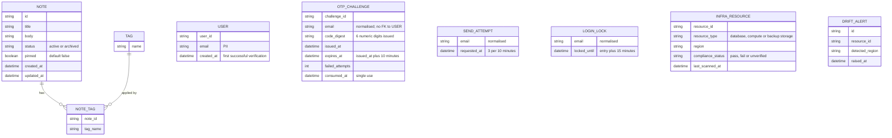

<!-- SECTION: backend.overview | status: DRAFT-UNVERIFIED -->
## 1. Overview

**What the service is.** `notes_api` is the backend service for the team note-taking product. Stack: Node.js 20, Express, PostgreSQL 16, hosted on AWS. [platform.md; feedback.md Preflight answers]

**Responsible for.**

1. **Notes API.** Create, read, edit, pin and unpin (via PATCH), tag, archive, unarchive, list and search notes. [stories.md EP-002, EP-003; requirements.md BR-005 to BR-011, BR-018, BR-019]
2. **Email one-time-code sign-in (CR-129).** This is an additional sign-in method; existing login methods are unchanged. [requirements.md NFR-016; feedback.md CR-129]
   - A request-code operation (POST `/auth/otp/send`) and a verify-code operation (POST `/auth/otp/verify`). Method and path come from the approved revision's operation records. [feedback.md, approved BACKEND-SPEC.md api-surface]
   - Code: 6 digits, all numeric. [requirements.md BR-029]
   - Expiry: valid 10 minutes from issue; a later submission is rejected as expired. [requirements.md BR-020, BR-024, BR-026]
   - Resend limit: at most 3 code requests within 10 minutes. Requests beyond the limit return 415. [requirements.md BR-021, BR-028, BR-032; stories.md US-004-03]
   - Lockout: after 5 wrong codes the account is locked for 15 minutes. Verification is refused during the lock with a locked-account response. [requirements.md BR-022, BR-025, BR-027, BR-032]
   - During a lock only verification is refused. Requesting a code is not refused, but it stays subject to the resend limit. [requirements.md BR-032]
   - Single-use: a code that verified successfully cannot be used again. [requirements.md BR-023]
   - The change is an interface change. Consumers are notified and must adapt. [requirements.md NFR-014 to NFR-016]
3. **Published API contract.** The OpenAPI document, its endpoint-coverage metric, the data-residency note and the Scope section. [stories.md EP-004; requirements.md BR-012, BR-013, NFR-008, NFR-009]
4. **Scope guardrail.** Rejection of attachment, real-time and mobile-specific calls, backed by a contract test suite. [stories.md EP-005; requirements.md BR-014 to BR-016, NFR-010, NFR-011]
5. **EU data-residency compliance.** EU-only provisioning of database, compute and backups. A CI/CD residency gate. A compliance report. A launch gate. Post-launch drift alerting. [stories.md EP-001; requirements.md BR-001 to BR-004, NFR-001 to NFR-004]

**Not responsible for.**

- Any user interface. The web-app screens in EP-006 belong to the web-app surface. [stories.md US-006-01 to US-006-06]
- Attachment or file-upload endpoints. [requirements.md BR-014]
- Any real-time channel (WebSocket, SSE, polling-push). [requirements.md BR-015]
- Mobile-specific endpoints. [stories.md US-005-01]
- Logging and classifying stakeholder feature requests. This is a product-management process. [requirements.md BR-017]
- Any sign-in method other than email one-time code. The existing authentication is unnamed in every input (`GAP-BE-085`).

**Run notes.**

- `RUN-CONTEXT.run_mode` is `bootstrap` with no `existing` block, but the approved revision of this specification is supplied inside feedback.md. It is used as the baseline and CR-129 is applied to it (`ASM-BE-026`).
- The identifiers `Q-BE-001`, `Q-BE-003`, `Q-BE-005` and the `GAP-`, `CON-`, `ASM-` and `INV-` identifiers below with numbers under 300 were minted in the approved revision. Their numbers are kept, so nothing is renumbered. New identifiers start at 300 because the numbers below it are occupied.
- The design_brief input is acceptance-criteria text (AC-001-01-01 to AC-002-01-03). It is not visual design and no Figma input is connected. `spec_mode` is `NOT-APPLICABLE`.
- The label of this change request differs between inputs (`CON-BE-019`).
- **Corrupted rule text.** Five supplied rules have a clause whose text is unrelated to its sentence. They are reproduced as supplied, and the decision each carries is treated as unanswered.
  - requirements.md BR-030 (eligibility to request, verify or receive a code).
  - BR-031 (the note access rule).
  - NFR-017 (the email region and the outside-EU condition).
  - NFR-018 (the treatment of email addresses and codes in logs).
  - NFR-019 (retention, positional reading in `ASM-BE-303`).
- **Contradiction check.**
  - Story to design: the design_brief ACs match US-001-01 to US-001-03 and US-002-01 to US-002-01 (AC-001-01-01 to AC-001-03-03, AC-001-04-01 to AC-001-06-02, AC-002-01-01 to AC-002-01-03). No contradiction found. The brief supplies ACs for only some stories.
  - Story to requirement: `CON-BE-007`, `CON-BE-151`.
  - Requirement to requirement: `CON-BE-003`, `CON-BE-006`, `CON-BE-011`, `CON-BE-019`, `CON-BE-300`.
  - Design to design: none found.
  - BR-020, BR-024 and BR-026 state the same expiry. BR-022, BR-025 and BR-027 state the same lockout. BR-021 and BR-028 state the same resend limit. No value conflicts among them.
- **Withdrawn contradiction.** The approved revision raised `CON-BE-010` (consecutive versus cumulative wrong-code counting). No supplied rule text says either word, so it is recorded as the gap `GAP-BE-024`, with a default in `ASM-BE-305`. It is not a contradiction between inputs.
- **Resolved question.** BR-032 states that requesting a code is not refused during a lock. That closes the approved revision's `Q-BE-007`.

**Halting.** Under core rule 10.1 this run ends in `HALT-CRITICAL-CONTRADICTION` and `HALT-BLOCKING-QUESTION`.
- Critical contradictions open: `CON-BE-003`, `CON-BE-006`, `CON-BE-151`, `CON-BE-300`.
- Blocking questions open: `Q-BE-003`, `Q-BE-005`, `Q-BE-012`, `Q-BE-152`, `Q-BE-300`.
- Everything that does not depend on them is written. Dependent parts are marked `BLOCKED` or `DRAFT-UNVERIFIED` in place.

### Open-item register

Each item is defined here once and referenced elsewhere by ID.

| ID | Kind | Statement |
|---|---|---|
| `Q-BE-001` | degradable | Are notes a shared team workspace? Default: yes, any authenticated team member may read and write any note. Notes carry no owner in the supplied inputs. |
| `Q-BE-003` | blocking | Who may request, verify or receive a login code? BR-030 as supplied is corrupted. [requirements.md BR-030] |
| `Q-BE-005` | blocking | From which AWS region are code emails sent, and may the email address leave the EU? NFR-017 as supplied is corrupted. [requirements.md NFR-017] |
| `Q-BE-012` | blocking | What credential does a successful verification return (body token, cookie or other)? No input states it. |
| `Q-BE-151` | degradable | Supply the approved EU region list. AC-001-01-01 refers to it and no input contains it. |
| `Q-BE-152` | blocking | Does a passed launch gate authorise release, or does the Engineering Lead sign off? |
| `Q-BE-153` | degradable | The period of the post-launch residency scan. Default in `ASM-BE-153`. |
| `Q-BE-300` | blocking | Is "notes 1 days" in NFR-019 intended? It would delete every note after one day. |
| `CON-BE-003` | Critical | BR-030 and BR-031 leave eligibility and note access open, and BR-030's rationale says any verified address may obtain a credential. The shared-workspace default of `Q-BE-001` may not hold. Touches an authorisation rule. |
| `CON-BE-006` | Critical | NFR-017 contemplates transmitting the email address outside the EU. BR-001 requires all notes_api infrastructure exclusively in approved EU regions, with no exception. Touches a PII path. |
| `CON-BE-007` | non-critical | US-005-02 requires 404 for attachment paths. US-005-04 and BR-016 require a message referencing the scope exclusion, not a bare 404. |
| `CON-BE-011` | non-critical | BR-021 limits "resending" to 3. BR-028, BR-032, US-004-03 and US-006-06 limit "requests" to 3 within 10 minutes. Reading used: every code request counts, 3 per window, the strongest citation (BR-032). |
| `CON-BE-019` | non-critical | The change request carries different labels: CR-129 (feedback.md), CR-125 (NFR-015, US-006-06, BR-030) and CR-127 (BR-032). Content overlaps. No identifier is renumbered. |
| `CON-BE-151` | Critical | BR-003 enforces the launch gate by Engineering Lead sign-off. AC-001-05-01 marks the gate passed and release authorised from the report alone. Touches an authorisation rule. |
| `CON-BE-300` | Critical | NFR-019 as supplied deletes notes after 1 day. BR-007, BR-008 and NFR-005 require that notes are never deleted by archiving and that CRUD has zero data loss. This adds a deletion transition to the note lifecycle. |
| `GAP-BE-001` | gap | US-006-01 to US-006-05 and US-005-06 belong to no backend module. Closing artefact: a decision that backend does not serve them. |
| `GAP-BE-003` | gap | No input relates a note to a user. Closing artefact: answer to `Q-BE-001` and `Q-BE-003`. |
| `GAP-BE-017` | gap | No PII handling policy. Closing artefact: a data-protection policy. |
| `GAP-BE-024` | gap | No input states whether wrong codes accumulate across challenges or reset on success. Default in `ASM-BE-305`. Closing artefact: a rule from the product owner. |
| `GAP-BE-031` | gap | No email normalisation rule. Closing artefact: a rule from the product owner. |
| `GAP-BE-033` | gap | No at-rest treatment for the stored code or for email addresses. Closing artefact: a security policy. |
| `GAP-BE-035` | gap | No validation rule for email format, code format or field length. Closing artefact: field-level requirements. |
| `GAP-BE-038` | gap | The status of the locked-account response is not stated. Closing artefact: a status decision. |
| `GAP-BE-053` | gap | The statuses of the wrong-code, expired-code and already-used-code responses are not stated. Closing artefact: a status decision. |
| `GAP-BE-083` | gap | No input says whether a new code invalidates earlier unconsumed codes. Closing artefact: a rule from the product owner. |
| `GAP-BE-085` | gap | The existing authentication method is unnamed. Closing artefact: its description. |
| `GAP-BE-089` | gap | No ORM, migration tool or other library is named. Closing artefact: a platform decision. |
| `GAP-BE-101` | gap | The mechanism that performs the NFR-019 deletion (scheduler, frequency) is not stated. Closing artefact: an operations decision. |
| `GAP-BE-104` | gap | The treatment of email addresses and codes in logs is not stated, because NFR-018 is corrupted. Closing artefact: a corrected NFR-018. |
| `GAP-BE-300` | gap | No error response envelope is supplied. Proposal in `ASM-BE-300`. |
| `GAP-BE-301` | gap | No latency, availability or throughput target for the login operations. |
| `GAP-BE-302` | gap | The credential lifetime is not stated. Closing artefact: the answer to `Q-BE-012`. |
| `GAP-BE-303` | gap | No path is supplied for tag add/remove, archive, unarchive, the OpenAPI document or the compliance report. Closing artefact: path decisions, which DevAgent renders into the contract. |
| `GAP-BE-304` | gap | No encryption-at-rest statement for any data. Closing artefact: a security policy. |
| `GAP-BE-305` | gap | Where scan results and compliance report data are stored is not stated. |
| `GAP-BE-306` | gap | The instant exactly 10 minutes after issue is not classified. BR-024 and US-006-06 say "after", which makes the boundary instant valid. BR-020 and BR-026 say "expires", which makes it expired. Closing artefact: a boundary decision. |
| `GAP-BE-307` | gap | Backup frequency and backup retention period are not stated. |
| `GAP-BE-308` | gap | The alert channel and recipients for drift alerts are not stated beyond "the DevOps team". |
| `GAP-BE-309` | gap | Statuses and choices left open in the inputs: already-archived conflict (US-002-04), unsupported Accept header (US-004-01: 406 or fallback), WebSocket and SSE rejection (US-005-03), and PUT versus PATCH (US-002-02). |
| `GAP-BE-310` | gap | US-003-01 says results are ordered by relevance after pinned. BR-019 says ordering within a pinned group is unchanged. The within-group order is therefore not defined. |
| `ASM-BE-015` | assumption | Email addresses are compared in a normalised form, exact rule `GAP-BE-031`. Reason: otherwise the same address defeats the per-address limits. Confirmed by `GAP-BE-031`'s closing artefact. |
| `ASM-BE-019` | assumption | An email address is personal data. Reason: it identifies a person. |
| `ASM-BE-025` | assumption | A User is created on first successful verification, never on code request. Reason: no input creates users any other way. Confirmed by the answer to `Q-BE-003`. |
| `ASM-BE-026` | assumption | The approved revision is the baseline although `run_mode` is `bootstrap`. Confirmed by the orchestrator. |
| `ASM-BE-027` | assumption | Email goes through AWS SES. Reason: NFR-017 names a transactional email service in an AWS region and the platform is AWS. Confirmed by `Q-BE-005`. |
| `ASM-BE-029` | assumption | The resend and lock counters are keyed per normalised email address. Reason: BR-021 to BR-028 speak of requests and of an account, never of a client. Confirmed by the product owner. |
| `ASM-BE-034` | assumption | `pinned` is `NOT NULL`. Reason: BR-018 gives it a default and no null state. |
| `ASM-BE-044` | assumption | The resend window is sliding (trailing 10 minutes). Reason: BR-021 reads "within 10 minutes". Confirmed by the product owner. |
| `ASM-BE-153` | assumption | The scan period is no longer than 15 minutes. Reason: NFR-003 requires an alert within 15 minutes of drift detection. Confirmed by `Q-BE-153`. |
| `ASM-BE-300` | assumption | The error envelope is the proposal in `backend.error-model`. Reason: none is supplied. Confirmed by `GAP-BE-300`'s closing artefact. |
| `ASM-BE-301` | assumption | Error code names other than `OUT_OF_SCOPE` are proposed names. Reason: only `OUT_OF_SCOPE` is cited, as an example. [stories.md US-005-04] |
| `ASM-BE-302` | assumption | A role has no permission on an operation unless an input grants it. Reason: no input defines a roles model. Confirmed by `GAP-BE-085`'s closing artefact. |
| `ASM-BE-303` | assumption | NFR-019 lists, positionally: code challenges 1 day, send attempts 1 day, account locks 5 days, notes 1 day. Reason: the sentence names four record types and four numbers. Confirmed by a corrected NFR-019. |
| `ASM-BE-304` | assumption | No notes_api database exists yet, so the migrations below start from empty. Reason: no input states otherwise. Confirmed by the orchestrator. |
| `ASM-BE-305` | assumption | The wrong-code count is per normalised email, increments on each wrong code, is cleared by a successful verification, and has no time window. Reason: no input states a window. Confirmed by `GAP-BE-024`'s closing artefact. |

<!-- /SECTION: backend.overview -->
<!-- SECTION: backend.domain-model | status: DRAFT-UNVERIFIED -->
## 2. Domain model

Three sub-domains are evidenced: note-taking (Note, Tag), login (User, OTP_CHALLENGE, SEND_ATTEMPT, LOGIN_LOCK) and residency compliance (INFRA_RESOURCE, DRIFT_ALERT). No input relates them beyond BR-013, which says notes_api's infrastructure hosts the note data.



**Entities and ownership.**

- **Note.** Title, body, status (active or archived), `pinned`, created and updated timestamps. [stories.md US-002-01 to US-002-06] Title and body are mandatory and non-empty at creation. [requirements.md BR-005] Archiving never deletes data and is reversible. [requirements.md BR-007, BR-008] `pinned` is a boolean, default `false`, set on create or PATCH. [requirements.md BR-018] Nullability is `ASM-BE-034`.
- **Tag.** A name, many-to-many with Note through NOTE_TAG. Adding an existing tag creates no duplicate. [stories.md US-002-03] Tag name format and length are not stated, nor is what happens to a tag with no notes. These are covered by `GAP-BE-035`.
- **User.** A person who has verified an email address (`ASM-BE-025`). `email` is personal data (`ASM-BE-019`). The handling policy is `GAP-BE-017`.
- **OTP_CHALLENGE.** One issued 6-digit numeric code for one email address. [requirements.md BR-029] It expires 10 minutes after issue and is single-use. [requirements.md BR-023, BR-024] It is keyed by email, not by user, because the user may not exist yet (`ASM-BE-025`). The storage form of the code is `GAP-BE-033`. Whether a new code invalidates an earlier one is `GAP-BE-083`.
- **SEND_ATTEMPT.** One record per code request, used to evaluate the limit of 3 within 10 minutes. [requirements.md BR-028] It is keyed per normalised email (`ASM-BE-015`, `ASM-BE-029`). The window is sliding (`ASM-BE-044`). The first request counts, per `CON-BE-011`.
- **LOGIN_LOCK.** The lock state for an email address, held 15 minutes after 5 wrong codes. [requirements.md BR-022, BR-025, BR-027] The counting rule is `GAP-BE-024` and `ASM-BE-305`.
- **INFRA_RESOURCE and DRIFT_ALERT.** A provisioned component with its reported region and status. A resource type the scanner does not recognise is flagged `unverified`, never omitted. [stories.md US-001-04; AC-001-04-02] Whether these rows are stored in the notes_api database is `GAP-BE-305`.

**Ownership.** No input relates a note to a user (`GAP-BE-003`). The default applied is `Q-BE-001`: notes form a shared workspace and any authenticated team member may read and write any note. `CON-BE-003` (Critical) calls that default into question, so note ownership columns and the note access rule are `BLOCKED` until `Q-BE-003` is answered.

**Invariants.** These hold after every operation on the named entity.

- `INV-BE-001`. In the note list and note search results, every pinned note is returned before every unpinned note. Order within each group is not defined (`GAP-BE-310`). [requirements.md BR-019]
- `INV-BE-002`. A code that has been verified successfully is refused on any later verification. [requirements.md BR-023]
- `INV-BE-003`. A User row is created only on successful verification (`ASM-BE-025`).
- `INV-BE-004`. A code submitted after its issue instant plus 10 minutes is rejected as expired. [requirements.md BR-024; stories.md US-006-06] The boundary instant is `GAP-BE-306`.
- `INV-BE-005`. While an email address is locked, no verification succeeds, including with a correct code, until the lock expires. [requirements.md BR-022, BR-027]
- `INV-BE-006`. A code request beyond 3 within 10 minutes creates no code and sends no email. [requirements.md BR-021, BR-028, BR-032]
- `INV-BE-007`. A residency check whose region metadata is missing or unreadable fails and blocks deployment. [stories.md US-001-03; AC-001-03-03]
- `INV-BE-008`. A PATCH never overwrites a field it does not contain. [requirements.md BR-006; AC-002-02-02]
- `INV-BE-009`. Archiving and unarchiving preserve all note data. [requirements.md BR-007, BR-008] `CON-BE-300` threatens this invariant.

**PII.** Personal data appears in `USER.email`, `OTP_CHALLENGE.email`, `SEND_ATTEMPT.email` and `LOGIN_LOCK.email`. Note `title` and `body` are free text and may contain PII incidentally. No masking or handling policy is supplied (`GAP-BE-017`, `GAP-BE-033`). No encryption, redaction or retention claim is made beyond what the inputs say.

<!-- /SECTION: backend.domain-model -->
<!-- SECTION: backend.module-map | status: DERIVED -->
## 3. Module map

The six modules are carried from the approved revision, which derived them from the epics. [approved BACKEND-SPEC.md module-map; stories.md EP-001 to EP-005, US-006-06]

| Module | Boundary | Depends on |
|---|---|---|
| `auth` | Email one-time-code sign-in: code issuance and delivery, verification, resend limit, lockout, expiry, user creation on first verification, credential issuance. Owns USER, OTP_CHALLENGE, SEND_ATTEMPT, LOGIN_LOCK. Coexists with the unchanged existing authentication. | external email transport (`ASM-BE-027`) |
| `notes` | Note create, read, edit, pin and unpin, tag add and remove, archive and unarchive. Owns NOTE, TAG, NOTE_TAG. | `auth` (caller identity) |
| `search` | Read-only note list and keyword and tag search: pagination, archived exclusion by default, pinned-first ordering. | `notes`, `auth` |
| `residency-compliance` | Provisioning and backup region validation, the CI/CD residency gate, the compliance report, launch-gate status, post-launch drift scan and alerting. Owns INFRA_RESOURCE and DRIFT_ALERT. | none at runtime; operates on the infrastructure and CI/CD layer |
| `api-docs` | Publishes the OpenAPI document (including both login operations and the pinned field), computes the endpoint-coverage metric, carries the data-residency note and the Scope section. | `notes`, `search`, `auth`, `residency-compliance` |
| `scope-guardrail` | Intercepts inbound requests and rejects attachment, real-time and mobile-specific patterns with a structured out-of-scope response. Backs the contract test suite. | upstream of all modules |

**Dependency direction.** `search → notes`, `search → auth`, `notes → auth`, `auth → email transport` (external), `api-docs → notes, search, auth, residency-compliance`. A request passes `scope-guardrail`, then `auth` for protected routes, then `notes`, `search` or `api-docs`. There are no other dependencies.

**Order of guardrail and authentication.** The guardrail runs before authentication so an out-of-scope call receives its documented response without a credential. This is the approved revision's reading. Whether out-of-scope calls are authenticated is not stated in any input. The response shape is in `CON-BE-007`.

**Change in this revision.** `auth` is the module that changed. It is the only module that calls the email transport, which carries `CON-BE-006` and `Q-BE-005`.

<!-- /SECTION: backend.module-map -->
<!-- SECTION: backend.api-surface | status: VERIFIED -->
## Api surface

_Rendered by DevAgent from the operation records._

| id | method | path | module | success | errors | summary |
|---|---|---|---|---|---|---|
| `API-APIDOCS-098363` | GET | `/openapi.json` | `api-docs` | 200 | 401, 403, 406 | Retrieve the published OpenAPI document covering all implemented endpoints, including both login operations and the pinned field, with the data-residency note and the Scope section. The path and supported Accept formats are open (GAP-BE-303, GAP-BE-309); this path is a placeholder pending a path decision. |
| `API-APIDOCS-827943` | GET | `/openapi/coverage` | `api-docs` | 200 | 401, 403 | Report the endpoint-coverage metric: the percentage of implemented endpoints present in the published OpenAPI document, listing any missing ones. Path is a placeholder (GAP-BE-303). |
| `API-AUTH-707260` | POST | `/auth/otp/send` | `auth` | 204 | 400, 415, 500 | Request a 6-digit email one-time sign-in code. Issues and emails a code valid for 10 minutes. At most 3 code requests per email address within 10 minutes; requests beyond the limit are refused with 415. Still permitted (but subject to the limit) while the address is locked. |
| `API-AUTH-692907` | POST | `/auth/otp/verify` | `auth` | 200 | 400, 401, 403, 423, 429, 500 | Verify a one-time code for an email address. On first successful verification a User is created; on success the code is consumed (single use) and a credential is issued. Refused while the address is locked (15 minutes after 5 wrong codes), and for wrong, expired (after 10 minutes) or already-used codes. |
| `API-NOTES-232390` | POST | `/notes` | `notes` | 201 | 400, 401, 403, 415 | Create a note with a mandatory non-empty title and body, optionally pinned. |
| `API-NOTES-045877` | GET | `/notes/{id}` | `notes` | 200 | 401, 403, 404 | Read a single note by id. |
| `API-NOTES-847551` | PATCH | `/notes/{id}` | `notes` | 200 | 400, 401, 403, 404, 415 | Partially edit a note's title or body, and pin or unpin it via the pinned field; omitted fields are never overwritten. |
| `API-NOTES-810640` | POST | `/notes/{id}/archive` | `notes` | 200 | 401, 403, 404, 409 | Archive a note, hiding it from default listings without deleting any data. Path proposed (GAP-BE-303). |
| `API-NOTES-359413` | POST | `/notes/{id}/tags` | `notes` | 200 | 400, 401, 403, 404, 415 | Add a tag to a note; adding an existing tag creates no duplicate. Path proposed because none is supplied (GAP-BE-303). |
| `API-NOTES-150096` | DELETE | `/notes/{id}/tags/{tag}` | `notes` | 200 | 401, 403, 404 | Remove a tag from a note. Path proposed because none is supplied (GAP-BE-303). |
| `API-NOTES-917869` | POST | `/notes/{id}/unarchive` | `notes` | 200 | 401, 403, 404 | Unarchive a note, restoring it to active with all data preserved. Path proposed (GAP-BE-303). |
| `API-RESIDENCYCOMPLIANCE-913995` | GET | `/residency/compliance-report` | `residency-compliance` | 200 | 401, 403, 500 | Generate the compliance report listing every infrastructure component with region and pass, fail or unverified status, and the percentage EU-verified (US-001-04) |
| `API-RESIDENCYCOMPLIANCE-047792` | GET | `/residency/drift-alerts` | `residency-compliance` | 200 | 400, 401, 403, 500 | List drift alerts raised for resources found in non-EU regions after launch (US-001-06) |
| `API-RESIDENCYCOMPLIANCE-019122` | POST | `/residency/gate-checks` | `residency-compliance` | 200 | 400, 401, 403, 500 | CI/CD residency gate: check the regions of components in a deployment; a non-EU region or unreadable region metadata fails the check and blocks the build (US-001-03) |
| `API-RESIDENCYCOMPLIANCE-395094` | GET | `/residency/launch-gate` | `residency-compliance` | 200 | 401, 403, 500 | Return launch-gate status derived from the freshly refreshed compliance report, for Engineering Lead review (US-001-05) |
| `API-RESIDENCYCOMPLIANCE-466056` | POST | `/residency/scans` | `residency-compliance` | 200 | 401, 403, 500, 503 | Run a post-launch residency drift scan on demand; the same scan runs periodically and alerts the DevOps team on any non-EU resource (US-001-06) |
| `API-RESIDENCYCOMPLIANCE-241176` | POST | `/residency/validations/backups` | `residency-compliance` | 200 | 400, 401, 403, 422, 500 | Validate that a backup destination is in an approved EU region; a non-EU destination fails within 30 seconds with a residency violation and writes nothing (US-001-02) |
| `API-RESIDENCYCOMPLIANCE-731179` | POST | `/residency/validations/provisioning` | `residency-compliance` | 200 | 400, 401, 403, 422, 500 | Validate that a database or compute provisioning request targets an approved EU region (US-001-01) |
| `API-SEARCH-909642` | GET | `/notes` | `search` | 200 | 400, 401, 403 | List notes, paginated, with pinned notes first and archived notes excluded by default |
| `API-SEARCH-580505` | GET | `/notes/search` | `search` | 200 | 400, 401, 403, 503 | Keyword and tag search over notes, paginated, with pinned notes first and archived notes excluded by default |

### `API-APIDOCS-098363` — GET `/openapi.json`

Retrieve the published OpenAPI document covering all implemented endpoints, including both login operations and the pinned field, with the data-residency note and the Scope section. The path and supported Accept formats are open (GAP-BE-303, GAP-BE-309); this path is a placeholder pending a path decision.

**Request:** 
- `Accept` (string): Requested representation of the document. Behaviour for an unsupported Accept header (406 or default-format fallback) is undecided (GAP-BE-309).
**Response:** 
- `openapi` (string, required): OpenAPI document version identifier.
- `info` (object, required): API metadata, including the data-residency note stating that all note data, active and archived, is stored and served in the EU.
- `paths` (object, required): All implemented endpoints, including the login operations (POST /auth/otp/send, POST /auth/otp/verify) and the pinned field on notes, each with documented 401/403 responses where authentication is required and example payloads for search and tagging endpoints.
- `components` (object): Reusable schemas, including the error envelope.
- `scope` (object, required): Scope section listing excluded capabilities: attachments, real-time channels and mobile-specific endpoints, with the out-of-scope error behaviour.

### `API-APIDOCS-827943` — GET `/openapi/coverage`

Report the endpoint-coverage metric: the percentage of implemented endpoints present in the published OpenAPI document, listing any missing ones. Path is a placeholder (GAP-BE-303).

**Request:** none
**Response:** 
- `coverage_percent` (number, required): Percentage of implemented endpoints present in the published OpenAPI spec (target 100%, NFR-008).
- `implemented_count` (integer, required): Number of implemented endpoints.
- `documented_count` (integer, required): Number of implemented endpoints present in the published spec.
- `missing_endpoints` (array, required): Implemented endpoints absent from the published spec; empty at 100% coverage.

### `API-AUTH-707260` — POST `/auth/otp/send`

Request a 6-digit email one-time sign-in code. Issues and emails a code valid for 10 minutes. At most 3 code requests per email address within 10 minutes; requests beyond the limit are refused with 415. Still permitted (but subject to the limit) while the address is locked.

**Request:** 
- `email` (string, required): Email address to send the one-time code to. Personal data (PII); normalisation and format validation rules are not stated in the inputs.
**Response:** none

### `API-AUTH-692907` — POST `/auth/otp/verify`

Verify a one-time code for an email address. On first successful verification a User is created; on success the code is consumed (single use) and a credential is issued. Refused while the address is locked (15 minutes after 5 wrong codes), and for wrong, expired (after 10 minutes) or already-used codes.

**Request:** 
- `email` (string, required): Email address the code was sent to. Personal data (PII).
- `code` (string, required): The 6-digit numeric one-time code received by email.
**Response:** 
- `credential` (object, required): Credential issued on successful verification. Its form (body token, cookie or other) and lifetime are not stated in the inputs and are an open blocking question; shape to be confirmed.

### `API-NOTES-232390` — POST `/notes`

Create a note with a mandatory non-empty title and body, optionally pinned.

**Request:** 
- `title` (string, required): Note title; mandatory and non-empty (BR-005, AC-002-01-03).
- `body` (string, required): Note body; mandatory and non-empty (BR-005).
- `pinned` (boolean): Whether the note is pinned; defaults to false (BR-018).
**Response:** 
- `id` (string, required): Identifier of the created note.
- `title` (string, required): Note title.
- `body` (string, required): Note body.
- `status` (string, required): Note status, active or archived; a new note is active.
- `pinned` (boolean, required): Pinned flag.
- `tags` (array, required): Tag names applied to the note.
- `created_at` (string, required): Creation timestamp.
- `updated_at` (string, required): Last update timestamp.

### `API-NOTES-045877` — GET `/notes/{id}`

Read a single note by id.

**Request:** none
**Response:** 
- `id` (string, required): Note identifier.
- `title` (string, required): Note title.
- `body` (string, required): Note body.
- `status` (string, required): Note status, active or archived.
- `pinned` (boolean, required): Pinned flag.
- `tags` (array, required): Tag names applied to the note.
- `created_at` (string, required): Creation timestamp.
- `updated_at` (string, required): Last update timestamp.

### `API-NOTES-847551` — PATCH `/notes/{id}`

Partially edit a note's title or body, and pin or unpin it via the pinned field; omitted fields are never overwritten.

**Request:** 
- `title` (string): New title; omitted means unchanged (BR-006).
- `body` (string): New body; omitted means unchanged (BR-006).
- `pinned` (boolean): true pins, false unpins the note (BR-018).
**Response:** 
- `id` (string, required): Note identifier.
- `title` (string, required): Note title after the update.
- `body` (string, required): Note body after the update.
- `status` (string, required): Note status, active or archived.
- `pinned` (boolean, required): Pinned flag after the update.
- `tags` (array, required): Tag names applied to the note.
- `created_at` (string, required): Creation timestamp.
- `updated_at` (string, required): Last update timestamp.

### `API-NOTES-810640` — POST `/notes/{id}/archive`

Archive a note, hiding it from default listings without deleting any data. Path proposed (GAP-BE-303).

**Request:** none
**Response:** 
- `id` (string, required): Note identifier.
- `status` (string, required): Note status, now archived.
- `updated_at` (string, required): Last update timestamp.

### `API-NOTES-359413` — POST `/notes/{id}/tags`

Add a tag to a note; adding an existing tag creates no duplicate. Path proposed because none is supplied (GAP-BE-303).

**Request:** 
- `name` (string, required): Tag name to add; format and length rules not supplied.
**Response:** 
- `id` (string, required): Note identifier.
- `tags` (array, required): Tag names on the note after the addition, without duplicates.
- `updated_at` (string, required): Last update timestamp.

### `API-NOTES-150096` — DELETE `/notes/{id}/tags/{tag}`

Remove a tag from a note. Path proposed because none is supplied (GAP-BE-303).

**Request:** none
**Response:** 
- `id` (string, required): Note identifier.
- `tags` (array, required): Tag names remaining on the note.
- `updated_at` (string, required): Last update timestamp.

### `API-NOTES-917869` — POST `/notes/{id}/unarchive`

Unarchive a note, restoring it to active with all data preserved. Path proposed (GAP-BE-303).

**Request:** none
**Response:** 
- `id` (string, required): Note identifier.
- `status` (string, required): Note status, now active.
- `updated_at` (string, required): Last update timestamp.

### `API-RESIDENCYCOMPLIANCE-913995` — GET `/residency/compliance-report`

Generate the compliance report listing every infrastructure component with region and pass, fail or unverified status, and the percentage EU-verified (US-001-04)

**Request:** none
**Response:** 
- `generated_at` (string, required): When the report was refreshed
- `resources` (array, required): Each component with resource type, region, compliance status (pass, fail or unverified) and last scan time
- `eu_verified_percentage` (number, required): Percentage of infrastructure components verified as EU

### `API-RESIDENCYCOMPLIANCE-047792` — GET `/residency/drift-alerts`

List drift alerts raised for resources found in non-EU regions after launch (US-001-06)

**Request:** 
- `limit` (integer): Maximum number of alerts to return
- `page` (integer): Page number of the alert list
**Response:** 
- `alerts` (array, required): Drift alerts, each with resource id, detected region and raised-at time
- `total` (integer, required): Total number of alerts

### `API-RESIDENCYCOMPLIANCE-019122` — POST `/residency/gate-checks`

CI/CD residency gate: check the regions of components in a deployment; a non-EU region or unreadable region metadata fails the check and blocks the build (US-001-03)

**Request:** 
- `deployment_id` (string, required): Identifier of the pipeline deployment being checked
- `components` (array, required): Components in the deployment, each with its resource type and region metadata
**Response:** 
- `result` (string, required): pass or fail; fail blocks deployment
- `checked_at` (string, required): Timestamp of the check
- `violations` (array, required): Components found in non-EU regions or with missing or unreadable region metadata

### `API-RESIDENCYCOMPLIANCE-395094` — GET `/residency/launch-gate`

Return launch-gate status derived from the freshly refreshed compliance report, for Engineering Lead review (US-001-05)

**Request:** none
**Response:** 
- `status` (string, required): Launch gate status: passed or not passed
- `report_generated_at` (string, required): Timestamp of the compliance report the status is based on
- `blocking_resources` (array, required): Components that are non-EU or unverified and prevent the gate from passing

### `API-RESIDENCYCOMPLIANCE-466056` — POST `/residency/scans`

Run a post-launch residency drift scan on demand; the same scan runs periodically and alerts the DevOps team on any non-EU resource (US-001-06)

**Request:** none
**Response:** 
- `scanned_at` (string, required): Timestamp of the scan
- `result` (string, required): pass when all resources are in EU regions, otherwise drift
- `drift_alerts` (array, required): Alerts raised by this scan with resource details; empty when no drift

### `API-RESIDENCYCOMPLIANCE-241176` — POST `/residency/validations/backups`

Validate that a backup destination is in an approved EU region; a non-EU destination fails within 30 seconds with a residency violation and writes nothing (US-001-02)

**Request:** 
- `destination_region` (string, required): Region of the backup storage destination
- `destination` (string): Identifier of the backup storage target
**Response:** 
- `valid` (boolean, required): True when the destination is in an approved EU region
- `destination_region` (string, required): Region that was evaluated
- `reason` (string): Residency violation detail when rejected

### `API-RESIDENCYCOMPLIANCE-731179` — POST `/residency/validations/provisioning`

Validate that a database or compute provisioning request targets an approved EU region (US-001-01)

**Request:** 
- `resource_type` (string, required): Kind of resource being provisioned: database or compute
- `region` (string, required): Target region of the provisioning request
**Response:** 
- `valid` (boolean, required): True when the region is an approved EU region
- `region` (string, required): Region that was evaluated
- `reason` (string): Explanation when the region is rejected as non-EU

### `API-SEARCH-909642` — GET `/notes`

List notes, paginated, with pinned notes first and archived notes excluded by default

**Request:** 
- `page` (integer): Page number of the paginated result. A bad value returns 400.
- `limit` (integer): Page size. The spec gives a default and a maximum but states only 100 as a tested size. A bad value returns 400.
- `include_archived` (boolean): When true, archived notes are included. By default archived notes are excluded. A bad value returns 400.
- `tag` (string): Restrict the list to notes carrying this tag. A malformed filter returns 400.
**Response:** 
- `items` (array, required): The notes on this page. Every pinned note comes before every unpinned note. Order within each group is undefined (GAP-BE-310). Each item shows id, title, body, status (active or archived), pinned, tags, created_at and updated_at.
- `page` (integer, required): The page number returned. The field name is proposed, because no input names the pagination fields.
- `limit` (integer, required): The page size applied. The field name is proposed.
- `total` (integer): Total number of matching notes. The field name is proposed, and the inputs do not say whether a total is returned.

### `API-SEARCH-580505` — GET `/notes/search`

Keyword and tag search over notes, paginated, with pinned notes first and archived notes excluded by default

**Request:** 
- `q` (string, required): Keyword query matched against notes. A missing q returns 400.
- `tag` (string): Restrict results to notes carrying this tag. A malformed filter returns 400.
- `include_archived` (boolean): When true, archived notes are included. By default archived notes are excluded. A bad value returns 400.
- `page` (integer): Page number of the paginated result. A bad value returns 400.
- `limit` (integer): Page size, tested up to 100 results. A bad value returns 400.
**Response:** 
- `items` (array, required): The matching notes on this page. Every pinned note comes before every unpinned note. Order within each group is undefined (GAP-BE-310). Each item shows id, title, body, status, pinned, tags, created_at and updated_at.
- `page` (integer, required): The page number returned. The field name is proposed.
- `limit` (integer, required): The page size applied. The field name is proposed.
- `total` (integer): Total number of matching notes. The field name is proposed, and the inputs do not say whether a total is returned.
<!-- /SECTION: backend.api-surface -->
<!-- SECTION: backend.auth-model | status: DRAFT-UNVERIFIED -->
## 5. Auth model

**Actors and roles.** No input defines a roles model (`GAP-BE-085`). The actors below come from the stories. Roles are the actor names, not a proposal for an enforcement scheme.

| Actor | Source | Interacts with |
|---|---|---|
| Unauthenticated caller | the login operations exist to authenticate a caller | login operations |
| Team member (credential holder) | stories.md US-002-01 to US-003-06, US-006-06 | note and search operations |
| Integration developer, QA engineer | stories.md US-004-01, US-002-06 | OpenAPI document; note read; they call the API as a team member would, no distinct permissions are stated |
| Platform/DevOps Engineer | stories.md US-001-01, US-001-02, US-001-06 | infrastructure and alerts |
| Release/CI Pipeline Owner | stories.md US-001-03 | CI/CD residency gate |
| Compliance/Security Auditor | stories.md US-001-04 | compliance report |
| Engineering Lead | stories.md US-001-05 | launch gate |

**Default rule.** A role has no permission on an operation unless an input grants it (`ASM-BE-302`).

**Legend.** `A` allowed (cited). `A*` allowed, derived from stories (reasoning in notes). `D` refused, cited or derived. `-` no grant stated, so refused under `ASM-BE-302`. `B` blocked on the named item.

| Resource and operation | Unauth. caller | Team member | Platform/DevOps | Release/CI owner | Auditor | Eng. Lead |
|---|---|---|---|---|---|---|
| Login code, request (POST `/auth/otp/send`) | A* | `B` (`Q-BE-003`) | - | - | - | - |
| Login code, verify (POST `/auth/otp/verify`) | A* | `B` (`Q-BE-003`) | - | - | - | - |
| Note, create (POST `/notes`) | D* | `B` (`CON-BE-003`) | - | - | - | - |
| Note, read (GET `/notes/{id}`) | D* | `B` (`CON-BE-003`) | - | - | - | - |
| Note, edit and pin (PATCH `/notes/{id}`) | D* | `B` (`CON-BE-003`) | - | - | - | - |
| Note, tag add and remove (path `GAP-BE-303`) | D* | `B` (`CON-BE-003`) | - | - | - | - |
| Note, archive and unarchive (path `GAP-BE-303`) | D* | `B` (`CON-BE-003`) | - | - | - | - |
| Note list (GET `/notes`) | D* | `B` (`CON-BE-003`) | - | - | - | - |
| Note search (GET `/notes/search`) | D* | `B` (`CON-BE-003`) | - | - | - | - |
| OpenAPI document (path `GAP-BE-303`) | not stated, `GAP-BE-309` | not stated | - | - | - | - |
| Residency check in the pipeline | - | - | A* (support) | A | - | - |
| Compliance report, generate | - | - | - | - | A | - |
| Launch gate, review and mark | - | - | - | - | - | `B` (`CON-BE-151`) |
| Drift alert, receive | - | - | A | - | - | - |
| Any out-of-scope path (attachments, WebSocket or SSE, mobile) | D | D | D | D | D | D |

**Notes on the matrix.**

- The first two rows: unauthenticated callers can request and verify codes because these operations exist to authenticate them (derived from US-006-06). Whether team members may also call them, and who may receive a code at all, is `Q-BE-003`.
- Note and search rows for unauthenticated callers: refused by derivation. US-006-06 states that sign-in is how a user accesses notes, and US-004-03 says 401 and 403 responses are documented for operations that require authentication. No input names which operations require it, so this is derived and not cited.
- The Team member column on note rows stays `B`, not `A`. The stories grant these actions to team members, but who counts as a team member is open under `CON-BE-003`.
- Platform/DevOps on the residency check is support only. Region validation for provisioning and backups happens in infrastructure code. [stories.md US-001-01; requirements.md BR-001]
- Out-of-scope paths are rejected for everyone. [requirements.md BR-014, BR-015, BR-016]

**Ownership predicate.** `BLOCKED` on `CON-BE-003` and `Q-BE-003`. The shared-workspace default (`Q-BE-001`) is a placeholder only.

**Credential.** What a successful verification returns, and how protected routes check it, is `BLOCKED` on `Q-BE-012`. Lifetime is `GAP-BE-302`. The existing method that protected routes already use is unnamed (`GAP-BE-085`).

**Abuse controls on login.** Per email address: at most 3 code requests within 10 minutes, and a 15-minute lock after 5 wrong codes. [requirements.md BR-021, BR-022, BR-028] Both are keyed per normalised email (`ASM-BE-029`). No per-client or per-IP limit is stated in any input.

<!-- /SECTION: backend.auth-model -->
<!-- SECTION: backend.data-lifecycle | status: DRAFT-UNVERIFIED -->
## 6. Data lifecycle

No input states encryption at rest for any data (`GAP-BE-304`). No claim of encryption is made.

| Data | Stored | Retention and deletion | Notes |
|---|---|---|---|
| Notes (title, body, status, pinned, timestamps) | EU-region PostgreSQL. [requirements.md BR-001; platform.md] | Archive hides a note and never deletes it. [requirements.md BR-007, BR-008] NFR-019 as supplied also says "notes 1 days" (`ASM-BE-303`). That contradicts BR-007 and NFR-005, so retention is `BLOCKED` on `CON-BE-300` and `Q-BE-300`. | Free text that may contain PII incidentally. |
| Tags and note-tag links | Same database. | Not stated. | Cascade when a tag has no notes is not stated. |
| Users | Same database. | Not stated (`GAP-BE-017`). | Created on first successful verification (`ASM-BE-025`). |
| Code challenges | Same database. | Expire at 10 minutes. [requirements.md BR-024] Kept 1 day, then deleted (`ASM-BE-303`). | The mechanism is `GAP-BE-101`. Storage form of the code is `GAP-BE-033`. |
| Send attempts | Same database. | Kept 1 day, then deleted (`ASM-BE-303`). | Needed only for the 10-minute window. |
| Account locks | Same database. | The lock lasts 15 minutes. [requirements.md BR-022] The record is kept 5 days, then deleted (`ASM-BE-303`). | |
| Compliance report and scan results | Not stated (`GAP-BE-305`). | Refreshed at each launch gate check. [requirements.md NFR-004] | |
| Drift alerts | Delivered to the DevOps team. [stories.md US-001-06] | Not stated. | Channel is `GAP-BE-308`. |
| Database backups | EU-region storage only. [requirements.md BR-001; stories.md US-001-02; AC-001-02-01] | Schedule and retention are `GAP-BE-307`. | A destination outside the EU fails validation within 30 seconds and writes nothing. [AC-001-02-02] |
| Email address in transit to the email service | Region `BLOCKED` on `Q-BE-005`. | Not stored by this row. | `CON-BE-006` (Critical). |
| Application logs | Not stated. | Not stated. | Email and code treatment is `GAP-BE-104`. |

**Deletion and archive.** The only data removal stated in any input is the NFR-019 deletion. The mechanism, schedule and effect on references are `GAP-BE-101`. NFR-019's target is the share of records older than their retention period that are deleted. [requirements.md NFR-019]

**Residency of the data itself.** All note data, active and archived, is stored and served in the EU, and the API documentation must say so, calling out any difference between archived and active storage. [stories.md US-004-06; requirements.md BR-013] No input states a difference.

<!-- /SECTION: backend.data-lifecycle -->
<!-- SECTION: backend.nfr | status: VERIFIED -->
## 7. Non-functional requirements

Every row cites the input that states it. No figure is added beyond the inputs.

| Area | Target | Source |
|---|---|---|
| Residency | 100% of infrastructure components EU-verified | [requirements.md NFR-001] |
| Residency gate | 0 non-EU deploys reach production | [requirements.md NFR-002] |
| Backup validation | A non-EU backup destination fails within 30 seconds with a residency violation error | [stories.md US-001-02; AC-001-02-02] |
| Drift alerting | Alert fired within 15 minutes of drift detection | [requirements.md NFR-003] |
| Compliance report | Refreshed and 100% accurate at each launch gate check | [requirements.md NFR-004] |
| CRUD | 100% functional-test pass rate for create, edit, get, archive, unarchive | [requirements.md NFR-005] |
| Search latency | p95 under 300 ms at 50 requests per second | [requirements.md NFR-006; stories.md US-003-03] |
| Search at large page sizes | p95 under 300 ms up to page sizes of 100 results | [requirements.md NFR-007] |
| Search at scale | The latency target still holds on a dataset of about 100k notes via indexed lookup | [stories.md US-003-03] |
| Search degradation | When the search index is degraded or unavailable, return 503 with a retry-after header instead of hanging | [stories.md US-003-03] |
| Pagination | Results are paginated with a default and maximum page size. The page size values are not stated beyond the 100 above. | [requirements.md BR-011; NFR-007] |
| Contract coverage | 100% of implemented endpoints in the published OpenAPI spec | [requirements.md NFR-008] |
| API examples | 100% of search and tagging endpoints have example payloads | [requirements.md NFR-009] |
| Scope guardrail | 0 out-of-scope endpoints detected per build, on every CI build | [requirements.md NFR-010] |
| Out-of-scope errors | 100% of out-of-scope calls return a documented 4xx error with an explanatory message | [requirements.md NFR-011] |
| Injection | 0 critical injection vulnerabilities per release; requests validated and sanitised on note title, body and tag fields | [requirements.md NFR-012] |
| Availability | 99.9% uptime monthly for CRUD and search | [requirements.md NFR-013] |
| Interface change | The pinned field, pinned-first ordering and both login operations are documented in the OpenAPI spec and consumers are notified | [requirements.md NFR-014, NFR-015, NFR-016] |
| Login email residency | Share of login-code emails sent from the approved region. The region and the outside-EU condition are not readable in NFR-017 (`Q-BE-005`). | [requirements.md NFR-017] |
| Log redaction | Share of log entries containing an unredacted email address or login code. The verb of NFR-018 is corrupted (`GAP-BE-104`). | [requirements.md NFR-018] |
| Retention | Share of records older than their retention period that are deleted | [requirements.md NFR-019] |
| Concurrency | Concurrent PATCH requests to one note get a standard last-write or conflict response, with no live broadcast or merge logic | [stories.md US-005-03] |
| Login operations | No latency, availability or throughput target is supplied (`GAP-BE-301`) | none |

<!-- /SECTION: backend.nfr -->
<!-- SECTION: backend.error-model | status: DRAFT-UNVERIFIED -->
## 8. Error model

**Envelope.** No input supplies an error envelope (`GAP-BE-300`). The proposal below is `ASM-BE-300`. It is the minimum that lets a client tell the causes below apart, in particular the two uses of 415.

```
{ "error": { "code": "<REGISTRY_CODE>", "message": "<human-readable reason>", "details": [ ... optional ... ] } }
```

Messages never contain an email address or a one-time code in full. [requirements.md NFR-018]

**Status-code policy.** Statuses stated by the inputs. A blank means the input leaves the status open.

| Situation | Status | Source |
|---|---|---|
| Note created | 201 | [AC-002-01-01, AC-002-01-02] |
| Note read, updated, archived, unarchived | 200 | [stories.md US-002-02, US-002-04, US-002-05, US-002-06] |
| Validation failure (missing title, malformed filter, bad page or limit, bad `include_archived`, missing `q`) | 400 | [AC-002-01-03; stories.md US-003-01 to US-003-06] |
| Authentication or authorisation failure on protected operations | 401 or 403, body shape documented | [stories.md US-004-03] |
| Note not found | 404 | [stories.md US-002-02, US-002-05, US-002-06] |
| Code request beyond 3 in 10 minutes | 415 | [requirements.md BR-028; stories.md US-004-03] |
| Multipart or file payload to a note endpoint | 415, nothing persisted | [stories.md US-005-02] |
| Search index degraded or unavailable | 503 with retry-after | [stories.md US-003-03] |
| Verify during a lock | locked-account response, status not stated (`GAP-BE-038`) | [requirements.md BR-027] |
| Verify with a wrong, expired or already-used code | rejection, status not stated (`GAP-BE-053`) | [requirements.md BR-023, BR-024, BR-026] |
| Archive of an already-archived note | conflict or error, status not stated | [stories.md US-002-04; `GAP-BE-309`] |
| Unsupported Accept header on the OpenAPI document | 406 or default-format fallback, not decided | [stories.md US-004-01; `GAP-BE-309`] |
| Attachment path | 404, or an out-of-scope response with a message (`CON-BE-007`) | [stories.md US-005-02, US-005-04] |
| WebSocket upgrade or SSE connection | rejected with a standard error status, not decided | [stories.md US-005-03; `GAP-BE-309`] |

**Two causes share 415.** A resend-limit refusal and a multipart rejection both return 415 as supplied. The error `code` is what tells a client which occurred.

**Error-code registry.** Only `OUT_OF_SCOPE` is cited, as an example. [stories.md US-005-04] All other names are proposals (`ASM-BE-301`).

| Code | Status | Trigger | Basis |
|---|---|---|---|
| `VALIDATION_FAILED` | 400 | any validation failure listed above | proposed |
| `UNAUTHENTICATED` | 401 | missing or invalid credential on a protected operation | proposed |
| `FORBIDDEN` | 403 | authenticated but not permitted (rule `BLOCKED` on `Q-BE-003`) | proposed |
| `NOT_FOUND` | 404 | unknown note id | proposed |
| `OTP_SEND_LIMIT` | 415 | more than 3 code requests within 10 minutes | proposed name, status cited |
| `UNSUPPORTED_MEDIA_TYPE` | 415 | multipart or file payload to a note endpoint | proposed name, status cited |
| `OTP_LOCKED` | not stated | verify attempt while locked | proposed name, status `GAP-BE-038` |
| `OTP_INVALID` | not stated | wrong code | proposed name, status `GAP-BE-053` |
| `OTP_EXPIRED` | not stated | code submitted after expiry | proposed name, status `GAP-BE-053` |
| `OTP_ALREADY_USED` | not stated | code already verified | proposed name, status `GAP-BE-053` |
| `ALREADY_ARCHIVED` | not stated | archive of an archived note | proposed name, status `GAP-BE-309` |
| `SEARCH_UNAVAILABLE` | 503 | search index degraded or unavailable | proposed name, status cited |
| `OUT_OF_SCOPE` | `CON-BE-007` | call to an attachment, real-time or mobile-specific endpoint | name cited as an example |

**Constraint on `OTP_INVALID`.** A wrong-code response must not reveal whether the address belongs to a User. No input states this. It follows from the 3-per-10-minutes and 5-wrong-code controls, which assume the response gives no better oracle than the code itself. This is derived, not cited.

<!-- /SECTION: backend.error-model -->
<!-- SECTION: backend.observability | status: DRAFT-UNVERIFIED -->
## 9. Observability

**Logged.**

- A periodic residency scan logs a pass when all resources are in EU regions. [stories.md US-001-06; AC-001-06-01]
- A residency violation from backup validation fails with an error, and a failed pipeline residency check fails the build. [AC-001-02-02, AC-001-03-02]
- A region metadata read failure in the residency check is logged as a failed check, not a pass. [AC-001-03-03]
- Login events (code requested, refused by limit, verified, wrong, expired, locked). No input lists them. The application logs must not carry an unredacted email address or code. [requirements.md NFR-018]

**Redacted.** Email addresses and one-time login codes in all application logs. The treatment (masking, hashing, omission) is `GAP-BE-104`, because NFR-018's verb is corrupted. Its target metric presupposes redaction. [requirements.md NFR-018]

**Metered.**

| Metric | Source |
|---|---|
| % of infrastructure EU-verified, per resource pass, fail or unverified | [AC-001-04-01; requirements.md NFR-001] |
| % of implemented endpoints present in the published spec | [stories.md US-004-04; requirements.md NFR-008] |
| Out-of-scope endpoints detected per build | [requirements.md NFR-010] |
| Share of login-code emails sent from the approved region | [requirements.md NFR-017] |
| Share of log entries with an unredacted email address or code | [requirements.md NFR-018] |
| Share of records older than retention that are deleted | [requirements.md NFR-019] |
| Search latency at p95 | [requirements.md NFR-006] |

**Alerts.**

- A resource found in a non-EU region after launch alerts the DevOps team immediately with resource details. [stories.md US-001-06; AC-001-06-02] The alert must fire within 15 minutes of drift detection. [requirements.md NFR-003] Scan period `ASM-BE-153` and `Q-BE-153`. Channel and recipients `GAP-BE-308`.
- No alert is raised when all resources remain in EU regions. [AC-001-06-01]
- No alert on login abuse, lockouts or email delivery failure is stated in any input.

<!-- /SECTION: backend.observability -->
<!-- SECTION: backend.migration-plan | status: DRAFT-UNVERIFIED -->
## 10. Migration plan

The platform is PostgreSQL 16. [platform.md] The migration tool is not named (`GAP-BE-089`). The order assumes an empty database (`ASM-BE-304`). Column-level definitions are in the module specifications. This section fixes order and reversibility only.

| Order | Migration | Depends on | Reversibility |
|---|---|---|---|
| 001 | `notes` (including `pinned` boolean default `false`, `NOT NULL` per `ASM-BE-034`) | none | Reversible by dropping the table, which destroys its rows. No data-preserving down path. |
| 002 | `tags` and `note_tags` | 001 | Reversible by dropping both tables, which destroys tag data. |
| 003 | `users` | none | Reversible by drop, destroying users. |
| 004 | `otp_challenges` | none (keyed by email, no foreign key to users) | Reversible by drop. |
| 005 | `send_attempts` | none | Reversible by drop. |
| 006 | `login_locks` | none | Reversible by drop. |
| 007 | `infra_resources` and `drift_alerts` | none | `BLOCKED` on `GAP-BE-305`, which says whether this data is stored in the application database at all. |

**Notes.**

- Migrations 003 to 006 are the CR-129 additions. They are additive and touch no existing table, so they can be rolled back independently of 001 and 002.
- No migration deletes or rewrites existing note data. The NFR-019 deletion of notes is not a migration and is `BLOCKED` on `CON-BE-300`.
- If a database already exists with the note tables, migration 001 does not apply and `pinned` must be added as an additive column with default `false`. No input says which case holds (`ASM-BE-304`).

<!-- /SECTION: backend.migration-plan -->
<!-- SECTION: backend.coverage | status: DERIVED -->
## 11. Coverage

Every supplied story is mapped to the input requirements that cover it and to the owning module. Requirements are cited by their input IDs. Module requirement IDs are minted in the module specifications.

| Story | Covered by | Module | Note |
|---|---|---|---|
| US-001-01 | BR-001, NFR-001, AC-001-01-01, AC-001-01-02 | residency-compliance | `Q-BE-151` |
| US-001-02 | BR-001, NFR-001, AC-001-02-01, AC-001-02-02 | residency-compliance | `GAP-BE-307` |
| US-001-03 | BR-002, NFR-002, AC-001-03-01 to AC-001-03-03 | residency-compliance | `INV-BE-007` |
| US-001-04 | NFR-001, NFR-004, AC-001-04-01, AC-001-04-02 | residency-compliance | `GAP-BE-305` |
| US-001-05 | BR-003, NFR-004, AC-001-05-01, AC-001-05-02 | residency-compliance | `CON-BE-151`, `Q-BE-152` |
| US-001-06 | BR-004, NFR-003, AC-001-06-01, AC-001-06-02 | residency-compliance | `Q-BE-153`, `GAP-BE-308` |
| US-002-01 | BR-005, BR-018, NFR-005, NFR-012, AC-002-01-01 to AC-002-01-03 | notes | |
| US-002-02 | BR-006, BR-018, NFR-005, AC-002-02-01 to AC-002-02-03 | notes | `GAP-BE-309` (PUT versus PATCH) |
| US-002-03 | NFR-005, NFR-012 | notes | tag removal has no AC; `GAP-BE-303` |
| US-002-04 | BR-007, NFR-005 | notes | `GAP-BE-309` |
| US-002-05 | BR-008, NFR-005 | notes | `GAP-BE-303` |
| US-002-06 | NFR-005, BR-018 | notes | |
| US-003-01 | BR-009, BR-019, NFR-006, NFR-012 | search | `GAP-BE-310` |
| US-003-02 | BR-010, NFR-006 | search | |
| US-003-03 | NFR-006, NFR-007 | search | |
| US-003-04 | BR-010 | search | |
| US-003-05 | BR-011, NFR-007 | search | |
| US-003-06 | BR-009 | search | |
| US-004-01 | BR-012, BR-032, NFR-008, NFR-014 to NFR-016 | api-docs | `GAP-BE-309` |
| US-004-02 | BR-012, NFR-008 | api-docs | |
| US-004-03 | BR-012, BR-027, BR-028, BR-032 | api-docs | `GAP-BE-038`, `GAP-BE-053` |
| US-004-04 | NFR-008 | api-docs | |
| US-004-05 | NFR-009 | api-docs | |
| US-004-06 | BR-013 | api-docs | |
| US-005-01 | BR-016 | api-docs | no rule states the Scope section itself; the stated criteria are the requirement |
| US-005-02 | BR-014, NFR-010 | scope-guardrail | `CON-BE-007` |
| US-005-03 | BR-015, NFR-010 | scope-guardrail | `GAP-BE-309` |
| US-005-04 | BR-016, NFR-011 | scope-guardrail | `CON-BE-007` |
| US-005-05 | BR-014, BR-015, NFR-010 | scope-guardrail | |
| US-005-06 | BR-017 | none | Uncovered. This is a product-management intake process, not service behaviour. `GAP-BE-001`. |
| US-006-01 | none (UI behaviour) | none | Uncovered by backend. The web-app surface owns it. Backend support: the note list (GET `/notes`). `GAP-BE-001`. |
| US-006-02 | none (UI behaviour) | none | Uncovered by backend. Support: POST `/notes`, PATCH `/notes/{id}`. `GAP-BE-001`. |
| US-006-03 | none (UI behaviour) | none | Uncovered by backend. Support: GET `/notes/search`. `GAP-BE-001`. |
| US-006-04 | none (UI behaviour) | none | Uncovered by backend. Support: tag operations. `GAP-BE-001`, `GAP-BE-303`. |
| US-006-05 | none (UI behaviour) | none | Uncovered by backend. Support: archive and unarchive. `GAP-BE-001`, `GAP-BE-303`. |
| US-006-06 | BR-020 to BR-032, NFR-015 to NFR-019 | auth | `Q-BE-003`, `Q-BE-005`, `Q-BE-012`, `CON-BE-011`, `GAP-BE-024`, `GAP-BE-306` |

**Result.** 36 stories supplied. 30 are covered by a module, with open items noted. 6 are uncovered by backend, each with a reason above: US-005-06 and US-006-01 to US-006-05.

<!-- /SECTION: backend.coverage -->
<!-- SECTION: backend.lane-needs | status: VERIFIED -->
## Lane needs

### Needs this lane raised

| Need | Kind | What is needed | Why | Blocking | Waiting sections |
|---|---|---|---|---|---|
| `HANDOFF-NOTESAPI-793846` | `business_rule` | Supply a corrected BR-030 and BR-031: who may request, verify or receive a login code, and the note access rule (shared team workspace or per-owner notes). | BR-030 and BR-031 are corrupted. The note ownership columns, the note access rule and the Team member permissions on every note and search operation cannot be built until this is answered (Q-BE-003, CON-BE-003). | yes | `backend.auth-model`, `backend.domain-model`, `backend.api-surface` |
| `HANDOFF-NOTESAPI-301789` | `nfr` | Supply a corrected NFR-017: the AWS region that login-code emails are sent from, and whether the email address may leave the EU. Reconcile it with BR-001, which allows no non-EU infrastructure. | NFR-017 is corrupted and conflicts with BR-001. The path of the email address to the email service cannot be fixed (Q-BE-005, CON-BE-006). | yes | `backend.data-lifecycle`, `backend.nfr`, `backend.module-map` |
| `HANDOFF-NOTESAPI-423034` | `api_contract` | Define the credential that POST /auth/otp/verify returns on success: its form (body token, cookie or other), its lifetime, and how protected routes check it. | The credential field of the verify response and the protected-route check cannot be specified without it (Q-BE-012, GAP-BE-302). | yes | `backend.api-surface`, `backend.auth-model` |
| `HANDOFF-NOTESAPI-061516` | `business_rule` | Confirm or correct NFR-019. As supplied it deletes notes after 1 day, which contradicts BR-007, BR-008 and NFR-005. State the retention period for each record type. | The note lifecycle and the retention job cannot be specified while NFR-019 conflicts with the never-delete archive rules (Q-BE-300, CON-BE-300). | yes | `backend.data-lifecycle`, `backend.nfr`, `backend.migration-plan`, `backend.domain-model` |
| `HANDOFF-NOTESAPI-510599` | `business_rule` | Decide whether a passed launch gate authorises release by itself (AC-001-05-01) or whether the Engineering Lead must sign off (BR-003). | The launch-gate endpoint and the Engineering Lead permission depend on which rule holds (Q-BE-152, CON-BE-151). | yes | `backend.auth-model`, `backend.api-surface`, `backend.coverage` |
| `HANDOFF-NOTESAPI-883349` | `business_rule` | State the HTTP statuses for the locked-account, wrong-code, expired-code and already-used-code responses on verify. Also state the boundary rule at exactly 10 minutes after issue. | Neither the status codes of these error responses nor the expiry boundary instant is stated in the inputs (GAP-BE-038, GAP-BE-053, GAP-BE-306). | no | `backend.api-surface`, `backend.error-model` |
| `HANDOFF-NOTESAPI-226305` | `business_rule` | State whether wrong codes accumulate across challenges or reset on success. State whether a new code invalidates earlier unconsumed codes. State the email normalisation rule. | The lockout counter, the challenge invalidation and the per-email keys of the limits cannot be implemented exactly without them (GAP-BE-024, GAP-BE-083, GAP-BE-031). | no | `backend.domain-model`, `backend.api-surface` |
| `HANDOFF-NOTESAPI-280435` | `api_contract` | Decide the paths for tag add and remove, archive, unarchive, the OpenAPI document and the compliance report. Also decide the error envelope, the pagination field names, the already-archived status and the unsupported Accept behaviour. | The proposed paths, statuses and envelope in the api-surface and error-model sections are placeholders until decided (GAP-BE-303, GAP-BE-300, GAP-BE-309). | no | `backend.api-surface`, `backend.error-model` |
| `HANDOFF-NOTESAPI-441863` | `business_rule` | Supply the approved EU region list referenced by AC-001-01-01. | The provisioning and backup validation endpoints cannot decide whether a region is approved without the list (Q-BE-151). | no | `backend.api-surface`, `backend.coverage` |
<!-- /SECTION: backend.lane-needs -->
