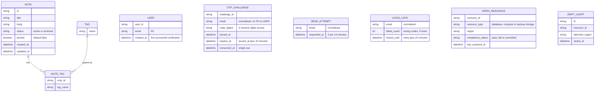

<!-- SECTION: backend.overview | status: DRAFT-UNVERIFIED -->
## 1. Overview

**What the service is.** `notes_api` is the backend service for the team note-taking product. Stack: Node.js 20, Express, PostgreSQL 16, hosted on AWS. [platform.md; feedback.md Preflight answers]

**Responsible for.**

1. **Notes API.** Create, read, edit, pin and unpin (via PATCH), tag, archive, unarchive, list and search notes. [stories.md EP-002, EP-003; requirements.md BR-005 to BR-011, BR-018, BR-019]
2. **Email one-time-code sign-in (CR-129).** This is an additional sign-in method and existing login methods are unchanged. [requirements.md NFR-016; feedback.md CR-129]
   - Two operations: POST `/auth/otp/send` (request a code) and POST `/auth/otp/verify` (verify a code). [feedback.md, approved BACKEND-SPEC.md operation records]
   - Code: 6 digits, all numeric. [requirements.md BR-029]
   - Expiry: valid 10 minutes from issue, and a later submission is rejected as expired. [requirements.md BR-020, BR-024, BR-026]
   - Resend limit: at most 3 code requests within 10 minutes, and requests beyond the limit return 415. [requirements.md BR-021, BR-028, BR-032; stories.md US-004-03]
   - Lockout: after 5 wrong codes the account is locked for 15 minutes, and verification is refused during the lock with a locked-account response. [requirements.md BR-022, BR-025, BR-027, BR-032]
   - During a lock only verification is refused. Requesting a code is not refused, but it stays subject to the resend limit. [requirements.md BR-032]
   - Single use: a code that verified successfully cannot be used again. [requirements.md BR-023]
   - This is an interface change, so consumers are notified and must adapt. [requirements.md NFR-014 to NFR-016]
3. **Published API contract.** The OpenAPI document, its endpoint-coverage metric, the data-residency note and the Scope section. [stories.md EP-004; requirements.md BR-012, BR-013, NFR-008, NFR-009]
4. **Scope guardrail.** Rejection of attachment, real-time and mobile-specific calls, backed by a contract test suite. [stories.md EP-005; requirements.md BR-014 to BR-016, NFR-010, NFR-011]
5. **EU data-residency compliance.** EU-only provisioning of database, compute and backups, a CI/CD residency gate, a compliance report, a launch gate and post-launch drift alerting. [stories.md EP-001; requirements.md BR-001 to BR-004, NFR-001 to NFR-004]

**Not responsible for.**

- Any user interface. The web-app screens in EP-006 belong to the web-app surface. [stories.md US-006-01 to US-006-06]
- Attachment or file-upload endpoints. [requirements.md BR-014]
- Any real-time channel (WebSocket, SSE, polling-push). [requirements.md BR-015]
- Mobile-specific endpoints. [stories.md US-005-01]
- Logging and classifying stakeholder feature requests, which is a product-management process. [requirements.md BR-017]
- Any sign-in method other than email one-time code. The existing authentication is unnamed in every input (`GAP-BE-085`).

**Run notes.**

- `RUN-CONTEXT.run_mode` is `bootstrap` with no `existing` block, but the approved revision of this specification is supplied inside feedback.md. It is used as the baseline and CR-129 is applied to it (`ASM-BE-026`).
- Identifiers from the approved revision keep their numbers and nothing is renumbered. Two new `GAP-` items start at 500 because the numbers below it are occupied.
- The design_brief input is acceptance-criteria text (AC-001-01-01 to AC-002-01-03), not visual design, and no Figma input is connected. `spec_mode` is `NOT-APPLICABLE` for a backend run.
- The label of this change request differs between inputs (`CON-BE-019`).
- **Corrupted rule text.** Five supplied rules have a clause whose text is unrelated to its sentence. They are reproduced as supplied and the decision each carries is treated as unanswered.
  - requirements.md BR-030 (eligibility to request, verify or receive a code).
  - BR-031 (the note access rule).
  - NFR-017 (the email region and the outside-EU condition).
  - NFR-018 (the treatment of email addresses and codes in logs).
  - NFR-019 (retention, positional reading in `ASM-BE-303`).
- **Contradiction check.**
  - Story to design: the design_brief ACs match US-001-01 to US-001-06 and US-002-01. No contradiction found. The brief supplies ACs for only some stories.
  - Story to requirement: `CON-BE-007`, `CON-BE-151`.
  - Requirement to requirement: `CON-BE-003`, `CON-BE-006`, `CON-BE-011`, `CON-BE-019`, `CON-BE-300`.
  - Design to design: none found.
  - BR-020, BR-024 and BR-026 state the same expiry. BR-022, BR-025 and BR-027 state the same lockout. BR-021 and BR-028 state the same resend limit. No values conflict among them.
- **Withdrawn contradiction.** The approved revision raised `CON-BE-010` (consecutive versus cumulative wrong-code counting). No supplied rule text says either word, so it is recorded as the gap `GAP-BE-024`, with a default in `ASM-BE-305`.
- **Resolved question.** BR-032 states that requesting a code is not refused during a lock. That closes the approved revision's `Q-BE-007`.

**Halting.** Under core rule 10.1 this run ends in `HALT-CRITICAL-CONTRADICTION` and `HALT-BLOCKING-QUESTION`.
- Critical contradictions open: `CON-BE-003`, `CON-BE-006`, `CON-BE-151`, `CON-BE-300`.
- Blocking questions open: `Q-BE-003`, `Q-BE-005`, `Q-BE-012`, `Q-BE-152`, `Q-BE-300`.
- Everything that does not depend on them is written. Dependent parts are marked `BLOCKED` or `DRAFT-UNVERIFIED` in place.
- `HALT.md` names the artefacts needed to resume: answers to the five questions, and a decision on each of the four contradictions.

### Open-item register

Each item is defined here once and referenced elsewhere by ID.

| ID | Kind | Statement |
|---|---|---|
| `Q-BE-001` | degradable | Are notes a shared team workspace? Default: yes, any authenticated team member may read and write any note. Notes carry no owner in the supplied inputs. |
| `Q-BE-003` | blocking | Who may request, verify or receive a login code? BR-030 as supplied is corrupted. [requirements.md BR-030] |
| `Q-BE-005` | blocking | From which AWS region are code emails sent, and may the email address leave the EU? NFR-017 as supplied is corrupted. [requirements.md NFR-017] |
| `Q-BE-012` | blocking | What credential does a successful verification return (body token, cookie or other)? No input states it. |
| `Q-BE-151` | degradable | Supply the approved EU region list. AC-001-01-01 refers to it and no input contains it. |
| `Q-BE-152` | blocking | Does a passed launch gate authorise release, or does the Engineering Lead sign off? |
| `Q-BE-153` | degradable | The period of the post-launch residency scan. Default in `ASM-BE-153`. |
| `Q-BE-300` | blocking | Is "notes 1 days" in NFR-019 intended? It would delete every note after one day. |
| `CON-BE-003` | Critical | BR-030 and BR-031 leave eligibility and note access open, and BR-030's rationale says any verified address may obtain a credential. The shared-workspace default of `Q-BE-001` may not hold. Touches an authorisation rule. |
| `CON-BE-006` | Critical | NFR-017 contemplates transmitting the email address outside the EU. BR-001 requires all notes_api infrastructure exclusively in approved EU regions, with no exception. Touches a PII path. |
| `CON-BE-007` | non-critical | US-005-02 requires 404 for attachment paths. US-005-04 and BR-016 require a message referencing the scope exclusion, not a bare 404. |
| `CON-BE-011` | non-critical | BR-021 limits "resending" to 3. BR-028, BR-032, US-004-03 and US-006-06 limit "requests" to 3 within 10 minutes. Reading used: every code request counts, 3 per window (strongest citation, BR-032). |
| `CON-BE-019` | non-critical | The change request carries different labels: CR-129 (feedback.md), CR-125 (NFR-015, US-006-06, BR-030) and CR-127 (BR-032). Content overlaps. No identifier is renumbered. |
| `CON-BE-151` | Critical | BR-003 enforces the launch gate by Engineering Lead sign-off. AC-001-05-01 marks the gate passed and release authorised from the report alone. Touches an authorisation rule. |
| `CON-BE-300` | Critical | NFR-019 as supplied deletes notes after 1 day. BR-007, BR-008 and NFR-005 require that notes are never deleted by archiving and that CRUD has zero data loss. This adds a deletion transition to the note lifecycle. |
| `GAP-BE-001` | gap | US-006-01 to US-006-05 and US-005-06 belong to no backend module. Closing artefact: a decision that backend does not serve them. |
| `GAP-BE-003` | gap | No input relates a note to a user. Closing artefact: answers to `Q-BE-001` and `Q-BE-003`. |
| `GAP-BE-017` | gap | No PII handling policy. Closing artefact: a data-protection policy. |
| `GAP-BE-024` | gap | No input states whether wrong codes accumulate across challenges or reset on success. Default in `ASM-BE-305`. Closing artefact: a rule from the product owner. |
| `GAP-BE-031` | gap | No email normalisation rule. Closing artefact: a rule from the product owner. |
| `GAP-BE-033` | gap | No at-rest treatment for the stored code or for email addresses. Closing artefact: a security policy. |
| `GAP-BE-035` | gap | No validation rule for email format, code format or field length. Closing artefact: field-level requirements. |
| `GAP-BE-038` | gap | The status of the locked-account response is not stated. Closing artefact: a status decision. |
| `GAP-BE-053` | gap | The statuses of the wrong-code, expired-code and already-used-code responses are not stated. Closing artefact: a status decision. |
| `GAP-BE-083` | gap | No input says whether a new code invalidates earlier unconsumed codes. Closing artefact: a rule from the product owner. |
| `GAP-BE-085` | gap | The existing authentication method is unnamed. Closing artefact: its description. |
| `GAP-BE-089` | gap | No ORM, migration tool or other library is named. Closing artefact: a platform decision. |
| `GAP-BE-101` | gap | The mechanism that performs the NFR-019 deletion (scheduler, frequency) is not stated. Closing artefact: an operations decision. |
| `GAP-BE-104` | gap | The treatment of email addresses and codes in logs is not stated, because NFR-018 is corrupted. Closing artefact: a corrected NFR-018. |
| `GAP-BE-300` | gap | No error response envelope is supplied. Proposal in `ASM-BE-300`. |
| `GAP-BE-301` | gap | No latency, availability or throughput target for the login operations. |
| `GAP-BE-302` | gap | The credential lifetime is not stated. Closing artefact: the answer to `Q-BE-012`. |
| `GAP-BE-303` | gap | No path is supplied for note by id, tag add/remove, archive, unarchive, the OpenAPI document or the compliance report. Closing artefact: path decisions, which DevAgent renders into the contract. |
| `GAP-BE-304` | gap | No encryption-at-rest statement for any data. Closing artefact: a security policy. |
| `GAP-BE-305` | gap | Where scan results and compliance report data are stored is not stated. |
| `GAP-BE-306` | gap | The instant exactly 10 minutes after issue is not classified. BR-024 and US-006-06 say "after", which makes the boundary instant valid. BR-020 and BR-026 say "expires", which makes it expired. Closing artefact: a boundary decision. |
| `GAP-BE-307` | gap | Backup frequency and backup retention period are not stated. |
| `GAP-BE-308` | gap | The alert channel and recipients for drift alerts are not stated beyond "the DevOps team". |
| `GAP-BE-309` | gap | Statuses and choices left open in the inputs: already-archived conflict (US-002-04), unsupported Accept header (US-004-01: 406 or fallback), WebSocket and SSE rejection (US-005-03), and PUT versus PATCH (US-002-02). |
| `GAP-BE-310` | gap | US-003-01 says results are ordered by relevance after pinned. BR-019 says ordering within a pinned group is unchanged. The within-group order is therefore not defined. |
| `GAP-BE-500` | gap | The default and maximum page size are not stated. BR-011 requires them and NFR-007 names only "up to page sizes of 100". Closing artefact: a pagination decision. |
| `GAP-BE-501` | gap | Log retention and the metrics and alerting tooling are not stated. Closing artefact: an operations decision. |
| `ASM-BE-015` | assumption | Email addresses are compared in a normalised form, exact rule `GAP-BE-031`. Reason: otherwise the same address defeats the per-address limits. |
| `ASM-BE-019` | assumption | An email address is personal data. Reason: it identifies a person. |
| `ASM-BE-025` | assumption | A User is created on first successful verification, never on code request. Reason: no input creates users any other way. Confirmed by the answer to `Q-BE-003`. |
| `ASM-BE-026` | assumption | The approved revision is the baseline although `run_mode` is `bootstrap`. Confirmed by the orchestrator. |
| `ASM-BE-027` | assumption | Email goes through AWS SES. Reason: NFR-017 names a transactional email service in an AWS region and the platform is AWS. Confirmed by `Q-BE-005`. |
| `ASM-BE-029` | assumption | The resend and lock counters are keyed per normalised email address. Reason: BR-021 to BR-028 speak of requests and of an account, never of a client. |
| `ASM-BE-034` | assumption | `pinned` is `NOT NULL`. Reason: BR-018 gives it a default and no null state. |
| `ASM-BE-044` | assumption | The resend window is sliding (trailing 10 minutes). Reason: BR-021 reads "within 10 minutes". |
| `ASM-BE-153` | assumption | The scan period is no longer than 15 minutes. Reason: NFR-003 requires an alert within 15 minutes of drift detection. Confirmed by `Q-BE-153`. |
| `ASM-BE-300` | assumption | The error envelope is the proposal in `backend.error-model`. Reason: none is supplied. Confirmed by `GAP-BE-300`'s closing artefact. |
| `ASM-BE-301` | assumption | Error code names other than `OUT_OF_SCOPE` are proposed names. Reason: only `OUT_OF_SCOPE` is cited, as an example. [stories.md US-005-04] |
| `ASM-BE-302` | assumption | A role has no permission on an operation unless an input grants it. Reason: no input defines a roles model. Confirmed by `GAP-BE-085`'s closing artefact. |
| `ASM-BE-303` | assumption | NFR-019 lists, positionally: code challenges 1 day, send attempts 1 day, account locks 5 days, notes 1 day. Reason: the sentence names four record types and four numbers. Confirmed by a corrected NFR-019. |
| `ASM-BE-304` | assumption | No notes_api database exists yet, so the migrations start from empty. Reason: no input states otherwise. Confirmed by the orchestrator. |
| `ASM-BE-305` | assumption | The wrong-code count is per normalised email, increments on each wrong code, is cleared by a successful verification, and has no time window. Reason: no input states a window. Confirmed by `GAP-BE-024`'s closing artefact. |
<!-- /SECTION: backend.overview -->
<!-- SECTION: backend.domain-model | status: DRAFT-UNVERIFIED -->
## 2. Domain model

Three sub-domains are evidenced: note-taking (Note, Tag), login (User, OTP_CHALLENGE, SEND_ATTEMPT, LOGIN_LOCK) and residency compliance (INFRA_RESOURCE, DRIFT_ALERT). No input relates them beyond BR-013, which says notes_api's infrastructure hosts the note data.



**Entities and ownership.**

- **Note.** Title, body, status (active or archived), `pinned`, created and updated timestamps. [stories.md US-002-01 to US-002-06]
  - Title and body are mandatory and non-empty at creation. [requirements.md BR-005]
  - Archiving never deletes data and is reversible. [requirements.md BR-007, BR-008]
  - `pinned` is a boolean, default `false`, set on create or PATCH. [requirements.md BR-018] Nullability is `ASM-BE-034`.
- **Tag.** A name, many-to-many with Note through NOTE_TAG. Adding an existing tag creates no duplicate. [stories.md US-002-03] Tag name format and length are not stated, nor is what happens to a tag with no notes (`GAP-BE-035`).
- **User.** A person who has verified an email address (`ASM-BE-025`). `email` is personal data (`ASM-BE-019`). The handling policy is `GAP-BE-017`.
- **OTP_CHALLENGE.** One issued 6-digit numeric code for one email address. [requirements.md BR-029]
  - It expires 10 minutes after issue and is single-use. [requirements.md BR-023, BR-024]
  - It is keyed by email, not by user, because the user may not exist yet (`ASM-BE-025`).
  - The storage form of the code is `GAP-BE-033`. Whether a new code invalidates an earlier one is `GAP-BE-083`.
- **SEND_ATTEMPT.** One record per accepted code request, used to evaluate the limit of 3 within 10 minutes. [requirements.md BR-028] It is keyed per normalised email (`ASM-BE-015`, `ASM-BE-029`). The window is sliding (`ASM-BE-044`) and the first request counts (`CON-BE-011`).
- **LOGIN_LOCK.** The lock state and the wrong-code count for an email address, held 15 minutes after 5 wrong codes. [requirements.md BR-022, BR-025, BR-027] The counting rule is `GAP-BE-024` and `ASM-BE-305`.
- **INFRA_RESOURCE and DRIFT_ALERT.** A provisioned component with its reported region and status. A resource type the scanner does not recognise is flagged `unverified`, never omitted. [stories.md US-001-04; AC-001-04-02] Whether these rows are stored in the notes_api database is `GAP-BE-305`.

**Ownership.** No input relates a note to a user (`GAP-BE-003`). The default applied is `Q-BE-001`: notes form a shared workspace and any authenticated team member may read and write any note. `CON-BE-003` (Critical) calls that default into question, so note ownership columns and the note access rule are `BLOCKED` until `Q-BE-003` is answered.

**Invariants.** These hold after every operation on the named entity.

- `INV-BE-001`. In the note list and note search results, every pinned note is returned before every unpinned note. Order within each group is not defined (`GAP-BE-310`). [requirements.md BR-019]
- `INV-BE-002`. A code that has been verified successfully is refused on any later verification. [requirements.md BR-023]
- `INV-BE-003`. A User row is created only on successful verification (`ASM-BE-025`).
- `INV-BE-004`. A code submitted after its issue instant plus 10 minutes is rejected as expired. [requirements.md BR-024; stories.md US-006-06] The boundary instant is `GAP-BE-306`.
- `INV-BE-005`. While an email address is locked, no verification succeeds, including with a correct code, until the lock expires. [requirements.md BR-022, BR-027]
- `INV-BE-006`. A code request beyond 3 within 10 minutes creates no code and sends no email. [requirements.md BR-021, BR-028, BR-032]
- `INV-BE-007`. A residency check whose region metadata is missing or unreadable fails and blocks deployment. [stories.md US-001-03; AC-001-03-03]
- `INV-BE-008`. A PATCH never overwrites a field it does not contain. [requirements.md BR-006; stories.md US-002-02]
- `INV-BE-009`. Archiving and unarchiving preserve all note data. [requirements.md BR-007, BR-008] `CON-BE-300` threatens this invariant.
- `INV-BE-010`. A verification refused because of a lock changes neither `failed_count` nor `locked_until`. This rests on `ASM-BE-305` and the auth module's `ASM-BE-306`.
- `INV-BE-011`. Two simultaneous correct submissions of one code result in exactly one success. [requirements.md BR-023]

**PII.** Personal data appears in `USER.email` and in the normalised `email` columns of OTP_CHALLENGE, SEND_ATTEMPT and LOGIN_LOCK (`ASM-BE-019`). `OTP_CHALLENGE.code_digest` is sensitive. The at-rest treatment is `GAP-BE-033`, `GAP-BE-304` and the policy is `GAP-BE-017`. No example in this specification uses a real-looking address.
<!-- /SECTION: backend.domain-model -->
<!-- SECTION: backend.module-map | status: DRAFT-UNVERIFIED -->
## 3. Module map

Six internal modules. The split follows the epics, since no input names modules (`ASM-BE-502` is not needed: the module names are labels, not a claim about the inputs).

| Module | Responsibility | Owns data | Source |
|---|---|---|---|
| `auth` | Email one-time-code send and verify, resend limiter, lockout, user creation, credential issue | USER, OTP_CHALLENGE, SEND_ATTEMPT, LOGIN_LOCK | EP-006 (US-006-06), BR-020 to BR-029, BR-032, NFR-016 |
| `notes` | Create, read, edit, pin, tag, archive, unarchive, retention deletion | NOTE, TAG, NOTE_TAG | EP-002, BR-005 to BR-008, BR-018 |
| `search` | Keyword and tag search, pagination, archived filter, pinned-first ordering | none (reads `notes` data) | EP-003, BR-009 to BR-011, BR-019 |
| `residency-compliance` | EU region checks, backup validation, compliance report, launch gate, drift scan and alert | INFRA_RESOURCE, DRIFT_ALERT (`GAP-BE-305`) | EP-001, BR-001 to BR-004 |
| `api-docs` | OpenAPI document, coverage metric, data-handling note, example payloads | none | EP-004, BR-012, BR-013, BR-032 |
| `scope-guardrail` | Rejection of out-of-scope calls, Scope section, contract test suite | none | EP-005, BR-014 to BR-016 |

**Direction of every dependency** (A → B means A depends on B).

| Dependency | Reason |
|---|---|
| `search` → `notes` | Search reads the notes, tags and archive status that `notes` owns. |
| `notes` → `auth` | Note operations require an authenticated caller, validated against the credential `auth` issues (`Q-BE-012`, `Q-BE-001`). |
| `search` → `auth` | Same reason as `notes` → `auth`. |
| `api-docs` → `auth`, `notes`, `search`, `scope-guardrail` | The OpenAPI document and its coverage check read each module's operation records. |
| `scope-guardrail` → `api-docs` | The contract test suite runs against the OpenAPI document and the route registry. [stories.md US-005-05] |
| `residency-compliance` → none | It inspects infrastructure, not application data. |

No module depends on `residency-compliance`. `auth` depends on no other module. The one outward dependency of `auth` is the email transport, whose region is `Q-BE-005` and `CON-BE-006`.

The `notes` → `auth` direction is derived, not cited. A note access rule is `BLOCKED` on `CON-BE-003` and `Q-BE-003`. The credential form is `BLOCKED` on `Q-BE-012`.

**Boundaries.**

- `search` never writes. `notes` never ranks.
- Retention deletion of notes belongs to `notes` and is `BLOCKED` on `CON-BE-300`.
- The global error envelope is defined once in `backend.error-model` and used by every module.
<!-- /SECTION: backend.module-map -->
<!-- SECTION: backend.api-surface | status: VERIFIED -->
## Api surface

_Rendered by DevAgent from the operation records._

| id | method | path | module | success | errors | summary |
|---|---|---|---|---|---|---|
| `API-APIDOCS-304307` | GET | `/openapi` | `api-docs` | 200 | 406, 500 | Return the published OpenAPI document describing every notes_api endpoint (US-004-01, US-004-02). Path is a proposal pending GAP-BE-303; behaviour for an unsupported Accept header (406 versus default-format fallback) is open per GAP-BE-309. |
| `API-APIDOCS-827943` | GET | `/openapi/coverage` | `api-docs` | 200 | 401, 403, 500 | Return the endpoint coverage metric: percentage of implemented endpoints present in the published spec, naming any missing endpoints (US-004-04, NFR-008). |
| `API-APIDOCS-639507` | GET | `/openapi/data-handling` | `api-docs` | 200 | 500 | Return the data-handling note stating that all note data is stored and served within the EU (US-004-06, BR-013). |
| `API-APIDOCS-057616` | GET | `/openapi/examples` | `api-docs` | 200 | 400, 404, 500 | Return example request and response payloads for the search and tagging endpoints (US-004-05, NFR-009). Examples use masked or synthetic data only. |
| `API-AUTH-707260` | POST | `/auth/otp/send` | `auth` | 204 | 400, 415, 500 | Request an email one-time sign-in code: 6 numeric digits, valid 10 minutes, at most 3 requests per 10 minutes per normalised email. Not refused during a lock. |
| `API-AUTH-692907` | POST | `/auth/otp/verify` | `auth` | 200 | 400, 401, 403, 423, 429, 500 | Verify an emailed one-time code. On success it creates the User if absent, marks the code consumed (single use) and issues a credential. Refused while the account is locked (5 wrong codes lock for 15 minutes). |
| `API-NOTES-232390` | POST | `/notes` | `notes` | 201 | 400, 401, 403, 500 | Create a note (US-002-01). Title and body mandatory and non-empty; pinned defaults to false. |
| `API-NOTES-045877` | GET | `/notes/{id}` | `notes` | 200 | 401, 403, 404, 500 | Read a single note by id (US-002-06). Unknown id returns not found with no partial data. |
| `API-NOTES-847551` | PATCH | `/notes/{id}` | `notes` | 200 | 400, 401, 403, 404, 500 | Partially edit a note, including pinning/unpinning via pinned (US-002-02). Fields not sent are never overwritten. |
| `API-NOTES-810640` | POST | `/notes/{id}/archive` | `notes` | 200 | 401, 403, 404, 409, 500 | Archive a note (US-002-04). Status change only; no data is deleted. Already-archived returns a conflict (status proposed, unstated in inputs). |
| `API-NOTES-359413` | POST | `/notes/{id}/tags` | `notes` | 200 | 400, 401, 403, 404, 500 | Add a tag to a note (US-002-03). Adding an existing tag creates no duplicate. |
| `API-NOTES-150096` | DELETE | `/notes/{id}/tags/{name}` | `notes` | 200 | 400, 401, 403, 404, 500 | Remove a tag from a note (US-002-03). |
| `API-NOTES-917869` | POST | `/notes/{id}/unarchive` | `notes` | 200 | 401, 403, 404, 500 | Unarchive a note, restoring it to active with all data preserved (US-002-05). |
| `API-RESIDENCYCOMPLIANCE-174124` | POST | `/residency/backup-validations` | `residency-compliance` | 200 | 400, 401, 403, 422, 500 | Validate a backup configuration: a target outside the EU is rejected with a residency violation error within 30 seconds and no data is written (US-001-02, AC-001-02-01, AC-001-02-02). |
| `API-RESIDENCYCOMPLIANCE-913995` | GET | `/residency/compliance-report` | `residency-compliance` | 200 | 401, 403, 500 | Return the current compliance report: every infrastructure component with its EU verification status, including unrecognised types flagged unverified, and the overall percent compliant (US-001-04, NFR-001, NFR-004). Storage of report data is open (GAP-BE-305). |
| `API-RESIDENCYCOMPLIANCE-047792` | GET | `/residency/drift-alerts` | `residency-compliance` | 200 | 400, 401, 403, 500 | List drift alerts raised for running resources found outside an EU region, with resource details (AC-001-06-02). Alert channel and recipients are open (GAP-BE-308). |
| `API-RESIDENCYCOMPLIANCE-395094` | GET | `/residency/launch-gate` | `residency-compliance` | 200 | 401, 403, 500 | Return the launch gate status derived from the compliance report (US-001-05, BR-003). Whether a pass authorises release or needs Engineering Lead sign-off is unresolved (CON-BE-151, Q-BE-152). |
| `API-RESIDENCYCOMPLIANCE-548093` | POST | `/residency/launch-gate/signoff` | `residency-compliance` | 201 | 400, 401, 403, 409, 500 | Record the Engineering Lead sign-off authorising release (BR-003). Refused while the gate has failed. Blocked on CON-BE-151 and Q-BE-152. |
| `API-RESIDENCYCOMPLIANCE-117596` | POST | `/residency/region-checks` | `residency-compliance` | 200 | 400, 401, 403, 500 | Check that the supplied infrastructure resources (database, compute, backup storage) are in approved EU regions; fails closed when region metadata is missing or unreadable (US-001-01, US-001-03, BR-001, BR-002, INV-BE-007). Pipeline step may call it; approved region list is open (Q-BE-151). |
| `API-RESIDENCYCOMPLIANCE-466056` | POST | `/residency/scans` | `residency-compliance` | 202 | 400, 401, 403, 409, 500 | Trigger a residency drift scan of running resources; every scan result is logged and any resource outside an EU region raises a drift alert within 15 minutes of detection (US-001-06, BR-004, NFR-003). The periodic scan itself is a scheduled job, this is the on-demand trigger. |
| `API-SEARCH-580505` | GET | `/notes/search` | `search` | 200 | 400, 401, 403, 500, 503 | Search notes by keyword and/or tags with pagination, an archived filter, and pinned notes returned before unpinned notes (US-003-01 to US-003-06; BR-009 to BR-011, BR-019). |

### `API-APIDOCS-304307` — GET `/openapi`

Return the published OpenAPI document describing every notes_api endpoint (US-004-01, US-004-02). Path is a proposal pending GAP-BE-303; behaviour for an unsupported Accept header (406 versus default-format fallback) is open per GAP-BE-309.

**Request:** none
**Response:** 
- `openapi` (string, required): OpenAPI specification version declared by the document.
- `info` (object, required): API title and document version metadata.
- `paths` (object, required): Every endpoint with its methods, parameters, request and response schemas and documented error responses.
- `components` (object): Shared schemas, including the error envelope, and security schemes.

### `API-APIDOCS-827943` — GET `/openapi/coverage`

Return the endpoint coverage metric: percentage of implemented endpoints present in the published spec, naming any missing endpoints (US-004-04, NFR-008).

**Request:** none
**Response:** 
- `coverage_percent` (number, required): Percentage of implemented endpoints documented in the published OpenAPI document.
- `total_endpoints` (integer, required): Number of endpoints registered in the route registry.
- `documented_endpoints` (integer, required): Number of those endpoints present in the OpenAPI document.
- `missing_endpoints` (array, required): Endpoints (method and path) that are implemented but absent from the document; empty when coverage is 100%.

### `API-APIDOCS-639507` — GET `/openapi/data-handling`

Return the data-handling note stating that all note data is stored and served within the EU (US-004-06, BR-013).

**Request:** none
**Response:** 
- `statement` (string, required): Data-residency statement: all note data is stored and served within the EU.
- `scope` (array): Data categories the statement covers, such as database, compute and backups.

### `API-APIDOCS-057616` — GET `/openapi/examples`

Return example request and response payloads for the search and tagging endpoints (US-004-05, NFR-009). Examples use masked or synthetic data only.

**Request:** 
- `endpoint` (string): Restrict the result to examples for a single documented endpoint (method and path).
**Response:** 
- `examples` (array, required): List of examples, each naming its endpoint with a request payload and a response payload.

### `API-AUTH-707260` — POST `/auth/otp/send`

Request an email one-time sign-in code: 6 numeric digits, valid 10 minutes, at most 3 requests per 10 minutes per normalised email. Not refused during a lock.

**Request:** 
- `email` (string, required): Email address that receives the 6-digit code. Normalisation and format validation rules are not yet supplied (GAP-BE-031, GAP-BE-035). Personal data, never logged unredacted.
**Response:** none

### `API-AUTH-692907` — POST `/auth/otp/verify`

Verify an emailed one-time code. On success it creates the User if absent, marks the code consumed (single use) and issues a credential. Refused while the account is locked (5 wrong codes lock for 15 minutes).

**Request:** 
- `email` (string, required): Email address the code was sent to. Personal data. Normalisation per the unresolved GAP-BE-031.
- `code` (string, required): The 6-digit numeric one-time code received by email (BR-029). Never logged or echoed.
**Response:** 
- `credential` (string, required): Credential issued on successful verification. Its form (body token, cookie or other) and lifetime are unresolved (Q-BE-012, GAP-BE-302); this entry is provisional.

### `API-NOTES-232390` — POST `/notes`

Create a note (US-002-01). Title and body mandatory and non-empty; pinned defaults to false.

**Request:** 
- `title` (string, required): Note title, mandatory and non-empty.
- `body` (string, required): Note body, mandatory and non-empty.
- `pinned` (boolean): Whether the note is pinned; defaults to false.
**Response:** 
- `id` (string, required): Note identifier.
- `title` (string, required): Note title.
- `body` (string, required): Note body.
- `status` (string, required): active or archived; new notes are active.
- `pinned` (boolean, required): Pinned flag.
- `tags` (array, required): Tag names applied to the note.
- `created_at` (string, required): Creation timestamp.
- `updated_at` (string, required): Last update timestamp.

### `API-NOTES-045877` — GET `/notes/{id}`

Read a single note by id (US-002-06). Unknown id returns not found with no partial data.

**Request:** 
- `id` (string, required): Path parameter: note identifier.
**Response:** 
- `id` (string, required): Note identifier.
- `title` (string, required): Note title.
- `body` (string, required): Note body.
- `status` (string, required): active or archived.
- `pinned` (boolean, required): Pinned flag.
- `tags` (array, required): Tag names applied to the note.
- `created_at` (string, required): Creation timestamp.
- `updated_at` (string, required): Last update timestamp.

### `API-NOTES-847551` — PATCH `/notes/{id}`

Partially edit a note, including pinning/unpinning via pinned (US-002-02). Fields not sent are never overwritten.

**Request:** 
- `id` (string, required): Path parameter: note identifier.
- `title` (string): New title; must be non-empty if sent.
- `body` (string): New body; must be non-empty if sent.
- `pinned` (boolean): Pin (true) or unpin (false) the note.
**Response:** 
- `id` (string, required): Note identifier.
- `title` (string, required): Note title.
- `body` (string, required): Note body.
- `status` (string, required): active or archived.
- `pinned` (boolean, required): Pinned flag.
- `tags` (array, required): Tag names applied to the note.
- `created_at` (string, required): Creation timestamp.
- `updated_at` (string, required): Last update timestamp.

### `API-NOTES-810640` — POST `/notes/{id}/archive`

Archive a note (US-002-04). Status change only; no data is deleted. Already-archived returns a conflict (status proposed, unstated in inputs).

**Request:** 
- `id` (string, required): Path parameter: note identifier.
**Response:** 
- `id` (string, required): Note identifier.
- `status` (string, required): archived after success.
- `updated_at` (string, required): Last update timestamp.

### `API-NOTES-359413` — POST `/notes/{id}/tags`

Add a tag to a note (US-002-03). Adding an existing tag creates no duplicate.

**Request:** 
- `id` (string, required): Path parameter: note identifier.
- `name` (string, required): Tag name to add.
**Response:** 
- `id` (string, required): Note identifier.
- `tags` (array, required): Resulting tag names on the note, without duplicates.
- `updated_at` (string, required): Last update timestamp.

### `API-NOTES-150096` — DELETE `/notes/{id}/tags/{name}`

Remove a tag from a note (US-002-03).

**Request:** 
- `id` (string, required): Path parameter: note identifier.
- `name` (string, required): Path parameter: tag name to remove.
**Response:** 
- `id` (string, required): Note identifier.
- `tags` (array, required): Resulting tag names on the note.
- `updated_at` (string, required): Last update timestamp.

### `API-NOTES-917869` — POST `/notes/{id}/unarchive`

Unarchive a note, restoring it to active with all data preserved (US-002-05).

**Request:** 
- `id` (string, required): Path parameter: note identifier.
**Response:** 
- `id` (string, required): Note identifier.
- `status` (string, required): active after success.
- `updated_at` (string, required): Last update timestamp.

### `API-RESIDENCYCOMPLIANCE-174124` — POST `/residency/backup-validations`

Validate a backup configuration: a target outside the EU is rejected with a residency violation error within 30 seconds and no data is written (US-001-02, AC-001-02-01, AC-001-02-02).

**Request:** 
- `backup_target` (object, required): The backup configuration under validation, including the storage location and its region.
- `resource_id` (string): Identifier of the backed-up resource, if known.
**Response:** 
- `valid` (boolean, required): True when the backup storage is in an approved EU region.
- `region` (string, required): Region the backup target resolves to.
- `validated_at` (string, required): Timestamp of the validation.

### `API-RESIDENCYCOMPLIANCE-913995` — GET `/residency/compliance-report`

Return the current compliance report: every infrastructure component with its EU verification status, including unrecognised types flagged unverified, and the overall percent compliant (US-001-04, NFR-001, NFR-004). Storage of report data is open (GAP-BE-305).

**Request:** 
- `refresh` (boolean): When true, run a fresh scan before building the report so it is current at the launch gate check.
**Response:** 
- `generated_at` (string, required): Timestamp the report was generated.
- `percent_compliant` (number, required): Share of infrastructure components verified as EU-hosted.
- `resources` (array, required): Each component: resource_id, resource_type, region, compliance_status (pass, fail or unverified) and last_scanned_at.
- `all_compliant` (boolean, required): True only when every component passes.

### `API-RESIDENCYCOMPLIANCE-047792` — GET `/residency/drift-alerts`

List drift alerts raised for running resources found outside an EU region, with resource details (AC-001-06-02). Alert channel and recipients are open (GAP-BE-308).

**Request:** 
- `since` (string): Return only alerts raised at or after this timestamp.
- `page` (integer): Page number. Default and maximum page size are not stated (GAP-BE-500).
- `limit` (integer): Page size.
**Response:** 
- `items` (array, required): Alerts: id, resource_id, resource_type, detected_region and raised_at.
- `total` (integer, required): Total number of matching alerts.

### `API-RESIDENCYCOMPLIANCE-395094` — GET `/residency/launch-gate`

Return the launch gate status derived from the compliance report (US-001-05, BR-003). Whether a pass authorises release or needs Engineering Lead sign-off is unresolved (CON-BE-151, Q-BE-152).

**Request:** none
**Response:** 
- `gate_status` (string, required): Gate outcome: passed or failed, based on the compliance report.
- `report_generated_at` (string, required): Timestamp of the compliance report the status is based on.
- `failing_resources` (array, required): Resources that are non-compliant or unverified and cause a failed gate; empty when passed.
- `signoff` (object): Engineering Lead sign-off record (approver and time) when one has been recorded. Presence rules are blocked on Q-BE-152.

### `API-RESIDENCYCOMPLIANCE-548093` — POST `/residency/launch-gate/signoff`

Record the Engineering Lead sign-off authorising release (BR-003). Refused while the gate has failed. Blocked on CON-BE-151 and Q-BE-152.

**Request:** 
- `decision` (string, required): approve or reject.
- `comment` (string): Free-text rationale recorded with the decision.
**Response:** 
- `gate_status` (string, required): Gate outcome after the decision.
- `decided_by` (string, required): Identity of the approver.
- `decided_at` (string, required): Timestamp of the decision.

### `API-RESIDENCYCOMPLIANCE-117596` — POST `/residency/region-checks`

Check that the supplied infrastructure resources (database, compute, backup storage) are in approved EU regions; fails closed when region metadata is missing or unreadable (US-001-01, US-001-03, BR-001, BR-002, INV-BE-007). Pipeline step may call it; approved region list is open (Q-BE-151).

**Request:** 
- `resources` (array, required): Resources to check; each item carries resource_id, resource_type (database, compute or backup storage) and the region metadata as read from the target.
- `deployment_ref` (string): Identifier of the deployment or pipeline run being gated, for the audit log.
**Response:** 
- `result` (string, required): Overall outcome: pass or fail. Fail when any resource is outside an approved EU region or has missing or unreadable region metadata.
- `deployment_blocked` (boolean, required): True when the result is fail and the deployment must be blocked.
- `resources` (array, required): Per-resource outcome: resource_id, resource_type, region, compliance_status (pass, fail or unverified) and reason.
- `checked_at` (string, required): Timestamp of the check.

### `API-RESIDENCYCOMPLIANCE-466056` — POST `/residency/scans`

Trigger a residency drift scan of running resources; every scan result is logged and any resource outside an EU region raises a drift alert within 15 minutes of detection (US-001-06, BR-004, NFR-003). The periodic scan itself is a scheduled job, this is the on-demand trigger.

**Request:** 
- `resource_ids` (array): Limit the scan to these resources; all resources when omitted.
**Response:** 
- `scan_id` (string, required): Identifier of the accepted scan.
- `status` (string, required): Scan state at acceptance, for example queued.
- `accepted_at` (string, required): Timestamp the scan was accepted.

### `API-SEARCH-580505` — GET `/notes/search`

Search notes by keyword and/or tags with pagination, an archived filter, and pinned notes returned before unpinned notes (US-003-01 to US-003-06; BR-009 to BR-011, BR-019).

**Request:** 
- `q` (string, required): Keyword query matched against notes. A missing or empty value returns a validation error (US-003-01 to US-003-06).
- `tags` (array): Tag names to filter by. Invalid tags or a malformed filter return a validation error (US-003-02, US-003-04).
- `include_archived` (boolean): When true, archived notes are included in results. Archived notes are excluded by default. An invalid value returns a validation error (US-003-06, BR-009).
- `page` (integer): Page number of results. A bad value returns a validation error (US-003-05, BR-011).
- `limit` (integer): Page size, up to 100 (NFR-007). The default and maximum are not stated (GAP-BE-500). A bad value returns a validation error.
**Response:** 
- `results` (array, required): Matching notes for the requested page, every pinned note before every unpinned note (INV-BE-001). An empty array with 200 when nothing matches (US-003-01). The within-group order is undefined (GAP-BE-310). The field name is proposed, since no input names it.
- `page` (integer): Page number of the returned page. Proposed field, not named in any input.
- `limit` (integer): Page size applied to the returned page. Proposed field, not named in any input.
- `total` (integer): Total number of matching notes across all pages. Proposed field, not named in any input.
<!-- /SECTION: backend.api-surface -->
<!-- SECTION: backend.auth-model | status: DRAFT-UNVERIFIED -->
## 5. Auth model

**Actors named in the inputs.**

| Actor | Source | Interacts with the API |
|---|---|---|
| Team member | stories.md EP-002, EP-003, EP-006 | Yes: notes and search operations |
| Unauthenticated caller signing in | stories.md US-006-06 | Yes: the two login operations |
| Integration developer / third-party integrator | stories.md EP-004, US-005-04 | Reads the OpenAPI document; may call out-of-scope paths |
| QA engineer | stories.md US-002-06, US-005-05 | Calls note operations, runs the contract test suite |
| Platform/DevOps Engineer | stories.md US-001-01, US-001-02, US-001-06 | Infrastructure, backups, receives drift alerts |
| Release/CI Pipeline Owner | stories.md US-001-03 | Residency check in the pipeline |
| Compliance/Security Auditor | stories.md US-001-04 | Generates and reads the compliance report |
| Engineering Lead | stories.md US-001-05 | Launch gate |

No input defines roles, scopes or a permission model, so none is invented (`GAP-BE-085`). A role has no permission on an operation unless an input grants it (`ASM-BE-302`). The existing authentication method is unnamed (`GAP-BE-085`) and the credential issued by login is `Q-BE-012`.

**Permission matrix.** Rows are resources and operations, referred to by method and path where an input gives one (`GAP-BE-303` for the rest). Columns are the callers that exist in the inputs. "Allow" needs a citation. "Not stated" means no input grants it, so it is denied under `ASM-BE-302`.

| Resource and operation | Unauthenticated caller | Authenticated team member | Other actors |
|---|---|---|---|
| POST `/auth/otp/send` | Allow, no sign-in is required to ask for a code [BR-032; US-006-06]. Eligibility is `BLOCKED` on `Q-BE-003` | Allow (same) | Not stated |
| POST `/auth/otp/verify` | Allow [BR-032; US-006-06]. Eligibility is `BLOCKED` on `Q-BE-003` | Allow (same) | Not stated |
| Create note (POST on the notes collection) | Not stated | Allow under the `Q-BE-001` default, `BLOCKED` on `CON-BE-003` | Not stated |
| Get note by id | Not stated | Allow under the `Q-BE-001` default, `BLOCKED` on `CON-BE-003` | QA engineer: allow [US-002-06] as a team member |
| Edit note (PUT or PATCH, including `pinned`) | Not stated | Allow under the `Q-BE-001` default, `BLOCKED` on `CON-BE-003` | Not stated |
| Add or remove a tag | Not stated | Allow under the `Q-BE-001` default, `BLOCKED` on `CON-BE-003` | Not stated |
| Archive or unarchive a note | Not stated | Allow under the `Q-BE-001` default, `BLOCKED` on `CON-BE-003` | Not stated |
| GET `/notes/search` | Not stated | Allow under the `Q-BE-001` default, `BLOCKED` on `CON-BE-003` | Integration engineer: not stated |
| Fetch the OpenAPI document | Not stated | Not stated | Integration developer: the stories say "client requests the OpenAPI document" [US-004-01] without an authentication rule (`GAP-BE-303`) |
| Generate the compliance report | Not stated | Not stated | Compliance/Security Auditor [US-001-04]. Whether it is an API operation is `GAP-BE-303` |
| Mark the launch gate passed or failed | Not stated | Not stated | Engineering Lead sign-off [BR-003] versus report-driven pass [AC-001-05-01] is `CON-BE-151` and `Q-BE-152` |
| Residency check in the pipeline | Not applicable | Not applicable | Release/CI Pipeline Owner [US-001-03]. A pipeline step, not an API operation |

**Ownership predicate.** No ownership predicate exists, because no input relates a note to a user (`GAP-BE-003`). It is `BLOCKED` on `Q-BE-003`.

**Abuse controls on the unauthenticated login operations.**

- The resend limit (3 requests per 10 minutes) and the lockout (5 wrong codes, 15 minutes) are keyed per normalised email address (`ASM-BE-029`).
- No response distinguishes an address that has a User from one that does not. This is derived from the abuse controls of BR-021 and BR-022 and is not cited in an input (`BE-AUTH-FR-011` in the auth module).
<!-- /SECTION: backend.auth-model -->
<!-- SECTION: backend.data-lifecycle | status: DRAFT-UNVERIFIED -->
## 6. Data lifecycle

**What is stored, and for how long.**

| Data | Stored where | Retention | Source |
|---|---|---|---|
| Notes, tags, note-tag links | PostgreSQL 16 in an EU region [BR-001; platform.md] | Archiving never deletes [BR-007]. NFR-019 read positionally says 1 day, then deleted (`ASM-BE-303`), which is `BLOCKED` on `CON-BE-300` and `Q-BE-300` | BR-007, BR-008, NFR-019 |
| Users | PostgreSQL | Not stated | `GAP-BE-017` |
| OTP challenges | PostgreSQL | 1 day, then deleted (`ASM-BE-303`) | NFR-019 |
| Send attempts | PostgreSQL | 1 day, then deleted (`ASM-BE-303`) | NFR-019 |
| Account locks and wrong-code counts | PostgreSQL | 5 days, then deleted (`ASM-BE-303`) | NFR-019 |
| Backups of the notes database | EU-region storage only [US-001-02; AC-001-02-01] | Not stated (`GAP-BE-307`) | US-001-02 |
| Infrastructure scan results, compliance report data, drift alerts | Not stated (`GAP-BE-305`) | Not stated | US-001-04, US-001-06 |
| Application logs | Not stated | Not stated (`GAP-BE-501`) | NFR-018 |

**Residency.** All database, compute and backup resources are provisioned only in approved EU regions, with no exception. [requirements.md BR-001] The approved region list is not supplied (`Q-BE-151`). The email transport region is `Q-BE-005`, and a transmission outside the EU contradicts BR-001 (`CON-BE-006`). The published API documentation states that all note data is stored and served within the EU. [stories.md US-004-06; BR-013]

**Encryption.** No input says whether any data is encrypted at rest or in transit. None is claimed (`GAP-BE-304`, `GAP-BE-033`).

**Deletion.** The only deletions the inputs describe are the NFR-019 retention deletions. The mechanism, scheduler and frequency are `GAP-BE-101`. The share of records older than their retention period that are deleted is the stated target metric of NFR-019. Deleting notes after 1 day contradicts BR-007, BR-008 and NFR-005 (`CON-BE-300`), so the notes deletion is `BLOCKED` until `Q-BE-300` is answered. The three login-record deletions do not depend on that answer.

**Hard deletes.** There is no delete operation for notes in scope. Archiving is a status change, not a deletion. [requirements.md BR-007]
<!-- /SECTION: backend.data-lifecycle -->
<!-- SECTION: backend.nfr | status: DRAFT-UNVERIFIED -->
## 7. Non-functional requirements

Every figure below is quoted from an input. No figure is invented.

| Area | Target | Source |
|---|---|---|
| Search latency | p95 < 300 ms under 50 requests per second | requirements.md NFR-006; stories.md US-003-03 |
| Search at scale | The 300 ms SLA still holds on a dataset such as 100k notes, via indexed lookup | stories.md US-003-03 |
| Search pagination | p95 < 300 ms maintained up to page sizes of 100 results | requirements.md NFR-007 |
| Search degraded | If the search index is degraded or unavailable, return 503 with a retry-after header instead of hanging | stories.md US-003-03 |
| Availability | 99.9% uptime monthly for CRUD and search | requirements.md NFR-013 |
| CRUD correctness | 100% functional-test pass rate with zero data loss | requirements.md NFR-005 |
| Injection safety | 0 critical injection vulnerabilities in the security scan per release, for note title, body and tag fields | requirements.md NFR-012 |
| Drift alert | Alert fired within 15 minutes of drift detection | requirements.md NFR-003; stories.md US-001-06 says "immediately" |
| Backup validation | A backup configuration pointing outside the EU fails within 30 seconds with a residency violation error and writes no data | stories.md US-001-02; AC-001-02-02 |
| EU verification | 100% of infrastructure components EU-verified | requirements.md NFR-001 |
| Pipeline gate | 0 non-EU deploys reach production | requirements.md NFR-002 |
| Compliance report | Refreshed and 100% accurate at each launch gate check | requirements.md NFR-004 |
| OpenAPI coverage | 100% endpoint coverage in the published spec | requirements.md NFR-008 |
| Example payloads | 100% of search and tagging endpoints have example payloads | requirements.md NFR-009 |
| Scope guardrail | 0 out-of-scope endpoints detected per build, on every CI build | requirements.md NFR-010 |
| Out-of-scope errors | 100% of out-of-scope calls return a documented 4xx error with an explanatory message | requirements.md NFR-011 |
| Log hygiene | Target metric: share of log entries containing an unredacted email address or code. The rule text is corrupted (`GAP-BE-104`) | requirements.md NFR-018 |
| Retention | Target metric: share of records older than their retention period that are deleted. Values in `ASM-BE-303` | requirements.md NFR-019 |
| Mail residency | Target metric: share of code emails sent from the approved region. The region is `Q-BE-005` | requirements.md NFR-017 |

**Not stated.**

- Latency, throughput, concurrency and availability for the two login operations (`GAP-BE-301`).
- Default and maximum page size, although BR-011 requires them (`GAP-BE-500`).
- Throughput and concurrency targets for create, edit, tag, archive and get.
- Concurrent PATCH to one note: a "standard last-write/conflict response" is allowed and neither is specified further. [stories.md US-005-03; `GAP-BE-309`]
<!-- /SECTION: backend.nfr -->
<!-- SECTION: backend.error-model | status: DRAFT-UNVERIFIED -->
## 8. Error model

**Envelope.** No input supplies an error envelope (`GAP-BE-300`). The proposal below is `ASM-BE-300`, and it is used by every module:

```json
{ "error": { "code": "<ERROR_CODE>", "message": "<human-readable reason>", "details": [] } }
```

- `code` is machine-readable and comes from the registry below.
- `message` is human-readable. It never contains an email address or a one-time code.
- `details` lists field-level validation errors where they apply.
- Statuses and codes other than those cited are proposals (`ASM-BE-301`).

**Status-code policy.** Only statuses cited in an input are fixed.

| Status | Cited meaning | Source |
|---|---|---|
| 200 | Successful read, edit, tag add, archive, unarchive; empty search result | US-002-02 to US-002-06, US-003-01 |
| 201 | Note created | AC-002-01-01 |
| 400 | Validation error: missing title, missing or empty `q`, invalid tags, malformed filter, bad page or limit, invalid `include_archived` | AC-002-01-03; US-003-01 to US-003-06 |
| 401, 403 | Authentication or authorisation failure on a protected endpoint, documented with a body shape | US-004-03 |
| 404 | Note id not found; attachment path | US-002-02, US-002-05, US-002-06, US-005-02 |
| 406 | Possibly the response to an unsupported Accept header; a default-format fallback is the alternative (`GAP-BE-309`) | US-004-01 |
| 415 | Code request beyond 3 within 10 minutes; multipart file upload to a notes endpoint | BR-028; US-005-02, US-004-03 |
| 503 | Search index degraded or unavailable, with a retry-after header | US-003-03 |
| Conflict or error | Archive of an already-archived note; exact status `GAP-BE-309` | US-002-04 |
| Locked-account response | Verification during a lock; exact status `GAP-BE-038` | BR-027, BR-032 |

The operation records list, for the two login operations: send returns 400, 415, 500 and succeeds with 204; verify returns 400, 401, 403, 423, 429, 500 and succeeds with 200. The mapping of the wrong-code, expired-code and used-code responses to a status is `GAP-BE-053`. The auth module records the success status of send as `ASM-BE-310`, and the operation record's 204 is what DevAgent renders into the contract.

**Out-of-scope calls.** An attachment, real-time or mobile-specific call returns a structured error with code `OUT_OF_SCOPE` and a reason referencing the scope exclusion, not a bare 404. [US-005-04; BR-016; NFR-011] The 404 required for attachment paths by US-005-02 contradicts this (`CON-BE-007`). The status for WebSocket and SSE rejection is `GAP-BE-309`.

**Error-code registry.** Only `OUT_OF_SCOPE` is cited. The remaining names are proposals (`ASM-BE-301`).

| Code | Status | Trigger |
|---|---|---|
| `VALIDATION_ERROR` | 400 | Request fails validation. Persists nothing. |
| `UNAUTHENTICATED` | 401 | No valid credential (`Q-BE-012`). |
| `FORBIDDEN` | 403 | Credential valid but the operation is not permitted (`CON-BE-003`). |
| `NOT_FOUND` | 404 | Note id does not exist. No partial data is exposed. [US-002-06] |
| `ALREADY_ARCHIVED` | conflict (`GAP-BE-309`) | Archive of an archived note. |
| `UNSUPPORTED_MEDIA_TYPE` | 415 | Multipart file upload to a notes endpoint. [US-005-02] |
| `OTP_SEND_LIMIT_EXCEEDED` | 415 | A 4th code request within 10 minutes. [BR-028] |
| `ACCOUNT_LOCKED` | `GAP-BE-038` | Verification during a lock. |
| `CODE_INVALID` | `GAP-BE-053` | Wrong code. Counts toward the lock. |
| `CODE_EXPIRED` | `GAP-BE-053` | Code submitted after expiry. |
| `CODE_ALREADY_USED` | `GAP-BE-053` | Code already consumed. |
| `OUT_OF_SCOPE` | 4xx (`CON-BE-007`, `GAP-BE-309`) | Call to an excluded endpoint category. |
| `SERVICE_UNAVAILABLE` | 503 | Search index unavailable, with a retry-after header. |
| `INTERNAL_ERROR` | 500 | Unhandled failure. No internals are exposed. |

**Disclosure rule.** No response may reveal whether an email address has a User. No response, log or error includes a code or an unredacted address (`GAP-BE-104`).
<!-- /SECTION: backend.error-model -->
<!-- SECTION: backend.observability | status: DRAFT-UNVERIFIED -->
## 9. Observability

**Logged.**

- Every residency scan result, including a pass. [stories.md AC-001-06-01]
- Every drift alert with resource details. [stories.md AC-001-06-02]
- Pipeline residency check outcomes (pass, fail, and fail-closed on missing metadata). [US-001-03]
- A residency violation error when a backup configuration is outside the EU. [AC-001-02-02]
- Login events (send accepted, send refused, verify success, verify failure, lock entered), without any address or code.
- Request and response outcomes for every operation. Fields are not specified, because no input lists them.

**Redacted.**

- Email addresses and one-time login codes are redacted in all application logs. [requirements.md NFR-018] The verb in the rule text is corrupted, so the redaction method (mask, hash or drop) is `GAP-BE-104`.
- No log entry contains a credential, secret or token (core security constraints).
- Any example in documents uses masked data.

**Metered.**

- Share of infrastructure resources EU-verified and the overall % compliant metric. [NFR-001; AC-001-04-01]
- OpenAPI endpoint coverage percentage, with missing endpoints named. [stories.md US-004-04]
- Rejected out-of-scope requests. [stories.md EP-005 KPI] The log of stakeholder requests is a product-management process, not a backend metric. [BR-017]
- Share of log entries containing an unredacted email address or code. [NFR-018]
- Share of expired records deleted. [NFR-019]
- Search p95 latency against 300 ms. [NFR-006]
- Share of code emails sent from the approved region. [NFR-017]

**Alerts.**

- Any running resource found outside an EU region alerts the DevOps team within 15 minutes of detection. [NFR-003; BR-004] The channel and recipients are `GAP-BE-308`.
- A failing spec-validation or coverage check, or a failing guardrail test, fails the CI build. [US-004-02, US-004-04, US-005-05]
- No alert is defined for the login operations (`GAP-BE-301`).

The tooling for logs, metrics and alerts, and the log retention period, are not stated (`GAP-BE-501`).
<!-- /SECTION: backend.observability -->
<!-- SECTION: backend.migration-plan | status: DRAFT-UNVERIFIED -->
## 10. Migration plan

No notes_api database exists yet (`ASM-BE-304`), so all migrations start from empty. The migration tool and ORM are not named (`GAP-BE-089`). Column types follow the module specs and are proposals.

| Order | Migration | Contents | Reversible |
|---|---|---|---|
| 001 | `notes-core` | `notes` (id, title, body, status, `pinned` NOT NULL default false, created_at, updated_at), `tags`, `note_tags` with foreign keys and their `ON DELETE` behaviour, index serving the search query | Yes while the database is empty: drop the three tables. After notes exist, reversal destroys data and needs an approved export first. |
| 002 | `auth-tables` | `users` (unique normalised email), `otp_challenges`, `send_attempts`, `login_locks` with the CHECK constraints and indexes in the auth module | Yes while empty. After users exist, dropping `users` destroys identity records. |
| 003 | `search-indexes` | Indexed lookup for keyword and tag search, required for the 300 ms SLA on a dataset such as 100k notes [US-003-03] | Yes: drop the indexes, with no data loss. |
| 004 | `residency-records` | `infra_resources` and `drift_alerts`, only if they live in the notes_api database | Yes while empty. Whether this migration exists is `GAP-BE-305`. |
| 005 | `retention-deletes` | The scheduled deletion of login records per `ASM-BE-303` | Yes: remove the job. Rows already deleted are not restored. The mechanism is `GAP-BE-101`. |
| 006 | `notes-retention` | The notes deletion in NFR-019 | `BLOCKED` on `CON-BE-300` and `Q-BE-300`. Irreversible if enabled, since it deletes notes. It must not run until the contradiction is resolved. |

Migrations 001 to 005 never apply the notes deletion. Deployment is blocked by the residency check if any target resource is outside the EU or has unreadable region metadata. [BR-002; AC-001-03-03]
<!-- /SECTION: backend.migration-plan -->
<!-- SECTION: backend.coverage | status: DERIVED -->
## 11. Coverage

Requirement ids per module are in each module spec. Module names are given where this project-level document does not restate them (core rule 6). The auth module's requirement ids are `BE-AUTH-FR-001` to `BE-AUTH-FR-012`.

| Story | Covered by | Notes |
|---|---|---|
| US-001-01 | `residency-compliance`; BR-001, NFR-001 | Region list `Q-BE-151` |
| US-001-02 | `residency-compliance`; BR-001, NFR-001 | Backup frequency `GAP-BE-307` |
| US-001-03 | `residency-compliance`; BR-002, NFR-002 | Fail-closed `INV-BE-007` |
| US-001-04 | `residency-compliance`; NFR-004 | Storage `GAP-BE-305` |
| US-001-05 | `residency-compliance`; BR-003 | `CON-BE-151`, `Q-BE-152` |
| US-001-06 | `residency-compliance`; BR-004, NFR-003 | `GAP-BE-308`, `Q-BE-153` |
| US-002-01 | `notes`; BR-005, BR-018 | |
| US-002-02 | `notes`; BR-006, BR-018 | `GAP-BE-309` (PUT or PATCH) |
| US-002-03 | `notes` | Remove-tag behaviour in the notes module |
| US-002-04 | `notes`; BR-007 | `GAP-BE-309` |
| US-002-05 | `notes`; BR-008 | |
| US-002-06 | `notes` | |
| US-003-01 | `search`; BR-019, `INV-BE-001` | `GAP-BE-310` |
| US-003-02 | `search`; BR-010 | |
| US-003-03 | `search`; NFR-006 | 503 with retry-after |
| US-003-04 | `search`; BR-010 | |
| US-003-05 | `search`; BR-011, NFR-007 | `GAP-BE-500` |
| US-003-06 | `search`; BR-009 | |
| US-004-01 | `api-docs`; NFR-008 | `GAP-BE-309`, `GAP-BE-303` |
| US-004-02 | `api-docs`; BR-012 | |
| US-004-03 | `api-docs`; `backend.error-model` | Includes the 415 and locked-account responses |
| US-004-04 | `api-docs` | |
| US-004-05 | `api-docs`; NFR-009 | |
| US-004-06 | `api-docs`; BR-013, `backend.data-lifecycle` | |
| US-005-01 | `scope-guardrail`; `api-docs` | Scope section |
| US-005-02 | `scope-guardrail`; BR-014 | `CON-BE-007` |
| US-005-03 | `scope-guardrail`; BR-015 | `GAP-BE-309` |
| US-005-04 | `scope-guardrail`; BR-016, NFR-011 | `CON-BE-007` |
| US-005-05 | `scope-guardrail`; NFR-010 | |
| US-005-06 | **Uncovered** | A product-management process [BR-017]. `GAP-BE-001` |
| US-006-01 | **Uncovered** | Web-app screen. `GAP-BE-001` |
| US-006-02 | **Uncovered** | Web-app screen. `GAP-BE-001` |
| US-006-03 | **Uncovered** | Web-app screen. `GAP-BE-001` |
| US-006-04 | **Uncovered** | Web-app screen. `GAP-BE-001` |
| US-006-05 | **Uncovered** | Web-app screen. `GAP-BE-001` |
| US-006-06 | `auth`; `BE-AUTH-FR-001` to `BE-AUTH-FR-012`; BR-020 to BR-029, BR-032 | Backend side only. The screens belong to the web-app surface. `Q-BE-003`, `Q-BE-005`, `Q-BE-012` open |

**Counts.** 36 stories supplied. 30 are covered by a backend module. 6 are uncovered with a reason: US-005-06 and US-006-01 to US-006-05 (`GAP-BE-001`).
<!-- /SECTION: backend.coverage -->
<!-- SECTION: backend.lane-needs | status: VERIFIED -->
## Lane needs

### Needs this lane raised

| Need | Kind | What is needed | Why | Blocking | Waiting sections |
|---|---|---|---|---|---|
| `HANDOFF-NOTESAPI-037579` | `business_rule` | State who may request, verify or receive a login code (BR-030 is corrupted), and the note access rule (BR-031 is corrupted): whether notes are a shared team workspace or owned by a user. | Eligibility for the login operations and every note authorisation rule and ownership column are blocked until this is answered. | yes | `backend.auth-model`, `backend.domain-model`, `backend.api-surface` |
| `HANDOFF-NOTESAPI-260773` | `business_rule` | Correct NFR-017: state the AWS region from which code emails are sent and whether the email address may leave the EU, which conflicts with BR-001. | The email transport path, residency claim and mail residency metric depend on it. | yes | `backend.data-lifecycle`, `backend.module-map` |
| `HANDOFF-NOTESAPI-700320` | `api_contract` | Define the credential returned by a successful POST /auth/otp/verify: its form (body token, cookie or other) and its lifetime. | The verify response and the authentication of every protected operation are provisional without it. | yes | `backend.api-surface`, `backend.auth-model`, `backend.error-model` |
| `HANDOFF-NOTESAPI-984094` | `business_rule` | Decide whether a passed launch gate authorises release by itself or requires Engineering Lead sign-off (BR-003 versus AC-001-05-01). | The launch-gate and sign-off operations cannot be finalised until the rule is decided. | yes | `backend.api-surface`, `backend.coverage`, `backend.auth-model` |
| `HANDOFF-NOTESAPI-510608` | `nfr` | Correct NFR-019: confirm whether notes are deleted after 1 day, which contradicts BR-007, BR-008 and NFR-005, and confirm the retention periods for the other record types. | The notes retention deletion and migration 006 are blocked until this is answered. | yes | `backend.data-lifecycle`, `backend.migration-plan`, `backend.nfr` |
<!-- /SECTION: backend.lane-needs -->
