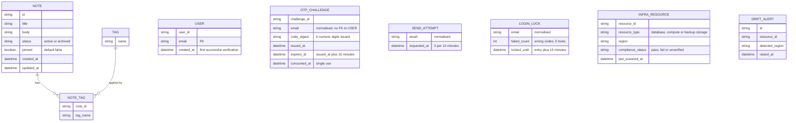

<!-- SECTION: backend.overview | status: DRAFT-UNVERIFIED -->
## 1. Overview

**What the service is.** `notes_api` is the backend service for the team note-taking product. Stack: Node.js 20, Express, PostgreSQL 16, hosted on AWS. [platform.md; feedback.md Preflight answers]

**Responsible for.**

1. **Notes API.** Create, read, edit, pin and unpin (via PATCH), tag, archive, unarchive, list and search notes. [stories.md EP-002, EP-003; requirements.md BR-005 to BR-011, BR-018, BR-019]
2. **Email one-time-code sign-in (CR-129).** This is an additional sign-in method. Existing login methods are unchanged. [requirements.md NFR-016; feedback.md CR-129]
   - Two operations: `POST /auth/otp/send` (request a code) and `POST /auth/otp/verify` (verify a code). [feedback.md, approved BACKEND-SPEC.md]
   - Code: 6 digits, all numeric. [requirements.md BR-029]
   - Expiry: valid 10 minutes from issue. A later submission is rejected as expired. [requirements.md BR-020, BR-024, BR-026]
   - Resend limit: at most 3 code requests within 10 minutes. Requests beyond the limit return 415. [requirements.md BR-021, BR-028, BR-032; stories.md US-004-03]
   - Lockout: after 5 wrong codes the account is locked for 15 minutes. Verification is refused during the lock with a locked-account response. [requirements.md BR-022, BR-025, BR-027, BR-032]
   - During a lock only verification is refused. Requesting a code is not refused, but it stays subject to the resend limit. [requirements.md BR-032]
   - Single use: a code that verified successfully cannot be used again. [requirements.md BR-023]
   - This is an interface change, so consumers are notified and must adapt. [requirements.md NFR-014 to NFR-016]
3. **Published API contract.** The OpenAPI document, its endpoint-coverage metric, the data-residency note and the Scope section. [stories.md EP-004; requirements.md BR-012, BR-013, NFR-008, NFR-009]
4. **Scope guardrail.** Rejection of attachment, real-time and mobile-specific calls, backed by a contract test suite. [stories.md EP-005; requirements.md BR-014 to BR-016, NFR-010, NFR-011]
5. **EU data-residency compliance.** EU-only provisioning of database, compute and backups, a CI/CD residency gate, a compliance report, a launch gate and post-launch drift alerting. [stories.md EP-001; requirements.md BR-001 to BR-004, NFR-001 to NFR-004]

**Not responsible for.**

- Any user interface. The web-app screens in EP-006 belong to the web-app surface. [stories.md US-006-01 to US-006-06]
- Attachment or file-upload endpoints. [requirements.md BR-014]
- Any real-time channel (WebSocket, SSE, polling-push). [requirements.md BR-015]
- Mobile-specific endpoints. [stories.md US-005-01]
- Logging and classifying stakeholder feature requests, which is a product-management process. [requirements.md BR-017]
- Any sign-in method other than email one-time code. The existing authentication is unnamed in every input (`GAP-BE-085`).

**Run notes.**

- `RUN-CONTEXT.run_mode` is `bootstrap` with no `existing` block. The approved revision is supplied inside feedback.md and is used as the baseline, with CR-129 applied (`ASM-BE-026`). Identifiers from that revision keep their numbers.
- The design_brief input is acceptance-criteria text (AC-001-01-01 to AC-002-01-03), not visual design. No Figma input is connected. `spec_mode` is `NOT-APPLICABLE` for a backend run.
- Operation ids are not written in this document. Operations are referred to by method and path, and DevAgent mints their ids.
- **Corrupted rule text.** Five supplied rules carry a clause unrelated to its sentence: BR-030, BR-031, NFR-017, NFR-018 and NFR-019. They are reproduced as supplied and the decision each carries is treated as unanswered.
- **Contradiction check.** Story to design: no contradiction found; the brief supplies ACs for only some stories. Story to requirement: `CON-BE-007`, `CON-BE-151`. Requirement to requirement: `CON-BE-003`, `CON-BE-006`, `CON-BE-011`, `CON-BE-019`, `CON-BE-300`. Design to design: none found.
- **Withdrawn.** `CON-BE-010` (consecutive versus cumulative counting) is recorded as the gap `GAP-BE-024`, with a default in `ASM-BE-305`.
- **Resolved.** BR-032 states that requesting a code is not refused during a lock. That closes the earlier `Q-BE-007`.

**Halting.** Under core rule 10.1 this run ends in `HALT-CRITICAL-CONTRADICTION` and `HALT-BLOCKING-QUESTION`.
- Critical contradictions open: `CON-BE-003`, `CON-BE-006`, `CON-BE-151`, `CON-BE-300`.
- Blocking questions open: `Q-BE-003`, `Q-BE-005`, `Q-BE-012`, `Q-BE-152`, `Q-BE-300`.
- Everything that does not depend on them is written. Dependent parts are marked `BLOCKED` or `DRAFT-UNVERIFIED` in place.

### Open-item register

Each item is defined here once and referenced elsewhere by ID.

| ID | Kind | Statement |
|---|---|---|
| `Q-BE-001` | degradable | Are notes a shared team workspace? Default: yes, any authenticated team member may read and write any note. |
| `Q-BE-003` | blocking | Who may request, verify or receive a login code? BR-030 is corrupted. [BR-030] |
| `Q-BE-005` | blocking | From which AWS region are code emails sent, and may the email address leave the EU? NFR-017 is corrupted. [NFR-017] |
| `Q-BE-012` | blocking | What credential does a successful verification return (body token, cookie or other)? |
| `Q-BE-151` | degradable | Supply the approved EU region list referred to by AC-001-01-01. |
| `Q-BE-152` | blocking | Does a passed launch gate authorise release, or does the Engineering Lead sign off? |
| `Q-BE-153` | degradable | The period of the post-launch residency scan. Default `ASM-BE-153`. |
| `Q-BE-300` | blocking | Is "notes 1 days" in NFR-019 intended? It would delete every note after one day. |
| `CON-BE-003` | Critical | BR-030 and BR-031 leave eligibility and note access open. The shared-workspace default may not hold. Touches an authorisation rule. |
| `CON-BE-006` | Critical | NFR-017 contemplates transmitting the email address outside the EU. BR-001 requires all infrastructure exclusively in approved EU regions, with no exception. Touches a PII path. |
| `CON-BE-007` | non-critical | US-005-02 requires 404 for attachment paths. US-005-04 and BR-016 require a message referencing the scope exclusion, not a bare 404. |
| `CON-BE-011` | non-critical | BR-021 limits "resending" to 3. BR-028, BR-032, US-004-03 and US-006-06 limit "requests" to 3 within 10 minutes. Reading used: every code request counts. |
| `CON-BE-019` | non-critical | The change request is labelled CR-129 (feedback.md), CR-125 (NFR-015, US-006-06, BR-030) and CR-127 (BR-032). Content overlaps. |
| `CON-BE-151` | Critical | BR-003 enforces the launch gate by Engineering Lead sign-off. AC-001-05-01 marks release authorised from the report alone. Touches an authorisation rule. |
| `CON-BE-300` | Critical | NFR-019 as supplied deletes notes after 1 day. BR-007, BR-008 and NFR-005 require that notes are never deleted by archiving and that CRUD has zero data loss. |
| `GAP-BE-001` | gap | US-006-01 to US-006-05 and US-005-06 belong to no backend module. Closing artefact: a decision that backend does not serve them. |
| `GAP-BE-003` | gap | No input relates a note to a user. Closing artefact: answers to `Q-BE-001` and `Q-BE-003`. |
| `GAP-BE-017` | gap | No PII handling policy. Closing artefact: a data-protection policy. |
| `GAP-BE-024` | gap | Whether wrong codes accumulate across challenges or reset on success is not stated. Default `ASM-BE-305`. |
| `GAP-BE-031` | gap | No email normalisation rule. |
| `GAP-BE-033` | gap | No at-rest treatment for stored codes or email addresses. |
| `GAP-BE-035` | gap | No validation rule for email format, code format, tag format or field length. |
| `GAP-BE-038` | gap | The status of the locked-account response is not stated. |
| `GAP-BE-053` | gap | The statuses of the wrong-code, expired-code and already-used-code responses are not stated. |
| `GAP-BE-083` | gap | Whether a new code invalidates earlier unconsumed codes is not stated. |
| `GAP-BE-085` | gap | The existing authentication method is unnamed. |
| `GAP-BE-089` | gap | No ORM, migration tool or other library is named. |
| `GAP-BE-101` | gap | The mechanism that performs retention deletion (scheduler, frequency) is not stated. |
| `GAP-BE-104` | gap | The treatment of email addresses and codes in logs is not stated, because NFR-018 is corrupted. |
| `GAP-BE-300` | gap | No error response envelope is supplied. Proposal `ASM-BE-300`. |
| `GAP-BE-301` | gap | No latency, availability or throughput target for the login operations. |
| `GAP-BE-302` | gap | The credential lifetime is not stated. |
| `GAP-BE-303` | gap | No path is supplied for note by id, tag add/remove, archive, unarchive, the OpenAPI document or the compliance report. |
| `GAP-BE-304` | gap | No encryption-at-rest statement for any data. |
| `GAP-BE-305` | gap | Where scan results and compliance report data are stored is not stated. |
| `GAP-BE-306` | gap | The instant exactly 10 minutes after issue is not classified. BR-024 says "after"; BR-020 and BR-026 say "expires". |
| `GAP-BE-307` | gap | Backup frequency and backup retention period are not stated. |
| `GAP-BE-308` | gap | The alert channel and recipients for drift alerts are not stated beyond "the DevOps team". |
| `GAP-BE-309` | gap | Statuses and choices left open: already-archived conflict (US-002-04), unsupported Accept header (US-004-01), WebSocket and SSE rejection (US-005-03), PUT versus PATCH (US-002-02). |
| `GAP-BE-310` | gap | US-003-01 and BR-019 leave the order within a pinned group undefined. |
| `GAP-BE-500` | gap | The default and maximum page size are not stated. NFR-007 names only "page sizes of 100". |
| `GAP-BE-501` | gap | Log retention and the metrics and alerting tooling are not stated. |
| `ASM-BE-015` | assumption | Email addresses are compared in a normalised form (rule `GAP-BE-031`). |
| `ASM-BE-019` | assumption | An email address is personal data. |
| `ASM-BE-025` | assumption | A User is created on first successful verification, never on code request. |
| `ASM-BE-026` | assumption | The approved revision is the baseline although `run_mode` is `bootstrap`. |
| `ASM-BE-027` | assumption | Email goes through AWS SES. NFR-017 names a transactional email service in an AWS region and the platform is AWS. |
| `ASM-BE-029` | assumption | The resend and lock counters are keyed per normalised email address. |
| `ASM-BE-034` | assumption | `pinned` is `NOT NULL`. |
| `ASM-BE-044` | assumption | The resend window is sliding (trailing 10 minutes). |
| `ASM-BE-153` | assumption | The scan period is no longer than 15 minutes, because NFR-003 requires an alert within 15 minutes of drift detection. |
| `ASM-BE-300` | assumption | The error envelope is the proposal in `backend.error-model`. |
| `ASM-BE-301` | assumption | Error code names other than `OUT_OF_SCOPE` are proposed names. [US-005-04] |
| `ASM-BE-302` | assumption | A role has no permission on an operation unless an input grants it. |
| `ASM-BE-303` | assumption | NFR-019 lists, positionally: code challenges 1 day, send attempts 1 day, account locks 5 days, notes 1 day. |
| `ASM-BE-304` | assumption | No notes_api database exists yet, so migrations start from empty. |
| `ASM-BE-305` | assumption | The wrong-code count is per normalised email, increments on each wrong code, is cleared by a successful verification, and has no time window. |
<!-- /SECTION: backend.overview -->
<!-- SECTION: backend.domain-model | status: DRAFT-UNVERIFIED -->
## 2. Domain model

Three sub-domains are evidenced: note-taking (Note, Tag), login (User, OTP_CHALLENGE, SEND_ATTEMPT, LOGIN_LOCK) and residency compliance (INFRA_RESOURCE, DRIFT_ALERT). Only BR-013 relates them, by saying the infrastructure hosts the note data.

**Entities and ownership.**

- **Note.** Title, body, status (active or archived), `pinned`, created and updated timestamps. [US-002-01 to US-002-06]
  - Title and body are mandatory and non-empty at creation. [BR-005]
  - Archiving never deletes data and is reversible. [BR-007, BR-008]
  - `pinned` is a boolean, default `false`, set on create or PATCH. [BR-018] Nullability is `ASM-BE-034`.
- **Tag.** A name, many-to-many with Note through NOTE_TAG. Adding an existing tag creates no duplicate. [US-002-03] Tag format and the fate of an unused tag are `GAP-BE-035`.
- **User.** A person who has verified an email address (`ASM-BE-025`). `email` is personal data (`ASM-BE-019`). Handling policy is `GAP-BE-017`.
- **OTP_CHALLENGE.** One issued 6-digit numeric code for one email address. [BR-029] It expires 10 minutes after issue and is single-use. [BR-023, BR-024] It is keyed by email, because the user may not exist yet. Storage form is `GAP-BE-033`. Whether a new code invalidates an older one is `GAP-BE-083`.
- **SEND_ATTEMPT.** One record per accepted code request, used to evaluate the limit of 3 within 10 minutes. [BR-028] Keyed per normalised email (`ASM-BE-015`, `ASM-BE-029`). Sliding window (`ASM-BE-044`); the first request counts (`CON-BE-011`).
- **LOGIN_LOCK.** The lock state and wrong-code count for an email, held 15 minutes after 5 wrong codes. [BR-022, BR-025, BR-027] Counting rule: `GAP-BE-024`, `ASM-BE-305`.
- **INFRA_RESOURCE and DRIFT_ALERT.** A provisioned component with its reported region and status. A resource type the scanner does not recognise is flagged `unverified`, never omitted. [US-001-04; AC-001-04-02] Whether these rows live in the notes_api database is `GAP-BE-305`.

**Ownership.** No input relates a note to a user (`GAP-BE-003`). The default is `Q-BE-001`: a shared workspace. `CON-BE-003` (Critical) calls that default into question, so note ownership columns and the note access rule are `BLOCKED` until `Q-BE-003` is answered.

**Invariants.** These hold after every operation on the named entity.

- `INV-BE-001`. In note list and search results, every pinned note precedes every unpinned note. Order within a group is `GAP-BE-310`. [BR-019]
- `INV-BE-002`. A code that has verified successfully is refused on any later verification. [BR-023]
- `INV-BE-003`. A User row is created only on successful verification (`ASM-BE-025`).
- `INV-BE-004`. A code submitted after its issue instant plus 10 minutes is rejected as expired. [BR-024; US-006-06] Boundary: `GAP-BE-306`.
- `INV-BE-005`. While an email is locked, no verification succeeds, including with a correct code, until the lock expires. [BR-022, BR-027]
- `INV-BE-006`. A code request beyond 3 within 10 minutes creates no code and sends no email. [BR-021, BR-028, BR-032]
- `INV-BE-007`. A residency check whose region metadata is missing or unreadable fails and blocks deployment. [AC-001-03-03]
- `INV-BE-008`. A PATCH never overwrites a field it does not contain. [BR-006; US-002-02]
- `INV-BE-009`. Archiving and unarchiving preserve all note data. [BR-007, BR-008]
<!-- /SECTION: backend.domain-model -->
<!-- SECTION: backend.module-map | status: DRAFT-UNVERIFIED -->
## 3. Module map

Six modules. The split follows the epics (EP-001 to EP-005 and CR-129). No input names modules, so the boundaries are derived from the epics.

| Module | Owns | Stories |
|---|---|---|
| `auth` | USER, OTP_CHALLENGE, SEND_ATTEMPT, LOGIN_LOCK; send and verify operations; retention deletion of its records | US-006-06 (backend side), US-004-03 (login responses) |
| `notes` | NOTE, TAG, NOTE_TAG; create, get, edit, tag, archive, unarchive | US-002-01 to US-002-06 |
| `search` | the search operation over notes and tags; pagination and ordering | US-003-01 to US-003-06 |
| `residency-compliance` | INFRA_RESOURCE, DRIFT_ALERT; region validation, scan, report, launch gate, drift alert | US-001-01 to US-001-06 |
| `api-docs` | the published OpenAPI document; coverage metric; data-handling note; Scope section | US-004-01, US-004-02, US-004-04 to US-004-06, US-005-01 |
| `scope-guardrail` | rejection of out-of-scope calls; contract test suite | US-005-02 to US-005-05 |

**Dependency direction.** `A → B` means A depends on B.

| From | To | Reason |
|---|---|---|
| `notes` | `auth` | validates the caller's credential on protected routes. Blocked on `Q-BE-012` and `GAP-BE-085`. |
| `search` | `auth` | same reason |
| `search` | `notes` | read-only access to NOTE and TAG data. `search` never writes. |
| `api-docs` | all other modules | reads each module's operation records to build the document |
| `scope-guardrail` | `api-docs` | the contract test reads the published document. [US-005-05] |
| `residency-compliance` | none | independent of the note-taking and login domains |
| `auth` | none | the User table is not shared with note data (`CON-BE-003`) |

No dependency cycle exists. `auth` and `residency-compliance` have no outbound dependencies.

**Cross-cutting.** The global error envelope is owned by `backend.error-model` and applied by every module. Request logging and redaction are owned by `backend.observability`.

**Unassigned.** US-006-01 to US-006-05 (web-app screens) and US-005-06 (product-management process) belong to no backend module (`GAP-BE-001`).
<!-- /SECTION: backend.module-map -->
<!-- SECTION: backend.api-surface | status: VERIFIED -->
## Api surface

_Rendered by DevAgent from the operation records._

| id | method | path | module | success | errors | summary |
|---|---|---|---|---|---|---|
| `API-APIDOCS-098363` | GET | `/openapi.json` | `api-docs` | 200 | 406 | Return the published OpenAPI document for notes_api. The document carries every endpoint, the data-handling note (EU residency, active and archived notes) and the Scope section listing exclusions (attachments, real-time, mobile-specific). The path is proposed because no input supplies one (GAP-BE-303). An unsupported Accept header is 406 or a fallback (GAP-BE-309), and whether the document is public is undecided. |
| `API-APIDOCS-827943` | GET | `/openapi/coverage` | `api-docs` | 200 | 406 | Return the endpoint-coverage metric for the published OpenAPI document: how many implemented endpoints are documented and how many search and tagging endpoints carry examples. The target is 100% for both. The path is proposed because no input supplies one (GAP-BE-303). Whether it requires authentication is undecided. |
| `API-AUTH-707260` | POST | `/auth/otp/send` | `auth` | 200 | 400, 415 | Request a 6-digit email one-time code for sign-in. Limited to 3 requests within 10 minutes per normalised email; requests beyond the limit return 415 and create no code and send no email. Not refused during an account lock. Does not reveal whether a User exists. |
| `API-AUTH-692907` | POST | `/auth/otp/verify` | `auth` | 200 | 400, 401, 403, 423 | Verify a 6-digit email one-time code. Success consumes the code (single use), creates the User on first successful verification, clears the wrong-code count, and returns a credential (form unresolved, Q-BE-012). Refused during a 15-minute lock after 5 wrong codes, even with a correct code. Wrong, expired and already-used code statuses are not stated in any input (GAP-BE-038, GAP-BE-053). |
| `API-NOTES-232390` | POST | `/notes` | `notes` | 201 | 400, 401, 403, 415 | Create a note with mandatory title and body, optional pinned flag (BR-005, BR-018; US-002-01) |
| `API-NOTES-045877` | GET | `/notes/{id}` | `notes` | 200 | 401, 403, 404 | Get a single note by id, including archived notes (US-002-06) |
| `API-NOTES-847551` | PATCH | `/notes/{id}` | `notes` | 200 | 400, 401, 403, 404 | Partially edit a note; fields not sent are never overwritten, includes pin/unpin via pinned (BR-006, BR-018; US-002-02) |
| `API-NOTES-810640` | POST | `/notes/{id}/archive` | `notes` | 200 | 401, 403, 404, 409 | Archive a note without deleting any data (BR-007; US-002-04) |
| `API-NOTES-359413` | POST | `/notes/{id}/tags` | `notes` | 200 | 400, 401, 403, 404 | Add a tag to a note; adding an existing tag creates no duplicate (US-002-03) |
| `API-NOTES-150096` | DELETE | `/notes/{id}/tags/{tag}` | `notes` | 200 | 401, 403, 404 | Remove a tag from a note (US-002-03) |
| `API-NOTES-917869` | POST | `/notes/{id}/unarchive` | `notes` | 200 | 401, 403, 404 | Restore an archived note to active with all data preserved (BR-008; US-002-05) |
| `API-RESIDENCYCOMPLIANCE-585907` | POST | `/residency/deployment-checks` | `residency-compliance` | 200 | 400, 401, 403 | CI/CD residency gate: evaluate a deployment's resource regions; missing or unreadable region metadata fails the check and blocks deployment (US-001-03, INV-BE-007). Path is proposed (GAP-BE-303). |
| `API-RESIDENCYCOMPLIANCE-047792` | GET | `/residency/drift-alerts` | `residency-compliance` | 200 | 400, 401, 403 | List DRIFT_ALERT records raised when a resource is detected outside the approved EU regions after launch (US-001-06, NFR-003). Alert channel is unresolved (GAP-BE-308). Path is proposed (GAP-BE-303). |
| `API-RESIDENCYCOMPLIANCE-395094` | GET | `/residency/launch-gate` | `residency-compliance` | 200 | 401, 403 | Evaluate the launch gate from the current compliance report (US-001-05). Whether a pass authorises release or needs Engineering Lead sign-off is unresolved (CON-BE-151, Q-BE-152). Path is proposed (GAP-BE-303). |
| `API-RESIDENCYCOMPLIANCE-894798` | GET | `/residency/report` | `residency-compliance` | 200 | 401, 403, 404 | Retrieve the compliance report: EU verification status of every infrastructure component, refreshed at each launch gate check (US-001-04, NFR-004). Path is proposed (GAP-BE-303). |
| `API-RESIDENCYCOMPLIANCE-381444` | GET | `/residency/resources` | `residency-compliance` | 200 | 400, 401, 403 | List INFRA_RESOURCE records with region and compliance status (pass, fail, unverified) (US-001-01, US-001-04). Path is proposed (GAP-BE-303). |
| `API-RESIDENCYCOMPLIANCE-466056` | POST | `/residency/scans` | `residency-compliance` | 202 | 401, 403, 409 | Trigger a residency scan of INFRA_RESOURCE records, flagging unrecognised resource types as unverified (US-001-04). Path is proposed (GAP-BE-303). |
| `API-RESIDENCYCOMPLIANCE-405210` | POST | `/residency/validations` | `residency-compliance` | 200 | 400, 401, 403 | Validate a proposed resource region against the approved EU region list (US-001-01, US-001-02). Path is proposed; no input supplies it (GAP-BE-303). Region list pending Q-BE-151. |
| `API-SEARCH-580505` | GET | `/notes/search` | `search` | 200 | 400, 401, 403, 503 | Search notes by keyword and tags, with pagination and ordering where pinned notes precede unpinned notes |

### `API-APIDOCS-098363` — GET `/openapi.json`

Return the published OpenAPI document for notes_api. The document carries every endpoint, the data-handling note (EU residency, active and archived notes) and the Scope section listing exclusions (attachments, real-time, mobile-specific). The path is proposed because no input supplies one (GAP-BE-303). An unsupported Accept header is 406 or a fallback (GAP-BE-309), and whether the document is public is undecided.

**Request:** none
**Response:** 
- `openapi` (string, required): OpenAPI specification version of the document.
- `info` (object, required): API title, version and description. The description states that notes_api is scoped to notes, search and email one-time-code sign-in.
- `paths` (object, required): All documented endpoints with parameters, request bodies, success responses and error responses (including 401 and 403 for authenticated endpoints). Search and tagging endpoints carry request and response examples.
- `components` (object, required): Reusable schemas, including the error envelope and security schemes.
- `x-data-handling` (object, required): Data-handling note: all note data, active and archived, is stored and served within the EU, and archive endpoints do not differ in storage location. The approved region list is open (Q-BE-151).
- `x-scope` (object, required): Scope section: lists attachment/file-upload, real-time channels (WebSocket, SSE) and mobile-specific endpoints as out of scope, with the message returned when they are called.

### `API-APIDOCS-827943` — GET `/openapi/coverage`

Return the endpoint-coverage metric for the published OpenAPI document: how many implemented endpoints are documented and how many search and tagging endpoints carry examples. The target is 100% for both. The path is proposed because no input supplies one (GAP-BE-303). Whether it requires authentication is undecided.

**Request:** none
**Response:** 
- `total_endpoints` (integer, required): Number of implemented endpoints in notes_api.
- `documented_endpoints` (integer, required): Number of those endpoints present in the published OpenAPI document.
- `coverage_percent` (number, required): Documented endpoints as a percentage of total endpoints. The target is 100.
- `undocumented_endpoints` (array, required): Method and path of each implemented endpoint missing from the document. Empty when coverage is 100%.
- `search_tagging_endpoints_total` (integer, required): Number of search and tagging endpoints.
- `search_tagging_endpoints_with_examples` (integer, required): Number of search and tagging endpoints that carry request and response examples. The target is all of them.

### `API-AUTH-707260` — POST `/auth/otp/send`

Request a 6-digit email one-time code for sign-in. Limited to 3 requests within 10 minutes per normalised email; requests beyond the limit return 415 and create no code and send no email. Not refused during an account lock. Does not reveal whether a User exists.

**Request:** 
- `email` (string, required): Email address to which the one-time code is sent. Personal data; compared in normalised form (ASM-BE-015). Format validation rule is not stated (GAP-BE-035).
**Response:** 
- `message` (string): Human-readable acknowledgement that a code was requested. Identical whether or not a User exists for the address. Response body shape is not supplied in any input; this is a proposal.
- `expires_at` (string): Timestamp at which the issued code expires, 10 minutes after issue (BR-020, BR-024). Proposed field; not stated in any input.

### `API-AUTH-692907` — POST `/auth/otp/verify`

Verify a 6-digit email one-time code. Success consumes the code (single use), creates the User on first successful verification, clears the wrong-code count, and returns a credential (form unresolved, Q-BE-012). Refused during a 15-minute lock after 5 wrong codes, even with a correct code. Wrong, expired and already-used code statuses are not stated in any input (GAP-BE-038, GAP-BE-053).

**Request:** 
- `email` (string, required): Email address the code was issued for; compared in normalised form (ASM-BE-015).
- `code` (string, required): The 6-digit numeric one-time code (BR-029).
**Response:** 
- `credential` (string): Credential returned on successful verification. Its form (body token, cookie or other) and lifetime are unanswered (Q-BE-012, GAP-BE-302); presence in the body is a placeholder pending that answer.

### `API-NOTES-232390` — POST `/notes`

Create a note with mandatory title and body, optional pinned flag (BR-005, BR-018; US-002-01)

**Request:** 
- `title` (string, required): Note title; mandatory and non-empty at creation (BR-005)
- `body` (string, required): Note body; mandatory and non-empty at creation (BR-005)
- `pinned` (boolean): Whether the note is pinned; defaults to false (BR-018)
- `tags` (array): Optional tag names to apply on creation
**Response:** 
- `id` (string, required): Note identifier
- `title` (string, required): Note title
- `body` (string, required): Note body
- `status` (string, required): active or archived; a new note is active
- `pinned` (boolean, required): Pinned flag
- `tags` (array, required): Tag names applied to the note
- `created_at` (string, required): Creation timestamp
- `updated_at` (string, required): Last update timestamp

### `API-NOTES-045877` — GET `/notes/{id}`

Get a single note by id, including archived notes (US-002-06)

**Request:** 
- `id` (string, required): Path parameter: note identifier
**Response:** 
- `id` (string, required): Note identifier
- `title` (string, required): Note title
- `body` (string, required): Note body
- `status` (string, required): active or archived
- `pinned` (boolean, required): Pinned flag
- `tags` (array, required): Tag names applied to the note
- `created_at` (string, required): Creation timestamp
- `updated_at` (string, required): Last update timestamp

### `API-NOTES-847551` — PATCH `/notes/{id}`

Partially edit a note; fields not sent are never overwritten, includes pin/unpin via pinned (BR-006, BR-018; US-002-02)

**Request:** 
- `id` (string, required): Path parameter: note identifier
- `title` (string): New title; omitted means unchanged
- `body` (string): New body; omitted means unchanged
- `pinned` (boolean): Set true to pin, false to unpin; omitted means unchanged
**Response:** 
- `id` (string, required): Note identifier
- `title` (string, required): Note title
- `body` (string, required): Note body
- `status` (string, required): active or archived
- `pinned` (boolean, required): Pinned flag
- `tags` (array, required): Tag names applied to the note
- `created_at` (string, required): Creation timestamp
- `updated_at` (string, required): Last update timestamp

### `API-NOTES-810640` — POST `/notes/{id}/archive`

Archive a note without deleting any data (BR-007; US-002-04)

**Request:** 
- `id` (string, required): Path parameter: note identifier
**Response:** 
- `id` (string, required): Note identifier
- `status` (string, required): archived after success
- `updated_at` (string, required): Last update timestamp

### `API-NOTES-359413` — POST `/notes/{id}/tags`

Add a tag to a note; adding an existing tag creates no duplicate (US-002-03)

**Request:** 
- `id` (string, required): Path parameter: note identifier
- `tag` (string, required): Tag name to add
**Response:** 
- `id` (string, required): Note identifier
- `tags` (array, required): Resulting tag names on the note, without duplicates
- `updated_at` (string, required): Last update timestamp

### `API-NOTES-150096` — DELETE `/notes/{id}/tags/{tag}`

Remove a tag from a note (US-002-03)

**Request:** 
- `id` (string, required): Path parameter: note identifier
- `tag` (string, required): Path parameter: tag name to remove
**Response:** 
- `id` (string, required): Note identifier
- `tags` (array, required): Resulting tag names on the note
- `updated_at` (string, required): Last update timestamp

### `API-NOTES-917869` — POST `/notes/{id}/unarchive`

Restore an archived note to active with all data preserved (BR-008; US-002-05)

**Request:** 
- `id` (string, required): Path parameter: note identifier
**Response:** 
- `id` (string, required): Note identifier
- `status` (string, required): active after success
- `updated_at` (string, required): Last update timestamp

### `API-RESIDENCYCOMPLIANCE-585907` — POST `/residency/deployment-checks`

CI/CD residency gate: evaluate a deployment's resource regions; missing or unreadable region metadata fails the check and blocks deployment (US-001-03, INV-BE-007). Path is proposed (GAP-BE-303).

**Request:** 
- `deployment_id` (string, required): Identifier of the pipeline deployment being checked.
- `resources` (array, required): Resources to check, each with resource_type and region metadata.
**Response:** 
- `passed` (boolean, required): True only if every resource is in an approved EU region.
- `failures` (array, required): Resources that failed, with region and reason, including missing metadata.

### `API-RESIDENCYCOMPLIANCE-047792` — GET `/residency/drift-alerts`

List DRIFT_ALERT records raised when a resource is detected outside the approved EU regions after launch (US-001-06, NFR-003). Alert channel is unresolved (GAP-BE-308). Path is proposed (GAP-BE-303).

**Request:** 
- `resource_id` (string): Filter alerts by resource.
- `raised_since` (string): Only alerts raised at or after this timestamp.
- `page` (integer): Page number; page size undefined (GAP-BE-500).
**Response:** 
- `items` (array, required): Alerts with id, resource_id, detected_region, raised_at.
- `total` (integer): Total matching alerts.

### `API-RESIDENCYCOMPLIANCE-395094` — GET `/residency/launch-gate`

Evaluate the launch gate from the current compliance report (US-001-05). Whether a pass authorises release or needs Engineering Lead sign-off is unresolved (CON-BE-151, Q-BE-152). Path is proposed (GAP-BE-303).

**Request:** none
**Response:** 
- `gate_passed` (boolean, required): Whether the report shows all components compliant.
- `blocking_resources` (array, required): Resources preventing launch; empty when passed.
- `evaluated_at` (string, required): Timestamp of evaluation, after report refresh.

### `API-RESIDENCYCOMPLIANCE-894798` — GET `/residency/report`

Retrieve the compliance report: EU verification status of every infrastructure component, refreshed at each launch gate check (US-001-04, NFR-004). Path is proposed (GAP-BE-303).

**Request:** none
**Response:** 
- `generated_at` (string, required): Timestamp the report was refreshed.
- `resources` (array, required): Each component with region, compliance status and last scan time.
- `summary` (object, required): Counts of pass, fail and unverified components.

### `API-RESIDENCYCOMPLIANCE-381444` — GET `/residency/resources`

List INFRA_RESOURCE records with region and compliance status (pass, fail, unverified) (US-001-01, US-001-04). Path is proposed (GAP-BE-303).

**Request:** 
- `resource_type` (string): Filter by resource type.
- `compliance_status` (string): Filter by pass, fail or unverified.
- `page` (integer): Page number; page size undefined (GAP-BE-500).
**Response:** 
- `items` (array, required): Resources with resource_id, resource_type, region, compliance_status, last_scanned_at.
- `total` (integer): Total matching resources.

### `API-RESIDENCYCOMPLIANCE-466056` — POST `/residency/scans`

Trigger a residency scan of INFRA_RESOURCE records, flagging unrecognised resource types as unverified (US-001-04). Path is proposed (GAP-BE-303).

**Request:** 
- `resource_types` (array): Optional restriction of the scan to given resource types.
**Response:** 
- `scan_id` (string, required): Identifier of the started scan.
- `status` (string, required): Scan state at acceptance.
- `started_at` (string, required): Timestamp the scan was accepted.

### `API-RESIDENCYCOMPLIANCE-405210` — POST `/residency/validations`

Validate a proposed resource region against the approved EU region list (US-001-01, US-001-02). Path is proposed; no input supplies it (GAP-BE-303). Region list pending Q-BE-151.

**Request:** 
- `resource_type` (string, required): Kind of component: database, compute or backup storage.
- `region` (string, required): Region identifier to validate.
- `resource_id` (string): Identifier of an existing INFRA_RESOURCE being validated, if any.
**Response:** 
- `compliant` (boolean, required): Whether the region is an approved EU region.
- `region` (string, required): The region that was evaluated.
- `reason` (string): Explanation when the region is rejected.

### `API-SEARCH-580505` — GET `/notes/search`

Search notes by keyword and tags, with pagination and ordering where pinned notes precede unpinned notes

**Request:** 
- `q` (string): Keyword to match against notes. The parameter name is proposed because no input names it. Invalid values return 400 (US-003-01, US-003-02).
- `tags` (array): Tag names to filter by. The parameter name and encoding are proposed. Tag format is unspecified (GAP-BE-035). A malformed value returns 400 (US-003-02, US-003-04).
- `include_archived` (boolean): Whether archived notes are included in the results. The parameter name comes from the 400 policy in the error model. An invalid value returns 400 (US-003-04).
- `page` (integer): Page number for pagination. The name is proposed. An invalid value returns 400 (US-003-05, BR-011).
- `limit` (integer): Page size. The name is proposed. The default and maximum are unstated (GAP-BE-500); the latency target holds up to page sizes of 100 (NFR-007). An invalid value returns 400 (US-003-05).
**Response:** 
- `items` (array, required): Matching notes for the requested page, in order. Every pinned note precedes every unpinned note (INV-BE-001, BR-019). The order within a group is undefined (GAP-BE-310). Each item shows note fields; their schema is defined by the notes module.
- `page` (integer, required): The page number returned. The name is proposed (US-003-05).
- `limit` (integer, required): The page size applied. The name is proposed (US-003-05).
- `total` (integer): Total number of matching notes across all pages. The field is proposed, and no input requires it (US-003-05).
<!-- /SECTION: backend.api-surface -->
<!-- SECTION: backend.auth-model | status: DRAFT-UNVERIFIED -->
## 5. Auth model

No input defines roles or a credential. The existing authentication is unnamed (`GAP-BE-085`) and what a successful verification returns is `Q-BE-012`. Following `ASM-BE-302`, no actor has a permission that an input does not grant.

**Actors.**

| Actor | Evidence |
|---|---|
| Anonymous caller | calls the send and verify operations before holding a credential. [US-006-06] |
| Authenticated team member | calls the notes and search operations. [US-002-01 to US-003-06] |
| Integration developer, QA engineer | consume the API. They hold no distinct role in any input. |
| Platform/DevOps Engineer, Release/CI Pipeline Owner, Compliance/Security Auditor, Engineering Lead | act on infrastructure and the pipeline. They are not API roles in any input. [US-001-01 to US-001-06] |

Whether an infrastructure actor is an API role is `GAP-BE-085`. These actors are therefore excluded from the matrix below.

**Permission matrix.** Roles are the two API actors above. Operations are named by method and path where an input gives one, otherwise by function (`GAP-BE-303`).

| Resource / operation | Anonymous | Authenticated team member |
|---|---|---|
| Login: `POST /auth/otp/send` | allow (limited per `INV-BE-006`) | allow (same limit) |
| Login: `POST /auth/otp/verify` | allow (lock per `INV-BE-005`) | allow (same lock) |
| Note: create (POST notes endpoint) | deny | allow |
| Note: get by id, edit (PATCH), tag add/remove, archive, unarchive | deny | allow |
| Note: list | deny | allow |
| Search: `GET /notes/search` | deny | allow |
| OpenAPI document | undecided | undecided |
| Compliance report | undecided | undecided |

- The allow entries for the team member rest on `Q-BE-001`. Under `CON-BE-003` the **ownership predicate is `BLOCKED`**: with a per-owner rule a member could act only on their own notes.
- Who may request, verify or receive a code is `BLOCKED` on `Q-BE-003`.
- Whether the OpenAPI document is public is not stated. It is a gap, not a default.
- US-004-03 requires 401 and 403 responses to be documented for authenticated endpoints. The body shape is in `backend.error-model`.

**Credential.** Form (`Q-BE-012`) and lifetime (`GAP-BE-302`) are unanswered. No token format, cookie attribute or signing mechanism is specified.

**No disclosure.** Neither login operation distinguishes an address that has a User from one that does not. This derives from the abuse controls in BR-021 and BR-022 and is not cited in an input.
<!-- /SECTION: backend.auth-model -->
<!-- SECTION: backend.data-lifecycle | status: DRAFT-UNVERIFIED -->
## 6. Data lifecycle

| Data | Stored | Kept | Encrypted at rest | Deleted |
|---|---|---|---|---|
| Notes, tags | PostgreSQL 16 in an EU region [BR-001; US-004-06] | until deleted. Archive is a flag and never deletes. [BR-007] | not stated (`GAP-BE-304`) | **`BLOCKED`**: NFR-019 as supplied reads "notes 1 days" (`CON-BE-300`, `Q-BE-300`). No note deletion is specified. |
| Users | PostgreSQL | not stated | not stated (`GAP-BE-304`) | not stated |
| Code challenges | PostgreSQL | 1 day (`ASM-BE-303`) | not stated (`GAP-BE-033`) | deleted after 1 day. Mechanism `GAP-BE-101`. |
| Send attempts | PostgreSQL | 1 day (`ASM-BE-303`) | not stated | deleted after 1 day |
| Account locks | PostgreSQL | 5 days (`ASM-BE-303`) | not stated | deleted after 5 days. Basis is an `updated_at` instant, proposed in the `auth` module. |
| Residency scan results, drift alerts | location undecided (`GAP-BE-305`) | not stated | not stated | not stated |
| Database backups | EU-region storage only. [US-001-02] | frequency and period `GAP-BE-307` | not stated | not stated |
| Application logs | not stated | not stated (`GAP-BE-501`) | not stated | not stated |

**Residency.** All note data, active and archived, is stored and served within the EU. Archive endpoints are not documented as differing in storage location. [US-004-06; BR-013] The approved region list is `Q-BE-151`.

**Email address.** An email address is personal data (`ASM-BE-019`). Its transport region is `BLOCKED` on `Q-BE-005` and `CON-BE-006`. No claim of encryption, redaction or retention is made beyond what is cited above.

**Retention reading.** NFR-019 is corrupted. The positional reading in `ASM-BE-303` applies to the three login records only. Deleting notes is not specified.
<!-- /SECTION: backend.data-lifecycle -->
<!-- SECTION: backend.nfr | status: DRAFT-UNVERIFIED -->
## 7. Non-functional requirements

Every figure below is cited. Targets with no source are listed as gaps.

| Area | Target | Source |
|---|---|---|
| Search latency | p95 < 300 ms at 50 requests per second | NFR-006; US-003-03 |
| Search at large result sets | p95 < 300 ms maintained up to page sizes of 100 | NFR-007 |
| Search on a large dataset | latency target still met on a dataset of e.g. 100k notes, via indexed lookup | US-003-03 |
| Availability (CRUD and search) | 99.9% uptime monthly | NFR-013 |
| Drift alert | alert fired within 15 minutes of drift detection | NFR-003 |
| Backup config check | fails within 30 seconds on a non-EU destination | AC-001-02-02 |
| EU residency | 100% of infrastructure components EU-verified | NFR-001 |
| Residency gate | 0 non-EU deploys reach production | NFR-002 |
| Compliance report | refreshed and 100% accurate at each launch gate check | NFR-004 |
| CRUD correctness | 100% functional-test pass rate, zero data loss | NFR-005 |
| OpenAPI coverage | 100% endpoint coverage; 100% of search/tagging endpoints with examples | NFR-008, NFR-009 |
| Scope guardrail | 0 out-of-scope endpoints per build; 100% of out-of-scope calls return a documented 4xx | NFR-010, NFR-011 |
| Injection | 0 critical injection vulnerabilities per release | NFR-012 |
| Log redaction | share of log entries holding an unredacted email or code is measured | NFR-018 (treatment `GAP-BE-104`) |
| Retention | share of records older than their period that are deleted is measured | NFR-019 |

**Not stated.**

- Throughput and latency of the login operations (`GAP-BE-301`).
- Availability of the login operations: NFR-013 names CRUD and search only.
- Concurrency beyond 50 requests per second.
- Default and maximum page size (`GAP-BE-500`).
- Search degraded behaviour: US-003-03 requires 503 with a retry-after header when the search index is degraded or unavailable.

No figure is derived or invented.
<!-- /SECTION: backend.nfr -->
<!-- SECTION: backend.error-model | status: DRAFT-UNVERIFIED -->
## 8. Error model

No error envelope is supplied (`GAP-BE-300`). The shape and the code names below are a proposal (`ASM-BE-300`, `ASM-BE-301`), except `OUT_OF_SCOPE` which is cited as an example. [US-005-04]

**Envelope (proposed).** Every non-2xx response has a JSON body with these fields:

| Field | Type | Meaning |
|---|---|---|
| `error.code` | string | a machine-readable code from the registry below |
| `error.message` | string | a human-readable reason |
| `error.details` | array, optional | per-field validation entries |

The envelope never contains an email address, a code or a credential. Responses to the login operations never reveal whether a User exists.

**Status-code policy.**

| Status | Used for | Source |
|---|---|---|
| 400 | validation failure (missing title, bad query parameter, bad page/limit, bad `include_archived`, bad tags, malformed filter combination) | US-002-01, US-003-01 to US-003-06 |
| 401, 403 | authentication / authorisation failure | US-004-03 |
| 404 | note not found (edit, unarchive, get) | US-002-02, US-002-05, US-002-06 |
| 415 | multipart/form-data with a file payload to a notes endpoint | US-005-02 |
| 415 | `POST /auth/otp/send` beyond 3 requests within 10 minutes | BR-028; US-004-03 |
| 503 with a retry-after header | search index degraded or unavailable | US-003-03 |
| locked-account response | verify while locked | BR-027; status `GAP-BE-038` |
| wrong, expired, already-used code | verify refused | statuses `GAP-BE-053` |
| already-archived conflict | archive of an archived note | US-002-04; status `GAP-BE-309` |
| out-of-scope call | message referencing the scope exclusion | US-005-04; BR-016; versus bare 404 `CON-BE-007` |

Status 415 is shared between the file-upload rejection and the resend limit. Clients must discriminate on `error.code`, never on the status alone.

**Error-code registry (proposed names unless marked).**

| Code | Used for |
|---|---|
| `VALIDATION_ERROR` | 400 on invalid input |
| `UNAUTHENTICATED` | 401 |
| `FORBIDDEN` | 403 |
| `NOT_FOUND` | 404 |
| `OUT_OF_SCOPE` (cited) | out-of-scope endpoint or file upload |
| `OTP_SEND_LIMIT_EXCEEDED` | 415 on send beyond the limit |
| `OTP_ACCOUNT_LOCKED` | verify refused during a lock |
| `OTP_CODE_INVALID` | wrong code |
| `OTP_CODE_EXPIRED` | code older than 10 minutes |
| `OTP_CODE_USED` | code already consumed |
| `NOTE_ALREADY_ARCHIVED` | archive of an archived note |
| `SEARCH_UNAVAILABLE` | 503 |

**Open.**

- Statuses of the verify refusals: `GAP-BE-038`, `GAP-BE-053`.
- Whether a code request while locked, or a verify with no challenge, has its own code: not stated.
- Behaviour when the email transport fails: not stated in any input.
- Unsupported Accept header: 406 or fallback (`GAP-BE-309`).
<!-- /SECTION: backend.error-model -->
<!-- SECTION: backend.observability | status: BLOCKED -->
## Observability

**BLOCKED.** the run did not produce this section. Nothing has been written in its place, and no claim about it should be read into this document.

This section is required by the surface's template and was not produced. It is emitted blocked rather than omitted: a missing section is invisible, a blocked one is a work item.
<!-- /SECTION: backend.observability -->
<!-- SECTION: backend.migration-plan | status: DRAFT-UNVERIFIED -->
## 10. Migration plan

No notes_api database exists yet, so migrations start from empty (`ASM-BE-304`). No migration tool is named (`GAP-BE-089`). Column types and constraints are in the module specs and are not restated here.

| Order | Migration | Contents | Reversible | Status |
|---|---|---|---|---|
| 001 | notes | NOTE, TAG, NOTE_TAG tables and indexes | Yes while empty (drop tables). Once rows exist, rollback destroys note data, which conflicts with zero data loss [NFR-005]; rollback after launch is not permitted. | Ownership columns `BLOCKED` on `CON-BE-003`, `Q-BE-003` |
| 002 | search support | indexes serving keyword and tag lookup [NFR-006; US-003-03] | Yes (drop indexes) | Index type is not stated |
| 003 | auth | users, otp_challenges, send_attempts, login_locks | Yes while empty. Once rows exist, rollback discards login state only; no note data. | Encryption of `code_digest` `GAP-BE-033` |
| 004 | residency | INFRA_RESOURCE, DRIFT_ALERT | Yes (drop tables) | `BLOCKED` on `GAP-BE-305` (location of this data) |
| 005 | retention | scheduled deletion of login records | Yes (remove the schedule). Deleted rows cannot be restored. | Mechanism `GAP-BE-101`; notes deletion `BLOCKED` on `CON-BE-300` |

**Ordering.** 001 precedes 002. 003 and 004 depend on nothing and may follow 001 in any order. 005 follows 003. If `users` is later related to notes (`Q-BE-003`), that is a new migration after 003 and is not drafted.

**Not specified.** Backfills, data seeds, zero-downtime strategy, and the environment in which migrations run. No input states any of them.
<!-- /SECTION: backend.migration-plan -->
<!-- SECTION: backend.coverage | status: DERIVED -->
## 11. Coverage

Every supplied story is mapped to the module that covers it. Requirement ids in the `auth` module are cited. Requirement ids for the other modules are defined in their module specs. Acceptance detail comes from stories.md and requirements.md.

| Story | Module | Requirements / rules | Status |
|---|---|---|---|
| US-001-01 | residency-compliance | BR-001; AC-001-01-01, AC-001-01-02 | covered; region list `Q-BE-151` |
| US-001-02 | residency-compliance | BR-001; AC-001-02-01, AC-001-02-02 | covered; backup frequency `GAP-BE-307` |
| US-001-03 | residency-compliance | BR-002; NFR-002; `INV-BE-007` | covered |
| US-001-04 | residency-compliance | NFR-004; AC-001-04-01, AC-001-04-02 | covered; storage `GAP-BE-305` |
| US-001-05 | residency-compliance | BR-003; AC-001-05-01, AC-001-05-02 | covered; `CON-BE-151`, `Q-BE-152` |
| US-001-06 | residency-compliance | BR-004; NFR-003 | covered; channel `GAP-BE-308` |
| US-002-01 | notes | BR-005, BR-018 | covered |
| US-002-02 | notes | BR-006, BR-018; `INV-BE-008` | covered; PUT versus PATCH `GAP-BE-309` |
| US-002-03 | notes | tagging rules in US-002-03 | covered; tag format `GAP-BE-035` |
| US-002-04 | notes | BR-007; `INV-BE-009` | covered; conflict status `GAP-BE-309` |
| US-002-05 | notes | BR-008; `INV-BE-009` | covered |
| US-002-06 | notes | US-002-06 acceptance criteria | covered |
| US-003-01 | search | BR-019; `INV-BE-001` | covered; within-group order `GAP-BE-310` |
| US-003-02 | search | BR-010 | covered; tag format `GAP-BE-035` |
| US-003-03 | search | NFR-006 | covered |
| US-003-04 | search | BR-010 | covered |
| US-003-05 | search | BR-011; NFR-007 | covered; page size `GAP-BE-500` |
| US-003-06 | search | BR-009 | covered |
| US-004-01 | api-docs | BR-012; NFR-008, NFR-016 | covered; Accept header `GAP-BE-309` |
| US-004-02 | api-docs | BR-012 | covered |
| US-004-03 | api-docs, auth | `backend.error-model`; BR-028, BR-032 | covered; statuses `GAP-BE-038`, `GAP-BE-053` |
| US-004-04 | api-docs | NFR-008 | covered |
| US-004-05 | api-docs | NFR-009 | covered |
| US-004-06 | api-docs | BR-013 | covered |
| US-005-01 | api-docs | BR-014 to BR-016 | covered |
| US-005-02 | scope-guardrail | BR-014; NFR-010 | covered; `CON-BE-007` |
| US-005-03 | scope-guardrail | BR-015 | covered; status `GAP-BE-309` |
| US-005-04 | scope-guardrail | BR-016; NFR-011 | covered; `CON-BE-007` |
| US-005-05 | scope-guardrail | NFR-010 | covered |
| US-005-06 | none | BR-017 | **uncovered**: a product-management process (`GAP-BE-001`) |
| US-006-01 | none | | **uncovered**: web-app screen (`GAP-BE-001`) |
| US-006-02 | none | | **uncovered**: web-app screen (`GAP-BE-001`) |
| US-006-03 | none | | **uncovered**: web-app screen (`GAP-BE-001`) |
| US-006-04 | none | | **uncovered**: web-app screen (`GAP-BE-001`) |
| US-006-05 | none | | **uncovered**: web-app screen (`GAP-BE-001`) |
| US-006-06 | auth | BE-AUTH-FR-001, BE-AUTH-FR-002, BE-AUTH-FR-005, BE-AUTH-FR-008, BE-AUTH-FR-009 | covered for the backend operations; screens belong to web-app. Open: `Q-BE-003`, `Q-BE-005`, `Q-BE-012`. |

**Totals.** 36 stories: 30 covered, 6 uncovered. The 6 uncovered stories are not backend responsibilities. The closing artefact for all six is a decision that backend does not serve them.
<!-- /SECTION: backend.coverage -->
<!-- SECTION: backend.lane-needs | status: VERIFIED -->
## Lane needs

### Needs this lane raised

| Need | Kind | What is needed | Why | Blocking | Waiting sections |
|---|---|---|---|---|---|
| `HANDOFF-NOTESAPI-059724` | `business_rule` | Restate BR-030 (corrupted text): who may request, verify or receive an email login code, and whether notes are owned per user or shared across the team (Q-BE-003, Q-BE-001). | Eligibility and the note access predicate are blocked. The ownership columns, the authorisation matrix and the login operations depend on this answer. | yes | `backend.overview`, `backend.domain-model`, `backend.auth-model`, `backend.api-surface`, `backend.coverage` |
<!-- /SECTION: backend.lane-needs -->
