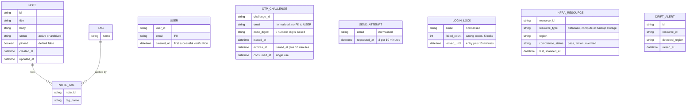

<!-- SECTION: backend.overview | status: DRAFT-UNVERIFIED -->
## 1. Overview

**What the service is.** `notes_api` is the backend for the team note-taking product. Stack: Node.js 20, Express, PostgreSQL 16, hosted on AWS. [platform.md; feedback.md Preflight answers]

**Responsible for.**

1. **Notes API.** Create, read, edit, pin and unpin (via PATCH), tag, archive, unarchive, list and search notes. [stories.md EP-002, EP-003; requirements.md BR-005 to BR-011, BR-018, BR-019]
2. **Email one-time-code sign-in (CR-130).** This is an additive sign-in method. Existing login methods are unchanged. [requirements.md NFR-016; feedback.md CR-130]
   - Two operations: `POST /auth/otp/send` (request a code) and `POST /auth/otp/verify` (verify a code). The paths come from the approved revision in feedback.md (`ASM-BE-026`).
   - The code has 6 digits, all numeric. [BR-029]
   - A code is valid for 10 minutes from issue. A later submission is rejected as expired. [BR-020, BR-024, BR-026]
   - At most 3 code requests are accepted within 10 minutes. Requests beyond that return 415. [BR-021, BR-028, BR-032; US-004-03]
   - After 5 wrong codes the account is locked for 15 minutes, and all verification is refused during the lock. [BR-022, BR-025, BR-027, BR-032]
   - Requesting a code is not refused during a lock, but it remains subject to the resend limit. [BR-032]
   - A code that has verified successfully cannot be used again. [BR-023]
   - Verify answers a locked account, a wrong code, an expired code and an already-used code each with 415. [BR-033] See `backend.error-model`.
   - This is an interface change. Consumers are notified and must adapt. [NFR-014 to NFR-016]
3. **Published API contract.** The OpenAPI document, its endpoint-coverage metric, the data-handling note (EU residency) and the Scope section. [EP-004; BR-012, BR-013, NFR-008, NFR-009]
4. **Scope guardrail.** Rejection of attachment, real-time and mobile-specific calls, backed by a contract test suite. [EP-005; BR-014 to BR-016, NFR-010, NFR-011]
5. **EU data-residency compliance.** EU-only provisioning of database, compute and backups, a CI/CD residency gate, a compliance report, a launch gate and post-launch drift alerting. [EP-001; BR-001 to BR-004, NFR-001 to NFR-004]

**Not responsible for.**

- Any user interface. The web-app screens US-006-01 to US-006-06 are the web-app surface's. [stories.md EP-006]
- Attachment or file-upload endpoints [BR-014], real-time channels [BR-015], and mobile-specific endpoints [US-005-01].
- Logging and classifying stakeholder feature requests, which is a product-management process. [BR-017]
- Any sign-in method other than email one-time code. The existing authentication is unnamed in every input (`GAP-BE-085`).

**Run notes.**

- `run_mode` is `bootstrap` with no `existing` block. The approved revision appears only as excerpts inside feedback.md, and those excerpts are truncated. Identifiers visible there keep their numbers. All sections are rewritten here from the inputs (`ASM-BE-026`). `spec_mode` is `NOT-APPLICABLE`.
- design_brief.md holds acceptance criteria (AC-001-01-01 to AC-002-01-03), not visual design. Figma is not connected.
- Operation ids are not written here. Operations are referred to by method and path, and DevAgent mints their ids.
- **Changes against the approved revision, driven by the current inputs.**
  - NFR-019 now says notes are not deleted by retention (archived notes follow BR-007 and BR-008). The approved revision carried a corrupted "notes 1 days" reading. `CON-BE-300` and `Q-BE-300` are therefore closed by input.
  - BR-033 supplies the verify refusal statuses (415). `GAP-BE-038` and `GAP-BE-053` are closed. The revision's proposed 423 and 401 for these cases are superseded.
  - BR-033's expiry-boundary clause is corrupted, so `GAP-BE-306` stays open.
- **Corrupted rule text.** These supplied rules carry a clause unrelated to their sentence: BR-030, BR-031, BR-033 (boundary clause only), NFR-017 and NFR-018. BR-027 is garbled but its meaning is readable and agrees with BR-022. They are reproduced as supplied and the decision each carries is treated as unanswered.
- **Contradiction check.**
  - Story to design: none found. The brief supplies ACs for US-001-01 to US-001-06 and US-002-01 only.
  - Story to requirement: `CON-BE-007`, `CON-BE-151`.
  - Requirement to requirement: `CON-BE-003`, `CON-BE-006`, `CON-BE-011`, `CON-BE-019`.
  - Design to design: none found.
- **Inbound handoffs.** Three are listed: HANDOFF-WEBAPP-163212, HANDOFF-WEBAPP-200601 and HANDOFF-WEBAPP-743710. Their content was not supplied to this run, so none could be read or answered (`GAP-BE-602`).
- **Outbound needs, for the web-app surface.**
  - Five login refusals share status 415, so the only discriminator is the error code (`backend.error-model`).
  - The credential returned on success is undecided (`Q-BE-012`).
  - Both appear in the lane-needs record.

**Halting.** Under core rule 10.1 this run ends in `HALT-CRITICAL-CONTRADICTION` and `HALT-BLOCKING-QUESTION`.
- Critical contradictions open: `CON-BE-003`, `CON-BE-006`, `CON-BE-151`.
- Blocking questions open: `Q-BE-003`, `Q-BE-005`, `Q-BE-012`, `Q-BE-152`.
- Everything not dependent on them is written. Dependent parts are `BLOCKED` or `DRAFT-UNVERIFIED` in place.

### Open-item register

Each item is defined here once and referenced elsewhere by ID.

| ID | Kind | Statement |
|---|---|---|
| `Q-BE-001` | degradable | Are notes a shared team workspace? Default: yes, any authenticated team member may read and write any note. |
| `Q-BE-003` | blocking | Who may request, verify or receive a login code? BR-030 is corrupted. |
| `Q-BE-005` | blocking | From which AWS region are code emails sent, and may the email address leave the EU? NFR-017 is corrupted. |
| `Q-BE-012` | blocking | What credential does a successful verification return (body token, cookie or other)? |
| `Q-BE-151` | degradable | Supply the approved EU region list referred to by AC-001-01-01. |
| `Q-BE-152` | blocking | Does a passed launch gate authorise release, or does the Engineering Lead sign off? |
| `Q-BE-153` | degradable | The period of the post-launch residency scan. Default `ASM-BE-153`. |
| `CON-BE-003` | Critical | BR-030 and BR-031 leave login eligibility and note access open. The shared-workspace default may not hold. Touches an authorisation rule. |
| `CON-BE-006` | Critical | NFR-017 contemplates sending the email address outside the EU. BR-001 requires all infrastructure exclusively in approved EU regions, with no exception. Touches a PII path. |
| `CON-BE-007` | non-critical | US-005-02 requires 404 for attachment paths. US-005-04 and BR-016 require a message referencing the scope exclusion, not a bare 404. |
| `CON-BE-011` | non-critical | BR-021 limits "resending" to 3. BR-028, BR-032, US-004-03 and US-006-06 limit "requests" to 3 within 10 minutes. Reading used: every code request counts. |
| `CON-BE-019` | non-critical | The login change is labelled CR-130 (feedback.md), CR-129 (approved revision), CR-125 (NFR-015, US-006-06, BR-030) and CR-127 (BR-032). Content overlaps. |
| `CON-BE-151` | Critical | BR-003 enforces the launch gate by Engineering Lead sign-off. AC-001-05-01 marks release authorised from the report alone. Touches an authorisation rule. |
| `GAP-BE-001` | gap | US-006-01 to US-006-05 and US-005-06 belong to no backend module. Closing artefact: a decision that backend does not serve them. |
| `GAP-BE-003` | gap | No input relates a note to a user. Closing artefact: answers to `Q-BE-001` and `Q-BE-003`. |
| `GAP-BE-017` | gap | No PII handling policy. Closing artefact: a data-protection policy. |
| `GAP-BE-024` | gap | Whether wrong codes accumulate across challenges or reset on success is not stated. Default `ASM-BE-305`. |
| `GAP-BE-031` | gap | No email normalisation rule. |
| `GAP-BE-033` | gap | No at-rest treatment for stored codes or email addresses. |
| `GAP-BE-035` | gap | No validation rule for email format, code format, tag format or field length. |
| `GAP-BE-083` | gap | Whether a new code invalidates earlier unconsumed codes is not stated. |
| `GAP-BE-085` | gap | The existing authentication method is unnamed. |
| `GAP-BE-089` | gap | No ORM, migration tool or other library is named. |
| `GAP-BE-101` | gap | The mechanism that performs retention deletion (scheduler, frequency) is not stated. |
| `GAP-BE-104` | gap | The treatment of email addresses and codes in logs is not stated, because NFR-018 is corrupted. |
| `GAP-BE-300` | gap | No error response envelope is supplied. Proposal `ASM-BE-300`. |
| `GAP-BE-301` | gap | No latency, availability or throughput target for the login operations. |
| `GAP-BE-302` | gap | The credential lifetime is not stated. |
| `GAP-BE-303` | gap | No path is supplied for note by id, tag add/remove, archive, unarchive, the OpenAPI document or the compliance report. |
| `GAP-BE-304` | gap | No encryption-at-rest statement for any data. |
| `GAP-BE-305` | gap | Where scan results and compliance report data are stored is not stated. |
| `GAP-BE-306` | gap | The instant exactly 10 minutes after issue is not classified. BR-024 says "after"; BR-020 and BR-026 say "expires"; BR-033's boundary clause is corrupted. |
| `GAP-BE-307` | gap | Backup frequency and backup retention period are not stated. |
| `GAP-BE-308` | gap | The alert channel and recipients for drift alerts are not stated beyond "the DevOps team". |
| `GAP-BE-309` | gap | Statuses and choices left open: already-archived conflict (US-002-04), unsupported Accept header (US-004-01), WebSocket and SSE rejection (US-005-03), PUT versus PATCH (US-002-02), concurrent PATCH outcome (US-005-03). |
| `GAP-BE-310` | gap | US-003-01 and BR-019 leave the order within a pinned group undefined beyond "unchanged". |
| `GAP-BE-500` | gap | The default and maximum page size are not stated. NFR-007 names only page sizes of 100. |
| `GAP-BE-501` | gap | Log retention and the metrics and alerting tooling are not stated. |
| `GAP-BE-600` | gap | Retention of User rows is not stated. NFR-019 covers challenges, send attempts and locks only. |
| `GAP-BE-601` | gap | When several verify refusals apply at once (locked, expired, used, wrong), which error code is returned is not stated. |
| `GAP-BE-602` | gap | The content of the three inbound handoffs was not supplied. Closing artefact: the three handoff files. |
| `GAP-BE-603` | gap | The clock that starts NFR-019 retention (issue time, last update) is not stated. |
| `GAP-BE-604` | gap | The success status and body of the send and verify operations are not stated. |
| `ASM-BE-015` | assumption | Email addresses are compared in a normalised form (`GAP-BE-031`). |
| `ASM-BE-019` | assumption | An email address is personal data. |
| `ASM-BE-025` | assumption | A User is created on first successful verification, never on code request. |
| `ASM-BE-026` | assumption | The approved revision, visible only as truncated excerpts in feedback.md, is the baseline although `run_mode` is `bootstrap`. |
| `ASM-BE-027` | assumption | Email goes through AWS SES. NFR-017 names a transactional email service in an AWS region and the platform is AWS. |
| `ASM-BE-029` | assumption | The resend and lock counters are keyed per normalised email address. |
| `ASM-BE-034` | assumption | `pinned` is `NOT NULL`. |
| `ASM-BE-044` | assumption | The resend window is sliding (trailing 10 minutes). |
| `ASM-BE-153` | assumption | The scan period is no longer than 15 minutes, because NFR-003 requires an alert within 15 minutes of drift detection. |
| `ASM-BE-300` | assumption | The error envelope is the proposal in `backend.error-model`. |
| `ASM-BE-301` | assumption | Error code names other than `OUT_OF_SCOPE` are proposed names. [US-005-04] |
| `ASM-BE-302` | assumption | A role has no permission on an operation unless an input grants it. |
| `ASM-BE-303` | assumption | NFR-019 lists, positionally: code challenges 1 day, send attempts 1 day, account locks 5 days. Notes are not deleted. |
| `ASM-BE-304` | assumption | No notes_api database exists yet, so migrations start from empty. |
| `ASM-BE-305` | assumption | The wrong-code count is per normalised email, increments on each wrong code, is cleared by a successful verification, and has no time window. |
| `ASM-BE-400` | assumption | No response distinguishes an email that has a User from one that has none. |
<!-- /SECTION: backend.overview -->
<!-- SECTION: backend.domain-model | status: DRAFT-UNVERIFIED -->
## 2. Domain model

Three sub-domains are evidenced: note-taking (Note, Tag), login (User, OTP_CHALLENGE, SEND_ATTEMPT, LOGIN_LOCK) and residency compliance (INFRA_RESOURCE, DRIFT_ALERT). Only BR-013 relates them, by saying the infrastructure hosts the note data.

**Entities and ownership.**

- **Note.** Title, body, status (active or archived), `pinned`, created and updated timestamps. [US-002-01 to US-002-06]
  - Title and body are mandatory and non-empty at creation. [BR-005]
  - Archiving never deletes data and is reversible. [BR-007, BR-008]
  - `pinned` is a boolean, default `false`, set on create or PATCH. [BR-018] Nullability is `ASM-BE-034`.
- **Tag.** A name, many-to-many with Note through NOTE_TAG. Adding an existing tag creates no duplicate. [US-002-03] Tag format is `GAP-BE-035`.
- **User.** A person who has verified an email address (`ASM-BE-025`). `email` is personal data (`ASM-BE-019`). Handling policy is `GAP-BE-017`. Retention is `GAP-BE-600`.
- **OTP_CHALLENGE.** One issued 6-digit numeric code for one email address. [BR-029] It expires 10 minutes after issue and is single-use. [BR-023, BR-024] It is keyed by email because the user may not exist yet. Storage form is `GAP-BE-033`. Whether a new code invalidates an older one is `GAP-BE-083`.
- **SEND_ATTEMPT.** One record per accepted code request, used to evaluate the limit of 3 within 10 minutes. [BR-028] Keyed per normalised email (`ASM-BE-015`, `ASM-BE-029`). Sliding window (`ASM-BE-044`). The first request counts (`CON-BE-011`).
- **LOGIN_LOCK.** The lock state and wrong-code count for an email, held 15 minutes after 5 wrong codes. [BR-022, BR-025, BR-027] Counting rule: `GAP-BE-024`, `ASM-BE-305`.
- **INFRA_RESOURCE and DRIFT_ALERT.** A provisioned component with its reported region and status. A resource type the scanner does not recognise is flagged `unverified`, never omitted. [AC-001-04-02] Whether these rows live in the notes_api database is `GAP-BE-305`.

**Ownership.** No input relates a note to a user (`GAP-BE-003`). The default is `Q-BE-001`, a shared workspace. `CON-BE-003` (Critical) calls that default into question, so note ownership columns and the note access rule are `BLOCKED` until `Q-BE-003` is answered.

**Invariants.** Each holds after every operation on the named entity.

- `INV-BE-001`. In note list and search results, every pinned note precedes every unpinned note. Order within a group is `GAP-BE-310`. [BR-019]
- `INV-BE-002`. A code that has verified successfully is refused on any later verification, including under concurrent submission. [BR-023]
- `INV-BE-003`. A User row is created only on successful verification (`ASM-BE-025`).
- `INV-BE-004`. A code submitted after its issue instant plus 10 minutes is rejected as expired. [BR-024; US-006-06] Boundary: `GAP-BE-306`.
- `INV-BE-005`. While an email is locked, no verification succeeds, including with a correct code, until the lock expires. [BR-022, BR-027]
- `INV-BE-006`. A code request beyond 3 within 10 minutes creates no code and sends no email. [BR-021, BR-028, BR-032]
- `INV-BE-007`. A residency check whose region metadata is missing or unreadable fails and blocks deployment. [AC-001-03-03]
- `INV-BE-008`. A PATCH never overwrites a field it does not contain. [BR-006; US-002-02]
- `INV-BE-009`. Archiving and unarchiving preserve all note data. [BR-007, BR-008; NFR-019]
<!-- /SECTION: backend.domain-model -->
<!-- SECTION: backend.module-map | status: DRAFT-UNVERIFIED -->
## 3. Module map

Six modules. No input names modules, so the boundaries are derived from the epics and the login change.

| Module | Owns | Stories |
|---|---|---|
| `auth` | USER, OTP_CHALLENGE, SEND_ATTEMPT, LOGIN_LOCK; send and verify operations; retention deletion of its records | US-006-06 (backend side), US-004-03 (login responses) |
| `notes` | NOTE, TAG, NOTE_TAG; create, get, edit, tag, archive, unarchive | US-002-01 to US-002-06 |
| `search` | the search operation over notes and tags; pagination and ordering | US-003-01 to US-003-06 |
| `residency-compliance` | INFRA_RESOURCE, DRIFT_ALERT; region validation, scan, report, launch gate, drift alert | US-001-01 to US-001-06 |
| `api-docs` | the published OpenAPI document; coverage metric; data-handling note; Scope section | US-004-01, US-004-02, US-004-04 to US-004-06, US-005-01 |
| `scope-guardrail` | rejection of out-of-scope calls; contract test suite | US-005-02 to US-005-05 |

**Dependency direction.** `A → B` means A depends on B.

| From | To | Reason |
|---|---|---|
| `notes` | `auth` | validates the caller's credential on protected routes. Blocked on `Q-BE-012` and `GAP-BE-085`. |
| `search` | `auth` | same reason |
| `search` | `notes` | read-only access to NOTE and TAG data. `search` never writes. |
| `api-docs` | all other modules | reads each module's operation records to build the document |
| `scope-guardrail` | `api-docs` | the contract test reads the published document. [US-005-05] |
| `residency-compliance` | none | independent of the note-taking and login domains |
| `auth` | none | the User table is not shared with note data (`CON-BE-003`) |

No dependency cycle exists. `auth` and `residency-compliance` have no outbound dependencies.

**Cross-cutting.** The global error envelope is owned by `backend.error-model` and applied by every module. Logging and redaction are owned by `backend.observability`.

**Unassigned.** US-006-01 to US-006-05 (web-app screens) and US-005-06 (product-management process) belong to no backend module (`GAP-BE-001`).
<!-- /SECTION: backend.module-map -->
<!-- SECTION: backend.api-surface | status: VERIFIED -->
## Api surface

_Rendered by DevAgent from the operation records._

| id | method | path | module | success | errors | summary |
|---|---|---|---|---|---|---|
| `API-APIDOCS-098363` | GET | `/openapi.json` | `api-docs` | 200 | 406 | Fetch the published OpenAPI document for notes_api. The document covers every endpoint, with examples for search and tagging endpoints. It also carries the data-handling note (EU residency of active and archived note data) and the Scope section (attachments, real-time and mobile-specific calls excluded). The path is proposed because no input supplies one (GAP-BE-303). |
| `API-AUTH-707260` | POST | `/auth/otp/send` | `auth` | 200 | 400, 415, 500, 503 | Request a 6-digit email one-time code for sign-in. Accepts at most 3 requests per email within a trailing 10 minutes (every request counts); further requests return 415 and create no code and send no email. Not refused during an account lock, but still subject to the resend limit. Response must not reveal whether the email has a User. |
| `API-AUTH-692907` | POST | `/auth/otp/verify` | `auth` | 200 | 400, 415, 500 | Verify a 6-digit email one-time code. A correct, unexpired, unused code on an unlocked account succeeds, consumes the code (single use, safe under concurrent submission) and creates the User on first successful verification. Locked account (15 minutes after 5 wrong codes), wrong code, expired code (older than 10 minutes) and already-used code are each refused with 415, distinguished only by the error code. Success status and credential returned are not fixed by inputs (GAP-BE-604, Q-BE-012). |
| `API-NOTES-232390` | POST | `/notes` | `notes` | 201 | 400, 401, 403 | Create a note with a mandatory non-empty title and body, optionally pinned (US-002-01, BR-005, BR-018) |
| `API-NOTES-045877` | GET | `/notes/{id}` | `notes` | 200 | 401, 403, 404 | Get a single note by id, including archived notes (US-002-06) |
| `API-NOTES-847551` | PATCH | `/notes/{id}` | `notes` | 200 | 400, 401, 403, 404 | Partially edit a note; fields not sent are never overwritten (US-002-02, BR-006, BR-018) |
| `API-NOTES-810640` | POST | `/notes/{id}/archive` | `notes` | 200 | 401, 403, 404, 409 | Archive a note without deleting data (US-002-04, BR-007) |
| `API-NOTES-359413` | POST | `/notes/{id}/tags` | `notes` | 200 | 400, 401, 403, 404 | Add a tag to a note; an existing tag creates no duplicate (US-002-03) |
| `API-NOTES-150096` | DELETE | `/notes/{id}/tags/{name}` | `notes` | 200 | 401, 403, 404 | Remove a tag from a note (US-002-03) |
| `API-NOTES-917869` | POST | `/notes/{id}/unarchive` | `notes` | 200 | 401, 403, 404 | Restore an archived note to active with all data preserved (US-002-05, BR-008) |
| `API-RESIDENCYCOMPLIANCE-047792` | GET | `/residency/drift-alerts` | `residency-compliance` | 200 | 400, 401, 403 | List drift alerts raised when a resource is detected outside approved EU regions, to be raised within 15 minutes of detection (NFR-003). Alert channel and recipients are open (GAP-BE-308). Proposed path (GAP-BE-303). |
| `API-RESIDENCYCOMPLIANCE-395094` | GET | `/residency/launch-gate` | `residency-compliance` | 200 | 401, 403, 503 | Evaluate the launch gate from the current compliance report. Read-only. Whether a pass authorises release or Engineering Lead sign-off is required is unresolved (CON-BE-151, Q-BE-152), so no sign-off operation is defined. Proposed path (GAP-BE-303). |
| `API-RESIDENCYCOMPLIANCE-894798` | GET | `/residency/report` | `residency-compliance` | 200 | 401, 403, 503 | Return the residency compliance report covering all infrastructure components, refreshed at each request so it is accurate at launch gate checks (NFR-004). Proposed path (GAP-BE-303); storage of report data is open (GAP-BE-305). |
| `API-RESIDENCYCOMPLIANCE-381444` | GET | `/residency/resources` | `residency-compliance` | 200 | 400, 401, 403 | List inventoried infrastructure resources with region, compliance status and last scan time. Resource types the scanner does not recognise appear with status unverified (AC-001-04-02). Proposed path (GAP-BE-303). |
| `API-RESIDENCYCOMPLIANCE-466056` | POST | `/residency/scans` | `residency-compliance` | 202 | 400, 401, 403, 404, 409, 503 | Trigger a residency scan of provisioned infrastructure, recording region and compliance status per resource. Proposed path (GAP-BE-303). Drift alerts are raised for any resource found outside approved regions. |
| `API-RESIDENCYCOMPLIANCE-405210` | POST | `/residency/validations` | `residency-compliance` | 200 | 400, 401, 403, 503 | Validate a resource's declared region against the approved EU region list (CI/CD residency gate and provisioning check). Proposed path (GAP-BE-303); approved region list pending (Q-BE-151). A violation is reported in the body, as pipeline failure handling is outside HTTP. |
| `API-SEARCH-580505` | GET | `/notes/search` | `search` | 200 | 400, 401, 403, 503 | Search notes and tags with pagination and ordering; pinned notes precede unpinned notes in results. Path and parameter names are proposed (no input supplies them, see GAP-BE-303). |

### `API-APIDOCS-098363` — GET `/openapi.json`

Fetch the published OpenAPI document for notes_api. The document covers every endpoint, with examples for search and tagging endpoints. It also carries the data-handling note (EU residency of active and archived note data) and the Scope section (attachments, real-time and mobile-specific calls excluded). The path is proposed because no input supplies one (GAP-BE-303).

**Request:** none
**Response:** 
- `openapi` (string, required): OpenAPI specification version the document conforms to.
- `info` (object, required): API metadata. It carries the title, the version, the data-handling note stating where active and archived note data is stored and served (BR-013, US-004-06), and the Scope section stating the excluded attachment, real-time and mobile-specific calls (BR-014 to BR-016, US-005-01).
- `paths` (object, required): Every endpoint with parameters, request and response schemas, and the documented error statuses (BR-012, NFR-008). Search and tagging endpoints include examples (NFR-009).
- `components` (object): Shared schemas, including the error envelope and the error-code registry, referenced from paths.

### `API-AUTH-707260` — POST `/auth/otp/send`

Request a 6-digit email one-time code for sign-in. Accepts at most 3 requests per email within a trailing 10 minutes (every request counts); further requests return 415 and create no code and send no email. Not refused during an account lock, but still subject to the resend limit. Response must not reveal whether the email has a User.

**Request:** 
- `email` (string, required): Email address to which the code is sent. Compared in normalised form (ASM-BE-015). Personal data; never logged unredacted. Format validation rule is unstated (GAP-BE-035).
**Response:** none

### `API-AUTH-692907` — POST `/auth/otp/verify`

Verify a 6-digit email one-time code. A correct, unexpired, unused code on an unlocked account succeeds, consumes the code (single use, safe under concurrent submission) and creates the User on first successful verification. Locked account (15 minutes after 5 wrong codes), wrong code, expired code (older than 10 minutes) and already-used code are each refused with 415, distinguished only by the error code. Success status and credential returned are not fixed by inputs (GAP-BE-604, Q-BE-012).

**Request:** 
- `email` (string, required): Email address the code was sent to. Compared in normalised form (ASM-BE-015). Personal data.
- `code` (string, required): The 6-digit numeric one-time code received by email (BR-029). Sent as a string so leading zeros survive.
**Response:** 
- `credential` (string): Credential granting authenticated access after successful verification. Form (body token, cookie or other) and lifetime are undecided (Q-BE-012, GAP-BE-302); may instead be delivered outside the body.

### `API-NOTES-232390` — POST `/notes`

Create a note with a mandatory non-empty title and body, optionally pinned (US-002-01, BR-005, BR-018)

**Request:** 
- `title` (string, required): Note title; mandatory and non-empty at creation (BR-005)
- `body` (string, required): Note body; mandatory and non-empty at creation (BR-005)
- `pinned` (boolean): Whether the note is pinned; defaults to false (BR-018)
**Response:** 
- `id` (string, required): Identifier of the created note
- `title` (string, required): Note title
- `body` (string, required): Note body
- `status` (string, required): Note status, active or archived; a new note is active
- `pinned` (boolean, required): Whether the note is pinned
- `tags` (array, required): Tags applied to the note
- `created_at` (string, required): Creation timestamp
- `updated_at` (string, required): Last update timestamp

### `API-NOTES-045877` — GET `/notes/{id}`

Get a single note by id, including archived notes (US-002-06)

**Request:** 
- `id` (string, required): Path parameter: note identifier
**Response:** 
- `id` (string, required): Note identifier
- `title` (string, required): Note title
- `body` (string, required): Note body
- `status` (string, required): active or archived
- `pinned` (boolean, required): Whether the note is pinned
- `tags` (array, required): Tags applied to the note
- `created_at` (string, required): Creation timestamp
- `updated_at` (string, required): Last update timestamp

### `API-NOTES-847551` — PATCH `/notes/{id}`

Partially edit a note; fields not sent are never overwritten (US-002-02, BR-006, BR-018)

**Request:** 
- `id` (string, required): Path parameter: note identifier
- `title` (string): New title; omitted fields stay unchanged
- `body` (string): New body; omitted fields stay unchanged
- `pinned` (boolean): Pin or unpin the note (BR-018)
**Response:** 
- `id` (string, required): Note identifier
- `title` (string, required): Note title after edit
- `body` (string, required): Note body after edit
- `status` (string, required): active or archived
- `pinned` (boolean, required): Whether the note is pinned
- `tags` (array, required): Tags applied to the note
- `created_at` (string, required): Creation timestamp
- `updated_at` (string, required): Last update timestamp

### `API-NOTES-810640` — POST `/notes/{id}/archive`

Archive a note without deleting data (US-002-04, BR-007)

**Request:** 
- `id` (string, required): Path parameter: note identifier
**Response:** 
- `id` (string, required): Note identifier
- `status` (string, required): archived after success
- `updated_at` (string, required): Last update timestamp

### `API-NOTES-359413` — POST `/notes/{id}/tags`

Add a tag to a note; an existing tag creates no duplicate (US-002-03)

**Request:** 
- `id` (string, required): Path parameter: note identifier
- `name` (string, required): Tag name to apply; format rules are unspecified
**Response:** 
- `id` (string, required): Note identifier
- `tags` (array, required): Tags now applied to the note, without duplicates
- `updated_at` (string, required): Last update timestamp

### `API-NOTES-150096` — DELETE `/notes/{id}/tags/{name}`

Remove a tag from a note (US-002-03)

**Request:** 
- `id` (string, required): Path parameter: note identifier
- `name` (string, required): Path parameter: tag name to remove
**Response:** 
- `id` (string, required): Note identifier
- `tags` (array, required): Tags remaining on the note
- `updated_at` (string, required): Last update timestamp

### `API-NOTES-917869` — POST `/notes/{id}/unarchive`

Restore an archived note to active with all data preserved (US-002-05, BR-008)

**Request:** 
- `id` (string, required): Path parameter: note identifier
**Response:** 
- `id` (string, required): Note identifier
- `status` (string, required): active after success
- `updated_at` (string, required): Last update timestamp

### `API-RESIDENCYCOMPLIANCE-047792` — GET `/residency/drift-alerts`

List drift alerts raised when a resource is detected outside approved EU regions, to be raised within 15 minutes of detection (NFR-003). Alert channel and recipients are open (GAP-BE-308). Proposed path (GAP-BE-303).

**Request:** 
- `resource_id` (string): Query filter by resource.
- `raised_after` (string): Query filter: only alerts raised after this timestamp.
- `page` (integer): Page number.
- `page_size` (integer): Items per page.
**Response:** 
- `items` (array, required): Drift alerts, each with id, resource_id, detected_region and raised_at.
- `total` (integer, required): Total number of matching alerts.

### `API-RESIDENCYCOMPLIANCE-395094` — GET `/residency/launch-gate`

Evaluate the launch gate from the current compliance report. Read-only. Whether a pass authorises release or Engineering Lead sign-off is required is unresolved (CON-BE-151, Q-BE-152), so no sign-off operation is defined. Proposed path (GAP-BE-303).

**Request:** none
**Response:** 
- `gate_passed` (boolean, required): True only when every component is compliant.
- `evaluated_at` (string, required): Timestamp of the evaluation against a freshly refreshed report.
- `blocking_resources` (array, required): Resources that are failing or unverified and prevent the gate passing; empty when passed.

### `API-RESIDENCYCOMPLIANCE-894798` — GET `/residency/report`

Return the residency compliance report covering all infrastructure components, refreshed at each request so it is accurate at launch gate checks (NFR-004). Proposed path (GAP-BE-303); storage of report data is open (GAP-BE-305).

**Request:** none
**Response:** 
- `generated_at` (string, required): Timestamp at which the report was generated.
- `total_components` (integer, required): Number of infrastructure components assessed.
- `verified_eu_components` (integer, required): Number of components verified as being in approved EU regions.
- `non_compliant_components` (integer, required): Number of components in the fail state.
- `unverified_components` (integer, required): Number of components flagged unverified, including unrecognised types.
- `components` (array, required): Per-component entries with resource_id, resource_type, region, compliance_status and last_scanned_at.

### `API-RESIDENCYCOMPLIANCE-381444` — GET `/residency/resources`

List inventoried infrastructure resources with region, compliance status and last scan time. Resource types the scanner does not recognise appear with status unverified (AC-001-04-02). Proposed path (GAP-BE-303).

**Request:** 
- `compliance_status` (string): Query filter: pass, fail or unverified.
- `resource_type` (string): Query filter: database, compute or backup storage.
- `page` (integer): Page number; default and maximum page size are not stated (GAP-BE-500).
- `page_size` (integer): Items per page.
**Response:** 
- `items` (array, required): Resources, each with resource_id, resource_type, region, compliance_status and last_scanned_at.
- `total` (integer, required): Total number of matching resources.

### `API-RESIDENCYCOMPLIANCE-466056` — POST `/residency/scans`

Trigger a residency scan of provisioned infrastructure, recording region and compliance status per resource. Proposed path (GAP-BE-303). Drift alerts are raised for any resource found outside approved regions.

**Request:** 
- `resource_ids` (array): Optional subset of resource identifiers to scan; all resources are scanned when omitted.
**Response:** 
- `scan_started_at` (string, required): Timestamp at which the scan was accepted.
- `resources_queued` (integer, required): Number of resources included in the scan.

### `API-RESIDENCYCOMPLIANCE-405210` — POST `/residency/validations`

Validate a resource's declared region against the approved EU region list (CI/CD residency gate and provisioning check). Proposed path (GAP-BE-303); approved region list pending (Q-BE-151). A violation is reported in the body, as pipeline failure handling is outside HTTP.

**Request:** 
- `resource_id` (string, required): Identifier of the infrastructure component being checked.
- `resource_type` (string, required): Component type: database, compute or backup storage. Unrecognised types are flagged unverified, not rejected.
- `region` (string): Declared region of the resource. If missing or unreadable the check fails and deployment is blocked (AC-001-03-03).
**Response:** 
- `resource_id` (string, required): Identifier of the checked resource.
- `region` (string): Region as read for the resource; absent when metadata is missing or unreadable.
- `compliance_status` (string, required): Result: pass, fail or unverified.
- `deployment_blocked` (boolean, required): True when the check fails, including missing or unreadable region metadata.
- `violation_reason` (string): Residency violation reason present when status is fail.

### `API-SEARCH-580505` — GET `/notes/search`

Search notes and tags with pagination and ordering; pinned notes precede unpinned notes in results. Path and parameter names are proposed (no input supplies them, see GAP-BE-303).

**Request:** 
- `q` (string): Free-text search term matched against note title, body and tag names. Proposed name; format and length limits unstated (GAP-BE-035).
- `tag` (string): Restrict results to notes carrying this tag name. Proposed name; tag format unstated (GAP-BE-035).
- `include_archived` (boolean): When true, archived notes are included in results; an invalid value returns a 400 validation failure.
- `page` (integer): Page number to return. Proposed name; invalid values return 400.
- `page_size` (integer): Number of results per page. Default and maximum not stated (GAP-BE-500); NFR-007 names page sizes of 100. Invalid values return 400.
**Response:** 
- `items` (array, required): Matching notes for the requested page, with every pinned note before every unpinned note (INV-BE-001). Empty array with 200 when nothing matches.
- `page` (integer, required): The page number returned.
- `page_size` (integer, required): The page size applied to this response.
- `total` (integer, required): Total number of notes matching the query across all pages.
<!-- /SECTION: backend.api-surface -->
<!-- SECTION: backend.auth-model | status: BLOCKED -->
## 5. Authorisation model

**Blocked.** The permission matrix (every role × resource × operation) cannot be written.

- **Roles.** No input defines the roles of an API caller. The existing authentication method is unnamed (`GAP-BE-085`). The personas in the stories are actors of the process, such as Platform/DevOps Engineer and Engineering Lead, not API roles.
- **Note access.** BR-031, which sets the rule for access to each note, is corrupted. `CON-BE-003` (Critical) and `Q-BE-001` keep the access rule open.
- **Login eligibility.** BR-030, which sets who may request, verify or receive a code, is corrupted (`Q-BE-003`).
- **Credential.** What a successful verification returns is `Q-BE-012`.
- **Launch gate.** Who authorises release is `CON-BE-151` and `Q-BE-152`.
- **Default.** Until an input grants a permission, a role has none (`ASM-BE-302`).

**Unblocked by:**
- the answers to `Q-BE-003`, `Q-BE-012` and `Q-BE-152` and the resolution of `CON-BE-003` and `CON-BE-151`;
- a statement of the existing authentication method and its roles.
<!-- /SECTION: backend.auth-model -->
<!-- SECTION: backend.data-lifecycle | status: DRAFT-UNVERIFIED -->
## 6. Data lifecycle

| Data | Retention | Deletion | Source |
|---|---|---|---|
| Notes (active) | no retention deletion | none | [NFR-019] |
| Notes (archived) | kept; archive is a soft state, reversible | never deleted by archiving | [BR-007, BR-008, NFR-019] |
| Tags and note-tag links | not stated | not stated | `GAP-BE-035` |
| OTP challenges | 1 day (`ASM-BE-303`) | deleted after the period | [NFR-019]; clock `GAP-BE-603` |
| Send attempts | 1 day (`ASM-BE-303`) | deleted after the period | [NFR-019]; clock `GAP-BE-603` |
| Account locks | 5 days (`ASM-BE-303`) | deleted after the period | [NFR-019]; clock `GAP-BE-603` |
| Users | not stated | not stated | `GAP-BE-600` |
| Residency scan results and reports | not stated | not stated | `GAP-BE-305` |
| Backups | frequency and retention not stated | not stated | `GAP-BE-307` |
| Logs | not stated | not stated | `GAP-BE-501` |

- **Mechanism.** What performs retention deletion is `GAP-BE-101`. The measured outcome is the share of records older than their period that are deleted. No target value is stated. [NFR-019]
- **Residency.** Database, compute and backups are provisioned exclusively in approved EU regions, with no exception. [BR-001] The OpenAPI document must state where active and archived note data is stored and served. [BR-013; US-004-06] The approved region list is `Q-BE-151`. The email transport region and whether the address may leave the EU are `Q-BE-005` and `CON-BE-006`.
- **Encryption.** No input states encryption at rest or in transit for any data. None is claimed (`GAP-BE-304`, `GAP-BE-033`).
- **PII.** Email addresses are personal data (`ASM-BE-019`). Their storage form and handling are `GAP-BE-017`.
<!-- /SECTION: backend.data-lifecycle -->
<!-- SECTION: backend.nfr | status: DRAFT-UNVERIFIED -->
## 7. Non-functional requirements

Every figure is cited. A figure with no source is not written.

| Area | Target | Source |
|---|---|---|
| Search latency | p95 < 300 ms under 50 requests per second | NFR-006; US-003-03 |
| Search at scale | p95 < 300 ms up to page sizes of 100; indexed lookup on a large dataset (100k notes is the story's example) | NFR-007; US-003-03 |
| Search degraded | 503 with a retry-after header, not a hang | US-003-03 |
| Availability | 99.9% uptime monthly for CRUD and search (Should Have) | NFR-013 |
| CRUD correctness | 100% functional-test pass rate, zero data loss | NFR-005 |
| Security | 0 critical injection vulnerabilities per release in a security scan | NFR-012 |
| EU infrastructure | 100% of infrastructure components EU-verified | NFR-001 |
| Deploy gate | 0 non-EU deploys reach production | NFR-002 |
| Bad backup config | job fails within 30 seconds with a residency violation error and writes no data | AC-001-02-02 |
| Drift alert | alert fired within 15 minutes of drift detection (the AC says "immediately") | NFR-003; AC-001-06-02 |
| Compliance report | refreshed and 100% accurate at each launch gate check | NFR-004 |
| API documentation | 100% endpoint coverage; 100% of search and tagging endpoints carry examples | NFR-008, NFR-009 |
| Scope guardrail | 0 out-of-scope endpoints per CI build; 100% of out-of-scope calls return a documented 4xx with an explanatory message | NFR-010, NFR-011 |
| Log hygiene | share of log entries with an unredacted email or code; no target value, rule text corrupted | NFR-018; `GAP-BE-104` |
| Retention | share of expired records deleted; no target value | NFR-019 |
| Login operations | no latency, availability or throughput target | `GAP-BE-301` |
| Concurrency | concurrent PATCH on one note: "last-write/conflict response", no broadcast or merge; the outcome is open | US-005-03; `GAP-BE-309` |
| Concurrency (login) | two simultaneous correct submissions of one code yield exactly one success | `INV-BE-002` |
| Pagination limits | default and maximum page size not stated | `GAP-BE-500` |
<!-- /SECTION: backend.nfr -->
<!-- SECTION: backend.error-model | status: DRAFT-UNVERIFIED -->
## 8. Error model

**Envelope.** No envelope is supplied (`GAP-BE-300`). Proposal `ASM-BE-300`. Every error response is a JSON body with one top-level `error` object holding `code` (a stable machine-readable string from the registry below), `message` (a human-readable reason) and an optional `details` list for field-level validation failures. Any response a consumer reads is documented in the OpenAPI document. [BR-012; US-004-03]

**Status-code policy.** Only statuses named by an input are fixed. Everything else is open.

| Status | Used for | Source |
|---|---|---|
| 200 | successful read, edit, tag, archive, unarchive; empty search result | US-002-02 to US-002-06; US-003-01 |
| 201 | note created | AC-002-01-01 |
| 400 | validation failure (missing title, bad search parameters, bad `include_archived`, bad pagination values) | AC-002-01-03; US-003-01 to US-003-06 |
| 401, 403 | authentication and authorisation failures, documented per endpoint | US-004-03 |
| 404 | note not found; attachment paths | US-002-02 to US-002-06; US-005-02 (`CON-BE-007`) |
| 406 | unsupported Accept on the spec endpoint, or a default-format fallback | US-004-01 (`GAP-BE-309`) |
| 415 | multipart file upload to a notes endpoint | US-005-02 |
| 415 | send beyond 3 requests in 10 minutes | BR-028; US-004-03 |
| 415 | verify: locked account, wrong code, expired code, already-used code | BR-033 |
| 503 | search index degraded or unavailable, with a retry-after header | US-003-03 |
| conflict | archiving an already-archived note: "conflict/error", status not stated | US-002-04; `GAP-BE-309` |

**Consequence of the shared 415.** Seven different failures share status 415 (the five login refusals, the multipart upload and nothing else named). A consumer cannot tell them apart by status. The error `code` is the only discriminator, and consumers must switch on it. The web-app surface needs this to show the lockout and expiry messages that US-006-06 and BR-033 call for. The success status and body of the send and verify operations are `GAP-BE-604`. Which code wins when several verify refusals apply at once is `GAP-BE-601`. Responses must not reveal whether an address has a User (`ASM-BE-400`).

**Error-code registry.** Only `OUT_OF_SCOPE` is named by an input, as an example (`ASM-BE-301`). Every other name is a proposal.

| Code | Status | Meaning | Source |
|---|---|---|---|
| `VALIDATION_FAILED` | 400 | request failed validation | AC-002-01-03; US-003 |
| `UNAUTHENTICATED` | 401 | no valid credential | US-004-03 |
| `FORBIDDEN` | 403 | credential lacks permission | US-004-03 |
| `NOTE_NOT_FOUND` | 404 | no note with that id | US-002-02, US-002-05, US-002-06 |
| `NOTE_ALREADY_ARCHIVED` | open | archive of an archived note | US-002-04; `GAP-BE-309` |
| `NOT_ACCEPTABLE` | 406 | unsupported Accept on the spec | US-004-01 |
| `OUT_OF_SCOPE` | 4xx (415 for multipart) | mobile, attachment or real-time call, with a message referencing the scope exclusion | US-005-04; NFR-011 |
| `SEARCH_UNAVAILABLE` | 503 | search index degraded, with a retry-after header | US-003-03 |
| `OTP_RATE_LIMITED` | 415 | more than 3 code requests in 10 minutes | BR-028 |
| `OTP_ACCOUNT_LOCKED` | 415 | verify during a 15-minute lock | BR-027, BR-033 |
| `OTP_CODE_INVALID` | 415 | wrong code | BR-033 |
| `OTP_CODE_EXPIRED` | 415 | code older than 10 minutes (boundary `GAP-BE-306`) | BR-024, BR-033 |
| `OTP_CODE_USED` | 415 | code already verified | BR-023, BR-033 |

Residency violations in provisioning, backup and deployment pipelines are pipeline failures, not HTTP responses. [AC-001-02-02, AC-001-03-02]
<!-- /SECTION: backend.error-model -->
<!-- SECTION: backend.observability | status: BLOCKED -->
## Observability

**BLOCKED.** the run did not produce this section. Nothing has been written in its place, and no claim about it should be read into this document.

This section is required by the surface's template and was not produced. It is emitted blocked rather than omitted: a missing section is invisible, a blocked one is a work item.
<!-- /SECTION: backend.observability -->
<!-- SECTION: backend.migration-plan | status: DRAFT-UNVERIFIED -->
## 10. Migration plan

PostgreSQL 16 is the platform. No migration tool is named (`GAP-BE-089`). No database exists yet, so migrations start from empty (`ASM-BE-304`). Column-level definitions are in the module specs.

| Order | Migration | Reversibility |
|---|---|---|
| M001 | notes, tags and note-tag links, including `status` and `pinned` | Down migration drops the tables. Safe only while empty. Once notes exist, a drop destroys data against BR-007 and NFR-005, so it is forward-only after launch. |
| M002 | login tables: users, challenges, send attempts, locks | Same: down drops the tables, safe before launch, forward-only after. Challenge, attempt and lock rows expire anyway (NFR-019). |
| M003 | indexes for search and for the login lookups (latest challenge per email, attempts in the trailing 10 minutes) | Reversible: indexes drop and rebuild without data loss. Search needs indexed lookup. [US-003-03] |
| M004 | residency scan and alert tables | Reversible before launch. Only if scan data lives in this database (`GAP-BE-305`). |
| M005 | note ownership columns and access constraint | `BLOCKED` on `Q-BE-003` and `CON-BE-003`. Adding it after M001 has data needs a backfill rule that no input supplies. |

M001 and M002 can run in either order, because the login tables share nothing with note data (`backend.module-map`). M005 is the only migration with a hard external block.
<!-- /SECTION: backend.migration-plan -->
<!-- SECTION: backend.coverage | status: DERIVED -->
## 11. Coverage

Every supplied story is mapped to its owning module and the supplied rules that constrain it. Module-level functional-requirement ids are assigned in the module specs. ACs are from design_brief.md, which supplies them for US-001-01 to US-001-06 and US-002-01 only.

| Story | Module | Requirements and ACs | Notes |
|---|---|---|---|
| US-001-01 | residency-compliance | BR-001, NFR-001; AC-001-01-01, AC-001-01-02 | region list `Q-BE-151` |
| US-001-02 | residency-compliance | BR-001; AC-001-02-01, AC-001-02-02 | `GAP-BE-307` |
| US-001-03 | residency-compliance | BR-002, NFR-002; AC-001-03-01 to AC-001-03-03 | `INV-BE-007` |
| US-001-04 | residency-compliance | NFR-001, NFR-004; AC-001-04-01, AC-001-04-02 | `GAP-BE-305` |
| US-001-05 | residency-compliance | BR-003, NFR-004; AC-001-05-01, AC-001-05-02 | `CON-BE-151`, `Q-BE-152` |
| US-001-06 | residency-compliance | BR-004, NFR-003; AC-001-06-01, AC-001-06-02 | `GAP-BE-308` |
| US-002-01 | notes | BR-005, BR-018, NFR-012; AC-002-01-01 to AC-002-01-03 | |
| US-002-02 | notes | BR-006, BR-018 | `GAP-BE-309` |
| US-002-03 | notes | story only | tag format `GAP-BE-035` |
| US-002-04 | notes | BR-007 | `GAP-BE-309` |
| US-002-05 | notes | BR-008 | |
| US-002-06 | notes | NFR-005 | |
| US-003-01 | search | BR-019, NFR-006 | `GAP-BE-310` |
| US-003-02 | search | BR-010 | |
| US-003-03 | search | NFR-006, NFR-007, NFR-013 | |
| US-003-04 | search | BR-010 | |
| US-003-05 | search | BR-011, NFR-007 | `GAP-BE-500` |
| US-003-06 | search | BR-009 | |
| US-004-01 | api-docs | BR-012, NFR-008, NFR-014 to NFR-016 | `GAP-BE-303`, `GAP-BE-309` |
| US-004-02 | api-docs | BR-012, NFR-008 | |
| US-004-03 | api-docs, auth, error-model | BR-021, BR-027, BR-028, BR-032, BR-033 | statuses per `backend.error-model` |
| US-004-04 | api-docs | BR-012, NFR-008 | |
| US-004-05 | api-docs | NFR-009 | |
| US-004-06 | api-docs | BR-013 | |
| US-005-01 | api-docs | BR-014 to BR-016 | |
| US-005-02 | scope-guardrail | BR-014, NFR-010 | `CON-BE-007` |
| US-005-03 | scope-guardrail | BR-015 | `GAP-BE-309` |
| US-005-04 | scope-guardrail | BR-016, NFR-011 | `CON-BE-007` |
| US-005-05 | scope-guardrail | BR-014, BR-015, NFR-010 | |
| US-005-06 | none | BR-017 | uncovered by backend: product-management process (`GAP-BE-001`) |
| US-006-01 | none | | uncovered by backend: web-app screen (`GAP-BE-001`) |
| US-006-02 | none | | uncovered by backend: web-app screen (`GAP-BE-001`) |
| US-006-03 | none | | uncovered by backend: web-app screen (`GAP-BE-001`) |
| US-006-04 | none | | uncovered by backend: web-app screen (`GAP-BE-001`) |
| US-006-05 | none | | uncovered by backend: web-app screen (`GAP-BE-001`) |
| US-006-06 | auth (backend side) | BR-020 to BR-033, NFR-015 to NFR-019 | `Q-BE-003`, `Q-BE-005`, `Q-BE-012`, `CON-BE-003`, `CON-BE-006` |

36 stories in scope. 30 are mapped to a module. 6 are uncovered by backend, each with the reason shown.
<!-- /SECTION: backend.coverage -->
<!-- SECTION: backend.lane-needs | status: VERIFIED -->
## Lane needs

### Needs this lane cannot answer

| Need | From lane | Asked | Why not |
|---|---|---|---|
| `HANDOFF-WEBAPP-200601` | `web_app` | Define a notes list operation returning active (non-archived) notes with pinned first, plus an archived-only list operation. The contract has neither; search cannot substitute because it requires a keyword or tag. | The backend document defines no notes list operation and no archived-only list. Its only read-many operation is GET /notes/search, with optional q, tag and include_archived and a proposed path (GAP-BE-303). It cannot return archived notes alone. Adding list operations is an API surface decision that the inputs do not make, so it needs a human decision. |
| `HANDOFF-WEBAPP-743710` | `web_app` | State what a successful verify-code response returns (body token, cookie or other), its lifetime, and whether any refresh operation exists. | What a successful verify returns is an open blocking question (Q-BE-012). The credential form (body token, cookie or other) and its lifetime (GAP-BE-302) are undecided, and no input mentions a refresh operation. This needs a human decision. |
| `HANDOFF-WEBAPP-163212` | `web_app` | Confirm the HTTP statuses and final machine-readable error codes for verify-code refusals (wrong, expired, used, locked) and request-code resend limit. Also state whether a remaining lock time is returned. | BR-033 fixes the verify refusals at status 415, and the send limit at 415 under BR-028. The machine-readable codes (OTP_CODE_INVALID etc.) are only proposed names (ASM-BE-301), so they cannot be confirmed as final. Which refusal code wins when several apply is open (GAP-BE-601). No input says whether a remaining lock time is returned, so a countdown is not provided. This needs a human decision. |
<!-- /SECTION: backend.lane-needs -->
