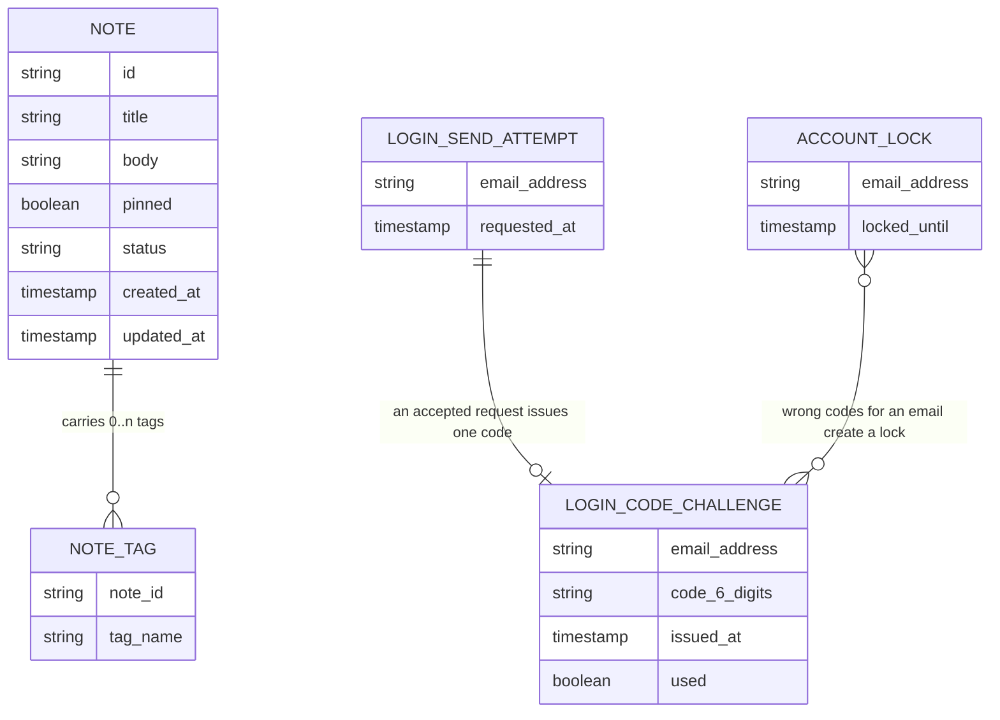

<!-- SECTION: backend.overview | status: VERIFIED -->
## Overview

**Run outcome.** This run ends with `HALT-BLOCKING-QUESTION`. `Q-BE-001`, `Q-BE-002` and `Q-BE-003` are blocking and the run is unattended. All eleven sections are emitted and `backend.auth-model` is `BLOCKED`. This is a bootstrap run (`RUN-CONTEXT.run_mode`), so IDs start at 001.

**What changed in this revision (CR-131).** The email one-time-code login is specified against the decided values below. The CR said these values were undecided; the requirements now carry them.

| Value | Decision | Source |
|---|---|---|
| Code expiry | 10 minutes after issue | BR-020, BR-024, BR-026 |
| Resend limit | at most 3 code requests per 10 minutes, then 429 | BR-021, BR-028; `feedback.md` preflight answer |
| Lockout | 5 wrong codes lock the account for 15 minutes | BR-022, BR-025, BR-027 |
| Code format | 6 digits, all numeric | BR-029 |

**Responsibilities.** The service is `notes_api`. Its stack is Node.js 20, Express and PostgreSQL 16, hosted on AWS (`platform.md`). It is responsible for:

- Note create, edit, get, archive and unarchive, with a `pinned` flag, title, body and tags (US-002-01 to US-002-06; BR-005 to BR-008, BR-018).
- Keyword and tag search, combined filters, pagination, archived exclusion and pinned-first ordering (US-003-01 to US-003-06; BR-009 to BR-011, BR-019).
- Email one-time-code login: a request-code endpoint and a verify-code endpoint, with expiry, resend limit, single-use codes and lockout (BR-020 to BR-033; US-006-06). Emails go through the transactional email service in AWS region eu-west-1 (NFR-017; its text is garbled, see `GAP-BE-003`).
- A published OpenAPI 3.x document. It covers every implemented endpoint, with schemas, 4xx/5xx errors, examples, a data-residency note and a Scope section (US-004-01 to US-004-06, US-005-01; BR-012, BR-013; NFR-008).
- Standardised refusal of out-of-scope calls (US-005-02 to US-005-05; BR-014 to BR-016).
- EU data residency of the database, compute and backups, with the CI gate, compliance report, launch gate and drift alerting (US-001-01 to US-001-06; BR-001 to BR-004).

**Not responsible for:**

- Attachment or file-upload endpoints (BR-014).
- Any real-time channel: WebSocket, SSE or polling-push (BR-015).
- Mobile-specific endpoints (BR-016).
- The web_app screens (US-006-01 to US-006-06). They are a separate surface; `platform.md` names React 18 + Vite.
- Logging and classifying stakeholder requests (BR-017, US-005-06). This is a product-manager process (`GAP-BE-009`).
- Existing login methods. NFR-016 says they "remain unchanged", but no input says what they are (`GAP-BE-007`).

**Design input.** `design-brief.md` carries only acceptance criteria (AC-001-01-01 to AC-002-01-03) and no visual design. Figma is not connected. No design claim is made, and `spec_mode` is `NOT-APPLICABLE` for backend.

**Inbound handoffs.** `RUN-CONTEXT.upstream.handoffs` lists four files: `HANDOFF-WEBAPP-263975`, `HANDOFF-WEBAPP-452996`, `HANDOFF-WEBAPP-500592` and `HANDOFF-WEBAPP-732181`. Their contents were not supplied to this run, so they could not be read or satisfied. See `GAP-BE-001`. The lane-needs step must record each one as answered or unanswerable.

**Open items.** The register is in `backend.coverage`.
<!-- /SECTION: backend.overview -->
<!-- SECTION: backend.domain-model | status: DRAFT-UNVERIFIED -->
## Domain model



**Sources**

- `NOTE`: US-002-01 gives a unique ID, timestamps and `pinned=false` by default. BR-005, BR-007, BR-008 and BR-018 give required title and body, the archive flag and the pinned flag. US-002-06 gives the archive status in the get response.
- `NOTE_TAG`: US-002-03 says a repeated add creates no duplicate entry on that note.
- `LOGIN_CODE_CHALLENGE`, `LOGIN_SEND_ATTEMPT` and `ACCOUNT_LOCK` are named by NFR-019 ("code challenges, send attempts and account locks"). Their attributes follow from BR-020 to BR-029, BR-032 and BR-033.
- The `ACCOUNT_LOCK` to challenge link is conceptual: wrong codes are counted per email, and no foreign key is implied.

**Ownership and cardinality are undecided.**

- Whether a note belongs to one user or to the shared team workspace is undecided. BR-031 holds a placeholder rule and cites `HANDOFF-NOTESAPI-981573`. The diagram therefore has no owner relation. See `Q-BE-002`.
- No `ACCOUNT` entity is defined anywhere. `ASM-BE-002` assumes the three login records are keyed by email address.
- The tag rules (case, charset, length, maximum count) are unstated, although US-003-02 implies some characters are invalid (`GAP-BE-010`).
- Residency artefacts (scan results, report, gate status) are infrastructure records, not application entities. See the `residency` module (`ASM-BE-013`).
<!-- /SECTION: backend.domain-model -->
<!-- SECTION: backend.module-map | status: DERIVED -->
## Module map

Modules are derived from the epics. The derivation is stated in the Source column.

| Module | Boundary | Source |
|---|---|---|
| `notes` | Note create, edit, get, archive, unarchive, `pinned` flag and tags. Archive is a flag, never a delete. | US-002-01 to US-002-06; BR-005 to BR-008, BR-018 |
| `search` | Keyword, tag and combined filters, pagination, archived exclusion, pinned-first ordering, 503 when the index is degraded. | US-003-01 to US-003-06; BR-009 to BR-011, BR-019 |
| `auth` | Request-code and verify-code: 6-digit codes, 10-minute expiry, 3-per-10-minutes resend limit, single use, 15-minute lock after 5 wrong codes, email delivery. | US-006-06; BR-020 to BR-033; NFR-015 to NFR-019 |
| `contract-docs` | Published OpenAPI 3.x document, spec-versus-route coverage check, data-residency note, Scope section. | US-004-01 to US-004-06, US-005-01; BR-012, BR-013; NFR-008, NFR-009 |
| `scope-guard` | Standardised refusal of attachment, real-time and mobile calls, and contract tests for their absence. | US-005-02 to US-005-05; BR-014 to BR-016; NFR-010, NFR-011 |
| `residency` | Region-constrained provisioning, EU-only backup validation, CI residency gate, compliance report, launch gate, drift scan and alert. | US-001-01 to US-001-06; BR-001 to BR-004; NFR-001 to NFR-004 |

**Dependency direction** (A → B means A depends on B):

- `search → notes`. It reads notes and tags.
- `contract-docs → notes, search, auth, scope-guard`. It reads the route registry only and does not call them at runtime.
- `scope-guard` is request middleware over the whole HTTP surface and depends on no module.
- `auth → transactional email service` (external, AWS eu-west-1; NFR-017).
- `notes → auth` and `search → auth` for a per-request access check. This edge is pending `Q-BE-002` and `Q-BE-003` and is not committed.
- `residency` depends on no other module. It inspects infrastructure and is not on the request path.

There are no cycles. `notes` does not depend on `search`, and neither depends on `contract-docs`.
<!-- /SECTION: backend.module-map -->
<!-- SECTION: backend.api-surface | status: VERIFIED -->
## Api surface

_Rendered by DevAgent from the operation records._

| id | method | path | module | success | errors | summary |
|---|---|---|---|---|---|---|
| `API-AUTH-015365` | POST | `/auth/request-code` | `auth` | 202 | 400, 429, 500 | Request a 6-digit one-time login code, emailed to the supplied address. Limited to 3 requests per rolling 10 minutes per email; not refused during an account lock (BR-032). |
| `API-AUTH-592570` | POST | `/auth/verify-code` | `auth` | 200 | 400, 401, 409, 410, 423, 500 | Verify a one-time login code. Codes expire 10 minutes after issue and are single use. Five wrong codes lock verification for 15 minutes. Precedence: lock, then used, then expired, then invalid. |
| `API-CONTRACTDOCS-304307` | GET | `/openapi` | `contract-docs` | 200 | 406, 500 | Return the published OpenAPI 3.x document covering every implemented endpoint, with schemas, 4xx/5xx errors, examples, the data-residency note and the Scope section. Format is chosen by the Accept header; an unsupported Accept returns 406 or falls back to the default format (US-004-01). |
| `API-CONTRACTDOCS-827943` | GET | `/openapi/coverage` | `contract-docs` | 200 | 500 | Return the spec-versus-route coverage check: the share of implemented routes present in the published document (US-004-04, NFR-008). |
| `API-NOTES-232390` | POST | `/notes` | `notes` | 201 | 400, 415, 500 | Create a note with title, body, optional pinned flag and optional tags (US-002-01, US-006-02). |
| `API-NOTES-045877` | GET | `/notes/{id}` | `notes` | 200 | 404, 500 | Get a single note, including its archive status and tags (US-002-06). |
| `API-NOTES-847551` | PATCH | `/notes/{id}` | `notes` | 200 | 400, 404, 415, 500 | Edit a note's title, body and pinned flag (US-002-02, US-006-02). |
| `API-NOTES-810640` | POST | `/notes/{id}/archive` | `notes` | 200 | 404, 409, 500 | Archive a note by setting its archive flag; no data is deleted (US-002-04, US-006-05). |
| `API-NOTES-359413` | POST | `/notes/{id}/tags` | `notes` | 200 | 400, 404, 415, 500 | Add a tag to a note; a repeated add creates no duplicate (US-002-03, US-006-04). |
| `API-NOTES-150096` | DELETE | `/notes/{id}/tags/{tag}` | `notes` | 200 | 404, 500 | Remove a tag from a note (US-006-04). |
| `API-NOTES-917869` | POST | `/notes/{id}/unarchive` | `notes` | 200 | 404, 500 | Unarchive a note, restoring it to active with all data intact (US-002-05, US-006-05). |
| `API-SEARCH-580505` | GET | `/notes/search` | `search` | 200 | 400, 500, 503 | Search active notes by keyword, tag or both, with pagination. Archived notes are excluded and pinned notes are ordered first. Returns 503 with Retry-After when the search index is degraded. Path is a proposal; no input names it. |

### `API-AUTH-015365` — POST `/auth/request-code`

Request a 6-digit one-time login code, emailed to the supplied address. Limited to 3 requests per rolling 10 minutes per email; not refused during an account lock (BR-032).

**Request:** 
- `email` (string, required): Email address to which the one-time login code is sent. PII; always masked in examples and logs.
**Response:** 
- `message` (string): Human-readable confirmation that a code was issued and emailed. Never contains the code or an unmasked email address.

### `API-AUTH-592570` — POST `/auth/verify-code`

Verify a one-time login code. Codes expire 10 minutes after issue and are single use. Five wrong codes lock verification for 15 minutes. Precedence: lock, then used, then expired, then invalid.

**Request:** 
- `email` (string, required): Email address the code was issued to. PII; always masked in examples and logs.
- `code` (string, required): The 6-digit numeric one-time code received by email.
**Response:** 
- `verified` (boolean): True when the code was accepted and consumed. What credential a successful verify issues (type, lifetime, transport) is undecided and blocked on Q-BE-003, so no credential field is defined.

### `API-CONTRACTDOCS-304307` — GET `/openapi`

Return the published OpenAPI 3.x document covering every implemented endpoint, with schemas, 4xx/5xx errors, examples, the data-residency note and the Scope section. Format is chosen by the Accept header; an unsupported Accept returns 406 or falls back to the default format (US-004-01).

**Request:** none
**Response:** 
- `openapi` (string, required): OpenAPI 3.x version string of the document.
- `info` (object, required): API title and version, including the data-residency note (US-004-06) and the Scope section (US-005-01: no attachments, no real-time channel, no mobile-specific endpoints).
- `paths` (object, required): Every implemented endpoint with parameters, request and response schemas, 4xx/5xx error responses and example payloads (US-004-02, US-004-03, US-004-05).
- `components` (object, required): Shared schemas, including the error envelope.

### `API-CONTRACTDOCS-827943` — GET `/openapi/coverage`

Return the spec-versus-route coverage check: the share of implemented routes present in the published document (US-004-04, NFR-008).

**Request:** none
**Response:** 
- `coverage_percent` (number, required): Percentage of implemented endpoints documented in the published spec; target 100.
- `implemented_count` (integer, required): Number of endpoints registered in the route registry.
- `documented_count` (integer, required): Number of those endpoints present in the published OpenAPI document.
- `undocumented_endpoints` (array, required): Method and path of each implemented endpoint missing from the spec; empty when coverage is 100%.

### `API-NOTES-232390` — POST `/notes`

Create a note with title, body, optional pinned flag and optional tags (US-002-01, US-006-02).

**Request:** 
- `title` (string, required): Note title; required (BR-005).
- `body` (string, required): Note body; required (BR-005).
- `pinned` (boolean): Pinned flag; defaults to false when omitted (US-002-01, BR-018).
- `tags` (array): Initial tag names to attach to the note; duplicates create no duplicate entry (US-002-03). Tag rules open in GAP-BE-010.
**Response:** 
- `id` (string, required): Unique note ID assigned on creation.
- `title` (string, required): Note title.
- `body` (string, required): Note body.
- `pinned` (boolean, required): Pinned flag.
- `status` (string, required): Archive status of the note; active on creation.
- `tags` (array, required): Tag names on the note.
- `created_at` (string, required): Creation timestamp.
- `updated_at` (string, required): Last update timestamp.

### `API-NOTES-045877` — GET `/notes/{id}`

Get a single note, including its archive status and tags (US-002-06).

**Request:** 
- `id` (string, required): Note ID (path parameter).
**Response:** 
- `id` (string, required): Note ID.
- `title` (string, required): Note title.
- `body` (string, required): Note body.
- `pinned` (boolean, required): Pinned flag.
- `status` (string, required): Archive status of the note.
- `tags` (array, required): Tag names on the note.
- `created_at` (string, required): Creation timestamp.
- `updated_at` (string, required): Last update timestamp.

### `API-NOTES-847551` — PATCH `/notes/{id}`

Edit a note's title, body and pinned flag (US-002-02, US-006-02).

**Request:** 
- `id` (string, required): Note ID (path parameter).
- `title` (string): New title; if supplied it must be valid (BR-005).
- `body` (string): New body; if supplied it must be valid (BR-005).
- `pinned` (boolean): New pinned flag value (BR-018).
**Response:** 
- `id` (string, required): Note ID.
- `title` (string, required): Note title after the edit.
- `body` (string, required): Note body after the edit.
- `pinned` (boolean, required): Pinned flag after the edit.
- `status` (string, required): Archive status of the note.
- `tags` (array, required): Tag names on the note.
- `created_at` (string, required): Creation timestamp.
- `updated_at` (string, required): Updated timestamp, refreshed by the edit.

### `API-NOTES-810640` — POST `/notes/{id}/archive`

Archive a note by setting its archive flag; no data is deleted (US-002-04, US-006-05).

**Request:** 
- `id` (string, required): Note ID (path parameter).
**Response:** 
- `id` (string, required): Note ID.
- `status` (string, required): Archive status, now archived.
- `pinned` (boolean, required): Pinned flag, unchanged.
- `updated_at` (string, required): Last update timestamp.

### `API-NOTES-359413` — POST `/notes/{id}/tags`

Add a tag to a note; a repeated add creates no duplicate (US-002-03, US-006-04).

**Request:** 
- `id` (string, required): Note ID (path parameter).
- `tag` (string, required): Tag name to add. Tag rules open in GAP-BE-010.
**Response:** 
- `id` (string, required): Note ID.
- `tags` (array, required): Tag names on the note after the add, without duplicates.
- `updated_at` (string, required): Last update timestamp.

### `API-NOTES-150096` — DELETE `/notes/{id}/tags/{tag}`

Remove a tag from a note (US-006-04).

**Request:** 
- `id` (string, required): Note ID (path parameter).
- `tag` (string, required): Tag name to remove (path parameter).
**Response:** 
- `id` (string, required): Note ID.
- `tags` (array, required): Tag names on the note after the removal.
- `updated_at` (string, required): Last update timestamp.

### `API-NOTES-917869` — POST `/notes/{id}/unarchive`

Unarchive a note, restoring it to active with all data intact (US-002-05, US-006-05).

**Request:** 
- `id` (string, required): Note ID (path parameter).
**Response:** 
- `id` (string, required): Note ID.
- `status` (string, required): Archive status, now active.
- `pinned` (boolean, required): Pinned flag, unchanged.
- `updated_at` (string, required): Last update timestamp.

### `API-SEARCH-580505` — GET `/notes/search`

Search active notes by keyword, tag or both, with pagination. Archived notes are excluded and pinned notes are ordered first. Returns 503 with Retry-After when the search index is degraded. Path is a proposal; no input names it.

**Request:** 
- `q` (string): Keyword matched against note title and body. At least one of q or tags is required (ASM-BE-015); a missing or empty q with no tags is a 400.
- `tags` (array): Tag names to filter by, combinable with q (combined filter). Sent as a repeated or comma-separated query parameter.
- `page` (integer): 1-based page number. Invalid or out-of-range values return 400.
- `page_size` (integer): Results per page; default 20, maximum 100 (ASM-BE-009). Values over the maximum or below 1 return 400.
**Response:** 
- `items` (array, required): Matching non-archived notes for the requested page, pinned notes first. Each item has id, title, body, pinned, tags, status, created_at, updated_at.
- `page` (integer, required): Current page number.
- `page_size` (integer, required): Page size applied to this response.
- `total` (integer, required): Total number of matching non-archived notes across all pages.
<!-- /SECTION: backend.api-surface -->
<!-- SECTION: backend.auth-model | status: BLOCKED -->
## Auth model

**BLOCKED.** The actors, roles and the role × resource × operation matrix cannot be written without inventing an authorisation rule. Three decisions are missing.

| Missing decision | Why it blocks | What would unblock it |
|---|---|---|
| Who may request, verify or receive a login code (BR-030). The rule text is garbled ("Only any person with a verified email address…") and the rule is recorded as open. | It decides who can obtain a credential at all. | `Q-BE-001`: a clean statement of BR-030, for example any email address or only a known set. |
| Whether notes are owned per user or shared by the team workspace (BR-031). The rule text is a placeholder and cites `HANDOFF-NOTESAPI-981573`. | It sets the access predicate on every note read and write. | `Q-BE-002`: the ownership decision and the access rule per operation. |
| What a successful verify issues (credential type, lifetime, transport, refresh), and whether the note and search endpoints require it. | The verify response, the 401/403 applicability on every other endpoint and the web_app session handling depend on it. US-004-03 expects 401/403 documented for authenticated endpoints. | `Q-BE-003`: the post-verify credential decision. |

The following lock and refusal rules do not depend on these decisions and are specified in `modules/auth-SPEC.md` and `backend.error-model`.

- Request-code is not refused during a lock; only verification is (BR-032).
- Verification is refused for 15 minutes after 5 wrong codes (BR-022).
- Requests beyond 3 per 10 minutes return 429 (BR-028).
<!-- /SECTION: backend.auth-model -->
<!-- SECTION: backend.data-lifecycle | status: DRAFT-UNVERIFIED -->
## Data lifecycle

| Data | Stored | Retention | Deletion | Source |
|---|---|---|---|---|
| Notes (title, body, `pinned`, tags, timestamps) | PostgreSQL 16 database, EU region | Indefinite. Notes are not deleted by retention. | None. Archive sets a flag and keeps all data; unarchive restores it. | NFR-019; BR-007, BR-008; `platform.md`; BR-001 |
| Archived notes | Same store as active notes. The archived/active data location must be stated in the published spec. | Same as notes | None | BR-013; US-004-06 |
| Login code challenges | Database | 1 day (`ASM-BE-011`) | Deleted after the retention period | NFR-019 |
| Login send attempts | Database | 1 day (`ASM-BE-011`) | Deleted after the retention period | NFR-019 |
| Account locks | Database | 5 days (`ASM-BE-011`) | Deleted after the retention period | NFR-019 |
| Database backups | EU-only storage bucket or service | Period not stated (`GAP-BE-006`) | Not stated | US-001-02 |
| Residency scan results and compliance report | Infrastructure tooling | Not stated (`GAP-BE-006`) | Not stated | US-001-04, US-001-06 |

**Residency.** All infrastructure (database, compute, backups) is in approved EU regions (BR-001). A backup configuration pointing outside the EU fails within 30 seconds with a residency violation error and writes no data (AC-001-02-02). A code email is sent through the transactional email service in AWS region eu-west-1 (NFR-017). The condition under which the email address leaves the EU is garbled in NFR-017 (`GAP-BE-003`).

**PII.** The email address is PII. In specifications and examples it is always masked.

**Encryption at rest is not stated by any input**, including the treatment of stored login codes. No encryption, hashing or redaction claim is made here (`GAP-BE-006`).

**Retention units.** NFR-019 reads "kept 1, send attempts 1 and account locks 5 days". `ASM-BE-011` reads this as 1, 1 and 5 days (`GAP-BE-004`).
<!-- /SECTION: backend.data-lifecycle -->
<!-- SECTION: backend.nfr | status: VERIFIED -->
## Non-functional requirements

| Area | Target | Source |
|---|---|---|
| Search latency | p95 < 300 ms under 50 requests per second | NFR-006; US-003-03 |
| Search at large result sets | p95 < 300 ms maintained up to page sizes of 100 results | NFR-007 |
| Search on a large dataset | latency SLA still met on about 100k notes via indexed lookup | US-003-03 |
| Availability | 99.9% uptime monthly for CRUD and search | NFR-013 |
| CRUD correctness | 100% functional-test pass rate, zero data loss | NFR-005 |
| Injection safety | 0 critical injection vulnerabilities per release in the security scan | NFR-012 |
| Spec coverage | 100% of implemented endpoints in the published spec; 100% of search and tagging endpoints with example payloads | NFR-008, NFR-009 |
| Scope guardrail | 0 out-of-scope endpoints detected per build, run on every CI build; 100% of out-of-scope calls return a documented 4xx error | NFR-010, NFR-011 |
| Residency, deploy | 0 non-EU deploys reach production | NFR-002 |
| Residency, infrastructure | 100% of infrastructure components EU-verified; report refreshed and accurate at each launch gate check | NFR-001, NFR-004 |
| Drift alert | alert fired within 15 minutes of drift detection | NFR-003 |
| Backup validation | a non-EU backup configuration fails within 30 seconds | AC-001-02-02 |
| Login rules | code expiry 10 minutes; at most 3 requests per 10 minutes; lock of 15 minutes after 5 wrong codes | BR-020 to BR-028; `feedback.md` |

**Concurrency.** The only stated load is 50 requests per second on search (NFR-006). No input states a concurrency target for any other operation.

**No source exists for the following, so no figure is given:**

- latency or throughput of the request-code and verify-code endpoints;
- email delivery time;
- latency of notes CRUD;
- the retention period for backups.

See `GAP-BE-008` and `GAP-BE-006`.
<!-- /SECTION: backend.nfr -->
<!-- SECTION: backend.error-model | status: DRAFT-UNVERIFIED -->
## Error model

**Envelope.** US-005-04 requires a structured error code (for example `OUT_OF_SCOPE`) with a human-readable reason. No input defines the full envelope. `ASM-BE-001` proposes one shape for every 4xx and 5xx response, including the 429 and lockout refusals:

```json
{ "error": { "code": "<REGISTRY_CODE>", "message": "<human-readable reason>", "details": [] } }
```

Machine-readable codes are stable. Messages may change. No response body ever contains a one-time code or an unmasked email address (NFR-018 reading, `ASM-BE-014`).

**Status-code policy.** Statuses marked "cited" come directly from an input. Everything else is proposed under `ASM-BE-001`.

| Status | Use | Cited |
|---|---|---|
| 400 | Validation failure; nothing is persisted | US-002-01 AC3, US-003-01 to US-003-06, US-004-03 |
| 401 | Wrong verification code | BR-033 |
| 403 | Authorisation refusal, applicability pending `Q-BE-003` | US-004-03 (documentation only) |
| 404 | Note not found; attachment path | US-002-02, US-002-05, US-002-06, US-005-02 |
| 406 | Unsupported Accept on the OpenAPI document, or a default-format fallback | US-004-01 |
| 409 | Note already archived; login code already used | US-002-04 ("conflict/error"), BR-033 |
| 410 | Expired login code | BR-033 |
| 415 | Multipart or file payload on a note endpoint | US-005-02 |
| 423 | Verification refused because the account is locked | BR-033 |
| 429 | Request-code beyond 3 per 10 minutes | BR-028, US-004-03 |
| 503 | Search index degraded or unavailable, with a `Retry-After` header | US-003-03 |
| 5xx other | Unhandled server error, documented per endpoint | US-004-03 |

**Error-code registry** (all names are proposals, `ASM-BE-001`, except `OUT_OF_SCOPE`, which US-005-04 gives as an example):

| Code | Status | Trigger |
|---|---|---|
| `VALIDATION_ERROR` | 400 | Missing or invalid field, query parameter or filter combination |
| `NOTE_NOT_FOUND` | 404 | No note with that ID |
| `NOTE_ALREADY_ARCHIVED` | 409 | Archive of an already-archived note |
| `OTP_CODE_INVALID` | 401 | Wrong code |
| `OTP_CODE_EXPIRED` | 410 | Code older than 10 minutes (boundary in `ASM-BE-004`) |
| `OTP_CODE_ALREADY_USED` | 409 | Code already verified successfully |
| `OTP_ACCOUNT_LOCKED` | 423 | Verification attempted during a 15-minute lock |
| `OTP_RATE_LIMITED` | 429 | More than 3 requests in 10 minutes |
| `OUT_OF_SCOPE` | 404 | Call to an attachment, real-time or mobile-specific endpoint (`ASM-BE-016`) |
| `UNSUPPORTED_MEDIA_TYPE` | 415 | Non-JSON or multipart payload |
| `NOT_ACCEPTABLE` | 406 | Unsupported Accept header on the spec endpoint |
| `SEARCH_UNAVAILABLE` | 503 | Degraded search index |
| `INTERNAL_ERROR` | 500 | Unhandled failure |

**Precedence on verify** (`ASM-BE-007`): lock first, then a match against an issued code (used → expired → success), otherwise invalid. Only an invalid (401) outcome counts as a wrong code toward the lock (`ASM-BE-005`). No input states precedence, and the web_app handoffs may need a ruling (`GAP-BE-001`).

**Not defined by any input:**

- the remaining lock time on a 423 response;
- `Retry-After` on a 429;
- the rejection status for a WebSocket upgrade (US-005-03 says only "standard error status").

See `GAP-BE-011`.
<!-- /SECTION: backend.error-model -->
<!-- SECTION: backend.observability | status: DRAFT-UNVERIFIED -->
## Observability

**Logged**, as events:

- request-code accepted and rate-limited;
- verify outcome by registry code;
- lock created and lock expired;
- search 503;
- out-of-scope refusals;
- residency scan pass or fail (AC-001-06-01).

**Redacted.** One-time codes are never logged. The email local part is masked in logs (NFR-017 and NFR-018 text, garbled, read per `ASM-BE-014`). The measure is the share of log entries containing an unredacted email address or code (NFR-018 target), and the target is 0 entries.

**Metered.** The following are specified from inputs:

- compliance percentage of EU-verified infrastructure (NFR-001, NFR-004);
- endpoint-spec coverage percentage (US-004-04);
- out-of-scope endpoints detected per build (NFR-010);
- search p95 latency (NFR-006).

Counts of 429, 423, 410, 409 and 401 login outcomes are proposed under `ASM-BE-014`. No input requires them.

**Alerts.**

- A resource found in a non-EU region produces an immediate alert to the DevOps team with resource details, within 15 minutes of detection (US-001-06, AC-001-06-02, NFR-003).
- No input defines alert routing, severity, or alerts on login abuse, availability or latency (`GAP-BE-008`).
<!-- /SECTION: backend.observability -->
<!-- SECTION: backend.migration-plan | status: DRAFT-UNVERIFIED -->
## Migration plan

Migrations are ordered by dependency. Each lists whether it can be reversed. Column-level detail is in the module specs. PostgreSQL 16 is the store (`platform.md`).

| # | Migration | Module | Reversible |
|---|---|---|---|
| 001 | Create `notes` (id, title, body, `pinned` default false, status, timestamps) | `notes` | Yes. Drop the table, as it holds no prior data. |
| 002 | Create `note_tags`, unique per note and tag name | `notes` | Yes. Drop the table. |
| 003 | Create the search index over title and body and a tag lookup index (`ASM-BE-010`) | `search` | Yes. Drop the indexes. |
| 004 | Create `login_code_challenges` (email, code, issued_at, used) | `auth` | Yes before any data exists; lossy after. |
| 005 | Create `login_send_attempts` (email, requested_at) | `auth` | Yes before any data exists; lossy after. |
| 006 | Create `account_locks` (email, locked_until) | `auth` | Yes before any data exists; lossy after. |
| 007 | Add note ownership columns and access predicate | `notes` | **Not specified.** Blocked on `Q-BE-002`. |
| 008 | Scheduled retention job for 004 to 006 (NFR-019) | `auth` | Yes. Disable the job; deleted rows are not recoverable. |

Region constraints, backup configuration and the CI residency gate are infrastructure-as-code (BR-001), not database migrations. They belong to the `residency` module. See `backend.module-map` and `ASM-BE-013`.
<!-- /SECTION: backend.migration-plan -->
<!-- SECTION: backend.coverage | status: DRAFT-UNVERIFIED -->
## Coverage

### Story coverage

Requirement IDs of the form `BE-<MOD>-FR-nnn` are minted in the module specs. This table maps each story to its owning module and the supplied requirements it rests on.

| Story | Module | Requirements and criteria | Status |
|---|---|---|---|
| US-001-01 | residency | BR-001, NFR-001, AC-001-01-01/02 | covered |
| US-001-02 | residency | BR-001, AC-001-02-01/02 | covered |
| US-001-03 | residency | BR-002, NFR-002, AC-001-03-01/02/03 | covered |
| US-001-04 | residency | NFR-001, NFR-004, AC-001-04-01/02 | covered |
| US-001-05 | residency | BR-003, AC-001-05-01/02 | covered |
| US-001-06 | residency | BR-004, NFR-003, AC-001-06-01/02 | covered |
| US-002-01 | notes | BR-005, BR-018, AC-002-01-01/02/03 | covered |
| US-002-02 | notes | BR-006, BR-018 | covered |
| US-002-03 | notes | story criteria; tag rules `GAP-BE-010` | covered, rules open |
| US-002-04 | notes | BR-007 | covered |
| US-002-05 | notes | BR-008 | covered |
| US-002-06 | notes | story criteria | covered |
| US-003-01 | search | BR-019; `CON-BE-003` | covered |
| US-003-02 | search | BR-010; `CON-BE-003` | covered |
| US-003-03 | search | NFR-006 | covered |
| US-003-04 | search | BR-010 | covered |
| US-003-05 | search | BR-011, NFR-007; `ASM-BE-009` | covered |
| US-003-06 | search | BR-009 | covered |
| US-004-01 | contract-docs | BR-012, NFR-008, BR-032 | covered |
| US-004-02 | contract-docs | BR-012 | covered |
| US-004-03 | contract-docs | BR-012, BR-028, BR-033; 401/403 pending `Q-BE-003` | covered, partly blocked |
| US-004-04 | contract-docs | BR-012, NFR-008 | covered |
| US-004-05 | contract-docs | NFR-009 | covered |
| US-004-06 | contract-docs | BR-013 | covered |
| US-005-01 | contract-docs | BR-014 to BR-016 | covered |
| US-005-02 | scope-guard | BR-014; `CON-BE-002` | covered |
| US-005-03 | scope-guard | BR-015; rejection status `GAP-BE-011` | covered, status open |
| US-005-04 | scope-guard | BR-016, NFR-011; `CON-BE-002` | covered |
| US-005-05 | scope-guard | NFR-010 | covered |
| US-005-06 | none | BR-017 is a product-manager process | **uncovered**, `GAP-BE-009` |
| US-006-01 | none for the list | web_app story. No operation lists active notes (`GAP-BE-005`). | **uncovered** for the list; the UI is not backend |
| US-006-02 | notes | web_app story; the backend serves the create and edit operations | covered (dependency) |
| US-006-03 | search | web_app story; the backend serves the search operation | covered (dependency) |
| US-006-04 | notes | web_app story; the backend serves the tag operations | covered (dependency) |
| US-006-05 | notes | web_app story; no operation lists archived notes only (`GAP-BE-005`) | covered for archive and unarchive; list **uncovered** |
| US-006-06 | auth | BR-020 to BR-033, NFR-015 to NFR-019; the post-verify credential is blocked (`Q-BE-003`) | covered, partly blocked |

### Open items register

| ID | Class | Item |
|---|---|---|
| `Q-BE-001` | blocking | Who may request, verify or receive a login code (BR-030). |
| `Q-BE-002` | blocking | Note ownership model and access rule (BR-031, `HANDOFF-NOTESAPI-981573`). |
| `Q-BE-003` | blocking | What a successful verify issues, and whether note and search endpoints require it. |
| `CON-BE-001` | non-critical | BR-027 says "login attempts during the lock are rejected". BR-032 says that during a lock only verification is refused and requesting a code is not. Reading used: BR-032, the explicit one (`ASM-BE-003`). Choosing the other reading means request-code is refused during a lock. |
| `CON-BE-002` | non-critical | BR-016 forbids "404 ambiguity". US-005-02 requires 404 for attachment paths. Reading used: 404 status with an `OUT_OF_SCOPE` body, which satisfies US-005-04 (`ASM-BE-016`). |
| `CON-BE-003` | non-critical | US-003-01 returns 400 for a missing or empty `q`. US-002 and US-003-02 filter by `tags` with no `q`. Reading used: a search needs `q` or `tags`; neither is a 400 (`ASM-BE-015`). |
| `GAP-BE-001` | non-critical | The four inbound handoffs (`HANDOFF-WEBAPP-263975`, `-452996`, `-500592`, `-732181`) were listed but their contents were not supplied. Closing artefact: the four files. |
| `GAP-BE-002` | non-critical | The BR-033 sentence on the exact-10-minute boundary is garbled. Closing artefact: clean BR-033 text. |
| `GAP-BE-003` | non-critical | NFR-017 and NFR-018 contain garbled text: whether the email address leaves the EU, and the email service name. Closing artefact: clean NFR-017 and NFR-018. |
| `GAP-BE-004` | non-critical | The NFR-019 retention units are garbled. Closing artefact: clean NFR-019. |
| `GAP-BE-005` | non-critical | No operation lists active notes (pinned first) or archived notes only, although BR-019, US-006-01 and US-006-05 assume one. Search cannot substitute because it needs a keyword or tag. Closing artefact: a story or decision for list operations. |
| `GAP-BE-006` | non-critical | Not stated: encryption at rest, treatment of stored codes, backup retention, residency artefact retention. Closing artefact: a platform or security input. |
| `GAP-BE-007` | non-critical | NFR-016 says existing login methods "remain unchanged", but no input names any. Closing artefact: the current login description. |
| `GAP-BE-008` | non-critical | No NFR for auth endpoints, email delivery or notes CRUD latency; no alert routing. Closing artefact: NFR inputs. |
| `GAP-BE-009` | non-critical | US-005-06 and BR-017 are a product-manager process, not an API behaviour. Closing artefact: a decision that the backend does not serve it. |
| `GAP-BE-010` | non-critical | Tag rules (case, charset, length, maximum count) are unstated. Closing artefact: a tag-rules requirement. |
| `GAP-BE-011` | non-critical | Not stated: remaining lock time on 423, `Retry-After` on 429 and 503, rejection status for WebSocket or SSE attempts. Closing artefact: error-handling requirements. |
| `ASM-BE-001` | assumption | The error envelope and registry code names are proposals. |
| `ASM-BE-002` | assumption | Login records are keyed by email address; no account entity exists. |
| `ASM-BE-003` | assumption | "Login attempts" in BR-027 means verification attempts (`CON-BE-001`). |
| `ASM-BE-004` | assumption | A code is expired when 10 minutes or more have elapsed since issue (BR-020 and BR-026, "expires 10 minutes after issue"). BR-024 can be read as expiry only after 10 minutes (`GAP-BE-002`). |
| `ASM-BE-005` | assumption | The resend window is rolling: a request-code call is refused when 3 codes were already issued in the preceding 10 minutes. Refused calls do not count. Wrong-code counting covers only 401 outcomes, resets on success or when a lock ends, and applies per email. |
| `ASM-BE-007` | assumption | Verify precedence: lock, then used, then expired, then invalid. |
| `ASM-BE-008` | assumption | A newly issued code does not invalidate earlier unexpired, unused codes. No input says otherwise. |
| `ASM-BE-009` | assumption | Search page size defaults to 20 with a maximum of 100. NFR-007 mentions 100 only as a tested size. |
| `ASM-BE-010` | assumption | Search uses PostgreSQL's own full-text index; no external engine is named. |
| `ASM-BE-011` | assumption | Retention is 1 day for challenges, 1 day for send attempts and 5 days for locks (`GAP-BE-004`). |
| `ASM-BE-012` | assumption | The method and paths for request-code (POST `/auth/request-code`) and verify-code (POST `/auth/verify-code`) are taken from the approved prior BACKEND-SPEC. No supplied input gives them. |
| `ASM-BE-013` | assumption | `residency` is operational tooling and infrastructure-as-code, not request-path code. |
| `ASM-BE-014` | assumption | Codes and unmasked emails are never logged. Per-outcome login metrics are proposed. |
| `ASM-BE-015` | assumption | A search with only `tags` is allowed (`CON-BE-003`). |
| `ASM-BE-016` | assumption | Out-of-scope calls return 404 with `OUT_OF_SCOPE` (`CON-BE-002`). |

IDs not listed above, including `ASM-BE-006` and `GAP-BE-012` onward, are unallocated in this document. Module specs continue the numbering without reuse.
<!-- /SECTION: backend.coverage -->
<!-- SECTION: backend.lane-needs | status: VERIFIED -->
## Lane needs

### Needs this lane raised

| Need | Kind | What is needed | Why | Blocking | Waiting sections |
|---|---|---|---|---|---|
| `HANDOFF-NOTESAPI-067561` | `business_rule` | Provide a clean statement of BR-030: who may request, verify or receive a login code (any email address, or only a known set). | The auth model cannot define actors or roles without it (Q-BE-001). | yes | `backend.auth-model`, `backend.api-surface` |
| `HANDOFF-NOTESAPI-501376` | `business_rule` | Decide whether notes are owned per user or shared in the team workspace (BR-031, HANDOFF-NOTESAPI-981573), and give the access rule for each note operation. | The access predicate, the ownership columns (migration 007) and the role matrix depend on it (Q-BE-002). | yes | `backend.auth-model`, `backend.domain-model`, `backend.migration-plan` |
| `HANDOFF-NOTESAPI-345681` | `business_rule` | Decide what a successful code verification issues (credential type, lifetime, transport, refresh and logout) and whether the notes and search endpoints require it. | The verify response, 401/403 applicability on other endpoints and the web_app session handling depend on it (Q-BE-003). | yes | `backend.auth-model`, `backend.api-surface`, `backend.error-model` |
| `HANDOFF-NOTESAPI-418421` | `story` | Supply a story or decision for list operations: active notes (pinned first), archived-only notes, and distinct tags. Search cannot substitute because it needs a keyword or tag. | US-006-01, US-006-05 and the tag filter have no backend data source (GAP-BE-005). | no | `backend.api-surface`, `backend.coverage` |
| `HANDOFF-NOTESAPI-558747` | `business_rule` | Specify the remaining lock time returned on a 423, Retry-After on 429 and 503, and the rejection status for WebSocket or SSE attempts. | The error model cannot give these values without inventing them (GAP-BE-011). | no | `backend.error-model`, `backend.api-surface` |
| `HANDOFF-NOTESAPI-590636` | `business_rule` | Provide tag rules: case, allowed characters, length and maximum tags per note. | The tag validation in create and add-tag is open (GAP-BE-010). | no | `backend.domain-model`, `backend.api-surface` |

### Needs this lane cannot answer

| Need | From lane | Asked | Why not |
|---|---|---|---|
| `HANDOFF-WEBAPP-500592` | `web_app` | Decide and define the session model: what a successful code verification issues (credential type, lifetime, transport), refresh and logout operations, and whether notes and search endpoints require a session (Q-BE-003). | The session model is undecided. It is blocking question Q-BE-003 and needs a human decision, so the backend spec defines no credential, refresh or logout. |
| `HANDOFF-WEBAPP-732181` | `web_app` | Add operations to list active notes and to list archived-only notes, since search requires q or a tag and include_archived mixes both states. | The backend spec has no operation that lists active or archived-only notes (GAP-BE-005). Adding one is a scope decision that needs a story or decision from the product side. |
| `HANDOFF-WEBAPP-263975` | `web_app` | Add an operation that lists distinct tags, usable for the tag filter options and the tags list screen. | The backend spec has no operation that lists distinct tags. No input defines one, and tag rules are also open (GAP-BE-010, GAP-BE-005), so a story or decision is needed first. |
| `HANDOFF-WEBAPP-452996` | `web_app` | Specify the remaining lock time, the re-enable rule, precedence among simultaneous verify refusals, whether a new code can be requested while locked, and the final error-code registry. | Only partly answerable. Request-code is allowed during a lock (BR-032), and verify precedence is proposed in ASM-BE-007. The remaining lock time, the re-enable rule and the final error-code registry are not defined by any input (GAP-BE-011, ASM-BE-001). |
<!-- /SECTION: backend.lane-needs -->
