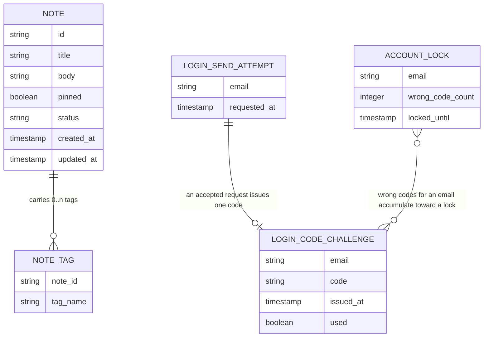

<!-- SECTION: backend.overview | status: VERIFIED -->
## Overview

**Run outcome.** This run ends with `HALT-BLOCKING-QUESTION`. `Q-BE-001`, `Q-BE-002` and `Q-BE-003` are blocking and `RUN-CONTEXT.unattended` is `true`. All eleven sections are emitted, and `backend.auth-model` is `BLOCKED`. This is a bootstrap run (`RUN-CONTEXT.run_mode`).

**Change in scope (CR-131).** The email one-time-code login is specified. The CR text said the expiry, resend and lockout numbers were undecided. The requirements now state them, and nothing in this run invents a number.

| Value | Decision | Source |
|---|---|---|
| Code expiry | 10 minutes after issue | BR-020, BR-024, BR-026 |
| Resend limit | 3 requests within 10 minutes; beyond that, HTTP 429 | BR-021, BR-028, BR-032; `feedback.md` preflight answer |
| Lockout | 5 wrong codes lock verification for 15 minutes | BR-022, BR-025, BR-027, BR-032 |
| Code format | 6 digits, all numeric | BR-029 |
| Verify status mapping | locked 423, wrong 401, expired 410, already used 409 | BR-033 |

**Responsibilities.** The service is `notes_api`. Its stack is Node.js 20, Express and PostgreSQL 16, hosted on AWS (`platform.md`). It is responsible for:

- Note create, edit, get, archive and unarchive, with a `pinned` flag, title, body and tags (US-002-01 to US-002-06; BR-005 to BR-008, BR-018).
- Keyword and tag search, combined filters, pagination, archived exclusion, pinned-first ordering and 503 on a degraded index (US-003-01 to US-003-06; BR-009 to BR-011, BR-019).
- Email one-time-code login: a request-code operation and a verify-code operation, with expiry, resend limit, single-use codes and lockout (BR-020 to BR-033; NFR-015 to NFR-019; US-006-06). Emails go through the transactional email service in AWS region eu-west-1 (NFR-017, whose text is garbled; see `GAP-BE-003`).
- A published OpenAPI 3.x document covering every implemented endpoint, with schemas, 4xx/5xx errors, examples, a data-residency note and a Scope section (US-004-01 to US-004-06, US-005-01; BR-012, BR-013; NFR-008, NFR-009).
- Standardised refusal of out-of-scope calls (US-005-02 to US-005-05; BR-014 to BR-016; NFR-010, NFR-011).
- EU data residency of the database, compute and backups, with the CI gate, compliance report, launch gate and drift alerting (US-001-01 to US-001-06; BR-001 to BR-004; NFR-001 to NFR-004).

**Not responsible for:**

- Attachment or file-upload endpoints (BR-014).
- Any real-time channel: WebSocket, SSE or polling-push (BR-015).
- Mobile-specific endpoints (BR-016).
- The web_app screens (US-006-01 to US-006-06). They belong to a separate surface; `platform.md` names React 18 + Vite for it.
- Logging and classifying stakeholder requests (BR-017, US-005-06). BR-017 makes this a product-manager process (`GAP-BE-009`).
- Existing login methods. NFR-016 says they "remain unchanged", but no input says what they are (`GAP-BE-007`).

**Design input.** `design-brief.md` carries only acceptance criteria (AC-001-01-01 to AC-002-01-03) and no visual design. Figma is not connected (`RUN-CONTEXT.inputs.figma_mcp`). No design claim is made, and `spec_mode` is `NOT-APPLICABLE` for every backend module.

**Contract input.** `api_docs` is empty and there is no upstream contract, so there is no existing-system claim to reconcile.

**Inbound handoffs.** `RUN-CONTEXT.upstream.handoffs` lists four web-app needs. Their file bodies were not supplied to this run (`GAP-BE-001`). The only description available is the summary in the previously approved `HANDOFFS.md` carried in `feedback.md`. Each is dispositioned below, and the lane-needs step records the same dispositions as data.

| Delivered need | As summarised in the prior `HANDOFFS.md` | Disposition |
|---|---|---|
| `HANDOFF-WEBAPP-500592` | Session model: what a successful verify issues, refresh, logout, and whether notes and search require a session | Cannot be answered. It is `Q-BE-003`, a blocking human decision. |
| `HANDOFF-WEBAPP-732181` | Operations to list active notes and archived-only notes | Cannot be answered. No story or decision exists (`GAP-BE-005`). |
| `HANDOFF-WEBAPP-263975` | An operation listing distinct tags | Cannot be answered. No story or decision exists, and tag rules are open (`GAP-BE-006`, `GAP-BE-010`). |
| `HANDOFF-WEBAPP-452996` | Remaining lock time, re-enable rule, verify-refusal precedence, request-while-locked, final error-code registry | Partly answered. Requesting a code is allowed during a lock (BR-032), the lock status is 423 (BR-033), precedence is `ASM-BE-003`, and the registry is proposed in `backend.error-model`. Remaining lock time and the re-enable detail stay open (`GAP-BE-008`, `GAP-BE-011`). |

**Open items.** The register of every `GAP-`, `CON-`, `Q-` and `ASM-` item is in `backend.coverage`.
<!-- /SECTION: backend.overview -->
<!-- SECTION: backend.domain-model | status: DRAFT-UNVERIFIED -->
## Domain model

**Sources**

- `NOTE`: US-002-01 gives a unique ID, timestamps and `pinned=false` by default. BR-005 gives required title and body. BR-007 gives the archive flag. US-002-05 and US-002-06 give the active/archived status. BR-018 gives the pinned flag.
- `NOTE_TAG`: US-002-03 says a repeated add creates no duplicate entry on that note.
- `LOGIN_SEND_ATTEMPT`, `LOGIN_CODE_CHALLENGE` and `ACCOUNT_LOCK` are the three records NFR-019 names ("code challenges, send attempts and account locks"). Their attributes follow from BR-020 to BR-029 and BR-032. How a code is stored is unstated and is part of `GAP-BE-012`.
- `wrong_code_count` is on the lock record by assumption (`ASM-BE-004`). The challenge-to-lock link is conceptual: wrong codes are counted per email and no foreign key is implied.

**Ownership and cardinality.**

- Whether a note belongs to one user or to the shared team workspace is undecided. BR-031 holds a placeholder rule and refers to an open handoff. The diagram therefore has no owner relation (`Q-BE-002`).
- No account entity is defined by any input. `ASM-BE-001` assumes the three login records are keyed by email address.
- Tag rules (case, charset, length, maximum count) are unstated, although US-003-02 implies some characters are invalid (`GAP-BE-010`).
- Residency artefacts (scan results, report, gate status) are infrastructure records, not application entities (`ASM-BE-011`).
<!-- /SECTION: backend.domain-model -->
<!-- SECTION: backend.module-map | status: DERIVED -->
## Module map

Modules are derived from the epics. The derivation is stated in the Source column.

| Module | Boundary | Source |
|---|---|---|
| `notes` | Note create, edit, get, archive, unarchive, `pinned` flag and tags. Archive is a flag, never a delete. | US-002-01 to US-002-06; BR-005 to BR-008, BR-018 |
| `search` | Keyword, tag and combined filters, pagination, archived exclusion, pinned-first ordering, 503 when the index is degraded. | US-003-01 to US-003-06; BR-009 to BR-011, BR-019 |
| `auth` | Request-code and verify-code: 6-digit codes, 10-minute expiry, 3-requests-per-10-minutes limit, single use, 15-minute lock after 5 wrong codes, email delivery. | US-006-06; BR-020 to BR-033; NFR-015 to NFR-019 |
| `contract-docs` | Published OpenAPI 3.x document, spec-versus-route coverage check, data-residency note, Scope section. | US-004-01 to US-004-06, US-005-01; BR-012, BR-013; NFR-008, NFR-009 |
| `scope-guard` | Standardised refusal of attachment, real-time and mobile calls, and contract tests for their absence. | US-005-02 to US-005-05; BR-014 to BR-016; NFR-010, NFR-011 |
| `residency` | Region-constrained provisioning, EU-only backup validation, CI residency gate, compliance report, launch gate, drift scan and alert. | US-001-01 to US-001-06; BR-001 to BR-004; NFR-001 to NFR-004 |

**Dependency direction** (A → B means A depends on B):

- `search → notes`. It reads notes and tags.
- `contract-docs → notes, search, auth, scope-guard`. It reads the route registry only and does not call them at runtime.
- `scope-guard` is request middleware over the whole HTTP surface and depends on no module.
- `auth → transactional email service` (external, AWS eu-west-1; NFR-017).
- `notes → auth` and `search → auth` for a per-request access check. This edge is pending `Q-BE-002` and `Q-BE-003` and is not committed.
- `residency` depends on no other module. It inspects infrastructure and is not on the request path (`ASM-BE-011`).

There are no cycles. `notes` does not depend on `search`, and neither depends on `contract-docs`.
<!-- /SECTION: backend.module-map -->
<!-- SECTION: backend.api-surface | status: VERIFIED -->
## Api surface

_Rendered by DevAgent from the operation records._

| id | method | path | module | success | errors | summary |
|---|---|---|---|---|---|---|
| `API-AUTH-015365` | POST | `/auth/request-code` | `auth` | 202 | 400, 429, 500 | Request a 6-digit one-time login code to be emailed to the given address. Limited to 3 requests within 10 minutes; allowed while verification is locked (BR-032). |
| `API-AUTH-592570` | POST | `/auth/verify-code` | `auth` | 200 | 400, 401, 409, 410, 423, 500 | Verify a one-time login code. Codes are single use, expire after 10 minutes, and 5 wrong codes lock verification for 15 minutes (BR-033). Refusal precedence: lock, used, expired, wrong (ASM-BE-003). |
| `API-CONTRACTDOCS-304307` | GET | `/openapi` | `contract-docs` | 200 | 406, 500 | Return the published OpenAPI 3.x document covering every implemented endpoint, with schemas, 4xx/5xx error responses, example payloads, the data-residency note and the Scope section. The format is negotiated through the Accept header (US-004-01 to US-004-06, US-005-01). No input names the path; it is an assumption to be confirmed. |
| `API-NOTES-232390` | POST | `/notes` | `notes` | 201 | 400, 415 | Create a note with a title and body; the service assigns a unique ID, timestamps and pinned=false by default (US-002-01, US-006-02; BR-005, BR-018). |
| `API-NOTES-045877` | GET | `/notes/{id}` | `notes` | 200 | 404 | Get a single note by ID, including its pinned flag, status and tags (US-002-06, US-006-02, US-006-05). |
| `API-NOTES-847551` | PATCH | `/notes/{id}` | `notes` | 200 | 400, 404, 409, 415 | Edit a note's title, body and/or pinned flag; updates the updated_at timestamp (US-002-02, US-006-02; BR-006, BR-018). Concurrent PATCH gets last-write or conflict (US-005-03). |
| `API-NOTES-810640` | POST | `/notes/{id}/archive` | `notes` | 200 | 404, 409 | Archive a note by setting the archive flag; the note is kept, never deleted (US-002-04, US-006-05; BR-007). |
| `API-NOTES-359413` | POST | `/notes/{id}/tags` | `notes` | 200 | 400, 404 | Add one or more tags to a note; a repeated add creates no duplicate entry on that note (US-002-03, US-006-04). Tag rules are open (GAP-BE-010). |
| `API-NOTES-917869` | POST | `/notes/{id}/unarchive` | `notes` | 200 | 404, 409 | Unarchive a note, returning it to active status (US-002-05, US-006-05; BR-008). |
| `API-RESIDENCY-174124` | POST | `/residency/backup-validations` | `residency` | 200 | 400, 422, 500 | Validate a backup destination; a non-EU destination fails the job within 30 seconds and writes no data (US-001-02, AC-001-02-02). |
| `API-RESIDENCY-685134` | POST | `/residency/ci-gate-evaluations` | `residency` | 200 | 400, 500 | Evaluate the CI residency gate for a build; fails when any resource is outside the EU (US-001-03, BR-002). |
| `API-RESIDENCY-913995` | GET | `/residency/compliance-report` | `residency` | 200 | 500 | Get the current compliance report of EU residency per component (US-001-04, NFR-004). |
| `API-RESIDENCY-922826` | POST | `/residency/drift-scans` | `residency` | 201 | 500 | Run a drift scan of all resources; non-EU resources trigger an alert to DevOps within 15 minutes (US-001-06, BR-004, NFR-003). |
| `API-RESIDENCY-202775` | GET | `/residency/drift-scans/{id}` | `residency` | 200 | 404, 500 | Get the result of a previous drift scan (US-001-06). |
| `API-RESIDENCY-648672` | POST | `/residency/launch-gate-checks` | `residency` | 200 | 400, 500 | Run the launch gate check; refreshes the compliance report and blocks release on failure (US-001-05, BR-003, AC-001-05-02). |
| `API-RESIDENCY-026899` | POST | `/residency/provisioning-requests` | `residency` | 201 | 400, 422, 500 | Request provisioning of a resource; refused unless the target region is an EU region (US-001-01, BR-001). |
| `API-SEARCH-580505` | GET | `/notes/search` | `search` | 200 | 400, 503, 500 | Search notes by keyword, by tag, or by both combined. Results are paginated, exclude archived notes unless include_archived is set, and list pinned notes first. Returns 503 when the search index is degraded. At least one of q or tags is required (ASM-BE-009, CON-BE-003). |

### `API-AUTH-015365` — POST `/auth/request-code`

Request a 6-digit one-time login code to be emailed to the given address. Limited to 3 requests within 10 minutes; allowed while verification is locked (BR-032).

**Request:** 
- `email` (string, required): Email address to send the one-time login code to (BR-020, ASM-BE-001; trimmed and compared case-insensitively).
**Response:** 
- `message` (string, required): Confirmation that a code has been sent, without revealing the code or an unmasked email address (NFR-018).
- `expires_in_seconds` (integer): Seconds until the issued code expires; 10 minutes per BR-020.

### `API-AUTH-592570` — POST `/auth/verify-code`

Verify a one-time login code. Codes are single use, expire after 10 minutes, and 5 wrong codes lock verification for 15 minutes (BR-033). Refusal precedence: lock, used, expired, wrong (ASM-BE-003).

**Request:** 
- `email` (string, required): Email address the code was issued to (ASM-BE-001).
- `code` (string, required): The 6-digit numeric one-time code (BR-029).
**Response:** 
- `verified` (boolean, required): True when the code was accepted. The credential issued on success is undecided (Q-BE-003), so no session or token field is defined.

### `API-CONTRACTDOCS-304307` — GET `/openapi`

Return the published OpenAPI 3.x document covering every implemented endpoint, with schemas, 4xx/5xx error responses, example payloads, the data-residency note and the Scope section. The format is negotiated through the Accept header (US-004-01 to US-004-06, US-005-01). No input names the path; it is an assumption to be confirmed.

**Request:** 
- `Accept` (string): Header, not a body field. Requested media type of the document. If it is unsupported, the service either returns 406 or falls back to the default format; this choice is open (US-004-01).
**Response:** 
- `openapi` (string, required): OpenAPI 3.x version string of the published document.
- `info` (object, required): Document metadata. It carries the data-residency note (US-004-06, BR-013) and the Scope section stating that attachments, real-time channels and mobile-specific endpoints are out of scope (US-005-01, BR-014 to BR-016).
- `paths` (object, required): Every implemented endpoint with its parameters, request bodies, success responses and documented 4xx/5xx error responses. Covers 100% of implemented routes (NFR-008).
- `components` (object, required): Reusable schemas, including the error body, plus example payloads. Search and tagging endpoints have examples (NFR-009).

### `API-NOTES-232390` — POST `/notes`

Create a note with a title and body; the service assigns a unique ID, timestamps and pinned=false by default (US-002-01, US-006-02; BR-005, BR-018).

**Request:** 
- `title` (string, required): Note title; required, missing or empty returns 400 (BR-005).
- `body` (string, required): Note body; required, missing or empty returns 400 (BR-005).
- `pinned` (boolean): Initial pinned flag; defaults to false when omitted (US-002-01, BR-018).
**Response:** 
- `id` (string, required): Unique note ID assigned by the service (US-002-01).
- `title` (string, required): Note title.
- `body` (string, required): Note body.
- `pinned` (boolean, required): Pinned flag; false by default.
- `status` (string, required): Active or archived status of the note (US-002-05, US-002-06); a new note is active.
- `tags` (array, required): Tags carried by the note; empty on creation.
- `created_at` (string, required): Creation timestamp (US-002-01).
- `updated_at` (string, required): Last-update timestamp (US-002-01).

### `API-NOTES-045877` — GET `/notes/{id}`

Get a single note by ID, including its pinned flag, status and tags (US-002-06, US-006-02, US-006-05).

**Request:** 
- `id` (string, required): Note ID (path parameter).
**Response:** 
- `id` (string, required): Note ID.
- `title` (string, required): Note title.
- `body` (string, required): Note body.
- `pinned` (boolean, required): Pinned flag.
- `status` (string, required): Active or archived status.
- `tags` (array, required): Tags carried by the note.
- `created_at` (string, required): Creation timestamp.
- `updated_at` (string, required): Last-update timestamp.

### `API-NOTES-847551` — PATCH `/notes/{id}`

Edit a note's title, body and/or pinned flag; updates the updated_at timestamp (US-002-02, US-006-02; BR-006, BR-018). Concurrent PATCH gets last-write or conflict (US-005-03).

**Request:** 
- `id` (string, required): Note ID (path parameter).
- `title` (string): New title; if supplied must not be empty.
- `body` (string): New body; if supplied must not be empty.
- `pinned` (boolean): New pinned flag value (BR-018).
**Response:** 
- `id` (string, required): Note ID.
- `title` (string, required): Note title after the edit.
- `body` (string, required): Note body after the edit.
- `pinned` (boolean, required): Pinned flag after the edit.
- `status` (string, required): Active or archived status.
- `tags` (array, required): Tags carried by the note.
- `created_at` (string, required): Creation timestamp.
- `updated_at` (string, required): Updated last-update timestamp.

### `API-NOTES-810640` — POST `/notes/{id}/archive`

Archive a note by setting the archive flag; the note is kept, never deleted (US-002-04, US-006-05; BR-007).

**Request:** 
- `id` (string, required): Note ID (path parameter).
**Response:** 
- `id` (string, required): Note ID.
- `status` (string, required): Archived status after the operation.
- `updated_at` (string, required): Last-update timestamp.

### `API-NOTES-359413` — POST `/notes/{id}/tags`

Add one or more tags to a note; a repeated add creates no duplicate entry on that note (US-002-03, US-006-04). Tag rules are open (GAP-BE-010).

**Request:** 
- `id` (string, required): Note ID (path parameter).
- `tags` (array, required): Tag names to add to the note; names already on the note are not duplicated.
**Response:** 
- `id` (string, required): Note ID.
- `tags` (array, required): The note's full tag set after the add, without duplicates.
- `updated_at` (string, required): Last-update timestamp.

### `API-NOTES-917869` — POST `/notes/{id}/unarchive`

Unarchive a note, returning it to active status (US-002-05, US-006-05; BR-008).

**Request:** 
- `id` (string, required): Note ID (path parameter).
**Response:** 
- `id` (string, required): Note ID.
- `status` (string, required): Active status after the operation.
- `updated_at` (string, required): Last-update timestamp.

### `API-RESIDENCY-174124` — POST `/residency/backup-validations`

Validate a backup destination; a non-EU destination fails the job within 30 seconds and writes no data (US-001-02, AC-001-02-02).

**Request:** 
- `backup_job_id` (string, required): Identifier of the backup job being validated.
- `destination_region` (string, required): Region of the backup destination.
**Response:** 
- `backup_job_id` (string, required): Identifier of the validated backup job.
- `destination_region` (string, required): Validated destination region.
- `valid` (boolean, required): True when the destination is in an EU region.

### `API-RESIDENCY-685134` — POST `/residency/ci-gate-evaluations`

Evaluate the CI residency gate for a build; fails when any resource is outside the EU (US-001-03, BR-002).

**Request:** 
- `build_id` (string, required): CI build identifier.
- `resources` (array, required): Resources in the deployment, each with an identifier and region.
**Response:** 
- `build_id` (string, required): CI build identifier evaluated.
- `passed` (boolean, required): True when every resource is in an EU region.
- `violations` (array, required): Resources found outside the EU; empty when passed.

### `API-RESIDENCY-913995` — GET `/residency/compliance-report`

Get the current compliance report of EU residency per component (US-001-04, NFR-004).

**Request:** none
**Response:** 
- `generated_at` (string, required): Timestamp of the last refresh.
- `eu_verified_percent` (number, required): Share of components verified as EU-resident.
- `components` (array, required): Each component with its region and verification status.

### `API-RESIDENCY-922826` — POST `/residency/drift-scans`

Run a drift scan of all resources; non-EU resources trigger an alert to DevOps within 15 minutes (US-001-06, BR-004, NFR-003).

**Request:** none
**Response:** 
- `scan_id` (string, required): Identifier of the scan.
- `scanned_at` (string, required): Timestamp of the scan.
- `all_eu` (boolean, required): True when every resource is in an EU region.
- `non_eu_resources` (array, required): Resources found outside the EU, with details.
- `alert_sent` (boolean, required): True when an alert was sent to the DevOps team.

### `API-RESIDENCY-202775` — GET `/residency/drift-scans/{id}`

Get the result of a previous drift scan (US-001-06).

**Request:** 
- `id` (string, required): Drift scan identifier (path parameter).
**Response:** 
- `scan_id` (string, required): Identifier of the scan.
- `scanned_at` (string, required): Timestamp of the scan.
- `all_eu` (boolean, required): True when every resource was in an EU region.
- `non_eu_resources` (array, required): Resources found outside the EU.
- `alert_sent` (boolean, required): True when an alert was sent.

### `API-RESIDENCY-648672` — POST `/residency/launch-gate-checks`

Run the launch gate check; refreshes the compliance report and blocks release on failure (US-001-05, BR-003, AC-001-05-02).

**Request:** 
- `release_id` (string, required): Identifier of the release being gated.
**Response:** 
- `release_id` (string, required): Release identifier checked.
- `passed` (boolean, required): True when the release may proceed.
- `report_generated_at` (string, required): Timestamp of the compliance report used for the check.
- `blocking_resources` (array, required): Non-EU resources blocking release; empty when passed.

### `API-RESIDENCY-026899` — POST `/residency/provisioning-requests`

Request provisioning of a resource; refused unless the target region is an EU region (US-001-01, BR-001).

**Request:** 
- `resource_type` (string, required): Kind of resource to provision (database, compute, backup storage).
- `region` (string, required): Target cloud region for the resource.
**Response:** 
- `resource_id` (string, required): Identifier of the provisioned resource.
- `resource_type` (string, required): Kind of resource provisioned.
- `region` (string, required): EU region the resource was provisioned in.
- `status` (string, required): Provisioning status.

### `API-SEARCH-580505` — GET `/notes/search`

Search notes by keyword, by tag, or by both combined. Results are paginated, exclude archived notes unless include_archived is set, and list pinned notes first. Returns 503 when the search index is degraded. At least one of q or tags is required (ASM-BE-009, CON-BE-003).

**Request:** 
- `q` (string): Keyword matched against note title and body. At least one of q or tags must be supplied. A present but empty q returns 400 (US-003-01).
- `tags` (array): One or more tag names to filter by. When combined with q, both filters apply (US-003-02, US-003-04). Tag rules are open (GAP-BE-010).
- `include_archived` (boolean): When true, archived notes are included. The default is false, so archived notes are excluded (BR-009). A non-boolean value returns 400.
- `page` (integer): 1-based page number. An invalid or non-numeric value returns 400 (US-003-05).
- `page_size` (integer): Results per page, maximum 100 (NFR-007). The default of 20 is an assumption (ASM-BE-009). A value over the maximum or a non-numeric value returns 400.
**Response:** 
- `items` (array, required): Matching notes for the requested page, with pinned notes before unpinned ones (BR-010). Each item shows the note's id, title, body, pinned flag, status (active or archived), tags and timestamps.
- `page` (integer, required): The page number returned.
- `page_size` (integer, required): The page size applied.
- `total` (integer, required): Total number of notes matching the filters across all pages.
<!-- /SECTION: backend.api-surface -->
<!-- SECTION: backend.auth-model | status: BLOCKED -->
## Auth model

**BLOCKED.** The actors, roles and the role × resource × operation matrix cannot be written without inventing an authorisation rule. Three decisions are missing.

| Missing decision | Why it blocks | What would unblock it |
|---|---|---|
| Who may request, verify or receive a login code. BR-030 is garbled ("Only any person with a verified email address...") and its rationale records the rule as open. | It decides who can obtain a credential at all. | `Q-BE-001`: a clean statement of BR-030, for example any email address or only a known set. |
| Whether notes are owned per user or shared by the team workspace. BR-031 is a placeholder and its rationale says the shared-workspace default is not a decision. | It sets the access predicate on every note read and write. | `Q-BE-002`: the ownership decision and the access rule per note operation. |
| What a successful verify issues (credential type, lifetime, transport, refresh, logout), and whether the note and search endpoints require it. | The verify response, the applicability of 401/403 on every other endpoint (US-004-03) and the web_app session handling depend on it. | `Q-BE-003`: the post-verify credential decision. |
<!-- /SECTION: backend.auth-model -->
<!-- SECTION: backend.data-lifecycle | status: DRAFT-UNVERIFIED -->
## Data lifecycle

| Data | Retention and deletion | Encryption at rest | Residency |
|---|---|---|---|
| Notes and note tags | Never deleted by retention. Archived notes follow BR-007 and BR-008: archive is a flag and the data is kept (NFR-019). No hard-delete operation is defined by any input. | Unstated (`GAP-BE-012`) | EU only (BR-001; US-004-06) |
| Login code challenges | Kept 1 unit, then deleted. NFR-019 omits the unit; 1 day is assumed (`GAP-BE-004`, `ASM-BE-005`). | Unstated (`GAP-BE-012`) | EU only (BR-001) |
| Login send attempts | Kept 1 unit, then deleted. Unit omitted in NFR-019; 1 day assumed (`GAP-BE-004`, `ASM-BE-005`). | Unstated (`GAP-BE-012`) | EU only (BR-001) |
| Account locks | Kept 5 days, then deleted (NFR-019). | Unstated (`GAP-BE-012`) | EU only (BR-001) |
| Database backups | Retention period unstated (`GAP-BE-012`). | Unstated (`GAP-BE-012`) | EU-region storage only (US-001-02; BR-001) |
| Login emails (transactional email service) | Not retained by notes_api. The email address is transmitted to the service in AWS eu-west-1 (NFR-017; garbled, `GAP-BE-003`). | Not applicable | eu-west-1 stated; the conditional on transmission outside the EU is garbled (`GAP-BE-003`) |
| Application logs | Must never contain a login code or an unmasked email local part (NFR-017, NFR-018). Retention unstated (`GAP-BE-012`). | Unstated (`GAP-BE-012`) | Unstated (`GAP-BE-012`) |

Retention applies to login records only. NFR-019 states the measure as the share of records older than their retention period that are deleted. How often the deletion runs is not stated (`GAP-BE-004`).
<!-- /SECTION: backend.data-lifecycle -->
<!-- SECTION: backend.nfr | status: VERIFIED -->
## Non-functional requirements

| Area | Target | Source |
|---|---|---|
| Search latency | p95 under 300 ms at 50 requests per second | NFR-006; US-003-03 |
| Search at scale | p95 under 300 ms with a dataset of about 100k notes, via indexed lookup | US-003-03 |
| Pagination | p95 under 300 ms maintained up to page sizes of 100 results | NFR-007 |
| Availability | 99.9% uptime monthly for CRUD and search | NFR-013 |
| CRUD correctness | 100% functional-test pass rate, zero data loss | NFR-005 |
| Injection safety | Requests validated and sanitised; 0 critical injection findings per release | NFR-012 |
| Concurrency | Concurrent PATCH to one note gets a last-write or conflict response, with no broadcast or merge | US-005-03 |
| Residency, infrastructure | 100% of components EU-verified; 0 non-EU deploys reach production | NFR-001, NFR-002 |
| Drift alerting | Alert within 15 minutes of drift detection | NFR-003 |
| Backup validation | A non-EU backup destination fails the job within 30 seconds, writing no data | AC-001-02-02 |
| Compliance report | Refreshed and 100% accurate at each launch gate check | NFR-004 |
| Spec coverage | 100% of implemented endpoints in the published spec; example payloads for 100% of search and tagging endpoints | NFR-008, NFR-009 |
| Scope guard | 0 out-of-scope endpoints per CI build; 100% of out-of-scope calls return a documented 4xx | NFR-010, NFR-011 |
| Login log safety | 0 log entries with an unredacted email address or login code | NFR-018 |
| Login email residency | Share of login emails sent from the approved region under the residency answer | NFR-017 |

No latency or throughput target is supplied for the request-code and verify-code operations. None is invented (`GAP-BE-012`).
<!-- /SECTION: backend.nfr -->
<!-- SECTION: backend.error-model | status: DRAFT-UNVERIFIED -->
## Error model

**Envelope.** No input defines an error body. One envelope is proposed for all 4xx/5xx responses (`ASM-BE-007`): a machine-readable `code` and a human-readable `message`. Validation errors may add field details. The envelope never contains a login code or an unmasked email address (NFR-018). The final shape is `GAP-BE-011`.

**Status-code policy.** Each status below is cited to an input. The `code` names are proposals (`ASM-BE-007`) unless marked as supplied.

| Status | Code (proposed) | Trigger | Source |
|---|---|---|---|
| 400 | `VALIDATION_ERROR` | Missing or empty required field, invalid or non-numeric query value, malformed filter combination, invalid `include_archived` | BR-005; AC-002-01-03; US-003-01 to US-003-06 |
| 401 | `INVALID_CODE` | Verify with a wrong code | BR-033 |
| 404 | `NOTE_NOT_FOUND` | Edit, get, archive or unarchive of an unknown note | AC-002-02-03; US-002-05; US-002-06 |
| 404 | `OUT_OF_SCOPE` (the code name is given as an example in US-005-04) | Call to an attachment, real-time or mobile-specific path | US-005-02; US-005-04; BR-016; `CON-BE-002` |
| 406 | `NOT_ACCEPTABLE` | Spec requested with an unsupported Accept header. US-004-01 allows a default-format fallback instead; the choice is open. | US-004-01 |
| 409 | `CODE_ALREADY_USED` | Verify with an already-used code | BR-033; BR-023 |
| 409 | `ALREADY_ARCHIVED` | Archive of an already-archived note. The story says "conflict/error"; 409 is adopted (`ASM-BE-007`). | US-002-04 |
| 410 | `CODE_EXPIRED` | Verify with a code older than 10 minutes | BR-033; BR-020 |
| 415 | `UNSUPPORTED_MEDIA_TYPE` | Multipart or file payload to a note endpoint; nothing persisted | US-005-02 |
| 423 | `ACCOUNT_LOCKED` | Verify during a 15-minute lock | BR-033; BR-022 |
| 429 | `RESEND_LIMIT_EXCEEDED` | More than 3 code requests within 10 minutes | BR-028; BR-032; US-004-03 |
| 503 | `SEARCH_UNAVAILABLE` | Search index degraded or unavailable; sent with a retry-after header | US-003-03 |
| 500 | `INTERNAL_ERROR` | Unexpected failure, including email delivery failure, with nothing persisted (`ASM-BE-013`) | Not stated by any input |

**Verify-code precedence.** When more than one refusal applies, the order is lock, then already-used, then expired, then wrong (`ASM-BE-003`). The 5th wrong code itself returns 401. The lock applies from the next verify attempt (`ASM-BE-004`).

**Open points.**

- The value of the retry-after header, the remaining lock time on a 423, and the rejection status for a WebSocket or SSE attempt are unstated (`GAP-BE-008`, `GAP-BE-011`).
- Whether a code submitted exactly at 10 minutes is valid is unstated (`GAP-BE-002`).
- 401/403 responses for note and search endpoints depend on `Q-BE-003`.
<!-- /SECTION: backend.error-model -->
<!-- SECTION: backend.observability | status: DRAFT-UNVERIFIED -->
## Observability

**Logged.** Request and outcome records for the login operations, with the following constraints:

- A login code is never logged.
- The email local part is masked in every log entry (NFR-017, NFR-018). This is the legible part of otherwise garbled NFR text (`GAP-BE-003`).
- A residency scan logs a pass when all resources are in EU regions (AC-001-06-01).

**Redacted.**

- Login codes and the email local part (NFR-018).
- Note title and body are not named as sensitive by any input. No redaction is claimed for them (`GAP-BE-012`).

**Metered.**

- The only measures named by inputs are the NFR targets in `backend.nfr`: search latency, availability, spec coverage, residency percentage and out-of-scope detections.
- Per-outcome login counters for requested, resend-limited, verified, wrong, expired, used and locked are proposed so lockout and expiry behaviour can be observed (`ASM-BE-012`).

**Alerts.**

- A resource found in a non-EU region sends an immediate alert to the DevOps team with resource details, within 15 minutes of drift detection (AC-001-06-02; NFR-003).
- A failed launch gate blocks release (AC-001-05-02).
- No other alert is specified, and none is invented.
<!-- /SECTION: backend.observability -->
<!-- SECTION: backend.migration-plan | status: DRAFT-UNVERIFIED -->
## Migration plan

Order is dependency order. Every migration is reversible structurally. A rollback after data exists is destructive for that table. Table names are derived from the entities in `backend.domain-model`. Column types are fixed in the module specs, not here.

| # | Migration | Reversibility | Depends on |
|---|---|---|---|
| 001 | Create notes (title, body, `pinned` default false, archive status, timestamps) | Drop table. Destroys notes if any exist. | none |
| 002 | Create note tags, unique per note and tag name | Drop table. Destroys tag data. | 001 |
| 003 | Create login send attempts | Drop table. Loses rate-limit history only. | none |
| 004 | Create login code challenges | Drop table. Invalidates outstanding codes. | none |
| 005 | Create account locks, including the wrong-code counter | Drop table. Clears all locks. | none |
| 006 | Search index structure for title, body and tags | Drop the index. Non-destructive to data. Pending: the search mechanism is unnamed (`GAP-BE-012`). | 001, 002 |
| 007 | Note ownership columns | Not scheduled. Pending `Q-BE-002`. | 001 |

Retention deletion of login records (NFR-019) is a scheduled job, not a migration. Its schedule is open (`GAP-BE-004`). Infrastructure provisioning is handled by the `residency` module's infrastructure-as-code (BR-001), not by database migrations.
<!-- /SECTION: backend.migration-plan -->
<!-- SECTION: backend.coverage | status: DRAFT-UNVERIFIED -->
## Coverage and open items

### Story coverage

Functional requirement IDs (`BE-<MOD>-FR-nnn`) are assigned in the module specs. This table maps each story to its owning module and the supporting input rules.

| Story | Module | Supporting rules | Status |
|---|---|---|---|
| US-001-01 | `residency` | BR-001; NFR-001 | covered |
| US-001-02 | `residency` | BR-001; NFR-001 | covered |
| US-001-03 | `residency` | BR-002; NFR-002 | covered |
| US-001-04 | `residency` | NFR-004 | covered |
| US-001-05 | `residency` | BR-003 | covered |
| US-001-06 | `residency` | BR-004; NFR-003 | covered |
| US-002-01 | `notes` | BR-005, BR-018; NFR-005 | covered |
| US-002-02 | `notes` | BR-006, BR-018 | covered |
| US-002-03 | `notes` | tag rules open (`GAP-BE-010`) | covered, tag rules open |
| US-002-04 | `notes` | BR-007 | covered |
| US-002-05 | `notes` | BR-008 | covered |
| US-002-06 | `notes` | NFR-005 | covered |
| US-003-01 | `search` | BR-019; NFR-006 | covered |
| US-003-02 | `search` | tag rules open (`GAP-BE-010`); `CON-BE-003` | covered, tag rules open |
| US-003-03 | `search` | NFR-006, NFR-013 | covered |
| US-003-04 | `search` | BR-010 | covered |
| US-003-05 | `search` | BR-011; NFR-007 | covered |
| US-003-06 | `search` | BR-009 | covered |
| US-004-01 | `contract-docs`, `auth` | BR-012; NFR-016 | covered |
| US-004-02 | `contract-docs` | BR-012; NFR-008 | covered |
| US-004-03 | `contract-docs`, `auth` | BR-028, BR-033; `Q-BE-003` | covered, 401/403 on non-login endpoints blocked |
| US-004-04 | `contract-docs` | BR-012; NFR-008 | covered |
| US-004-05 | `contract-docs` | NFR-009 | covered |
| US-004-06 | `contract-docs` | BR-013 | covered |
| US-005-01 | `contract-docs` | BR-014 to BR-016 | covered |
| US-005-02 | `scope-guard` | BR-014; NFR-010 | covered |
| US-005-03 | `scope-guard` | BR-015; NFR-010 | covered |
| US-005-04 | `scope-guard` | BR-016; NFR-011; `CON-BE-002` | covered |
| US-005-05 | `scope-guard` | NFR-010 | covered |
| US-005-06 | none | BR-017 | uncovered: product-manager process (`GAP-BE-009`) |
| US-006-01 | none | none | uncovered: no list operation (`GAP-BE-005`) |
| US-006-02 | `notes` | BR-005, BR-006 | backend operations covered; screens are web_app |
| US-006-03 | `search` | BR-009, BR-010 | backend operations covered; screens are web_app |
| US-006-04 | `notes` | tag rules open (`GAP-BE-010`) | backend operations covered; screens are web_app |
| US-006-05 | `notes` | BR-007, BR-008; archived-only view needs `GAP-BE-005` | partly covered |
| US-006-06 | `auth` | BR-020 to BR-033; NFR-015 to NFR-019 | covered, with open items |

### Checks performed

- **Story ↔ design:** `design-brief.md` carries only acceptance criteria that repeat the story criteria. No difference was found.
- **Story ↔ requirement:** `CON-BE-002`, `CON-BE-003` and `CON-BE-004`.
- **Requirement ↔ requirement:** `CON-BE-001`. BR-020, BR-024 and BR-026 all say 10 minutes. BR-021, BR-028 and BR-032 all say 3 per 10 minutes. BR-022, BR-025 and BR-027 all say 5 wrong codes and 15 minutes. The duplicates agree.
- **Design ↔ design:** nothing to check; the brief has no visual content.

### Open items register

| ID | Class / severity | Statement | Closing artefact |
|---|---|---|---|
| `Q-BE-001` | blocking | Who may request, verify or receive a login code (BR-030 is garbled)? | A clean statement of BR-030. |
| `Q-BE-002` | blocking | Are notes owned per user or shared in the team workspace, and what is the access rule per operation (BR-031)? | The ownership decision. |
| `Q-BE-003` | blocking | What does a successful verify issue (credential, lifetime, transport, refresh, logout), and do the note and search endpoints require it? | The session decision. |
| `GAP-BE-001` | non-critical | The four inbound handoff files were not supplied to this run. | The handoff file bodies. |
| `GAP-BE-002` | non-critical | Whether a code submitted exactly at 10 minutes is valid. BR-033's boundary sentence is garbled. | A clean BR-033. |
| `GAP-BE-003` | non-critical | NFR-017 and NFR-018 are garbled. The condition for transmitting an email address outside the EU is unreadable. | A clean NFR-017. |
| `GAP-BE-004` | non-critical | NFR-019 gives no unit for the 1-unit retention of challenges and send attempts, and no schedule for deletion. | A corrected NFR-019. |
| `GAP-BE-005` | non-critical | No operation lists active notes (pinned first) or archived-only notes. Search needs `q` or a tag. | A story or decision for list operations. |
| `GAP-BE-006` | non-critical | No operation lists distinct tags. | A story or decision for tag listing. |
| `GAP-BE-007` | non-critical | Existing login methods are unspecified, although NFR-016 says they remain unchanged. | A description of the existing methods. |
| `GAP-BE-008` | non-critical | Open lockout and limit details: remaining lock time on 423, Retry-After on 429, wrong-code counter reset rule, whether a new code invalidates earlier ones, whether verify is also rate-limited (US-004-03 reads as if it is), and handling of a malformed code. | A decision on these points. |
| `GAP-BE-009` | non-critical | BR-017 and US-005-06 describe a product-manager process, so no backend module owns them. | A decision on whether this surface serves them. |
| `GAP-BE-010` | non-critical | Tag rules: case, allowed characters, length, maximum per note. | Tag rules from product. |
| `GAP-BE-011` | non-critical | Error envelope shape, final error-code names, Retry-After value, and the rejection status for WebSocket or SSE attempts. | An error-model decision. |
| `GAP-BE-012` | non-critical | Unstated platform details: encryption at rest, backup and log retention, the AWS services used, the search mechanism, login-operation latency targets, and redaction of note content. | Platform and NFR input. |
| `CON-BE-001` | non-critical | BR-027 says "login attempts during the lock are rejected". BR-032 says only verification is refused and requesting a code is not. Reading adopted: BR-032, the most specific. | A decision confirming BR-032. |
| `CON-BE-002` | non-critical | US-005-02 and US-005-04 both say 404, and US-005-04 and BR-016 also say "not a bare 404". Reading adopted: 404 with a structured `OUT_OF_SCOPE` body (`ASM-BE-008`). | A decision on the out-of-scope status. |
| `CON-BE-003` | non-critical | US-003-01 says a missing or empty `q` returns 400. US-003-02 says a tags-only search is valid. Reading adopted: at least one of `q` or tags is required (`ASM-BE-009`). | A decision on search parameter rules. |
| `CON-BE-004` | non-critical | The preflight answer says "Max 3 resends per 10 minutes". BR-032 and US-006-06 say a limit of 3 requests within 10 minutes. Whether the initial request counts differs by one. Reading adopted: 3 requests in total, the 4th refused. | A decision on counting. |
| `ASM-BE-001` | assumption | Login records are keyed by email address, trimmed and compared case-insensitively. | Account model input. |
| `ASM-BE-002` | assumption | The request-code and verify-code paths are POST `/auth/request-code` and POST `/auth/verify-code`, retained from the prior approved spec in `feedback.md`. No other input names them. | Confirmation from the consumer lane. |
| `ASM-BE-003` | assumption | Verify refusals apply in the order lock, used, expired, wrong. | A precedence decision. |
| `ASM-BE-004` | assumption | The wrong-code counter is per email, held on the lock record, counts wrong codes only, and resets on a successful verify or when a lock starts. The 5th wrong code returns 401 and the lock applies from the next attempt. | A counting decision (`GAP-BE-008`). |
| `ASM-BE-005` | assumption | Retention is 1 day for challenges and for send attempts (`GAP-BE-004`). | A corrected NFR-019. |
| `ASM-BE-006` | assumption | All time comparisons use the database clock. The 10-minute send window is rolling. A lock is active while now is before `locked_until`. | Timing decision. |
| `ASM-BE-007` | assumption | The error envelope has `code` and `message`. The code names and the 409 for already-archived are proposals. | `GAP-BE-011` closed. |
| `ASM-BE-008` | assumption | Out-of-scope calls return 404 with `OUT_OF_SCOPE` (`CON-BE-002`). | A decision on `CON-BE-002`. |
| `ASM-BE-009` | assumption | Search requires at least one of `q` or tags (`CON-BE-003`). Default page size is 20 and the maximum is 100. The maximum comes from NFR-007 and the default is unstated. | A decision on `CON-BE-003`. |
| `ASM-BE-011` | assumption | `residency` is infrastructure-as-code and operational tooling, not request-path code. | Confirmation from the platform owner. |
| `ASM-BE-012` | assumption | Per-outcome login counters are proposed as metrics. | An observability decision. |
| `ASM-BE-013` | assumption | Email delivery failure returns 500 with nothing persisted. | An email-delivery requirement. |
<!-- /SECTION: backend.coverage -->
<!-- SECTION: backend.lane-needs | status: VERIFIED -->
## Lane needs

### Needs this lane raised

| Need | Kind | What is needed | Why | Blocking | Waiting sections |
|---|---|---|---|---|---|
| `HANDOFF-NOTESAPI-067561` | `business_rule` | Provide a clean statement of BR-030: who may request, verify or receive a login code (any email address, or only a known set). | Without it the auth actors and access rules cannot be written (Q-BE-001). | yes | `backend.auth-model`, `backend.api-surface` |
| `HANDOFF-NOTESAPI-217437` | `business_rule` | Decide whether notes are owned per user or shared in the team workspace, and give the access rule for each note operation (BR-031). | It sets the access predicate on every note read and write and decides whether ownership columns exist (Q-BE-002). | yes | `backend.auth-model`, `backend.domain-model`, `backend.migration-plan` |
| `HANDOFF-NOTESAPI-632796` | `business_rule` | Decide what a successful code verification issues (credential type, lifetime, transport, refresh, logout) and whether note and search endpoints require it. | The verify response and 401/403 behaviour on all other endpoints depend on it (Q-BE-003). | yes | `backend.auth-model`, `backend.api-surface`, `backend.error-model` |
| `HANDOFF-NOTESAPI-413008` | `story` | Provide a story or decision for operations that list active notes (pinned first) and archived-only notes. | Search requires q or a tag, so US-006-01 and the archived view have no backend operation (GAP-BE-005). | no | `backend.api-surface`, `backend.coverage` |
| `HANDOFF-NOTESAPI-998344` | `story` | Provide a story or decision for an operation listing distinct tags, together with tag rules (case, charset, length, maximum per note). | The tag filter and tags list have no data source and tag validation is open (GAP-BE-006, GAP-BE-010). | no | `backend.api-surface`, `backend.coverage` |
| `HANDOFF-NOTESAPI-352541` | `business_rule` | Decide remaining lock time on 423, Retry-After values, counter reset rule, whether verify is rate-limited, and the final error envelope and code names. | Lockout and refusal responses cannot be fully specified (GAP-BE-008, GAP-BE-011). | no | `backend.error-model`, `backend.api-surface` |

### Needs answered here

| Need | From lane | Asked | Answered in | How |
|---|---|---|---|---|
| `HANDOFF-WEBAPP-452996` | `web_app` | Specify the remaining lock time, the re-enable rule, precedence among simultaneous verify refusals, whether a new code can be requested while locked, and the final error-code registry. | `backend.error-model` | Proposes the error-code registry and verify-refusal precedence (lock, used, expired, wrong), the 423 lock status, and that a code may be requested during a lock; remaining lock time and re-enable detail stay open as GAP-BE-008 and GAP-BE-011. |

### Needs this lane cannot answer

| Need | From lane | Asked | Why not |
|---|---|---|---|
| `HANDOFF-WEBAPP-500592` | `web_app` | Decide and define the session model: what a successful code verification issues (credential type, lifetime, transport), refresh and logout operations, and whether notes and search endpoints require a session (Q-BE-003). | The session model is Q-BE-003, a blocking human decision. No input decides the credential, lifetime, refresh, logout or whether notes and search require a session. |
| `HANDOFF-WEBAPP-732181` | `web_app` | Add operations to list active notes and to list archived-only notes, since search requires q or a tag and include_archived mixes both states. | No story or decision defines list operations for active or archived-only notes (GAP-BE-005). Adding them would be inventing scope that needs a human decision. |
| `HANDOFF-WEBAPP-263975` | `web_app` | Add an operation that lists distinct tags, usable for the tag filter options and the tags list screen. | No story or decision defines a distinct-tags operation, and tag rules are open (GAP-BE-006, GAP-BE-010). It needs a human decision. |
<!-- /SECTION: backend.lane-needs -->
