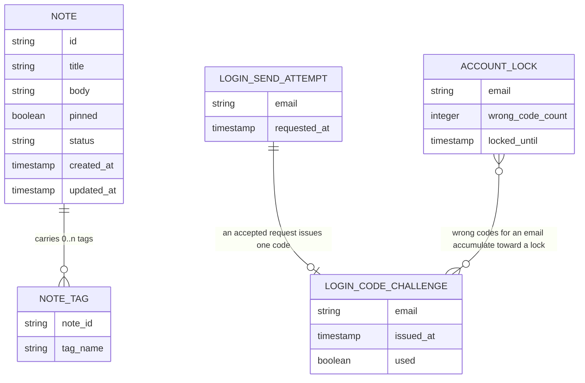

<!-- SECTION: backend.overview | status: VERIFIED -->
## Overview

**Run outcome.** This run ends with `HALT-BLOCKING-QUESTION`.
- `Q-BE-001`, `Q-BE-002` and `Q-BE-003` are blocking, and no input answers them.
- `RUN-CONTEXT.unattended` is `true`, so the run halts on them.
- All eleven sections are emitted. `backend.auth-model` is `BLOCKED`.
- `RUN-CONTEXT.run_mode` is `incremental`. `existing.max_ids` was supplied empty, so no new numbered `GAP-`, `CON-`, `Q-` or `ASM-` item is minted in this document. See `backend.coverage` for how new open points are carried.

**Change in scope (CR-132).** Email one-time-code login. The CR text said the expiry, resend and lockout numbers were undecided, and the CR answer record says "Not decided yet". The approved requirements nevertheless state them, so those requirements govern and no number is invented here. The CR's own suggested values (resend once per 60 seconds) are a suggestion and were not adopted, because BR-021, BR-028 and BR-032 supersede them.

| Value | Decision | Source |
|---|---|---|
| Code expiry | 10 minutes after issue | BR-020, BR-024, BR-026 |
| Resend limit | 3 requests within 10 minutes; beyond that, HTTP 429 | BR-021, BR-028, BR-032 |
| Lockout | 5 wrong codes lock verification for 15 minutes | BR-022, BR-025, BR-027, BR-032 |
| Code format | 6 digits, all numeric | BR-029 |
| Code reuse | single use | BR-023 |
| Verify status mapping | locked 423, wrong 401, expired 410, already used 409 | BR-033 |
| During a lock | only verification is refused; requesting a code is not | BR-032 |

**Responsibilities.** The service is `notes_api`. Its stack is Node.js 20, Express and PostgreSQL 16, hosted on AWS (`platform.md`; `feedback.md` preflight answer). It is responsible for:
- Note create, edit, get, archive and unarchive, with a `pinned` flag, title, body and tags (US-002-01 to US-002-06; BR-005 to BR-008, BR-018).
- Keyword and tag search, combined filters, pagination, archived exclusion, pinned-first ordering and 503 on a degraded index (US-003-01 to US-003-06; BR-009 to BR-011, BR-019).
- Email one-time-code login: a request-code operation and a verify-code operation, with expiry, resend limit, single-use codes and lockout (BR-020 to BR-033; NFR-015 to NFR-019; US-006-06). Emails go through the transactional email service in AWS region eu-west-1 (NFR-017, whose text is garbled; see `GAP-BE-003`).
- A published OpenAPI 3.x document covering every implemented endpoint, with schemas, 4xx/5xx errors, examples, a data-residency note and a Scope section (US-004-01 to US-004-06, US-005-01; BR-012, BR-013; NFR-008, NFR-009).
- Standardised refusal of out-of-scope calls (US-005-02 to US-005-05; BR-014 to BR-016; NFR-010, NFR-011).
- EU data residency of the database, compute and backups, with the CI gate, compliance report, launch gate and drift alerting (US-001-01 to US-001-06; BR-001 to BR-004; NFR-001 to NFR-004).

**Not responsible for:**
- Attachment or file-upload endpoints (BR-014).
- Any real-time channel: WebSocket, SSE or polling-push (BR-015).
- Mobile-specific endpoints (BR-016).
- The web_app screens (US-006-01 to US-006-06). They belong to a separate surface; `platform.md` names React 18 + Vite for it.
- Logging and classifying stakeholder requests (BR-017, US-005-06). BR-017 makes this a product-manager process (`GAP-BE-009`).
- Existing login methods. NFR-016 says they "remain unchanged", but no input says what they are (`GAP-BE-007`).

**Design input.** `design-brief.md` carries only acceptance criteria (AC-001-01-01 to AC-002-01-03) and no visual design. Figma is not connected (`RUN-CONTEXT.inputs.figma_mcp`). No design claim is made, and `spec_mode` is `NOT-APPLICABLE` for every backend module.

**Contract input.** `api_docs` is empty and there is no upstream contract (`RUN-CONTEXT.upstream.contract_source` is null). There is no existing-system claim to reconcile.

**Inbound handoffs.** `RUN-CONTEXT.upstream.handoffs` lists four web-app needs: `HANDOFF-WEBAPP-526592`, `HANDOFF-WEBAPP-701819`, `HANDOFF-WEBAPP-733353` and `HANDOFF-WEBAPP-752470`.
- The file bodies were not supplied to this run (`GAP-BE-001`).
- The previously approved handoff record in `feedback.md` summarises earlier web-app needs under different ids. Those summaries cannot be assumed to be the same needs, so none of the four is treated as read.
- Each is therefore dispositioned "cannot be answered this run: content not supplied".
- Closing artefact: the four handoff files.
- Two points the earlier summaries raised are answered here only from requirements, not from the handoffs:
  - Requesting a code is allowed during a lock (BR-032).
  - The lock status is 423 (BR-033).
- The lane-needs step records the dispositions as data.
<!-- /SECTION: backend.overview -->
<!-- SECTION: backend.domain-model | status: DRAFT-UNVERIFIED -->
## Domain model

**Sources**
- `NOTE`:
  - US-002-01 gives a unique ID, timestamps and `pinned=false` by default.
  - BR-005 gives required title and body.
  - BR-007 gives the archive flag. US-002-05 and US-002-06 give the active/archived status.
  - BR-018 gives the pinned flag.
- `NOTE_TAG`: US-002-03 says a repeated add creates no duplicate entry on that note.
- `LOGIN_SEND_ATTEMPT`, `LOGIN_CODE_CHALLENGE` and `ACCOUNT_LOCK` are the three records NFR-019 names ("code challenges, send attempts and account locks"). Their attributes follow from BR-020 to BR-029 and BR-032. The code value itself is deliberately not drawn: how a code is stored is unstated (`GAP-BE-012`).
- `wrong_code_count` sits on the lock record by assumption (`ASM-BE-004`). The challenge-to-lock link is conceptual: wrong codes are counted per email and no foreign key is implied.

**Ownership and cardinality**
- Whether a note belongs to one user or to the shared team workspace is undecided. BR-031's text is a placeholder ("Use the simplest option consistent with the rest of the spec") and its rationale says the rule cannot be written until decided. The diagram has no owner relation (`Q-BE-002`).
- No account entity is defined by any input. `ASM-BE-001` assumes the three login records are keyed by email address.
- Tag rules (case, charset, length, maximum count) are unstated, although US-003-02 implies some characters are invalid (`GAP-BE-010`).
- Residency artefacts (scan results, report, gate status) are infrastructure records, not application entities (`ASM-BE-011`).
<!-- /SECTION: backend.domain-model -->
<!-- SECTION: backend.module-map | status: DERIVED -->
## Module map

Modules are derived from the epics. The derivation is stated in the Source column.

| Module | Boundary | Source |
|---|---|---|
| `notes` | Note create, edit, get, archive, unarchive, `pinned` flag and tags. Archive is a flag, never a delete. | US-002-01 to US-002-06; BR-005 to BR-008, BR-018 |
| `search` | Keyword, tag and combined filters, pagination, archived exclusion, pinned-first ordering, 503 when the index is degraded. | US-003-01 to US-003-06; BR-009 to BR-011, BR-019 |
| `auth` | Request-code and verify-code: 6-digit codes, 10-minute expiry, 3-requests-per-10-minutes limit, single use, 15-minute lock after 5 wrong codes, email delivery, retention purge of login records. | US-006-06; BR-020 to BR-033; NFR-015 to NFR-019 |
| `contract-docs` | Published OpenAPI 3.x document, spec-versus-route coverage check, data-residency note, Scope section. | US-004-01 to US-004-06, US-005-01; BR-012, BR-013; NFR-008, NFR-009 |
| `scope-guard` | Standardised refusal of attachment, real-time and mobile calls, and contract tests for their absence. | US-005-02 to US-005-05; BR-014 to BR-016; NFR-010, NFR-011 |
| `residency` | Region-constrained provisioning, EU-only backup validation, CI residency gate, compliance report, launch gate, drift scan and alert. | US-001-01 to US-001-06; BR-001 to BR-004; NFR-001 to NFR-004 |

**Dependency direction** (A → B means A depends on B):
- `search → notes`. It reads notes and tags.
- `contract-docs → notes, search, auth, scope-guard`. It reads the route registry only and does not call them at runtime.
- `scope-guard` is request middleware over the whole HTTP surface and depends on no module.
- `auth → transactional email service` (external, AWS eu-west-1; NFR-017).
- `notes → auth` and `search → auth` for a per-request access check. This edge is pending `Q-BE-002` and `Q-BE-003` and is not committed.
- `residency` depends on no other module. It inspects infrastructure and is not on the request path (`ASM-BE-011`).

There are no cycles. `notes` does not depend on `search`, and neither depends on `contract-docs`.
<!-- /SECTION: backend.module-map -->
<!-- SECTION: backend.api-surface | status: VERIFIED -->
## Api surface

_Rendered by DevAgent from the operation records._

| id | method | path | module | success | errors | summary |
|---|---|---|---|---|---|---|
| `API-AUTH-015365` | POST | `/auth/request-code` | `auth` | 202 | 400, 429, 500 | Request a 6-digit one-time login code to be emailed to an address. Limited to 3 requests per 10 minutes per email; still allowed while verification is locked (BR-028, BR-032). |
| `API-AUTH-592570` | POST | `/auth/verify-code` | `auth` | 200 | 400, 401, 409, 410, 423 | Verify a one-time login code for an email address. Codes are single use, expire 10 minutes after issue, and 5 wrong codes lock verification for 15 minutes (BR-022, BR-023, BR-033). The credential issued on success is undecided (Q-BE-003). |
| `API-CONTRACTDOCS-098363` | GET | `/openapi.json` | `contract-docs` | 200 | 406, 500 | Retrieve the published OpenAPI 3.x document covering every implemented endpoint, with schemas, 4xx/5xx errors, examples, the data-residency note and the Scope section (US-004-01 to US-004-06, US-005-01; BR-012, BR-013; NFR-008, NFR-009). |
| `API-CONTRACTDOCS-827943` | GET | `/openapi/coverage` | `contract-docs` | 200 | 500 | Run the spec-versus-route coverage check and report which implemented routes are missing from the published OpenAPI document (NFR-008, NFR-010). |
| `API-NOTES-232390` | POST | `/notes` | `notes` | 201 | 400, 415 | Create a note with title, body and optional tags; assigns unique id, timestamps, pinned=false and status active (US-002-01, US-006-02). |
| `API-NOTES-045877` | GET | `/notes/{id}` | `notes` | 200 | 404 | Get one note including status, pinned flag and tags (US-002-02, US-002-06, US-006-02). |
| `API-NOTES-847551` | PATCH | `/notes/{id}` | `notes` | 200 | 400, 404, 415 | Edit a note's title, body and/or pinned flag; pin and unpin are done here (US-002-02, BR-018, US-006-02). |
| `API-NOTES-810640` | POST | `/notes/{id}/archive` | `notes` | 200 | 404, 409 | Archive a note by setting its archived flag; never deletes (US-002-04, US-006-05, BR-007). |
| `API-NOTES-359413` | POST | `/notes/{id}/tags` | `notes` | 200 | 400, 404 | Add a tag to a note; repeating the add creates no duplicate (US-002-03, US-006-04). |
| `API-NOTES-917869` | POST | `/notes/{id}/unarchive` | `notes` | 200 | 404 | Restore an archived note to active (US-002-05, US-006-05, BR-008). |
| `API-RESIDENCY-174124` | POST | `/residency/backup-validations` | `residency` | 200 | 400, 500 | Validate a backup configuration. A non-EU destination fails within 30 seconds and writes no data (US-001-02, BR-001, AC-001-02-02). |
| `API-RESIDENCY-034853` | POST | `/residency/ci-gate-checks` | `residency` | 200 | 400, 500 | Run the CI residency gate against a deployment's resource regions. The result lets the pipeline block a deploy that is not EU-only (US-001-03, BR-002, NFR-002). |
| `API-RESIDENCY-913995` | GET | `/residency/compliance-report` | `residency` | 200 | 404, 500 | Get the current residency compliance report, listing each resource and its region (US-001-04, NFR-004). |
| `API-RESIDENCY-922826` | POST | `/residency/drift-scans` | `residency` | 201 | 500, 503 | Trigger a residency drift scan across all resources. A non-EU resource is logged and alerts the DevOps team within 15 minutes (US-001-06, BR-004, NFR-003). |
| `API-RESIDENCY-202775` | GET | `/residency/drift-scans/{id}` | `residency` | 200 | 404, 500 | Get the result of a drift scan by its identifier (US-001-06, AC-001-06-01, AC-001-06-02). |
| `API-RESIDENCY-648672` | POST | `/residency/launch-gate-checks` | `residency` | 200 | 400, 500, 503 | Evaluate the launch gate. It refreshes the compliance report and reports whether any non-EU resource blocks launch (US-001-05, BR-003, NFR-004). |
| `API-RESIDENCY-026899` | POST | `/residency/provisioning-requests` | `residency` | 201 | 400, 500 | Request provisioning of an infrastructure resource. The request is accepted only if the target region is an approved EU region (BR-001, US-001-01). |
| `API-SEARCH-842161` | GET | `/search` | `search` | 200 | 400, 503 | Search notes by keyword, tag or both, with pagination, archived exclusion by default and pinned-first ordering; returns 503 with a retry-after header when the search index is degraded. |

### `API-AUTH-015365` — POST `/auth/request-code`

Request a 6-digit one-time login code to be emailed to an address. Limited to 3 requests per 10 minutes per email; still allowed while verification is locked (BR-028, BR-032).

**Request:** 
- `email` (string, required): Email address that will receive the one-time code. Masked in logs and examples (NFR-018).
**Response:** none

### `API-AUTH-592570` — POST `/auth/verify-code`

Verify a one-time login code for an email address. Codes are single use, expire 10 minutes after issue, and 5 wrong codes lock verification for 15 minutes (BR-022, BR-023, BR-033). The credential issued on success is undecided (Q-BE-003).

**Request:** 
- `email` (string, required): Email address the code was sent to.
- `code` (string, required): The 6-digit numeric one-time code (BR-029). Never logged (NFR-018).
**Response:** none

### `API-CONTRACTDOCS-098363` — GET `/openapi.json`

Retrieve the published OpenAPI 3.x document covering every implemented endpoint, with schemas, 4xx/5xx errors, examples, the data-residency note and the Scope section (US-004-01 to US-004-06, US-005-01; BR-012, BR-013; NFR-008, NFR-009).

**Request:** none
**Response:** 
- `openapi` (string, required): OpenAPI 3.x version string of the document.
- `info` (object, required): API title and version. Its description carries the data-residency note (BR-013, US-004-06) and the Scope section stating that attachments, real-time channels and mobile-specific endpoints are out of scope (US-005-01; BR-014 to BR-016).
- `paths` (object, required): Every implemented endpoint, including the login endpoints, each with documented 4xx/5xx responses and examples (BR-012, NFR-008, NFR-009).
- `components` (object, required): Reusable schemas, including the error body schema (US-004-02, US-004-03).

### `API-CONTRACTDOCS-827943` — GET `/openapi/coverage`

Run the spec-versus-route coverage check and report which implemented routes are missing from the published OpenAPI document (NFR-008, NFR-010).

**Request:** none
**Response:** 
- `implemented_routes` (integer, required): Number of implemented routes found in the route registry.
- `documented_routes` (integer, required): Number of those routes present in the published OpenAPI document.
- `coverage_percent` (number, required): Share of implemented endpoints present in the published spec. The target is 100% (NFR-008).
- `undocumented_routes` (array, required): Implemented routes absent from the published document, each as a method and path. Empty when coverage is complete.
- `out_of_scope_routes` (array, required): Implemented routes that fall into an excluded category (attachment, real-time, mobile). The target is none (NFR-010).

### `API-NOTES-232390` — POST `/notes`

Create a note with title, body and optional tags; assigns unique id, timestamps, pinned=false and status active (US-002-01, US-006-02).

**Request:** 
- `title` (string, required): Note title; required (BR-005).
- `body` (string, required): Note body; required (BR-005).
- `tags` (array): Tag names to attach; tag rules open (GAP-BE-010).
**Response:** 
- `id` (string, required): Unique note id.
- `title` (string, required): Note title.
- `body` (string, required): Note body.
- `pinned` (boolean, required): Pinned flag; false by default.
- `status` (string, required): active or archived.
- `tags` (array, required): Tag names on the note.
- `created_at` (string, required): Creation timestamp.
- `updated_at` (string, required): Last update timestamp.

### `API-NOTES-045877` — GET `/notes/{id}`

Get one note including status, pinned flag and tags (US-002-02, US-002-06, US-006-02).

**Request:** 
- `id` (string, required): Note id (path parameter).
**Response:** 
- `id` (string, required): Unique note id.
- `title` (string, required): Note title.
- `body` (string, required): Note body.
- `pinned` (boolean, required): Pinned flag.
- `status` (string, required): active or archived.
- `tags` (array, required): Tag names on the note.
- `created_at` (string, required): Creation timestamp.
- `updated_at` (string, required): Last update timestamp.

### `API-NOTES-847551` — PATCH `/notes/{id}`

Edit a note's title, body and/or pinned flag; pin and unpin are done here (US-002-02, BR-018, US-006-02).

**Request:** 
- `id` (string, required): Note id (path parameter).
- `title` (string): New title; must not be empty if sent.
- `body` (string): New body; must not be empty if sent.
- `pinned` (boolean): Set or clear the pinned flag.
**Response:** 
- `id` (string, required): Unique note id.
- `title` (string, required): Note title.
- `body` (string, required): Note body.
- `pinned` (boolean, required): Pinned flag.
- `status` (string, required): active or archived.
- `tags` (array, required): Tag names on the note.
- `created_at` (string, required): Creation timestamp.
- `updated_at` (string, required): Updated timestamp.

### `API-NOTES-810640` — POST `/notes/{id}/archive`

Archive a note by setting its archived flag; never deletes (US-002-04, US-006-05, BR-007).

**Request:** 
- `id` (string, required): Note id (path parameter).
**Response:** 
- `id` (string, required): Note id.
- `status` (string, required): archived.
- `updated_at` (string, required): Updated timestamp.

### `API-NOTES-359413` — POST `/notes/{id}/tags`

Add a tag to a note; repeating the add creates no duplicate (US-002-03, US-006-04).

**Request:** 
- `id` (string, required): Note id (path parameter).
- `tag` (string, required): Tag name to add; rules open (GAP-BE-010).
**Response:** 
- `id` (string, required): Note id.
- `tags` (array, required): Tag names on the note after the add, without duplicates.
- `updated_at` (string, required): Updated timestamp.

### `API-NOTES-917869` — POST `/notes/{id}/unarchive`

Restore an archived note to active (US-002-05, US-006-05, BR-008).

**Request:** 
- `id` (string, required): Note id (path parameter).
**Response:** 
- `id` (string, required): Note id.
- `status` (string, required): active.
- `updated_at` (string, required): Updated timestamp.

### `API-RESIDENCY-174124` — POST `/residency/backup-validations`

Validate a backup configuration. A non-EU destination fails within 30 seconds and writes no data (US-001-02, BR-001, AC-001-02-02).

**Request:** 
- `backup_name` (string, required): Name or identifier of the backup job or configuration being validated.
- `destination_region` (string, required): Region of the backup destination to validate.
- `replica_regions` (array): Any additional regions the backup is copied to. Each must also be an EU region.
**Response:** 
- `valid` (boolean, required): True only if every backup destination is in an approved EU region.
- `backup_name` (string, required): Echo of the backup name.
- `validated_regions` (array, required): Regions that were checked.
- `validated_at` (string, required): Timestamp of the validation (UTC).

### `API-RESIDENCY-034853` — POST `/residency/ci-gate-checks`

Run the CI residency gate against a deployment's resource regions. The result lets the pipeline block a deploy that is not EU-only (US-001-03, BR-002, NFR-002).

**Request:** 
- `deployment_id` (string, required): Identifier of the deployment or pipeline run being checked.
- `resources` (array, required): Resources in the deployment, each with a name and a region.
**Response:** 
- `gate_result` (string, required): pass or fail. A fail means the deploy must not reach production.
- `deployment_id` (string, required): Echo of the deployment identifier.
- `violations` (array, required): Resources found outside approved EU regions, each with name and region. Empty on pass.
- `checked_at` (string, required): Timestamp of the check (UTC).

### `API-RESIDENCY-913995` — GET `/residency/compliance-report`

Get the current residency compliance report, listing each resource and its region (US-001-04, NFR-004).

**Request:** none
**Response:** 
- `generated_at` (string, required): Timestamp when the report was generated (UTC).
- `total_resources` (integer, required): Number of resources covered by the report.
- `eu_resources` (integer, required): Number of resources verified as being in an approved EU region.
- `compliance_percentage` (number, required): Share of resources verified as EU (NFR-001).
- `resources` (array, required): Per-resource entries, each with name, type, region and an EU-verified flag.

### `API-RESIDENCY-922826` — POST `/residency/drift-scans`

Trigger a residency drift scan across all resources. A non-EU resource is logged and alerts the DevOps team within 15 minutes (US-001-06, BR-004, NFR-003).

**Request:** none
**Response:** 
- `scan_id` (string, required): Identifier of the scan.
- `status` (string, required): Scan status, such as completed or failed.
- `started_at` (string, required): Timestamp when the scan started (UTC).
- `resources_scanned` (integer, required): Number of resources inspected.
- `drift_detected` (boolean, required): True if any resource was found outside an approved EU region.
- `drifted_resources` (array, required): Resources found outside the EU, each with name, type and region. Empty when none.
- `alert_sent` (boolean, required): True if an alert was raised to the DevOps team for this scan.

### `API-RESIDENCY-202775` — GET `/residency/drift-scans/{id}`

Get the result of a drift scan by its identifier (US-001-06, AC-001-06-01, AC-001-06-02).

**Request:** 
- `id` (string, required): Identifier of the drift scan. This is the {id} path parameter.
**Response:** 
- `scan_id` (string, required): Identifier of the scan.
- `status` (string, required): Scan status.
- `started_at` (string, required): Timestamp when the scan started (UTC).
- `resources_scanned` (integer, required): Number of resources inspected.
- `drift_detected` (boolean, required): True if any resource was found outside an approved EU region.
- `drifted_resources` (array, required): Resources found outside the EU, each with name, type and region. Empty when none.
- `alert_sent` (boolean, required): True if an alert was raised to the DevOps team for this scan.

### `API-RESIDENCY-648672` — POST `/residency/launch-gate-checks`

Evaluate the launch gate. It refreshes the compliance report and reports whether any non-EU resource blocks launch (US-001-05, BR-003, NFR-004).

**Request:** 
- `release_id` (string): Identifier of the release being gated, for the record.
**Response:** 
- `gate_result` (string, required): pass or fail. A fail blocks launch.
- `report_generated_at` (string, required): Timestamp of the refreshed compliance report the decision is based on (UTC).
- `compliance_percentage` (number, required): Share of resources verified as EU at the time of the check.
- `blocking_findings` (array, required): Non-EU resources that block launch, each with name and region. Empty on pass.

### `API-RESIDENCY-026899` — POST `/residency/provisioning-requests`

Request provisioning of an infrastructure resource. The request is accepted only if the target region is an approved EU region (BR-001, US-001-01).

**Request:** 
- `resource_type` (string, required): Kind of infrastructure resource to provision, such as database, compute or backup storage.
- `resource_name` (string, required): Name of the resource to provision.
- `region` (string, required): Target region. Must be an approved EU region or the request is refused.
**Response:** 
- `provisioning_id` (string, required): Identifier of the accepted provisioning request.
- `resource_type` (string, required): Echo of the resource type.
- `resource_name` (string, required): Echo of the resource name.
- `region` (string, required): The approved EU region the resource was provisioned in.
- `status` (string, required): Outcome of the request, for example accepted.
- `created_at` (string, required): Timestamp when the request was accepted (UTC).

### `API-SEARCH-842161` — GET `/search`

Search notes by keyword, tag or both, with pagination, archived exclusion by default and pinned-first ordering; returns 503 with a retry-after header when the search index is degraded.

**Request:** 
- `q` (string): Keyword matched against note title and body (US-003-01). At least one of q or tag is required.
- `tag` (string): Tag filter (US-003-02). When combined with q, both filters apply together (US-003-04). At least one of q or tag is required.
- `include_archived` (boolean): When absent or false, archived notes are excluded from results (US-003-06, BR-009). Invalid values return 400.
- `page` (integer): Page number for pagination (US-003-05, BR-011). Invalid values return 400.
- `limit` (integer): Page size, up to 100 (NFR-007, US-003-05). Invalid values return 400.
**Response:** 
- `items` (array, required): Matching notes for the requested page, pinned notes ordered first (BR-019, US-003-01). Each item shows the note's id, title, body, tags, pinned flag and status, as defined once by the notes module.
- `page` (integer, required): The page number returned.
- `limit` (integer, required): The page size applied.
- `total` (integer, required): Total number of notes matching the filters, so clients can paginate.
<!-- /SECTION: backend.api-surface -->
<!-- SECTION: backend.auth-model | status: BLOCKED -->
## Auth model

**Blocked.** The actors, roles and permission matrix cannot be written. Three blocking human decisions are open and no input answers them:

| Open decision | What the inputs say | Unblocked by |
|---|---|---|
| `Q-BE-001`: who may request, verify or receive a login code | BR-030's text is garbled ("Only Any person with a verified email address may…"). Its rationale says any address that verifies can obtain a credential, which may conflict with the shared-team-workspace default, and that the rule stays open until decided. | A clean statement of BR-030: any email address, or only a known set. |
| `Q-BE-002`: note ownership and the access predicate | BR-031's text is a placeholder. Its rationale says ownership columns and the note access rule cannot be written until decided. | A decision: per-user ownership or shared workspace, and the access rule for each note operation. |
| `Q-BE-003`: what a successful verify issues | No input defines a credential, lifetime, transport, refresh, logout, or whether the notes and search operations require one. | A session-model decision. |

**What is known and does not depend on those decisions**
- The lock, rate-limit and code rules are in BR-020 to BR-033.
- Requesting a code is not refused during a lock (BR-032).

**Rows the matrix will need once unblocked**
- Every note operation, the search operation, request-code, verify-code, and the OpenAPI document retrieval.
- The residency operations. No input names an actor for them beyond the story personas (Platform/DevOps Engineer, Release/CI Pipeline Owner, Compliance/Security Auditor, Engineering Lead).

No role is named here, because none is defined by any input.
<!-- /SECTION: backend.auth-model -->
<!-- SECTION: backend.data-lifecycle | status: DRAFT-UNVERIFIED -->
## Data lifecycle

| Data | Stored where | Retention | Deletion | Source |
|---|---|---|---|---|
| Notes and tags | PostgreSQL 16, EU region | Kept indefinitely. Archive is a flag, never a delete. | Retention never deletes notes. No hard-delete operation is defined by any input. | BR-001, BR-007, BR-008, NFR-019; `platform.md` |
| Backups of the notes database | EU-only storage | No input states a backup retention period. | Not stated. | US-001-02, BR-001 |
| Login code challenges, send attempts, account locks | PostgreSQL 16, EU region | NFR-019 reads "kept 1, send attempts 1 and account locks 5 days". The text is garbled, so the unit for the first two figures and their mapping are not asserted (`GAP-BE-012`). | The purge job deletes records older than their retention period (NFR-019). Schedule unstated. | NFR-019, BR-001 |
| Email address in login records and in emails | Database in EU; email service in AWS eu-west-1 | As login records above. | As login records above. | NFR-017, NFR-019 |
| Logs | Not specified | Not stated | Not stated | NFR-018 covers redaction only |

**Encryption at rest.** No input states that any of this data is encrypted at rest, in backups or in transit. Nothing is asserted. This is an open point (see `backend.coverage`).

**Code storage.** How the one-time code is stored (plain, hashed, or not stored) is unstated (`GAP-BE-012`).

**PII.** Email addresses are PII. They are masked in logs (NFR-018) and masked in every example in this specification.

**Email transit.** NFR-017 states that login emails are sent through the transactional email service in AWS eu-west-1 (Ireland). The condition under which an address may leave the EU is garbled in the source text (`GAP-BE-003`).

**Residency of everything stored.** All infrastructure, including backups, is provisioned only in approved EU regions (BR-001). The approved region list itself is not in any input.
<!-- /SECTION: backend.data-lifecycle -->
<!-- SECTION: backend.nfr | status: DRAFT-UNVERIFIED -->
## Non-functional requirements

Every figure below has a cited source. None is invented.

| Area | Target | Source |
|---|---|---|
| Search latency | p95 < 300 ms under 50 requests per second | NFR-006, US-003-03 |
| Search at scale | The same SLA holds at page sizes up to 100, and on a 100k-note dataset via indexed lookup | NFR-007, US-003-03 |
| Availability | 99.9% monthly for CRUD and search | NFR-013 |
| Degraded search index | 503 with a retry-after header, not a hang | US-003-03 |
| Backup config validation | A non-EU destination fails the job within 30 seconds and writes no data | AC-001-02-02 |
| Residency, infrastructure | 100% of infrastructure components EU-verified | NFR-001 |
| Residency, deploys | 0 non-EU deploys reach production | NFR-002 |
| Drift alert | Alert fired within 15 minutes of drift detection | NFR-003 |
| Compliance report | Refreshed and 100% accurate at each launch-gate check | NFR-004 |
| OpenAPI coverage | 100% of implemented endpoints in the published spec | NFR-008 |
| Example payloads | 100% of search and tagging endpoints have examples | NFR-009 |
| Scope guardrail | 0 out-of-scope endpoints detected per CI build | NFR-010 |
| Out-of-scope refusals | 100% return a documented 4xx with an explanatory message | NFR-011 |
| Injection | 0 critical injection vulnerabilities per release | NFR-012 |
| CRUD correctness | 100% functional-test pass rate | NFR-005 |
| Login email region | Sent through AWS eu-west-1. The measurable target is garbled. | NFR-017, `GAP-BE-003` |
| Login log redaction | No unredacted email address or code in logs. Share of offending log entries is the metric. | NFR-018 |
| Login record retention | Share of records past their retention period that are deleted | NFR-019, `GAP-BE-012` |

**Not stated anywhere:**
- Latency, throughput and concurrency targets for the request-code and verify-code operations.
- Availability for login. NFR-013 names CRUD and search only.
- Any throughput target for the note CRUD operations.

These are not invented. Rate limits are defined only where an input states them: 3 requests in 10 minutes for request-code (BR-028) and the 5-wrong-code lock for verify-code (BR-027). Whether verify-code carries any other rate limit is open under `GAP-BE-008`.
<!-- /SECTION: backend.nfr -->
<!-- SECTION: backend.error-model | status: DRAFT-UNVERIFIED -->
## Error model

**Envelope.** No input defines a global error envelope. The envelope shape and final code names are open (`GAP-BE-011`). The proposal below is the minimum the stories require: a stable machine-readable `code`, a human-readable `message` (US-005-04) and, where applicable, a retry hint. It is not a contract until approved.

**Status-code policy** (each row cited):

| Status | Used for | Source |
|---|---|---|
| 400 | Validation failure: missing or empty fields, bad query values, bad page/limit/`include_archived` | AC-002-01-03, US-003-01 to US-003-06 |
| 401 | Wrong one-time code on verify | BR-033 |
| 404 | Unknown note | US-002-02, US-002-05, US-002-06 |
| 406 | Unsupported Accept on the OpenAPI document (or a documented default-format fallback) | US-004-01 |
| 409 | Note already archived; one-time code already used | US-002-04; BR-033 |
| 410 | Expired one-time code | BR-033 |
| 415 | Multipart or file payload on a note endpoint | US-005-02 |
| 423 | Verify while the account is locked | BR-033 |
| 429 | More than 3 code requests within 10 minutes | BR-028, BR-032 |
| 503 | Search index degraded or unavailable, with a retry-after header | US-003-03 |
| 5xx | Unspecified server failure | US-004-03 |

**Error-code registry** (machine-readable codes):

| Code | Status | Meaning | Source |
|---|---|---|---|
| `VALIDATION_ERROR` | 400 | A request field or parameter is invalid | `ASM-BE-018` |
| `OUT_OF_SCOPE` | per US-005-04 | A call to an excluded capability. The status for each out-of-scope category follows US-005-02, US-005-03 and US-005-04. | US-005-04 (given as an example name) |
| `AUTH_CODE_LOCKED` | 423 | Verification refused during the 15-minute lock | BR-033; name proposed |
| `AUTH_CODE_INVALID` | 401 | Wrong code | BR-033; name proposed |
| `AUTH_CODE_EXPIRED` | 410 | Code older than 10 minutes | BR-033; name proposed |
| `AUTH_CODE_USED` | 409 | Code already used | BR-033; name proposed |
| `AUTH_RATE_LIMITED` | 429 | More than 3 code requests in 10 minutes | BR-028; name proposed |

Every name marked "proposed" is an assumption pending `GAP-BE-011`. `NOT_FOUND`, `NOTE_ALREADY_ARCHIVED`, `UNSUPPORTED_MEDIA_TYPE`, `SEARCH_UNAVAILABLE` and similar names are open and not asserted.

**Verify refusal precedence.** When more than one refusal could apply to one verify call, the order is lock, then used, then expired, then wrong (`ASM-BE-003`). No input states this order.

**Open points on login errors** (`GAP-BE-008`, `GAP-BE-011`):
- Whether the lock response carries the remaining lock time or a retry hint.
- Whether 429 carries a retry hint, and its value.
- Whether an expired or used code counts toward the 5 wrong codes.
- When the wrong-code counter resets.
- Whether verify-code has any rate limit beyond the lock.
- Whether a newly issued code invalidates an earlier one.
- Whether the 3-in-10-minutes window slides or is fixed.
- The expiry boundary. BR-033's sentence about a code submitted exactly 10 minutes after issue is garbled, and the stated rule is only "codes expire after 10 minutes".

**Email delivery failure.** No input says what request-code returns when the email service fails. `ASM-BE-013` assumes 500 with nothing persisted.

**Redaction.** No error body or log line contains the code or an unmasked email address (NFR-018).
<!-- /SECTION: backend.error-model -->
<!-- SECTION: backend.observability | status: UNKNOWN -->
## Observability

**Status: DRAFT-UNVERIFIED.**

**Logged**
- Residency scan results, with a pass logged when all resources are in the EU (AC-001-06-01).
- The residency compliance report (US-001-04).
- Login events, subject to the redaction below. Which events are logged is not stated by any input.

**Redacted**
- One-time login codes are never logged (NFR-018).
- The local part of an email address is masked in logs (NFR-018).
- Examples in this specification mask all PII.

**Metered**
- Per-outcome login counters (requested, verified, wrong, expired, used, locked, rate-limited) are proposed (`ASM-BE-012`). No input requires them.
- The measurable targets that exist are the NFR metrics: residency %, the OpenAPI coverage %, the share of log entries with unredacted PII, and the share of expired records purged (NFR-001, NFR-008, NFR-018, NFR-019).

**Alerts**
- A resource found in a non-EU region alerts the DevOps team with resource details, within 15 minutes of detection (AC-001-06-02, BR-004, NFR-003). US-001-06 says "immediately"; NFR-003 gives the 15-minute bound.
- No other alert is required by an input. Alerting on search 503s, email delivery failures or lock rates is not specified.

**Request classification.** Logging and classifying stakeholder feature requests (US-005-06, BR-017) is a product-manager process, not a service capability (`GAP-BE-009`).
<!-- /SECTION: backend.observability -->
<!-- SECTION: backend.migration-plan | status: UNKNOWN -->
## Migration plan

**Status: DRAFT-UNVERIFIED.** The ordering follows the dependency direction in `backend.module-map`. No input defines migrations. Reversibility is stated per step as a proposal.

| Order | Migration | Depends on | Reversible |
|---|---|---|---|
| 1 | Notes and note-tag tables, including `pinned` and `status` (BR-007, BR-018) | none | Yes while empty. Once notes exist, dropping them loses data, so a reverse after launch is not safe. |
| 2 | Search indexing over note title, body and tags (US-003-03: indexed lookup) | 1 | Yes. Dropping an index loses no data. |
| 3 | Login code challenge, send attempt and account lock tables (NFR-019) | none | Yes. No business data lives in them. Active locks would be lost on reverse. |
| 4 | Retention purge job for the login tables (NFR-019) | 3 | Yes. The job can be disabled. |
| 5 | Note ownership columns and access predicate | 1 | Not defined. Blocked by `Q-BE-002`. |

**Notes**
- Whether a code value is stored, and how, changes the shape of migration 3 (`GAP-BE-012`).
- Infrastructure provisioning (EU region only) is infrastructure-as-code, not an application migration (BR-001, `ASM-BE-011`).
- Tag column constraints wait on `GAP-BE-010`.
<!-- /SECTION: backend.migration-plan -->
<!-- SECTION: backend.coverage | status: DERIVED -->
## Coverage

All 36 supplied stories appear below. Functional requirement ids (`BE-<M>-FR-nnn`) are defined in the module specs. Here each story is mapped to the module that owns it and the requirement and NFR ids that cover it.

| Story | Module | Covered by | Note |
|---|---|---|---|
| US-001-01 | residency | BR-001, NFR-001 | |
| US-001-02 | residency | BR-001, NFR-001 | |
| US-001-03 | residency | BR-002, NFR-002 | |
| US-001-04 | residency | NFR-004, NFR-001 | |
| US-001-05 | residency | BR-003, NFR-004 | |
| US-001-06 | residency | BR-004, NFR-003 | |
| US-002-01 | notes | BR-005, BR-018, NFR-005 | |
| US-002-02 | notes | BR-006, BR-018 | |
| US-002-03 | notes | module requirement; NFR-012 | No business rule; tag rules open (`GAP-BE-010`) |
| US-002-04 | notes | BR-007 | |
| US-002-05 | notes | BR-008 | |
| US-002-06 | notes | NFR-005 | |
| US-003-01 | search | BR-009, BR-019 | |
| US-003-02 | search | BR-010 | Tag rules open (`GAP-BE-010`) |
| US-003-03 | search | NFR-006 | |
| US-003-04 | search | BR-010 | |
| US-003-05 | search | BR-011, NFR-007 | |
| US-003-06 | search | BR-009 | |
| US-004-01 | contract-docs | BR-012, NFR-008, NFR-015, NFR-016 | Now lists the login endpoints |
| US-004-02 | contract-docs | BR-012 | |
| US-004-03 | contract-docs | BR-012, BR-028, BR-033 | 429 and locked responses for login |
| US-004-04 | contract-docs | BR-012, NFR-008 | |
| US-004-05 | contract-docs | NFR-009 | |
| US-004-06 | contract-docs | BR-013 | |
| US-005-01 | contract-docs, scope-guard | BR-014, BR-015, BR-016 | |
| US-005-02 | scope-guard | BR-014, NFR-010 | |
| US-005-03 | scope-guard | BR-015 | |
| US-005-04 | scope-guard | BR-016, NFR-011 | |
| US-005-05 | scope-guard | NFR-010 | |
| US-005-06 | none | none | **Uncovered**: a product-manager process (BR-017), not a service capability (`GAP-BE-009`, `GAP-BE-016`) |
| US-006-01 | none | none | **Uncovered**: search requires `q` or a tag, and no story defines an operation listing active notes (`GAP-BE-005`, `GAP-BE-016`) |
| US-006-02 | notes | BR-005, BR-006 | Backend side only; the screen belongs to web_app |
| US-006-03 | search | BR-009, BR-010 | Backend side only |
| US-006-04 | notes | module requirement | Backend side only; no operation lists distinct tags (`GAP-BE-006`) |
| US-006-05 | notes | BR-007, BR-008 | Backend side only |
| US-006-06 | auth | BR-020 to BR-033, NFR-015 to NFR-019 | Session model open (`Q-BE-003`) |

**Contradiction checks.** All four directions were checked.
- Story ↔ design: the design brief carries only acceptance criteria that repeat the stories, so nothing to contradict.
- Story ↔ requirement: US-004-03 documents 401/403 for authenticated endpoints, while no input defines any authenticated endpoint (`Q-BE-003`). That is a gap, not a contradiction.
- Requirement ↔ requirement:
  - BR-021 and BR-028 speak of "resends", while BR-032 counts "requests". BR-032 is read as governing (3 total requests in 10 minutes).
  - BR-020, BR-024 and BR-026 restate one expiry rule (10 minutes) consistently.
  - BR-022, BR-025 and BR-027 restate one lockout rule consistently.
- Design ↔ design: not applicable.
- No new `CON-` is raised. The CR-132 answer record ("Not decided yet") and the approved requirements do not conflict: one records an absent answer, the other records decisions.
- The earlier `CON-BE-001` to `CON-BE-004` are carried unchanged.

**Register of open items**

| ID | Class | One-line subject | Source |
|---|---|---|---|
| `Q-BE-001` | blocking | Who may request, verify or receive a code (BR-030) | `backend.auth-model` |
| `Q-BE-002` | blocking | Note ownership and the access rule (BR-031) | `backend.auth-model` |
| `Q-BE-003` | blocking | Credential issued on verify; session model | `backend.auth-model` |
| `GAP-BE-001` | gap | Handoff bodies not supplied | `backend.overview` |
| `GAP-BE-003` | gap | NFR-017 garbled | `backend.data-lifecycle` |
| `GAP-BE-005` | gap | No list-active or archived-only operation | `backend.coverage` |
| `GAP-BE-006` | gap | No distinct-tags operation | `backend.coverage` |
| `GAP-BE-007` | gap | Existing login methods unknown | `backend.overview` |
| `GAP-BE-008` | gap | Lock-time, counter-reset, window and boundary details | `backend.error-model` |
| `GAP-BE-009` | gap | Request-classification process (BR-017) | `backend.observability` |
| `GAP-BE-010` | gap | Tag rules | `backend.domain-model` |
| `GAP-BE-011` | gap | Final error envelope and code names | `backend.error-model` |
| `GAP-BE-012` | gap | Code storage and retention figures | `backend.data-lifecycle` |
| `GAP-BE-016` | gap | Stories with no backend module | this section |
| `ASM-BE-001` | assumption | Login records keyed by email | `backend.domain-model` |
| `ASM-BE-003` | assumption | Verify refusal precedence | `backend.error-model` |
| `ASM-BE-004` | assumption | Wrong-code count on the lock record | `backend.domain-model` |
| `ASM-BE-011` | assumption | `residency` is infrastructure tooling | `backend.module-map` |
| `ASM-BE-012` | assumption | Per-outcome login counters | `backend.observability` |
| `ASM-BE-013` | assumption | Email failure returns 500 | `backend.error-model` |

The register lists only items this document cites. Every other `GAP-`, `CON-`, `ASM-` and `Q-` item in the module specs is carried unchanged, including `Q-BE-054` to `Q-BE-056` with their defaults `ASM-BE-065` to `ASM-BE-067` and `CON-BE-003`.

**Open points without an id.** `existing.max_ids` was empty, so no safe continuation point exists for new numbered items. These points are carried as prose, and the orchestrator should allocate ids:
1. Encryption at rest, in backups and in transit is unstated for all data (`backend.data-lifecycle`).
2. Backup retention period is unstated.
3. Latency and availability targets for the login operations are unstated (`backend.nfr`).
4. The four inbound handoffs are unread, so a possible mismatch with the earlier handoff summaries is unconfirmed (`GAP-BE-001`).
5. Log retention is unstated.
<!-- /SECTION: backend.coverage -->
<!-- SECTION: backend.lane-needs | status: VERIFIED -->
## Lane needs

### Needs this lane raised

| Need | Kind | What is needed | Why | Blocking | Waiting sections |
|---|---|---|---|---|---|
| `HANDOFF-NOTESAPI-969269` | `business_rule` | Restate BR-030 cleanly: may any email address request, verify and receive a login code, or only a known set of addresses? | BR-030 is garbled and its rationale says the rule stays open. The actors and permission matrix in the auth model cannot be written without it. | yes | `backend.auth-model`, `backend.domain-model`, `backend.module-map` |
| `HANDOFF-NOTESAPI-690778` | `business_rule` | Decide note ownership (per-user or shared team workspace) and the access rule for each note and search operation, replacing the placeholder text of BR-031. | Ownership columns, the access predicate and the notes/search to auth dependency cannot be specified until this is decided. | yes | `backend.auth-model`, `backend.domain-model`, `backend.migration-plan`, `backend.module-map` |
| `HANDOFF-NOTESAPI-193009` | `business_rule` | Define the session model: the credential returned by a successful verify-code (type, lifetime, transport), refresh behaviour, logout, and whether notes and search operations require a session. | The verify-code response, 401/403 handling for protected endpoints and the auth model depend on it. | yes | `backend.auth-model`, `backend.api-surface`, `backend.error-model` |
| `HANDOFF-NOTESAPI-206942` | `story` | Add a story or rule for listing active notes and archived-only notes with pagination, and for listing distinct tags and removing a tag from a note. | Search needs q or tag, so no operation lists notes or tags. US-006-01 and US-006-04 are uncovered in the coverage section. | no | `backend.api-surface`, `backend.coverage` |
| `HANDOFF-NOTESAPI-872672` | `business_rule` | Specify retry hints and values for 429 and 503, remaining lock time and the re-enable rule on 423, wrong-code counter reset, window type, expiry boundary, and the final error envelope and code names. | The error model carries these as open points (GAP-BE-008, GAP-BE-011) and cannot state them without a decision. | no | `backend.error-model`, `backend.nfr` |
| `HANDOFF-NOTESAPI-284535` | `nfr` | Supply the NFR-017 and NFR-019 text without garbling, plus encryption at rest and in transit, backup and log retention, and latency and availability targets for the login operations. | The data lifecycle and NFR sections cannot assert these figures from the inputs. | no | `backend.data-lifecycle`, `backend.nfr`, `backend.observability` |

### Needs this lane cannot answer

| Need | From lane | Asked | Why not |
|---|---|---|---|
| `HANDOFF-WEBAPP-752470` | `web_app` | Define the session model: the credential returned by verify-code (type, lifetime, transport), refresh behaviour, a logout operation, and whether notes and search operations require a session. | The session model is undecided. No input defines a credential, lifetime, transport, refresh, logout or whether notes and search need a session (Q-BE-003, blocking). The decision is outside this lane. |
| `HANDOFF-WEBAPP-526592` | `web_app` | Add operations to list active notes and to list archived-only notes, with pagination. | No input defines an operation that lists active or archived-only notes, and search requires q or tag (GAP-BE-005). Adding one needs a story or a human decision, so this lane does not invent it. |
| `HANDOFF-WEBAPP-701819` | `web_app` | Add operations to list distinct tags and to remove a tag from a note. | No input defines distinct-tag listing or tag removal, and the tag rules are open (GAP-BE-006, GAP-BE-010). Adding them needs a story or a human decision, so this lane does not invent them. |
| `HANDOFF-WEBAPP-733353` | `web_app` | Specify retry-after values for 429 and 503 responses, remaining lock time and re-enable rule on 423, and the field-detail shape of 400 errors. | The retry-after values, the remaining lock time, the 423 re-enable rule and the 400 field-detail shape are not in any input (GAP-BE-008, GAP-BE-011). The error model keeps them open and does not invent them. |
<!-- /SECTION: backend.lane-needs -->
