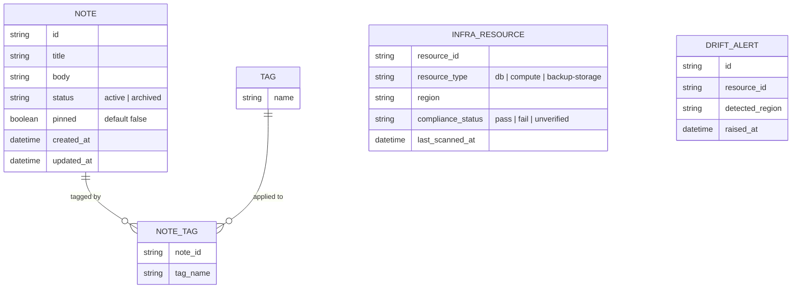

<!-- SECTION: backend.overview | status: DERIVED -->
## Service overview

`notes_api` is the single backend service for a team note-taking product. It has two bodies of in-scope capability, both cited in the supplied requirements:

1. **Application API.** Create, read, update, pin/unpin, tag, archive/unarchive, and search team notes (stories.md EP-002, EP-003), published as a versioned OpenAPI contract (EP-004).
2. **EU data-residency compliance.** Provisioning notes_api's own infrastructure (database, compute, backups) exclusively in approved EU regions, gating deploys on a residency check, generating a compliance report, enforcing a launch gate, and alerting on post-launch region drift (EP-001). [stories.md EP-001; requirements.md BR-001..BR-004, NFR-001..NFR-004]

**Change request CR-112 (incorporated in this revision).** Notes gain a boolean `pinned` flag. It defaults to `false`, is accepted on create and PATCH, is returned in note responses, and pinned notes sort before unpinned notes in list and search results. This is an interface change: consumers must adapt. [feedback.md CR-112; requirements.md BR-018, BR-019, NFR-014; stories.md AC-002-01-01, AC-002-01-02, AC-002-02-02, US-002-06, US-003-01]

**Stack.** Node.js 20, Express, PostgreSQL 16, hosted on AWS. [platform.md; feedback.md]

**Explicitly not in scope**, cited against the business rules that exclude them:

- Attachment and file-upload endpoints of any kind. [requirements.md BR-014]
- Any real-time channel (WebSocket, SSE, or polling-push) for collaborative editing. [requirements.md BR-015]
- Mobile-specific endpoints. [stories.md US-005-01, US-005-04]
- Rendering any user interface. The web-app surface (stories.md EP-006) is a separate run under invariant I-1. This spec defines only the API it consumes. The web pin toggle requested by CR-112 is handed off (`HANDOFF-BE-001`).
- Logging and classifying stakeholder feature requests (stories.md US-005-06). Per requirements.md BR-017's own "Enforcement" field, this is a Product-Manager intake log, not a notes_api system function. No backend requirement derives from US-005-06. See `backend.coverage`.

This overview synthesises cited inputs. It is not a new fact in itself, hence `DERIVED`.
<!-- /SECTION: backend.overview -->
<!-- SECTION: backend.domain-model | status: DRAFT-UNVERIFIED -->
## Domain model

Two largely independent sub-domains are evidenced: the **note-taking domain** (Note, Tag) and the **residency-compliance domain** (InfraResource, DriftAlert). No input relates them beyond "notes_api's infrastructure hosts the note-taking domain's data." [requirements.md BR-013]



- **Note.** Title, body, status (active/archived), `pinned` (boolean), created and updated timestamps. [stories.md AC-002-01-01, US-002-02, US-002-04, US-002-05, US-002-06] Title and body are mandatory and non-empty at creation. [requirements.md BR-005]
- **`pinned` attribute (CR-112).** Boolean, `NOT NULL`, default `false`. Settable on create and changeable via PATCH. [requirements.md BR-018; stories.md AC-002-01-01, AC-002-01-02, AC-002-02-02] Pinning does not alter title, body or tags. [stories.md AC-002-02-02]
- **Tag.** A name, many-to-many with Note via NOTE_TAG. Adding a tag already present is idempotent, with no duplicate entry. [stories.md US-002-03] `GAP-BE-009`: tag name format and length constraints are referenced ("invalid characters") but never defined. `GAP-BE-016`: cascade behaviour when a Tag's last referencing Note is archived or deleted is unspecified.
- **InfraResource.** A provisioned piece of notes_api infrastructure (DB, compute, backup storage) with its reported region and compliance status. Unrecognised resource types are flagged `unverified`, never silently omitted. [stories.md AC-001-04-01, AC-001-04-02]
- **DriftAlert.** A record of a post-launch detection of an InfraResource reporting a non-EU region. [stories.md US-001-06]

**Ownership and visibility.** No input states whether Note is scoped to its creating user (private) or visible to the whole team (shared workspace). `feedback.md`'s "Per-user auth required" establishes that every caller must be an authenticated individual, not that data is partitioned by that identity. `GAP-BE-003` records this gap. **Default applied (`Q-BE-001`, class: degradable, auto-resolved under `unattended: true`):** notes are a shared team workspace. Any authenticated team member may read and write any note, including pinning it. Revisit if the product intent is per-user private notes.

**PII.** No structured PII field exists in this domain model. Note `title` and `body` are free text and may incidentally contain user-entered PII. No masking or handling policy is supplied. `GAP-BE-017` records this. Per core rule 12, no encryption or retention claim is made in its absence.
<!-- /SECTION: backend.domain-model -->
<!-- SECTION: backend.module-map | status: DERIVED -->
## Module map

| Module | Boundary | Depends on |
|---|---|---|
| `notes` | Note CRUD, pin/unpin (via PATCH), tag assignment and removal, archive/unarchive lifecycle. Owns the Note, Tag and NOTE_TAG tables. | none (core module) |
| `search` | Read-only query surface over Note: keyword, tag filter, pagination, archived-exclusion default, pinned-first ordering. | `notes` |
| `residency-compliance` | Infra provisioning region validation, backup-destination region validation, CI/CD residency gate, compliance report generation, launch-gate status, post-launch drift scan and alerting. Owns InfraResource and DriftAlert. | none (operates on the infra and CI/CD layer, not on Note/Tag at runtime) |
| `api-docs` | Publishes the OpenAPI document, including the `pinned` interface change (NFR-014). Computes endpoint-coverage metric. Carries the EU data-residency documentation note. | `notes`, `search`, `residency-compliance` |
| `scope-guardrail` | Intercepts every inbound request ahead of routing. Rejects attachment/multipart, WebSocket/SSE-upgrade and mobile-specific patterns with a structured out-of-scope error. Backs the contract test suite. | sits upstream of `notes` and `search`; cross-cutting, gates everything |

**Dependency direction.** `search → notes`. `api-docs → notes, search, residency-compliance`. Requests flow through `scope-guardrail` before reaching `notes`, `search` or `api-docs`.

**CR-112 impact on boundaries.** No new module. The `pinned` attribute belongs to `notes`. Ordering of list and search results is owned by `notes` for `GET /notes` and by `search` for `GET /notes/search`, and both must apply the same pinned-first rule (`INV-BE-001`).

This grouping organises the cited stories. It is not a new factual claim, hence `DERIVED`.
<!-- /SECTION: backend.module-map -->
<!-- SECTION: backend.api-surface | status: DRAFT-UNVERIFIED -->
## API surface index

Full contracts (request and response schemas, every error, idempotency, rate limits) belong in the per-module `api-contract` sections, which are not produced in this run. This index is their authoritative introduction point.

**Versioning under CR-112.** Endpoints whose request or response shape changes are re-pinned from `@1` to `@2` (`ASM-BE-010`). Endpoints not touched by CR-112 keep `@1`.

| API ID | Method | Path | Auth | Module | Change under CR-112 and notes |
|---|---|---|---|---|---|
| `API-NOTES-001@2` | POST | `/notes` | authenticated team member | `notes` | **Changed from @1.** Accepts optional `pinned` (boolean, default `false`). Returns `pinned` in the 201 body. Title and body rules unchanged. [stories.md AC-002-01-01, AC-002-01-02; requirements.md BR-005, BR-018] |
| `API-NOTES-002@2` | PATCH | `/notes/{id}` | authenticated team member | `notes` | **Changed from @1.** Accepts optional `pinned`. Partial update: fields not sent are never overwritten (BR-006). Returns `pinned`. Pinning leaves title, body and tags unchanged. [stories.md AC-002-02-02; requirements.md BR-006, BR-018] `ASM-BE-001`: method is PATCH, not PUT. The AC text says "PUT/PATCH" interchangeably, but BR-006 mandates PATCH semantics, so the AC's wording is read as informal. |
| `API-NOTES-003@2` | GET | `/notes/{id}` | authenticated team member | `notes` | **Changed from @1.** Returns `pinned` alongside tags and archive status. [stories.md US-002-06 AC1] |
| `API-NOTES-004@2` | GET | `/notes` | authenticated team member | `notes` | **Changed from @1.** Default active-notes list. Returns `pinned`. Ordered pinned-first, then within each group most recently updated first (`feedback.md` preflight answer; see `CON-BE-002`). `GAP-BE-001`: no story gives this endpoint's exact parameters. Inferred from the web-app's need to show a list (US-006-01, out-of-run surface). `GAP-BE-015`: default and max page size not numerically stated. |
| `API-NOTES-005@1` | POST | `/notes/{id}/tags` | authenticated team member | `notes` | Not changed. Add tag, idempotent. `ASM-BE-002`: modelled as a dedicated sub-resource rather than via PATCH, because US-002-03 gives tag-add its own AC distinct from note update. |
| `API-NOTES-006@1` | DELETE | `/notes/{id}/tags/{tag}` | authenticated team member | `notes` | Not changed. Remove tag. Same `ASM-BE-002`. |
| `API-NOTES-007@1` | POST | `/notes/{id}/archive` | authenticated team member | `notes` | Not changed. [stories.md US-002-04] Pinned state is preserved across archive (see `backend.data-lifecycle`). |
| `API-NOTES-008@1` | POST | `/notes/{id}/unarchive` | authenticated team member | `notes` | Not changed. [stories.md US-002-05] Restores full prior state including `pinned` (BR-008). |
| `API-SEARCH-001@2` | GET | `/notes/search` | authenticated team member | `search` | **Changed from @1.** Query: keyword (`q`) and/or `tags`, `page`, `limit`, `include_archived`. Returns `pinned`. Ordered pinned-first, then by relevance within each group (US-003-01 AC1; BR-019). `ASM-BE-006` resolves `CON-BE-001`: at least one of `q` or `tags` must be present. Both absent yields 400. |
| `API-APIDOCS-001@1` | GET | `/openapi.{json\|yaml}` (exact path `GAP-BE-008`) | unauthenticated (`ASM-BE-004`) | `api-docs` | Not changed in path or shape. The published document must describe the `pinned` field and the ordering change as an interface change (NFR-014). [stories.md US-004-01] Unsupported `Accept` yields 406 or a documented fallback. |

`residency-compliance` and `scope-guardrail` own **no end-user HTTP endpoint** evidenced by any input:

- `residency-compliance` provisioning, backup and CI-gate behaviour is infrastructure-as-code and pipeline-hook work, not REST calls against notes_api. Its compliance-report output has no stated delivery mechanism: `GAP-BE-002`.
- `scope-guardrail` is the catch-all behaviour applied to every unmatched or excluded route. It is documented under `backend.error-model`, not as a discrete endpoint ID.

Section is `DRAFT-UNVERIFIED` because `ASM-BE-001`, `ASM-BE-002`, `ASM-BE-004`, `ASM-BE-006`, `ASM-BE-010` and `GAP-BE-001`, `GAP-BE-002`, `GAP-BE-008`, `GAP-BE-015` are unresolved.
<!-- /SECTION: backend.api-surface -->
<!-- SECTION: backend.auth-model | status: DRAFT-UNVERIFIED -->
## Auth model

The only direct instruction on authentication is `feedback.md`: "Q: auth / A: Per-user auth required." Every call must be attributable to an authenticated individual. Anonymous calls to Note, Tag and Search are not permitted.

**`GAP-BE-014`:** the mechanism (OAuth2, JWT, API key, session cookie) is not named by any input. `Q-BE-002` (class: degradable, auto-resolved): the assumed default is bearer-token authentication, with the token identifying a team member. This must be confirmed before implementation.

Actors named across the stories, and their relationship to the API surface:

| Actor | Calls Note, Tag or Search API? | Basis |
|---|---|---|
| Team member | Yes: full CRUD, pin, tag, archive/unarchive, search | stories.md EP-002, EP-003 |
| Integration developer / third-party client | Yes: same operations on behalf of a team member. Also reads the OpenAPI doc. | stories.md EP-004 |
| Platform/DevOps Engineer | No: operates infra provisioning and backup config outside this API | stories.md EP-001 |
| Release/CI Pipeline Owner | No: the residency gate runs inside the deploy pipeline, not as an API call | stories.md US-001-03 |
| Compliance/Security Auditor | Undetermined: reads the compliance report, but its delivery channel is `GAP-BE-002` | stories.md US-001-04 |
| Engineering Lead | Undetermined: reviews the launch checklist; not specified as an API call | stories.md US-001-05 |
| QA Engineer | No: runs the contract test suite at CI time, not a runtime caller | stories.md US-005-05 |
| Product Manager | No: external intake log per requirements.md BR-017 | stories.md US-005-06 |

### Permission matrix (resources exposed by this API)

Pinning and unpinning are performed by PATCH on the note. They therefore fall under **Note: Update** and require the same authority. No separate pin permission exists in any input.

| Role | Note: Create | Note: Read | Note: Update (incl. `pinned`) | Note: Archive/Unarchive | Tag: Add/Remove | Search: Read | OpenAPI Doc: Read |
|---|---|---|---|---|---|---|---|
| Team member (authenticated) | ✅ | ✅ | ✅ | ✅ | ✅ | ✅ | ✅ |
| Unauthenticated caller | ❌ (401) | ❌ (401) | ❌ (401) | ❌ (401) | ❌ (401) | ❌ (401) | ✅ (`ASM-BE-004`) |

No row differentiates team members by note ownership. `Q-BE-001` applies the default from `backend.domain-model`: shared workspace, no per-owner restriction, pending `GAP-BE-003`. No row exists for Auditor or Engineering Lead access to the compliance report, because no API resource for it is evidenced (`GAP-BE-002`). `GAP-BE-007`: no formal RBAC catalogue beyond this exists in any input.
<!-- /SECTION: backend.auth-model -->
<!-- SECTION: backend.data-lifecycle | status: DRAFT-UNVERIFIED -->
## Data lifecycle

| Data | Stored | Retention | Encrypted at rest | Deletion |
|---|---|---|---|---|
| Note (active), including `pinned` | Yes | Not stated (`GAP-BE-005`) | Not stated (`GAP-BE-004`) | Never hard-deleted by any documented flow |
| Note (archived), including `pinned` | Yes, same record, status flag changed | Not stated (`GAP-BE-005`) | `GAP-BE-004` | Archiving is explicitly **not** deletion: "Archiving a note hides it from active views but never deletes underlying data." [requirements.md BR-007] Unarchiving restores the note "without data loss." [requirements.md BR-008] |
| Tag | Yes, referenced by Note via NOTE_TAG | `GAP-BE-016` (cascade behaviour unspecified) | `GAP-BE-004` | Not documented |
| Backup artifact (of the notes database) | Yes, in EU-region storage | Not stated (`GAP-BE-005`) | `GAP-BE-004` | Not documented |
| InfraResource compliance-scan record | Implied by the compliance report | Not stated (`GAP-BE-005`) | `GAP-BE-004` | Not documented |
| DriftAlert | Implied by post-launch alerting | Not stated (`GAP-BE-005`) | `GAP-BE-004` | Not documented |

**CR-112 lifecycle effects.**

- `pinned` is stored on the note row as a `NOT NULL` boolean. It adds no new retention or deletion path. [requirements.md BR-018; DERIVED from BR-007 and BR-008]
- Archive preserves `pinned`, and unarchive restores it, because archive never deletes data and unarchive restores full prior state. [requirements.md BR-007, BR-008] The value of `pinned` on an archived note, and whether archived notes sort pinned-first in `include_archived=true` search results, is unspecified: `GAP-BE-019`.
- A pin change is an update. It sets `updated_at`, which affects "most recently updated first" ordering within the pinned group: `ASM-BE-009`.
- Existing rows receive `pinned = false` at migration time. No backfill is needed (see `backend.migration-plan`).

**What is cited directly:**

- All notes_api database and hosting compute must be provisioned exclusively in approved EU regions. [requirements.md BR-001; stories.md AC-001-01-01]
- A provisioning request naming a non-EU region must be rejected and no resource created. [stories.md AC-001-01-02]
- Scheduled backups must land in an EU-region storage bucket or service. A backup destination outside the EU fails fast before any data is written. [stories.md AC-001-02-01, AC-001-02-02]

Per core rule 12, no encryption, redaction or retention claim beyond what is cited above is made. `GAP-BE-004`, `GAP-BE-005`, `GAP-BE-016` and `GAP-BE-017` are why this section is `DRAFT-UNVERIFIED` rather than `BLOCKED`. Enough is cited to describe the residency guarantee, but the lifecycle mechanics around it are unverified.
<!-- /SECTION: backend.data-lifecycle -->
<!-- SECTION: backend.nfr | status: VERIFIED -->
## Non-functional requirements

Every target below is reproduced verbatim from `requirements.md`. No figure is invented.

| ID | Category | Target | Scope |
|---|---|---|---|
| NFR-001 | Compliance | 100% of infrastructure components EU-verified | EP-001 |
| NFR-002 | Compliance | 0 non-EU deploys reach production | EP-001 |
| NFR-003 | Availability | Alert fired within 15 minutes of drift detection | EP-001 |
| NFR-004 | Compliance | Compliance report refreshed and 100% accurate at each launch-gate check | EP-001 |
| NFR-005 | Performance | 100% functional-test pass rate for CRUD operations, zero data loss | EP-002 |
| NFR-006 | Performance | Search p95 latency < 300ms | EP-003 |
| NFR-007 | Scalability | p95 < 300ms maintained up to page sizes of 100 results | EP-003 |
| NFR-008 | Compliance | 100% endpoint coverage in published OpenAPI spec | EP-004 |
| NFR-009 | Usability | 100% of search/tagging endpoints have example payloads | EP-004 |
| NFR-010 | Compliance | 0 out-of-scope endpoints detected per build, every CI build | EP-005 |
| NFR-011 | Usability | 100% of out-of-scope calls return a documented 4xx with explanatory message | EP-005 |
| NFR-012 | Security | 0 critical injection vulnerabilities per release (title, body, tag fields) | EP-002, EP-003 |
| NFR-013 | Availability | 99.9% uptime monthly for CRUD and search | EP-002, EP-003 |
| NFR-014 | (blank) | "The pinned field and the pinned-first ordering are documented in the published OpenAPI spec as an interface change, and consumers are notified that they must adapt." Target: (blank). | CR-112 |

**Notes on the table.**

- NFR-007 is the only numeric lower bound on search pagination ("page sizes of 100"). It does not state the default page size, which remains `GAP-BE-015`.
- NFR-014 has no category and no target metric in its source record. It is treated as a documentation requirement enforced at contract publication. No numeric target is invented (`GAP-BE-021`).
- CR-112 adds a sort to list and search. NFR-006 applies to search. Index design for the pinned-first sort is in `backend.migration-plan` so that the sort does not itself threaten NFR-006. No input sets a latency target for `GET /notes`.
<!-- /SECTION: backend.nfr -->
<!-- SECTION: backend.error-model | status: DRAFT-UNVERIFIED -->
## Error model

**Global envelope.** No input states an exact JSON shape. The closest evidence is stories.md US-005-04 ("a structured error code (e.g. `OUT_OF_SCOPE`)... with a human-readable reason") and requirements.md BR-016. **`ASM-BE-008` (envelope shape, unverified):**

```json
{ "error": { "code": "VALIDATION_ERROR", "message": "human-readable text", "details": [] } }
```

`GAP-BE-006` records that this shape is not confirmed by any input.

**Status-code policy.** Each row is cited.

| Code | Meaning | Trigger | Source |
|---|---|---|---|
| 201 | Created | successful `POST /notes` | AC-002-01-01, AC-002-01-02 |
| 200 | OK | successful GET, PATCH, archive, unarchive, tag-add | AC-002-02-01, AC-002-02-02, US-002-06 AC1, US-002-04 AC1, US-002-05 AC1, US-002-03 AC1/AC2 |
| 400 | Validation error | missing or empty required field; **`pinned` present but not a JSON boolean, including `null` (`ASM-BE-011`)**; missing or invalid search params; negative or non-numeric page or limit; invalid `include_archived`; malformed filter combination; multipart file payload on a note endpoint | AC-002-01-03; US-003-01 AC3; US-003-02 AC3; US-003-04 AC3; US-003-05 AC3; US-003-06 AC3; US-005-02 AC2 |
| 401 / 403 | Unauthenticated / unauthorised | call made without a valid per-user credential | feedback.md ("Per-user auth required"). The exact 401 / 403 split is `GAP-BE-007`. |
| 404 | Not found | unknown note ID on update, unarchive, get or pin (PATCH); also the default response for a route matching an out-of-scope pattern | US-002-02 AC3, US-002-05 AC2, US-002-06 AC2, US-005-02 AC1 |
| 406 | Not acceptable | unsupported `Accept` header on the OpenAPI doc request, or a documented default-format fallback | US-004-01 AC3 |
| 409 | Conflict | archiving an already-archived note. `ASM-BE-005` (unverified): exact code assumed 409, since the AC says only "conflict/error response." | US-002-04 AC2 |
| 415 | Unsupported media type | multipart or file payload submitted to a note create or update endpoint. Alternative to 400, per the AC's own "or." | US-005-02 AC2 |
| 503 | Service unavailable | search index degraded or unavailable; response carries `Retry-After` | US-003-03 AC3 |

**Out-of-scope routes.** stories.md US-005-02 says a request to an attachment path returns "404 Not Found." requirements.md BR-016 insists this must not be "a silent failure or 404 ambiguity." US-005-04 requires the body to carry a scope-exclusion message rather than a bare 404. **`ASM-BE-007` reconciles these:** the status code is 404, and the body always carries `{ "error": { "code": "OUT_OF_SCOPE", "message": "<explicit exclusion reason>" } }`.

**Error-code registry.** `VALIDATION_ERROR`, `NOT_FOUND`, `UNAUTHENTICATED`, `UNAUTHORIZED`, `ALREADY_ARCHIVED`, `UNSUPPORTED_MEDIA_TYPE`, `SEARCH_UNAVAILABLE`, `OUT_OF_SCOPE`, `NOT_ACCEPTABLE`. Each is provisional pending `GAP-BE-006`. CR-112 adds no new error code. A non-boolean `pinned` reuses `VALIDATION_ERROR`.

**`CON-BE-001`** (non-critical; no data shape, state machine, auth rule, or money/PII path is affected). US-003-01 AC3 implies the `q` parameter is mandatory ("missing or empty yields 400"). US-003-02's own example calls `GET /notes/search?tags=project-x` with no `q` and expects success. Resolved by `ASM-BE-006`: at least one of `q` or `tags` must be present. Only simultaneous absence of both yields 400. Recorded, not resolved by authority. A human may override.

**`CON-BE-002`** (non-critical). The `feedback.md` preflight answer sets within-group order for the list to "most recently updated first." US-003-01 AC1 says search results are "ordered by relevance" after pinned-first. Applying the feedback answer to search would contradict the story. Default applied: most recently updated first for `GET /notes`, relevance within groups for search. Recorded, not resolved by authority. See `backend.api-surface`.
<!-- /SECTION: backend.error-model -->
<!-- SECTION: backend.observability | status: DRAFT-UNVERIFIED -->
## Observability

**Logged (cited):**

- Residency scan results, per resource, feeding the compliance report. [stories.md AC-001-04-01]
- CI/CD residency-gate pass or fail per deploy attempt. [stories.md AC-001-03-01, AC-001-03-02, AC-001-03-03]
- Periodic post-launch drift scans, including pass-logged runs. [stories.md AC-001-06-01]
- Drift-alert events, with resource details, at the point an alert is raised. [stories.md AC-001-06-02]

**CR-112.** No input requires logging or metering of pin or unpin actions. None is specified here (`GAP-BE-018`).

**Redacted.** No input names a log redaction policy. Note `title` and `body` are free text and may contain user-entered PII. Whether request and response logging captures these fields in full is unspecified. `GAP-BE-017` covers this. Per core rule 12, no redaction claim is made in its absence.

**Metered and alerting.** The drift alert (AC-001-06-02) and the 15-minute alert target (NFR-003) are cited. No other metering or alerting requirement is evidenced. NFR-013 (99.9% uptime) implies availability monitoring but names no alert channel. `GAP-BE-002` covers the report delivery channel.
<!-- /SECTION: backend.observability -->
<!-- SECTION: backend.migration-plan | status: DRAFT-UNVERIFIED -->
## Migration plan

Migrations are ordered. Reversibility is stated for each.

**Prerequisite (not in any input).** The base schema for `notes`, `tags` and `note_tags` is not supplied. `GAP-BE-020`. The steps below are expressed relative to a `notes` table that is assumed to exist with the Note fields in `backend.domain-model`.

| Step | Migration | Effect | Reversible? |
|---|---|---|---|
| M-CR112-001 | `ALTER TABLE notes ADD COLUMN pinned BOOLEAN NOT NULL DEFAULT false` | Adds the CR-112 attribute. Existing rows receive `false`. No backfill is required, since no existing note has a pin state to preserve. | **Yes.** `DROP COLUMN pinned`. Pin state is lost on rollback. No other data is affected. |
| M-CR112-002 | Create index on `notes (status, pinned DESC, updated_at DESC)` | Serves the default active-notes list (`GET /notes`) in the pinned-first, most-recently-updated order. Column order follows the list query's filter and sort. | **Yes.** `DROP INDEX`. Ordering still works, with a slower sort. No data change. |

**Notes on the plan.**

- The index supports the `GET /notes` ordering. Search (`GET /notes/search`) ordering depends on relevance within the pinned group, so it is not served by this index alone. Search index design is out of scope for this revision and must be specified before NFR-006 can be verified.
- Locking impact of M-CR112-001 on the live table is not assessed. No input states table size or write volume.
- Migrations M-CR112-001 and M-CR112-002 must be deployed together with the `@2` API release. Deploying the schema alone is safe, because `pinned` defaults to `false` and no `@1` response changes. Deploying `@2` before the schema is not safe.
<!-- /SECTION: backend.migration-plan -->
<!-- SECTION: backend.coverage | status: DERIVED -->
## Coverage

Every supplied story is mapped to the requirement or API that covers it. Stories in EP-006 belong to the web-app surface and are out of this run (invariant I-1). They are listed as uncovered by this surface, not as gaps in the backend.

| Story | Covered by | Coverage |
|---|---|---|
| US-001-01 | BR-001, NFR-001, AC-001-01-01, AC-001-01-02 | covered (`residency-compliance`; infra-as-code) |
| US-001-02 | BR-001, AC-001-02-01, AC-001-02-02 | covered (`residency-compliance`) |
| US-001-03 | BR-002, NFR-002, AC-001-03-01..03 | covered (`residency-compliance`; CI gate) |
| US-001-04 | BR-001, NFR-004, AC-001-04-01, AC-001-04-02 | covered in intent; report delivery channel uncovered (`GAP-BE-002`) |
| US-001-05 | BR-003, AC-001-05-01, AC-001-05-02 | covered in intent; launch-gate mechanism is a human sign-off (BR-003 "Enforcement") |
| US-001-06 | BR-004, NFR-003, AC-001-06-01, AC-001-06-02 | covered (`residency-compliance`) |
| US-002-01 | BR-005, BR-018, AC-002-01-01..03, NFR-005; `API-NOTES-001@2` | covered (CR-112 added) |
| US-002-02 | BR-006, BR-018, AC-002-02-01..03, NFR-005; `API-NOTES-002@2` | covered (CR-112 added) |
| US-002-03 | `API-NOTES-005@1`, `API-NOTES-006@1`, `ASM-BE-002` | covered; no BR entry |
| US-002-04 | BR-007, `API-NOTES-007@1`, `ASM-BE-005` | covered; 409 code assumed |
| US-002-05 | BR-008, `API-NOTES-008@1` | covered; pinned state restored (CR-112) |
| US-002-06 | `API-NOTES-003@2`, BR-018, NFR-005 | covered (CR-112 added) |
| US-003-01 | BR-019, `API-SEARCH-001@2`, NFR-006 | covered (CR-112 added); ordering within pinned group `CON-BE-002` |
| US-003-02 | `API-SEARCH-001@2` (tags) | covered |
| US-003-03 | NFR-006, NFR-007, 503 in `backend.error-model` | covered; index design uncovered (see `backend.migration-plan`) |
| US-003-04 | BR-010, `API-SEARCH-001@2` | covered |
| US-003-05 | BR-011, NFR-007, `API-SEARCH-001@2` | covered; default page size `GAP-BE-015` |
| US-003-06 | BR-009, `API-SEARCH-001@2` | covered |
| US-004-01 | BR-012, NFR-008, `API-APIDOCS-001@1` | covered |
| US-004-02 | BR-012, NFR-008, NFR-014 | covered |
| US-004-03 | BR-012, NFR-008, `backend.error-model` | covered |
| US-004-04 | BR-012 | covered (coverage check is a CI artefact) |
| US-004-05 | NFR-009 | covered |
| US-004-06 | BR-013 | covered |
| US-005-01 | BR-014, BR-015, BR-016 | covered |
| US-005-02 | BR-014, NFR-010, 404/OUT_OF_SCOPE in `backend.error-model` | covered (`ASM-BE-007`) |
| US-005-03 | BR-015 | partial. The concurrent-PATCH response is unspecified (`GAP-BE-022`). |
| US-005-04 | BR-016, NFR-011 | covered |
| US-005-05 | NFR-010, BR-014, BR-015 | covered |
| US-005-06 | none | **not a backend requirement** (requirements.md BR-017 "Enforcement": Product-Manager intake log). See `backend.overview`. |
| US-006-01 .. US-006-05 | none in this run | out of run: web-app surface (invariant I-1) |
| US-006-06 (CR-112 web pin toggle) | no story exists | CR-112 requests a pin toggle in the web notes list. No story in stories.md covers it. Handed off as `HANDOFF-BE-001`. |

**Totals.** 36 stories supplied. 29 covered by this surface, in whole or in part. 1 not a backend requirement (US-005-06). 6 out of run (EP-006, web-app). 1 partial (US-005-03). The CR-112 web pin toggle has no story, handed off as `HANDOFF-BE-001`.

### Open items introduced by CR-112

| ID | Kind | Item |
|---|---|---|
| `ASM-BE-009` | assumption | a pin or unpin via PATCH sets `updated_at` |
| `ASM-BE-010` | assumption | endpoints whose shape changes are re-pinned to `@2`; `@1` retirement is not decided |
| `ASM-BE-011` | assumption | `pinned` must be a JSON boolean; `null` or non-boolean yields 400 `VALIDATION_ERROR` |
| `CON-BE-002` | contradiction | list ordering (feedback) vs search relevance ordering (US-003-01) |
| `INV-BE-001` | invariant | in every list or search result, every pinned note precedes every unpinned note across all pages |
| `INV-BE-002` | invariant | a PATCH that changes only `pinned` leaves title, body and tags unchanged |
| `GAP-BE-018` | gap | no maximum number of pinned notes is stated, and no pin logging requirement is stated |
| `GAP-BE-019` | gap | value of `pinned` on archived notes, and sort placement in `include_archived=true` search, unspecified |
| `GAP-BE-020` | gap | base schema migrations for `notes`, `tags`, `note_tags` not supplied |
| `GAP-BE-021` | gap | NFR-014 has no category or target; consumer-notification mechanism unspecified |
| `GAP-BE-022` | gap | concurrent-PATCH conflict response unspecified (US-005-03 AC2) |
| `HANDOFF-BE-001` | handoff to web-app | add a pin toggle with pin icon to the notes list; send `pinned` via PATCH `API-NOTES-002@2`; render the list in server order without re-sorting client-side; adapt to `API-NOTES-004@2` and `API-SEARCH-001@2` |
<!-- /SECTION: backend.coverage -->
