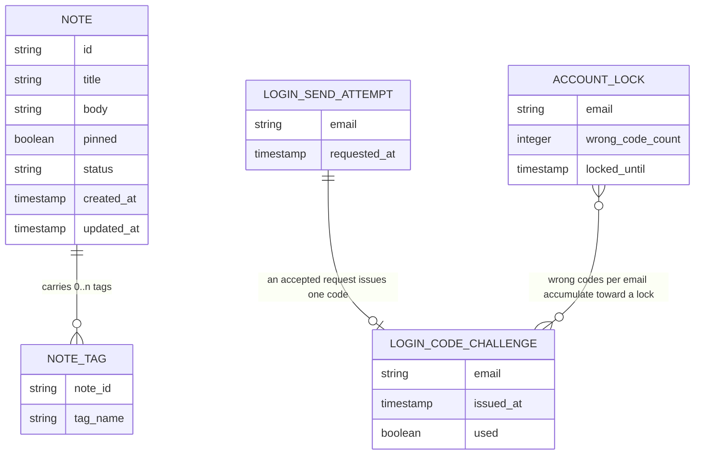

<!-- SECTION: backend.overview | status: DRAFT-UNVERIFIED -->
## Overview

**Run outcome.** This run ends with `HALT-BLOCKING-QUESTION`.
- `Q-BE-001`, `Q-BE-002` and `Q-BE-003` are blocking, and no input answers them.
- `RUN-CONTEXT.unattended` is `true`, so the run halts on them.
- All eleven sections are emitted. `backend.auth-model` is `BLOCKED`.
- `run_mode` is `bootstrap`, so ids restart at 001 in this document.

**Change in scope (CR-132).** Email one-time-code login: a request-code operation and a verify-code operation, with expiry, resend limit and lockout. The CR record says the numbers are "Not decided yet". The approved requirements already state them, so the requirements govern (`CON-BE-001`). The CR's own suggested values (resend once per 60 seconds) are a suggestion and were not adopted.

| Value | Decision | Source |
|---|---|---|
| Code expiry | 10 minutes after issue | BR-020, BR-024, BR-026 |
| Resend limit | 3 requests within 10 minutes; beyond that, HTTP 429 | BR-021, BR-028, BR-032 |
| Lockout | 5 wrong codes lock verification for 15 minutes | BR-022, BR-025, BR-027, BR-032 |
| Code format | 6 digits, all numeric | BR-029 |
| Code reuse | single use | BR-023 |
| Verify status mapping | locked 423, wrong 401, expired 410, already used 409 | BR-033 |
| During a lock | only verification is refused; requesting a code is not | BR-032 |

**Responsibilities.** The service is `notes_api`. Its stack is Node.js 20, Express and PostgreSQL 16, hosted on AWS (`platform.md`; `feedback.md` preflight answer). It is responsible for:
- Note create, edit, get, archive and unarchive, with a `pinned` flag, title, body and tags (US-002-01 to US-002-06; BR-005 to BR-008, BR-018).
- Keyword and tag search, combined filters, pagination, archived exclusion, pinned-first ordering and 503 on a degraded index (US-003-01 to US-003-06; BR-009 to BR-011, BR-019).
- Email one-time-code login (US-006-06; BR-020 to BR-033; NFR-015 to NFR-019). Emails go through the transactional email service in AWS region eu-west-1 (NFR-017, whose text is garbled; see `GAP-BE-005`).
- A published OpenAPI 3.x document covering every implemented endpoint, with schemas, 4xx/5xx errors, examples, a data-residency note and a Scope section (US-004-01 to US-004-06, US-005-01; BR-012, BR-013; NFR-008, NFR-009).
- Standardised refusal of out-of-scope calls (US-005-02 to US-005-05; BR-014 to BR-016; NFR-010, NFR-011).
- EU data residency of the database, compute and backups, with the CI gate, compliance report, launch gate and drift alerting (US-001-01 to US-001-06; BR-001 to BR-004; NFR-001 to NFR-004).

**Not responsible for:**
- Attachment or file-upload endpoints (BR-014).
- Any real-time channel: WebSocket, SSE or polling-push (BR-015).
- Mobile-specific endpoints (BR-016).
- The web_app screens (US-006-01 to US-006-06). They belong to a separate surface; `platform.md` names React 18 + Vite for it.
- Logging and classifying stakeholder requests (BR-017, US-005-06). BR-017 makes this a product-manager process (`GAP-BE-009`).
- Existing login methods. NFR-016 says they "remain unchanged", but no input says what they are (`GAP-BE-008`).

**Design input.** `design-brief.md` carries only acceptance criteria (AC-001-01-01 to AC-002-01-03) and no visual design. Figma is not connected. No design claim is made, and `spec_mode` is `NOT-APPLICABLE` for every backend module.

**Contract input.** `api_docs` is empty and `upstream.contract_source` is null. There is no existing-system claim to reconcile (`GAP-BE-013`).

**Inbound handoffs.** `RUN-CONTEXT.upstream.handoffs` lists four web-app needs: `HANDOFF-WEBAPP-526592`, `HANDOFF-WEBAPP-701819`, `HANDOFF-WEBAPP-733353` and `HANDOFF-WEBAPP-752470`.
- The file bodies were not supplied to this run (`GAP-BE-001`).
- The approved record in `feedback.md` summarises their asks.
  - `HANDOFF-WEBAPP-526592` asks for operations to list active and archived-only notes with pagination.
  - `HANDOFF-WEBAPP-701819` asks for distinct-tag listing and tag removal.
  - `HANDOFF-WEBAPP-733353` asks for retry-after values, remaining lock time, the 423 re-enable rule and the 400 field-detail shape.
  - `HANDOFF-WEBAPP-752470` asks for the session model.
- This reading rests on the assumption that those summaries match the files (`ASM-BE-010`).
- Dispositions:
  - `HANDOFF-WEBAPP-526592`: cannot be answered this run (`Q-BE-005`, `GAP-BE-002`).
  - `HANDOFF-WEBAPP-701819`: cannot be answered this run (`Q-BE-006`, `GAP-BE-003`).
  - `HANDOFF-WEBAPP-733353`: cannot be answered this run (`Q-BE-004`, `GAP-BE-004`).
  - `HANDOFF-WEBAPP-752470`: cannot be answered this run (`Q-BE-003`, blocking).
- Two points are answered here from requirements alone: requesting a code is allowed during a lock (BR-032), and the lock status is 423 (BR-033).
<!-- /SECTION: backend.overview -->
<!-- SECTION: backend.domain-model | status: DRAFT-UNVERIFIED -->
## Domain model

**Sources**
- `NOTE`:
  - US-002-01 gives a unique ID, timestamps and `pinned=false` by default.
  - BR-005 gives required title and body.
  - BR-007 gives the archive flag. US-002-04 to US-002-06 give the active/archived status.
  - BR-018 gives the pinned flag.
- `NOTE_TAG`: US-002-03 says a repeated add creates no duplicate entry on that note.
- `LOGIN_SEND_ATTEMPT`, `LOGIN_CODE_CHALLENGE` and `ACCOUNT_LOCK` are the three records NFR-019 names ("code challenges, send attempts and account locks"). Their attributes follow from BR-020 to BR-029 and BR-032. The code value is deliberately not drawn, because how a code is stored is unstated (`GAP-BE-012`).
- The challenge-to-lock link is conceptual. Wrong codes are counted per email and no foreign key is implied (`ASM-BE-002`).

**Ownership and cardinality**
- Whether a note belongs to one user or to the shared team workspace is undecided. BR-031's text is a placeholder ("Use the simplest option consistent with the rest of the spec") and its rationale says the rule cannot be written until decided. The diagram has no owner relation (`Q-BE-002`).
- No account entity is defined by any input. `ASM-BE-001` assumes the three login records are keyed by email address.
- Tag rules (case, charset, length, maximum count) are unstated, although US-003-02 implies some characters are invalid (`GAP-BE-003`).
- Residency artefacts (scan results, report, gate status) are infrastructure records, not application entities (`ASM-BE-003`).
<!-- /SECTION: backend.domain-model -->
<!-- SECTION: backend.module-map | status: DERIVED -->
## Module map

Modules are derived from the epics. The derivation is stated in the Source column.

| Module | Boundary | Source |
|---|---|---|
| `notes` | Note create, edit, get, archive, unarchive, `pinned` flag and tags. Archive is a flag, never a delete. | US-002-01 to US-002-06; BR-005 to BR-008, BR-018 |
| `search` | Keyword, tag and combined filters, pagination, archived exclusion, pinned-first ordering, 503 when the index is degraded. | US-003-01 to US-003-06; BR-009 to BR-011, BR-019 |
| `auth` | Request-code and verify-code: 6-digit codes, 10-minute expiry, 3-requests-per-10-minutes limit, single use, 15-minute lock after 5 wrong codes, email delivery, retention purge of login records. | US-006-06; BR-020 to BR-033; NFR-015 to NFR-019 |
| `contract-docs` | Published OpenAPI 3.x document, spec-versus-route coverage check, data-residency note, Scope section. | US-004-01 to US-004-06, US-005-01; BR-012, BR-013; NFR-008, NFR-009 |
| `scope-guard` | Standardised refusal of attachment, real-time and mobile calls, and contract tests for their absence. | US-005-02 to US-005-05; BR-014 to BR-016; NFR-010, NFR-011 |
| `residency` | Region-constrained provisioning, EU-only backup validation, CI residency gate, compliance report, launch gate, drift scan and alert. | US-001-01 to US-001-06; BR-001 to BR-004; NFR-001 to NFR-004 |

**Dependency direction** (A → B means A depends on B):
- `search → notes`. It reads notes and tags.
- `contract-docs → notes, search, auth, scope-guard`. It reads the route registry only and does not call them at runtime.
- `scope-guard` is request middleware over the whole HTTP surface and depends on no module.
- `auth → transactional email service` (external, AWS eu-west-1; NFR-017).
- `notes → auth` and `search → auth` for a per-request access check. This edge is pending `Q-BE-002` and `Q-BE-003` and is not committed.
- `residency` depends on no other module. It inspects infrastructure and is not on the request path (`ASM-BE-003`).

There are no cycles. `notes` does not depend on `search`, and neither depends on `contract-docs`.
<!-- /SECTION: backend.module-map -->
<!-- SECTION: backend.api-surface | status: VERIFIED -->
## Api surface

_Rendered by DevAgent from the operation records._

| id | method | path | module | success | errors | summary |
|---|---|---|---|---|---|---|
| `API-AUTH-015365` | POST | `/auth/request-code` | `auth` | 202 | 400, 429, 500 | Request an email one-time login code: 6 digits, expires 10 minutes after issue, limited to 3 requests per 10 minutes per email (429 beyond that). Allowed even while verification is locked (BR-032). |
| `API-AUTH-592570` | POST | `/auth/verify-code` | `auth` | 200 | 400, 401, 409, 410, 423, 500 | Verify an emailed one-time code. Errors: wrong code 401, already used 409, expired 410, locked after 5 wrong codes for 15 minutes 423 (BR-033). |
| `API-CONTRACTDOCS-098363` | GET | `/openapi.json` | `contract-docs` | 200 | 406, 500 | Return the published OpenAPI 3.x document covering every implemented endpoint, including the data-residency note and Scope section. |
| `API-CONTRACTDOCS-827943` | GET | `/openapi/coverage` | `contract-docs` | 200 | 500 | Report the spec-versus-route coverage check result. |
| `API-CONTRACTDOCS-446650` | GET | `/openapi/data-residency` | `contract-docs` | 200 | 500 | Return the data-residency note published with the API documentation. |
| `API-CONTRACTDOCS-206969` | GET | `/openapi/scope` | `contract-docs` | 200 | 500 | Return the Scope section listing what the API does and explicitly does not cover. |
| `API-NOTES-232390` | POST | `/notes` | `notes` | 201 | 400 | Create a note with a required title and body, optional tags and pinned flag. The note gets a unique id, timestamps, pinned=false by default and active status (US-002-01, BR-005, BR-018). |
| `API-NOTES-045877` | GET | `/notes/{id}` | `notes` | 200 | 404 | Get a single note by id, including its status, pinned flag and tags (US-002-02, BR-006). |
| `API-NOTES-847551` | PATCH | `/notes/{id}` | `notes` | 200 | 400, 404 | Edit a note's title, body or pinned flag. Setting pinned pins or unpins the note (BR-006, BR-018). |
| `API-NOTES-810640` | POST | `/notes/{id}/archive` | `notes` | 200 | 404, 409 | Archive a note by setting its archive flag. The note is never deleted (BR-007, US-002-04). |
| `API-NOTES-359413` | POST | `/notes/{id}/tags` | `notes` | 200 | 400, 404 | Add one or more tags to a note. Repeating an add creates no duplicate entry on that note (US-002-03). |
| `API-NOTES-917869` | POST | `/notes/{id}/unarchive` | `notes` | 200 | 404 | Unarchive a note, restoring it to active status without data loss (BR-008, US-002-05). |
| `API-RESIDENCY-174124` | POST | `/residency/backup-validations` | `residency` | 200 | 400, 500 | Validate that a backup destination is EU-only; reject non-EU destinations without writing data (US-001-02). |
| `API-RESIDENCY-685134` | POST | `/residency/ci-gate-evaluations` | `residency` | 200 | 400, 500 | Evaluate the CI residency gate for a build, failing it when any resource is non-EU (US-001-03). |
| `API-RESIDENCY-913995` | GET | `/residency/compliance-report` | `residency` | 200 | 500 | Return the current EU data-residency compliance report (US-001-04). |
| `API-RESIDENCY-922826` | POST | `/residency/drift-scans` | `residency` | 200 | 500 | Run a drift scan for non-EU resources and alert the DevOps team on detection (US-001-06). |
| `API-RESIDENCY-648672` | POST | `/residency/launch-gate-checks` | `residency` | 200 | 500 | Run the launch gate check, refreshing the compliance report and blocking launch on non-EU resources (US-001-05). |
| `API-RESIDENCY-892950` | POST | `/residency/provisioning-checks` | `residency` | 200 | 400, 500 | Validate that a resource provisioning request targets an approved EU region (US-001-01). |
| `API-SEARCH-580505` | GET | `/notes/search` | `search` | 200 | 400, 503 | Search notes by keyword, by tag, or both combined. Archived notes are excluded unless include_archived is set. Results are paginated with pinned notes first. Returns 503 when the search index is degraded. |

### `API-AUTH-015365` — POST `/auth/request-code`

Request an email one-time login code: 6 digits, expires 10 minutes after issue, limited to 3 requests per 10 minutes per email (429 beyond that). Allowed even while verification is locked (BR-032).

**Request:** 
- `email` (string, required): Email address that will receive the 6-digit one-time login code. PII: masked in logs and examples.
**Response:** 
- `message` (string): Confirmation that the code request was accepted and a code email is being sent. Does not contain the code.

### `API-AUTH-592570` — POST `/auth/verify-code`

Verify an emailed one-time code. Errors: wrong code 401, already used 409, expired 410, locked after 5 wrong codes for 15 minutes 423 (BR-033).

**Request:** 
- `email` (string, required): Email address the code was issued to. PII: masked in logs and examples.
- `code` (string, required): The 6-digit numeric one-time code received by email. Single use; never logged.
**Response:** 
- `message` (string): Confirmation that the code was valid and login succeeded. The session credential (type, lifetime, transport) is undecided pending Q-BE-003, so no credential field is asserted.

### `API-CONTRACTDOCS-098363` — GET `/openapi.json`

Return the published OpenAPI 3.x document covering every implemented endpoint, including the data-residency note and Scope section.

**Request:** none
**Response:** 
- `openapi` (string, required): OpenAPI version string of the published document (3.x).
- `info` (object, required): API metadata (title, version) for the published document.
- `paths` (object, required): Every implemented endpoint with its schemas, 4xx/5xx errors and examples (BR-012, NFR-008, NFR-009).
- `components` (object, required): Shared schemas, including the error body schema.

### `API-CONTRACTDOCS-827943` — GET `/openapi/coverage`

Report the spec-versus-route coverage check result.

**Request:** none
**Response:** 
- `implemented_count` (integer, required): Number of implemented routes found in the route registry.
- `documented_count` (integer, required): Number of those routes present in the published spec.
- `coverage_percent` (number, required): Share of implemented endpoints present in the published spec (target 100%, NFR-008).
- `missing_endpoints` (array, required): Implemented routes absent from the spec; the build fails when non-empty (US-004-04).

### `API-CONTRACTDOCS-446650` — GET `/openapi/data-residency`

Return the data-residency note published with the API documentation.

**Request:** none
**Response:** 
- `note` (string, required): Text of the data-residency note published with the API documentation (BR-013).

### `API-CONTRACTDOCS-206969` — GET `/openapi/scope`

Return the Scope section listing what the API does and explicitly does not cover.

**Request:** none
**Response:** 
- `scope` (string, required): Text of the Scope section stating what the API covers.
- `excluded` (array, required): Excluded capabilities: attachments, real-time channels, mobile-specific endpoints (BR-014 to BR-016).

### `API-NOTES-232390` — POST `/notes`

Create a note with a required title and body, optional tags and pinned flag. The note gets a unique id, timestamps, pinned=false by default and active status (US-002-01, BR-005, BR-018).

**Request:** 
- `title` (string, required): Note title; missing or empty returns 400 (AC-002-01-03, BR-005).
- `body` (string, required): Note body text (BR-005).
- `pinned` (boolean): Pinned flag; defaults to false (US-002-01, BR-018).
- `tags` (array): Initial tag names for the note. Tag rules are undecided (GAP-BE-003).
**Response:** 
- `id` (string, required): Unique note id.
- `title` (string, required): Note title.
- `body` (string, required): Note body.
- `pinned` (boolean, required): Whether the note is pinned.
- `status` (string, required): Active or archived status of the note.
- `tags` (array, required): Tag names on the note, without duplicates.
- `created_at` (string, required): Creation timestamp.
- `updated_at` (string, required): Last update timestamp.

### `API-NOTES-045877` — GET `/notes/{id}`

Get a single note by id, including its status, pinned flag and tags (US-002-02, BR-006).

**Request:** 
- `id` (string, required): Note id.
**Response:** 
- `id` (string, required): Unique note id.
- `title` (string, required): Note title.
- `body` (string, required): Note body.
- `pinned` (boolean, required): Whether the note is pinned.
- `status` (string, required): Active or archived status of the note.
- `tags` (array, required): Tag names on the note.
- `created_at` (string, required): Creation timestamp.
- `updated_at` (string, required): Last update timestamp.

### `API-NOTES-847551` — PATCH `/notes/{id}`

Edit a note's title, body or pinned flag. Setting pinned pins or unpins the note (BR-006, BR-018).

**Request:** 
- `id` (string, required): Note id.
- `title` (string): New title; must not be empty if supplied (BR-005).
- `body` (string): New body text.
- `pinned` (boolean): New pinned flag value (BR-018).
**Response:** 
- `id` (string, required): Unique note id.
- `title` (string, required): Note title.
- `body` (string, required): Note body.
- `pinned` (boolean, required): Whether the note is pinned.
- `status` (string, required): Active or archived status.
- `tags` (array, required): Tag names on the note.
- `created_at` (string, required): Creation timestamp.
- `updated_at` (string, required): Last update timestamp.

### `API-NOTES-810640` — POST `/notes/{id}/archive`

Archive a note by setting its archive flag. The note is never deleted (BR-007, US-002-04).

**Request:** 
- `id` (string, required): Note id.
**Response:** 
- `id` (string, required): Unique note id.
- `title` (string, required): Note title.
- `body` (string, required): Note body.
- `pinned` (boolean, required): Whether the note is pinned.
- `status` (string, required): Archived status after the operation.
- `tags` (array, required): Tag names on the note.
- `created_at` (string, required): Creation timestamp.
- `updated_at` (string, required): Last update timestamp.

### `API-NOTES-359413` — POST `/notes/{id}/tags`

Add one or more tags to a note. Repeating an add creates no duplicate entry on that note (US-002-03).

**Request:** 
- `id` (string, required): Note id.
- `tags` (array, required): Tag names to add. Tag rules are undecided (GAP-BE-003).
**Response:** 
- `id` (string, required): Unique note id.
- `title` (string, required): Note title.
- `body` (string, required): Note body.
- `pinned` (boolean, required): Whether the note is pinned.
- `status` (string, required): Active or archived status.
- `tags` (array, required): Tag names on the note after the add, without duplicates.
- `created_at` (string, required): Creation timestamp.
- `updated_at` (string, required): Last update timestamp.

### `API-NOTES-917869` — POST `/notes/{id}/unarchive`

Unarchive a note, restoring it to active status without data loss (BR-008, US-002-05).

**Request:** 
- `id` (string, required): Note id.
**Response:** 
- `id` (string, required): Unique note id.
- `title` (string, required): Note title.
- `body` (string, required): Note body.
- `pinned` (boolean, required): Whether the note is pinned.
- `status` (string, required): Active status after the operation.
- `tags` (array, required): Tag names on the note.
- `created_at` (string, required): Creation timestamp.
- `updated_at` (string, required): Last update timestamp.

### `API-RESIDENCY-174124` — POST `/residency/backup-validations`

Validate that a backup destination is EU-only; reject non-EU destinations without writing data (US-001-02).

**Request:** 
- `destination_region` (string, required): Destination region or location of the backup. A non-EU destination fails validation within 30 seconds and writes no data (AC-001-02-01, AC-001-02-02).
- `backup_id` (string): Identifier of the backup configuration or job being validated.
**Response:** 
- `valid` (boolean, required): True when the backup destination is EU-only.
- `destination_region` (string, required): The destination region that was evaluated.

### `API-RESIDENCY-685134` — POST `/residency/ci-gate-evaluations`

Evaluate the CI residency gate for a build, failing it when any resource is non-EU (US-001-03).

**Request:** 
- `resources` (array, required): Deployment targets (resource identifiers with regions) in the build under evaluation, so non-EU deploys can be blocked from production (BR-002, NFR-002).
- `build_id` (string): Identifier of the CI build being gated.
**Response:** 
- `result` (string, required): Gate outcome: pass or fail.
- `violations` (array, required): Resources found outside approved EU regions; empty on pass.

### `API-RESIDENCY-913995` — GET `/residency/compliance-report`

Return the current EU data-residency compliance report (US-001-04).

**Request:** none
**Response:** 
- `components` (array, required): Per-component residency status of the infrastructure inventory (NFR-004).
- `eu_verified_percent` (number, required): Share of infrastructure components EU-verified (NFR-001).
- `generated_at` (string, required): Timestamp at which the report was last refreshed.

### `API-RESIDENCY-922826` — POST `/residency/drift-scans`

Run a drift scan for non-EU resources and alert the DevOps team on detection (US-001-06).

**Request:** none
**Response:** 
- `result` (string, required): Scan outcome: clean or drift-detected.
- `drifted_resources` (array, required): Resources found in a non-EU region, with resource details; empty when clean (BR-004, AC-001-06-02).
- `alert_sent` (boolean, required): True when an alert was sent to the DevOps team (NFR-003).
- `scanned_at` (string, required): Timestamp of the scan.

### `API-RESIDENCY-648672` — POST `/residency/launch-gate-checks`

Run the launch gate check, refreshing the compliance report and blocking launch on non-EU resources (US-001-05).

**Request:** 
- `release_id` (string): Identifier of the release or launch being checked.
**Response:** 
- `result` (string, required): Launch gate outcome: pass or fail.
- `violations` (array, required): Non-compliant resources blocking launch; empty on pass.
- `report_generated_at` (string, required): Timestamp of the compliance report refreshed by this check (NFR-004).

### `API-RESIDENCY-892950` — POST `/residency/provisioning-checks`

Validate that a resource provisioning request targets an approved EU region (US-001-01).

**Request:** 
- `region` (string, required): Target region for the resource being provisioned. Must be an approved EU region (BR-001, US-001-01). The approved region list is open (GAP-BE-011).
- `resource_type` (string, required): Kind of infrastructure resource being provisioned (database, compute, backup storage).
**Response:** 
- `allowed` (boolean, required): True when the region is an approved EU region and provisioning may proceed.
- `region` (string, required): The region that was evaluated.
- `resource_type` (string, required): The resource type that was evaluated.

### `API-SEARCH-580505` — GET `/notes/search`

Search notes by keyword, by tag, or both combined. Archived notes are excluded unless include_archived is set. Results are paginated with pinned notes first. Returns 503 when the search index is degraded.

**Request:** 
- `q` (string): Keyword to match against notes. Optional when at least one tag is given (ASM-BE-004, CON-BE-002). A request with neither q nor tags is rejected with 400 (US-003-01).
- `tags` (array): One or more tags to filter by. When given together with q, both filters apply (US-003-02, BR-010). Tag rules are unstated (GAP-BE-003).
- `include_archived` (boolean): When true, archived notes are included. Default is false, so archived notes are excluded (BR-009, BR-019). A non-boolean value returns 400.
- `page` (integer): 1-based page number for pagination (US-003-05, BR-011). The name and base are not stated by an input.
- `page_size` (integer): Number of results per page, up to 100 (NFR-007). Larger or invalid values return 400. The name and default are not stated by an input.
**Response:** 
- `items` (array, required): Matching notes for the requested page. Pinned notes come first, then the remaining notes (BR-019). Each item shows the note id, title, body, pinned flag, status, tags and timestamps.
- `page` (integer, required): The page number returned.
- `page_size` (integer, required): The page size applied.
- `total` (integer, required): Total number of notes matching the filters across all pages.
<!-- /SECTION: backend.api-surface -->
<!-- SECTION: backend.auth-model | status: BLOCKED -->
## Auth model

**Blocked.** Actors, roles and the permission matrix cannot be written from the supplied inputs.

**Unblocking inputs:**
1. `Q-BE-001`: BR-030 is garbled ("Only any person with a verified email address may..."), and its rationale says the rule stays open. Which email addresses may request, verify and receive a code?
2. `Q-BE-002`: BR-031 is a placeholder. Are notes owned by one user or shared in a team workspace, and what is the access rule per note and search operation?
3. `Q-BE-003`: What is the session model? No input defines the credential returned by a successful verify-code (type, lifetime, transport), refresh, logout, or whether notes and search operations require a session.

Until these are answered, no role, ownership predicate or 401/403 rule for notes and search is asserted. Only the verify-code status mapping (BR-033) and the lock rules (BR-022, BR-032) are decided.
<!-- /SECTION: backend.auth-model -->
<!-- SECTION: backend.data-lifecycle | status: DRAFT-UNVERIFIED -->
## Data lifecycle

| Data | Stored | Retention and deletion | Source |
|---|---|---|---|
| Notes (title, body, pinned, status, timestamps) | PostgreSQL 16 on AWS, EU region only | Never deleted by retention. Archive sets a flag and is reversible without data loss. | BR-001, BR-007, BR-008, NFR-019, `platform.md` |
| Tags | Same database | Follow the note. A repeated add creates no duplicate. | US-002-03 |
| Login code challenges, send attempts, account locks | Same database (`ASM-BE-001`) | Deleted after a retention period. NFR-019's text is garbled; `ASM-BE-007` reads it as 1 day, 1 day and 5 days. | NFR-019 |
| Backups of the notes database | EU-only storage | A non-EU destination fails validation within 30 seconds and writes no data. | BR-001, AC-001-02-01, AC-001-02-02 |
| Email address in transit to the email service | Transactional email service, AWS eu-west-1 | NFR-017's clause on transfer outside the EU is garbled (`GAP-BE-005`). | NFR-017 |
| Application logs | Not specified | Emails are masked in the local part and codes are never logged. Log retention is unstated. | NFR-018, `GAP-BE-006` |

**Unstated, not defaulted** (`GAP-BE-006`):
- Encryption at rest and in transit.
- Backup retention period and backup schedule.
- Log retention.
- How a code value is stored (`GAP-BE-012`).

None of these is asserted either way.

The email address is PII. In every example in any artefact it is masked.
<!-- /SECTION: backend.data-lifecycle -->
<!-- SECTION: backend.nfr | status: UNKNOWN -->
## Non-functional requirements

| Target | Value | Source |
|---|---|---|
| Search latency | p95 < 300 ms under 50 requests per second | NFR-006, US-003-03 |
| Search latency with paging | p95 < 300 ms up to page sizes of 100 results | NFR-007 |
| Search index lookup | Indexed lookup on a dataset of about 100k notes | US-003-03 |
| Availability of CRUD and search | 99.9% uptime monthly | NFR-013 |
| CRUD correctness | 100% functional-test pass rate | NFR-005 |
| Injection safety | 0 critical injection vulnerabilities per release in a security scan | NFR-012 |
| EU residency | 100% of infrastructure components EU-verified; 0 non-EU deploys reach production | NFR-001, NFR-002 |
| Drift alert | Alert fired within 15 minutes of drift detection | NFR-003 |
| Compliance report | Refreshed and 100% accurate at each launch gate check | NFR-004 |
| OpenAPI coverage | 100% of implemented endpoints in the published spec | NFR-008 |
| Example payloads | 100% of search and tagging endpoints | NFR-009 |
| Out-of-scope endpoints | 0 detected per build, on every CI build | NFR-010 |
| Out-of-scope calls | 100% return a documented 4xx with an explanatory message | NFR-011 |
| Login records retention | Per NFR-019, text garbled | NFR-019, `GAP-BE-005` |

**Not stated by any input** (`GAP-BE-007`): latency, throughput and availability targets for the login operations, and concurrency targets for any operation. No figure is invented.
<!-- /SECTION: backend.nfr -->
<!-- SECTION: backend.error-model | status: DRAFT-UNVERIFIED -->
## Error model

**Envelope.** No input defines an error body shape. `ASM-BE-006` proposes one JSON object with `code` (machine-readable string), `message` (human-readable) and optional `details`. US-004-03 requires the body structure to be documented, and US-005-04 requires a structured code plus a reason. Confirmation is pending (`GAP-BE-004`).

**Status-code policy** (each row cites its input):

| Status | Used for | Source |
|---|---|---|
| 200, 201 | Success. Create returns 201. | AC-002-01-01, AC-002-01-02 |
| 400 | Validation failure: missing title, bad search parameters, bad `include_archived`. Also login request validation (`ASM-BE-006`). | AC-002-01-03, US-003-01 to US-003-06 |
| 401 | Wrong login code. Also documented for endpoints requiring authentication (applicability pending `Q-BE-003`). | BR-033, US-004-03 |
| 403 | Documented for authorization failures (applicability pending `Q-BE-002`). | US-004-03 |
| 404 | Unknown note id; attachment paths. | US-002-02 to US-002-06, US-005-02 |
| 406 | Unsupported Accept header on the OpenAPI document, or a default-format fallback. | US-004-01 |
| 409 | Already-used login code; archiving an already-archived note. | BR-033, US-002-04 |
| 410 | Expired login code. | BR-033 |
| 415 | Multipart file payload on a note endpoint. | US-005-02 |
| 423 | Locked account on verify-code. | BR-033 |
| 429 | More than 3 code requests within 10 minutes. | BR-028 |
| 503 | Search index degraded or unavailable, with a retry-after header. | US-003-03 |
| 5xx | Documented for each endpoint. | BR-012 |

**Error-code registry.** Only one code name is given by an input: `OUT_OF_SCOPE`, as an example (US-005-04, "e.g."). The login errors, the search 503 and the residency violation error (AC-001-02-02) have no stated code names.

Proposed codes, all awaiting confirmation (`ASM-BE-006`):

| Code | Meaning | Status |
|---|---|---|
| `OUT_OF_SCOPE` | Call to an excluded endpoint | cited |
| `VALIDATION_ERROR` | 400 on invalid input | proposed |
| `NOT_FOUND` | 404 | proposed |
| `CODE_WRONG` | 401 wrong login code | proposed |
| `CODE_EXPIRED` | 410 expired login code | proposed |
| `CODE_ALREADY_USED` | 409 used login code | proposed |
| `ACCOUNT_LOCKED` | 423 | proposed |
| `RATE_LIMITED` | 429 | proposed |
| `SEARCH_UNAVAILABLE` | 503 | proposed |
| `RESIDENCY_VIOLATION` | non-EU backup destination | proposed |

**Open** (`Q-BE-004`, `Q-BE-009`):
- Retry-after values for 429 and 503.
- Remaining lock time and the re-enable rule on 423.
- The field-detail shape of 400 errors.
- The expiry boundary at exactly 10 minutes (`ASM-BE-005`).
- Whether expired or used code submissions count toward the 5 wrong codes (`ASM-BE-008`).
<!-- /SECTION: backend.error-model -->
<!-- SECTION: backend.observability | status: UNKNOWN -->
## Observability

**Logged**
- Residency scan outcomes, including a logged pass when all resources are EU (AC-001-06-01).
- A residency violation on a failed backup validation (AC-001-02-02).
- Out-of-scope request attempts. US-005-04 requires only the response; logging them is `ASM-BE-009`.

**Redacted**
- Codes are never logged (NFR-018).
- The email local part is masked in logs (NFR-018).

**Metered**
- Share of implemented endpoints present in the published spec (NFR-008, US-004-04).
- Out-of-scope endpoints detected per build (NFR-010).
- Share of infrastructure components EU-verified (NFR-001, NFR-004).
- Share of log entries containing an unredacted email or code, target zero (NFR-018).
- Share of expired login records deleted (NFR-019).

**Alerts**
- A resource found in a non-EU region alerts the DevOps team with resource details (BR-004, AC-001-06-02). Timing: NFR-003 says within 15 minutes, AC-001-06-02 says "immediately" (`CON-BE-003`).
- A failed coverage check or a scope-guard failure fails the build (US-004-04, US-005-05).

**Not specified:** logging, metrics and alerting tools, and alert channels beyond "the DevOps team". No tool is named.
<!-- /SECTION: backend.observability -->
<!-- SECTION: backend.migration-plan | status: DRAFT-UNVERIFIED -->
## Migration plan

No input names a migration tool or a rollback policy (`GAP-BE-010`). The ordered set below is derived from the domain model. All migrations are new, since `run_mode` is `bootstrap`.

| Order | Migration | Reversible | Note |
|---|---|---|---|
| 1 | Create the notes table: id, title, body, pinned (default false), status, timestamps | Yes while empty; after data exists, reversal drops note data | Ownership columns are excluded until `Q-BE-002` is answered. Adding them later is a further migration. |
| 2 | Create the note-tags table, unique per note and tag name | Same as 1 | Tag rules are open (`GAP-BE-003`). |
| 3 | Create the login send-attempt, code-challenge and account-lock tables | Yes; these records are short-lived by NFR-019 | Key and code-storage design pending `GAP-BE-012`. |
| 4 | Add the search index structures | Yes | Index type is unstated. The p95 target needs an indexed lookup (US-003-03). |

**Blocked inside this plan:** note ownership (`Q-BE-002`) and session storage (`Q-BE-003`) would each add a migration after 1 and 3. Their shape is not asserted.
<!-- /SECTION: backend.migration-plan -->
<!-- SECTION: backend.coverage | status: DRAFT-UNVERIFIED -->
## Coverage

Requirement ids of the form `BE-<MOD>-FR-nnn` are defined in the module specifications. This table maps each story to the module that owns it and the inputs that govern it. Backend operations are referenced by method and path once minted.

| Story | Module | Governing inputs | Coverage |
|---|---|---|---|
| US-001-01 | residency | BR-001, AC-001-01-01, AC-001-01-02 | covered |
| US-001-02 | residency | BR-001, AC-001-02-01, AC-001-02-02 | covered |
| US-001-03 | residency | BR-002, NFR-002 | covered |
| US-001-04 | residency | NFR-004 | covered |
| US-001-05 | residency | BR-003 | covered |
| US-001-06 | residency | BR-004, NFR-003 | covered (`CON-BE-003`) |
| US-002-01 | notes | BR-005, BR-018, AC-002-01-01 to AC-002-01-03 | covered |
| US-002-02 | notes | BR-006, BR-018 | covered |
| US-002-03 | notes | US-002-03 | partial: add is covered, remove has no acceptance criterion (`GAP-BE-003`) |
| US-002-04 | notes | BR-007 | covered |
| US-002-05 | notes | BR-008 | covered |
| US-002-06 | notes | US-002-06 | covered |
| US-003-01 | search | BR-009, BR-019 | covered (`CON-BE-002`) |
| US-003-02 | search | US-003-02 | covered; tag rules open (`GAP-BE-003`) |
| US-003-03 | search | NFR-006 | covered |
| US-003-04 | search | BR-010 | covered |
| US-003-05 | search | BR-011, NFR-007 | covered |
| US-003-06 | search | BR-009 | covered |
| US-004-01 | contract-docs | BR-012, NFR-008 | covered |
| US-004-02 | contract-docs | BR-012 | covered |
| US-004-03 | contract-docs | BR-012, BR-033 | covered |
| US-004-04 | contract-docs | NFR-008 | covered |
| US-004-05 | contract-docs | NFR-009 | covered |
| US-004-06 | contract-docs | BR-013 | covered |
| US-005-01 | contract-docs | NFR-010 | covered |
| US-005-02 | scope-guard | BR-014 | covered |
| US-005-03 | scope-guard | BR-015 | covered |
| US-005-04 | scope-guard | BR-016, NFR-011 | covered |
| US-005-05 | scope-guard | NFR-010 | covered |
| US-005-06 | none | BR-017 | **uncovered:** a product-manager process, not a backend capability (`GAP-BE-009`) |
| US-006-01 | none | US-006-01 | **uncovered:** no operation lists notes; search requires `q` or tags (`GAP-BE-002`, `Q-BE-005`) |
| US-006-02 | notes | US-002-01, US-002-02 | backend dependency covered; screen is web_app |
| US-006-03 | search | US-003-01, US-003-02, US-003-04 | backend dependency covered; screen is web_app |
| US-006-04 | notes | US-002-03 | backend dependency partial: tag removal and tag listing are missing (`GAP-BE-003`) |
| US-006-05 | notes | US-002-04, US-002-05 | backend dependency covered; screen is web_app. The archived-notes view needs a list operation (`GAP-BE-002`). |
| US-006-06 | auth | BR-020 to BR-033, NFR-015 to NFR-019 | covered for expiry, resend limit and lockout; session undecided (`Q-BE-003`) |

**Open points raised in this document**

Blocking questions:
- `Q-BE-001`: which addresses may request and receive a login code (BR-030).
- `Q-BE-002`: note ownership and access (BR-031).
- `Q-BE-003`: session model.

Degradable questions, each with its default:
- `Q-BE-004`: retry hints, lock time and 400 detail. Default: leave unspecified (`GAP-BE-004`).
- `Q-BE-005`: a list-notes operation. Default: none.
- `Q-BE-006`: tag removal, distinct-tag listing and tag rules. Default: none.
- `Q-BE-007`: clean text for garbled NFR-017, NFR-019, BR-027 and BR-033 (`GAP-BE-005`). Default: read as `ASM-BE-007`.
- `Q-BE-008`: is `q` optional when tags are given. Default: `ASM-BE-004`.
- `Q-BE-009`: do expired or used code submissions count toward the 5 wrong codes. Default: `ASM-BE-008`.
- `Q-BE-010`: encryption, backup and log retention (`GAP-BE-006`). Default: unasserted.

Gaps:
- `GAP-BE-001`: handoff files not supplied. Closing artefact: the four handoff files.
- `GAP-BE-002`: no list-notes operation. Closing artefact: a story or decision.
- `GAP-BE-003`: tag rules and tag removal. Closing artefact: a story and tag rules.
- `GAP-BE-004`: error envelope, code names, retry values. Closing artefact: an error-model decision.
- `GAP-BE-005`: garbled text in NFR-017, NFR-019, BR-027, BR-030, BR-031 and BR-033. Closing artefact: restated requirements.
- `GAP-BE-006`: encryption and retention unstated. Closing artefact: platform or NFR statement.
- `GAP-BE-007`: no login-operation performance targets. Closing artefact: NFR statement.
- `GAP-BE-008`: existing login methods unspecified. Closing artefact: a description of those methods or a statement that none exist.
- `GAP-BE-009`: BR-017 and US-005-06 have no backend owner. Closing artefact: a decision that this surface does not serve them.
- `GAP-BE-010`: migration tool and rollback policy. Closing artefact: platform statement.
- `GAP-BE-011`: approved EU region list, scan cadence and resource inventory source. Closing artefact: infrastructure input.
- `GAP-BE-012`: how a code is stored. Closing artefact: security decision.
- `GAP-BE-013`: no `api_docs` or design input. Closing artefact: an existing API description, if one exists.

Contradictions (none is Critical):
- `CON-BE-001`: the CR record says the numbers are "Not decided yet" and suggests resend once per 60 seconds, while BR-021, BR-028 and BR-032 state 3 per 10 minutes. The requirements are used, and the CR's value is not adopted. Picking the CR side would change the limiter shape.
- `CON-BE-002`: US-003-01 returns 400 when `q` is missing or empty, while US-003-02 and BR-010 allow a tags-only search. The tags-only reading is used (`ASM-BE-004`). Picking the other side would make tag-only filtering impossible.
- `CON-BE-003`: AC-001-06-02 says "immediately", while NFR-003 says within 15 minutes. NFR-003 is used as the measurable bound, and the alert is sent as soon as detected. Picking "immediately" as a hard bound would constrain scan cadence.

Direction checks run: story ↔ design (no design content), story ↔ requirement, requirement ↔ requirement and design ↔ design (the acceptance-criteria brief repeats stories without conflict).

**Assumptions**
- `ASM-BE-001`: the three login records are keyed by email address, with case handling unstated.
- `ASM-BE-002`: `wrong_code_count` is held on the lock record. Its reset on lock expiry or success is unstated.
- `ASM-BE-003`: residency artefacts are infrastructure records. The `residency` module is not on the request path, and whether its checks are HTTP operations is unstated.
- `ASM-BE-004`: `q` is optional when at least one tag is given. The resend window is a rolling 10-minute window.
- `ASM-BE-005`: a code submitted at exactly 10 minutes is treated as expired.
- `ASM-BE-006`: the error envelope and code names proposed in `backend.error-model`.
- `ASM-BE-007`: NFR-019 means code challenges 1 day, send attempts 1 day, account locks 5 days.
- `ASM-BE-008`: expired or used code submissions do not count toward the 5 wrong codes.
- `ASM-BE-009`: out-of-scope request attempts are logged.
- `ASM-BE-010`: the summaries of the four web-app handoffs in `feedback.md` match the unsupplied files.
<!-- /SECTION: backend.coverage -->
<!-- SECTION: backend.lane-needs | status: VERIFIED -->
## Lane needs

### Needs this lane raised

| Need | Kind | What is needed | Why | Blocking | Waiting sections |
|---|---|---|---|---|---|
| `HANDOFF-NOTESAPI-320429` | `business_rule` | Decide which email addresses may request, verify and receive a login code (BR-030 is garbled and its rationale leaves it open). | The actors and permission rules in the auth model cannot be written without it. | yes | `backend.auth-model`, `backend.domain-model`, `backend.api-surface` |
| `HANDOFF-NOTESAPI-324925` | `business_rule` | Decide whether notes are owned by one user or shared in a team workspace, and state the access rule per notes and search operation (BR-031 is a placeholder). | Ownership columns, access checks and 401/403 rules for notes and search depend on it. | yes | `backend.auth-model`, `backend.domain-model`, `backend.module-map`, `backend.migration-plan` |
| `HANDOFF-NOTESAPI-813214` | `business_rule` | Decide the session model: the credential verify-code returns (type, lifetime, transport), refresh, logout, and whether notes and search require a session. | The verify-code response and the auth model cannot be completed without it. | yes | `backend.auth-model`, `backend.api-surface`, `backend.module-map`, `backend.migration-plan` |
| `HANDOFF-NOTESAPI-693322` | `business_rule` | Confirm the error body envelope and code names, and give retry-after values for 429 and 503, remaining lock time and re-enable rule on 423, and the field-detail shape of 400 errors. | The error model is proposed only (ASM-BE-006) and these values have no source. | no | `backend.error-model`, `backend.api-surface` |
| `HANDOFF-NOTESAPI-158497` | `story` | Provide a story or decision for operations to list active notes and archived-only notes with pagination. | No input defines a list-notes operation, so US-006-01 and the archived view are uncovered. | no | `backend.api-surface`, `backend.coverage` |
| `HANDOFF-NOTESAPI-467940` | `story` | Provide a story and rules for removing a tag from a note, listing distinct tags, and tag validation (case, charset, length, count). | Tag removal and listing have no acceptance criteria, and the tag rules are unstated. | no | `backend.api-surface`, `backend.domain-model`, `backend.coverage` |

### Needs this lane cannot answer

| Need | From lane | Asked | Why not |
|---|---|---|---|
| `HANDOFF-WEBAPP-752470` | `web_app` | Define the session model: the credential returned by verify-code (type, lifetime, transport), refresh behaviour, a logout operation, and whether notes and search operations require a session. | The session model is undecided and no input defines it. It is raised as blocking question Q-BE-003 and needs a human decision. |
| `HANDOFF-WEBAPP-526592` | `web_app` | Add operations to list active notes and to list archived-only notes, with pagination. | No input defines a list-notes operation, and adding one is a scope decision. The handoff file body was not supplied (Q-BE-005, GAP-BE-002). |
| `HANDOFF-WEBAPP-701819` | `web_app` | Add operations to list distinct tags and to remove a tag from a note. | No input has a story for distinct-tag listing or tag removal, and the tag rules are unstated. This needs a story and a decision (Q-BE-006, GAP-BE-003). |
| `HANDOFF-WEBAPP-733353` | `web_app` | Specify retry-after values for 429 and 503 responses, remaining lock time and re-enable rule on 423, and the field-detail shape of 400 errors. | Retry-after values, remaining lock time, the 423 re-enable rule and the 400 detail shape are not stated by any input. This needs an error-model decision (Q-BE-004, GAP-BE-004). Only the 423 status for a lock (BR-033) and the rule that requesting a code is allowed during a lock (BR-032) are answered. |
<!-- /SECTION: backend.lane-needs -->
