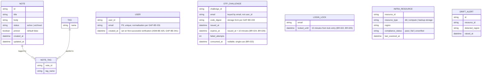

<!-- SECTION: backend.overview | status: DERIVED -->
## 1. Overview

**Responsibility.** `notes_api` is the single backend service for a team note-taking product. It is responsible for:

1. **Application API.** Create, read, update, pin/unpin, tag, archive/unarchive and search team notes, published as a versioned OpenAPI document. [stories.md EP-002, EP-003, EP-004]
2. **Email one-time-code login (CR-116).** A caller requests a one-time code for an email address and verifies it to receive a credential. The service enforces a resend limit (more than 3 requests within 10 minutes), expires each code 10 minutes after issue, and locks an email address for 15 minutes after five wrong codes. [feedback.md CR-116; requirements.md BR-020 to BR-028; stories.md US-004-03, US-006-06] This is an interface change: consumers must adapt. [feedback.md CR-116; requirements.md NFR-015, NFR-016]
3. **EU data-residency compliance.** Provisioning `notes_api`'s own database, compute and backups in approved EU regions, gating deploys on a residency check, generating a compliance report, enforcing a launch gate, and alerting on post-launch region drift. [stories.md EP-001; requirements.md BR-001 to BR-004, NFR-001 to NFR-004]

**Not responsible for.**

- Rendering any user interface. The web-app surface (stories.md EP-006) is a separate run. This document defines only the API it consumes. [stories.md EP-006]
- Attachment and file-upload endpoints of any kind. [requirements.md BR-014]
- Any real-time channel (WebSocket, SSE, polling-push) for collaborative editing. [requirements.md BR-015]
- Mobile-specific endpoints. [stories.md US-005-01, US-005-04]
- Any login method other than email one-time code. No supplied input names a password, social or SSO login. [feedback.md CR-116]
- Logging and classifying stakeholder feature requests. This is a Product-Manager intake process. [requirements.md BR-017; stories.md US-005-06]

**Change requests in this revision.**

- **CR-112 (retained from the approved revision).** Notes carry a boolean `pinned` flag, default `false`, settable on create and via PATCH, returned in note responses. Pinned notes sort before unpinned notes in list and search results. This is an interface change. [requirements.md BR-018, BR-019, NFR-014; feedback.md CR-112 as retained]
- **CR-116 (this change request).** Email one-time-code login as described in capability 2. Note, tag, search and residency behaviour are unchanged by CR-116. [feedback.md CR-116]
- **Label discrepancy.** The header of this change request is `CR-116`. The approved revision labels the same email one-time-code content `CR-115`. Earlier drafts and inputs use `CR-113` (in requirements NFR-015 and the approved revision) and `CR-114` (in stories US-006-06 and the drafted spec). The content is the same. This document uses `CR-116`. Recorded as `CON-BE-009` (`CR-115` and `CR-116`), `CON-BE-005` (`CR-113`) and `CON-BE-008` (`CR-114`).

**Stack.** Node.js 20, Express, PostgreSQL 16, hosted on AWS. [platform.md; feedback.md preflight answers]. Transactional email is specified as AWS SES in the approved revision, but the CR-116 text does not name a transport. `ASM-BE-027`. Session and token handling is specified as reuse of the application's existing mechanism in the approved revision. The preflight answers do not state this. `ASM-BE-028`.

**Revision state and identifier continuity.**

- New identifiers in this revision continue from the highest observed in the approved GAPS index: `GAP-BE-053` onward, `ASM-BE-030` onward, `CON-BE-009` onward, `INV-BE-007` onward. No identifier is reused.
- Identifiers carried forward whose text is not in any supplied document: `GAP-BE-004`, `GAP-BE-005`, `GAP-BE-007`, `GAP-BE-042`, `GAP-BE-043`, and `Q-BE-004`. They remain open. No section below depends on them.
- `GAP-BE-045` to `GAP-BE-052` were raised in the approved revision. Their text is not in the supplied excerpt of that revision. They remain open and no section below depends on their content.
- Run mode. `RUN-CONTEXT` declares `bootstrap` with no existing files, but `feedback.md` supplies an approved revision and instructs the run to keep what the change request does not touch. This document treats the supplied approved revision as the baseline. `ASM-BE-026`.
- Module-level `api-contract` sections (full request, response and error schemas per endpoint) are not produced in this document. The `SCHEMA-` IDs for login payloads are deferred to the `auth` module contract.

**Open blocking questions.** `Q-BE-003` (who may verify and receive access) and `Q-BE-005` (AWS region from which SES sends, and the residency of email transmission) are open. Neither answer is in the CR-116 feedback. Under the composition rules these map to `HALT-BLOCKING-QUESTION`.

**Open Critical contradictions.** `CON-BE-003` (registration scope against the shared-workspace default), `CON-BE-006` (email transmission against BR-001) and `CON-BE-010` (lockout counting: consecutive wrong codes against cumulative wrong codes). Under core rule 8: `CON-BE-003` touches an authorisation rule, `CON-BE-006` touches the residency of personal data, and `CON-BE-010` changes a lock state machine. These map to `HALT-CRITICAL-CONTRADICTION`.

**Halting.** The orchestrator decides whether to halt. This document records the work completed. Sections and subsections that depend on an open blocking question or Critical contradiction are marked `BLOCKED` in place.

<!-- /SECTION: backend.overview -->
<!-- SECTION: backend.domain-model | status: DRAFT-UNVERIFIED -->
## 2. Domain model

Three sub-domains are evidenced: the **note-taking domain** (Note, Tag), the **login domain** (User, OTP challenge, login lock), and the **residency-compliance domain** (InfraResource, DriftAlert). The login domain is new in this revision. [feedback.md CR-116] No input relates these sub-domains beyond "notes_api's infrastructure hosts the note-taking data." [requirements.md BR-013]



- **Note.** Title, body, status (active/archived), `pinned`, created and updated timestamps. [stories.md AC-002-01-01, US-002-02, US-002-04, US-002-05, US-002-06] Title and body are mandatory and non-empty at creation. [requirements.md BR-005]
- **`pinned` (CR-112).** Boolean, `NOT NULL`, default `false`. Settable on create and changeable via PATCH. Pinning does not alter title, body or tags. [requirements.md BR-018; stories.md AC-002-01-01, AC-002-01-02, AC-002-02-02]
- **Tag.** A name, many-to-many with Note through NOTE_TAG. Adding an existing tag is idempotent, with no duplicate entry. [stories.md US-002-03] Tag name format and length: `GAP-BE-009`. Cascade when a tag's last note is archived or deleted: `GAP-BE-016`.
- **User.** A person who has verified an email address. Created on first successful verification, not on code request. `ASM-BE-025`. The rule is carried from the approved revision; no CR-116 input states it. `email` is personal data. `ASM-BE-019`. Handling policy: `GAP-BE-033`. Normalisation and uniqueness: `GAP-BE-031`.
- **OTP challenge.** One issued one-time code for one email address, keyed by email because the user may not yet exist. Expiry is 10 minutes from issue. [requirements.md BR-024, BR-026; stories.md US-006-06] The code is single-use. [requirements.md BR-023] Expiry is enforced by `INV-BE-004`. Code length and character set: `GAP-BE-026`, `GAP-BE-027`. Storage form: `GAP-BE-033`.
- **Login lock.** The lock state for an email address. A lock is entered after five wrong codes and lasts 15 minutes. [requirements.md BR-022, BR-025, BR-027; stories.md US-004-03] Keyed by normalised email: `ASM-BE-015`. Whether the wrong-code count is consecutive or cumulative, and whether it resets: `CON-BE-010` (Critical), `GAP-BE-024`.
- **InfraResource.** A provisioned notes_api component (DB, compute, backup storage) with its reported region and compliance status. Unrecognised resource types are flagged `unverified`, never silently omitted. [stories.md AC-001-04-01, AC-001-04-02]
- **DriftAlert.** A record of a post-launch detection of an InfraResource in a non-EU region. [stories.md US-001-06]

**Cardinality and ownership.**

- A User and a Note have no relationship in the diagram. No input states whether a Note belongs to a user, is private, or is shared. `GAP-BE-003`. The default applied is `Q-BE-001` (class: degradable): notes form a shared team workspace, and any authenticated team member may read and write any note.
- **BLOCKED.** `CON-BE-003` (Critical) calls that default into question. Under CR-116 any holder of an email address that verifies can obtain a credential, so "team member" no longer names a bounded group. Until `Q-BE-003` is answered, the shared-workspace default applies only to users created by a route the human has approved. Note ownership columns and the note-access rule are blocked. See `backend.auth-model`.

**PII.** Personal data now exists in this domain: `USER.email`, `OTP_CHALLENGE.email` and `LOGIN_LOCK.email`, which hold the same value. Note `title` and `body` are free text that may incidentally contain PII. No masking or handling policy is supplied for any of them. `GAP-BE-017` (general PII policy), `GAP-BE-033` (at-rest treatment) and `GAP-BE-035` (validation scope for the email and code fields). Per core rule 12, no encryption, redaction or retention claim is made in their absence.

<!-- /SECTION: backend.domain-model -->
<!-- SECTION: backend.module-map | status: DERIVED -->
## 3. Module map

| Module | Boundary | Depends on |
|---|---|---|
| `auth` | Email one-time-code login (CR-116): code issuance and delivery, verification, resend limits, lockout, code expiry, user creation on first verification, credential issuance through the existing session/token mechanism. Owns User, OTP_CHALLENGE, LOGIN_LOCK. | external: email transport (`ASM-BE-027`; region `BLOCKED` on `Q-BE-005`, `CON-BE-006`) |
| `notes` | Note CRUD, pin/unpin via PATCH, tag assignment and removal, archive/unarchive. Owns Note, Tag, NOTE_TAG. | `auth` (caller identity) |
| `search` | Read-only query over Note: keyword, tag filter, pagination, archived-exclusion default, pinned-first ordering. | `notes`, `auth` |
| `residency-compliance` | Provisioning region validation, backup-destination validation, CI/CD residency gate, compliance report, launch-gate status, post-launch drift scan and alerting. Owns InfraResource, DriftAlert. | none at runtime; operates on the infrastructure and CI/CD layer |
| `api-docs` | Publishes the OpenAPI document, including `pinned`, the ordering change, and both login endpoints. Computes the endpoint-coverage metric. Carries the data-residency note and the Scope section. | `notes`, `search`, `auth`, `residency-compliance` |
| `scope-guardrail` | Intercepts every inbound request ahead of routing. Rejects attachment/multipart, WebSocket/SSE-upgrade and mobile-specific patterns with a structured out-of-scope response. Backs the contract test suite. | sits upstream of all modules; cross-cutting |

**Dependency direction.** `search → notes`, `search → auth`, `notes → auth`, `api-docs → notes, search, auth, residency-compliance`, `auth → email transport` (external). Requests flow through `scope-guardrail` first, then `auth` for protected routes, then `notes`, `search` or `api-docs`.

**Guardrail before authentication.** The guardrail runs before authentication, so an out-of-scope call returns its documented response without a credential. `ASM-BE-018`. The response form for excluded paths is in conflict across inputs: `CON-BE-007`.

**CR-112 impact on boundaries.** No new module. Pinned-first ordering is owned by `notes` for `GET /notes` and by `search` for `GET /notes/search`. Both apply the same rule. `INV-BE-001`.

**CR-116 impact on boundaries.** `auth` is the new module. It is a new dependency of `notes` and `search`, which previously had no identity dependency. It is the only module that calls the email transport. That dependency carries the residency question `CON-BE-006`.

<!-- /SECTION: backend.module-map -->
<!-- SECTION: backend.api-surface | status: DRAFT-UNVERIFIED -->
## 4. API surface index

Full contracts (request and response schemas, every error, idempotency, rate limits) belong in the per-module `api-contract` sections, which this document does not produce.

**Versioning.** An endpoint whose request or response shape changes is re-pinned from `@1` to `@2` (`ASM-BE-010`). New endpoints start at `@1` (`ASM-BE-021`). CR-116 adds no shape change to existing endpoints, so their pins stay at `@2`. Whether authenticated endpoints should bump because their caller obligation changes: `GAP-BE-037`.

| API ID | Method | Path | Auth | Module | Notes |
|---|---|---|---|---|---|
| `API-AUTH-001@1` | POST | `/auth/otp/send` | unauthenticated; rate-limited | `auth` | **New (CR-116).** Issues a one-time code to an email address and sends it via the email transport. Also the resend path. More than 3 requests within 10 minutes returns 429 and sends no code. [requirements.md BR-021, BR-028; stories.md US-006-06] Whether the initial send counts toward the 3: `CON-BE-011`. Limit key: `Q-BE-006`, default per email (`ASM-BE-029`). Response must not reveal whether an account exists (`ASM-BE-030`). Path: `ASM-BE-013`. Success status, body and 429 detail: `GAP-BE-028`, `GAP-BE-053`. Transport region: `BLOCKED` on `Q-BE-005`, `CON-BE-006`. |
| `API-AUTH-002@1` | POST | `/auth/otp/verify` | unauthenticated; subject to lockout | `auth` | **New (CR-116).** Verifies a code for an email address. A wrong or expired code is rejected. Expiry is 10 minutes after issue. [requirements.md BR-024, BR-026; `ASM-BE-023`] A used code is refused. [requirements.md BR-023; `INV-BE-002`] Five wrong codes lock the address for 15 minutes; the caller receives a locked-account response. [requirements.md BR-022, BR-027; stories.md US-004-03] Lock counting: `CON-BE-010` (Critical, BLOCKED). Locked-response status and body: `GAP-BE-038`. Wrong-code and expired-code statuses: `GAP-BE-053`. On success, creates the User if absent (`INV-BE-003`, `GAP-BE-041`) and returns a credential from the existing session/token mechanism (`ASM-BE-028`, `GAP-BE-030`). |
| `API-NOTES-001@2` | POST | `/notes` | authenticated team member (`ASM-BE-031`) | `notes` | **Changed from @1 (CR-112).** Accepts optional `pinned` (boolean, default `false`). Returns `pinned` in the 201 body. Title and body rules unchanged. [stories.md AC-002-01-01, AC-002-01-02; requirements.md BR-005, BR-018] |
| `API-NOTES-002@2` | PATCH | `/notes/{id}` | authenticated team member | `notes` | **Changed from @1 (CR-112).** Accepts optional `pinned`. Partial update: fields not sent are never overwritten. [requirements.md BR-006] Returns `pinned`. Pinning leaves title, body and tags unchanged. [stories.md AC-002-02-02] PATCH, not PUT: `ASM-BE-001`. Concurrent-write policy: `GAP-BE-040`. |
| `API-NOTES-003@2` | GET | `/notes/{id}` | authenticated team member | `notes` | **Changed from @1 (CR-112).** Returns `pinned` with tags and archive status. A missing or deleted note returns 404 with no partial data. [stories.md US-002-06] Whether a delete operation exists: `GAP-BE-046`. |
| `API-NOTES-004@2` | GET | `/notes` | authenticated team member | `notes` | **Changed from @1 (CR-112).** Default active-notes list. Pinned-first, then most recently updated within each group. [requirements.md BR-019; `CON-BE-002`] Parameters: `GAP-BE-001`. Page size: `GAP-BE-015`. |
| `API-NOTES-005@1` | POST | `/notes/{id}/tags` | authenticated team member | `notes` | Add tag, idempotent: no duplicate entry on repeat. [stories.md US-002-03] `ASM-BE-002`. |
| `API-NOTES-006@1` | DELETE | `/notes/{id}/tags/{tag}` | authenticated team member | `notes` | Remove tag. `ASM-BE-002`. |
| `API-NOTES-007@1` | POST | `/notes/{id}/archive` | authenticated team member | `notes` | Archive; data retained. [requirements.md BR-007] Repeat archive returns a conflict/error response. Status: `GAP-BE-048`. [stories.md US-002-04] |
| `API-NOTES-008@1` | POST | `/notes/{id}/unarchive` | authenticated team member | `notes` | Restores full prior state, including `pinned`. [stories.md US-002-05; requirements.md BR-008] |
| `API-SEARCH-001@2` | GET | `/notes/search` | authenticated team member | `search` | **Changed from @1 (CR-112).** Keyword (`q`), `tags`, `page`, `limit`, `include_archived`. Returns `pinned`. Pinned-first, then relevance. [stories.md US-003-01; requirements.md BR-019] Archived notes excluded by default. [requirements.md BR-009] Returns 503 with a retry-after indication when the search index is unavailable, rather than hanging. [stories.md US-003-03] At least one of `q` or `tags` required: `ASM-BE-006`, `CON-BE-001`. |
| `API-APIDOCS-001@1` | GET | `/openapi.{json\|yaml}` (exact path `GAP-BE-008`) | unauthenticated (`ASM-BE-004`) | `api-docs` | Describes `pinned`, the ordering change (NFR-014), and both login endpoints with their 429, expiry and locked-account responses. [stories.md US-004-01, US-004-03] Unsupported `Accept` yields 406 or a documented fallback. |

`residency-compliance` and `scope-guardrail` own **no end-user HTTP endpoint** evidenced by any input. Residency behaviour is infrastructure-as-code and pipeline-hook work. Report delivery: `GAP-BE-002`. Excluded-path behaviour is specified in `backend.error-model` and is in conflict across inputs: `CON-BE-007`.

**Consumer obligation under CR-116.** Every authenticated endpoint above requires a credential from `API-AUTH-002@1`. Client integrators must complete the login flow before calling them. This is the interface change CR-116 declares. [feedback.md CR-116] Web-app obligations: `HANDOFF-BE-002`. The web-app must also surface the 429, expired-code and locked-account responses. `HANDOFF-BE-003`, to be recorded in `HANDOFFS.md`.

<!-- /SECTION: backend.api-surface -->
<!-- SECTION: backend.auth-model | status: DRAFT-UNVERIFIED -->
## 5. Auth model

### 5.1 Authentication: email one-time code (CR-116)

**Flow.**

1. **Send.** The caller submits an email address to `API-AUTH-001@1`. The service issues a code, records an OTP challenge, and sends the code through the email transport. [feedback.md CR-116] If the resend limit is exceeded (more than 3 requests within 10 minutes), the service returns 429 and sends no code. [requirements.md BR-021, BR-028; stories.md US-006-06]
2. **Verify.** The caller submits the email address and the code to `API-AUTH-002@1`.
3. **Success.** On a correct, unexpired, unconsumed code, the service creates the User if none exists for that email, consumes the challenge, and returns a credential. [INV-BE-002, INV-BE-003; ASM-BE-025; GAP-BE-041]
4. **Wrong code.** A wrong code increments the challenge's failed-attempt count. At five wrong codes the email address is locked for 15 minutes and the caller receives a locked-account response. [requirements.md BR-022, BR-027; stories.md US-004-03] Counting rule: `CON-BE-010`. Whether the count resets: `GAP-BE-024`. Locked-response status and body: `GAP-BE-038`.
5. **Expiry.** A code expires 10 minutes after issue. A submission after that is rejected with an expired-code outcome. [requirements.md BR-024, BR-026; stories.md US-006-06] The backend reading is `ASM-BE-023`.
6. **Locked during verification.** No successful verification occurs for an email address while its lock is in effect. `INV-BE-005`.

**Example request, masked per core rule 12.**

```json
{ "email": "a***@e***.com", "code": "<one-time code>" }
```

**Resend limit.** Stated: more than 3 requests within 10 minutes triggers a rate-limit response and no code is sent. [stories.md US-006-06; requirements.md BR-021, BR-028] Two readings are open. Whether the initial send counts toward the 3 is `CON-BE-011`. The key (per email, per client, or both) is `Q-BE-006`, default per email (`ASM-BE-029`). The body of the 429 response is `GAP-BE-023`.

**Credential.** The approved revision specifies reuse of the existing session/token mechanism. The mechanism itself is not described by any input: `ASM-BE-028`, `GAP-BE-030`.

**Enumeration.** The approved revision states that the send response must not reveal whether an account exists. No supplied requirement or story states this: `ASM-BE-030`.

### 5.2 Lockout state machine: BLOCKED

**BLOCKED** pending `CON-BE-010` (Critical). BR-027 says "5 consecutive wrong one-time codes." BR-022 says "the threshold of 5 wrong codes." US-004-03 says "5 wrong codes." The first reading resets on a successful code or a new challenge. The second does not. The state machine is not specified until the human resolves this. The lock duration (15 minutes, BR-022, BR-025, BR-027) is not in conflict and is used. Whether a locked address may still request codes: `GAP-BE-024`.

### 5.3 Authorisation: permission matrix

Operations are rows. Columns are the actor classes named in the inputs. "Allow" and "Deny" are stated by an input. "Not stated" means no input gives the rule and the cell is a `GAP-`.

| Operation | Anonymous | Authenticated team member | Platform/DevOps | Release/CI | Compliance auditor | Engineering lead | Integrator |
|---|---|---|---|---|---|---|---|
| `API-AUTH-001` send code | Allow, rate-limited (BR-028) | Not stated (`GAP-BE-028`) | n/a | n/a | n/a | n/a | Allow (via login) |
| `API-AUTH-002` verify code | Allow, lockout applies (BR-022) | Not stated | n/a | n/a | n/a | n/a | Allow (via login) |
| `API-NOTES-*` read, write, tag, archive | Not stated; authenticated required per CR-116 (`ASM-BE-031`) | Allow, scope BLOCKED (`CON-BE-003`, `Q-BE-001`) | n/a | n/a | n/a | n/a | Allow (team member only) |
| `API-SEARCH-001` | Not stated | Allow, scope BLOCKED (`CON-BE-003`) | n/a | n/a | n/a | n/a | Allow (team member only) |
| `API-APIDOCS-001` read spec | Allow (`ASM-BE-004`) | Allow | Allow | Allow | Allow | Allow | Allow |
| Residency compliance report | n/a | n/a | Not stated (`GAP-BE-062`) | Not stated | Allow (US-001-04) | Allow (US-001-05) | n/a |
| Launch-gate sign-off | n/a | n/a | n/a | n/a | n/a | Allow (BR-003) | n/a |
| Receive drift alert | n/a | n/a | Allow (AC-001-06-02) | n/a | n/a | n/a | n/a |
| Pipeline residency gate | n/a | n/a | n/a | Enforce (AC-001-03-02) | n/a | n/a | n/a |

Rows for `DriftAlert` delivery channel: `GAP-BE-058`.

### 5.4 Ownership predicate: BLOCKED

No input gives an ownership predicate for notes. Defaults and blocks are in `backend.domain-model`. The predicate for `API-NOTES-002@2` and `API-NOTES-003@2` is `BLOCKED` on `CON-BE-003` and `Q-BE-003`.

<!-- /SECTION: backend.auth-model -->
<!-- SECTION: backend.data-lifecycle | status: DRAFT-UNVERIFIED -->
## 6. Data lifecycle

| Data | Stored | Residency | Retention | At-rest treatment | Deletion |
|---|---|---|---|---|---|
| Notes (title, body, status, pinned, timestamps) | PostgreSQL 16 | EU (BR-013, US-004-06; infrastructure per BR-001) | Not stated (`GAP-BE-057`) | Not stated (`GAP-BE-033`) | Archive retains data (BR-007). Delete operation not stated (`GAP-BE-046`). |
| Tags and note-tag links | PostgreSQL 16 | EU | Follows the note | Not stated | Cascade rule not stated (`GAP-BE-016`) |
| User (`email`, `created_at`) | PostgreSQL 16 | EU | Not stated (`GAP-BE-057`) | Not stated (`GAP-BE-033`); PII per `GAP-BE-017` | Not stated |
| OTP challenge (`email`, code digest, timestamps, failed attempts) | PostgreSQL 16 | EU | Not stated | Storage form of code digest not stated (`GAP-BE-033`) | Not stated; expiry governs use, not removal (`GAP-BE-057`) |
| Login lock (`email`, `locked_until`) | PostgreSQL 16 | EU | Not stated | Not stated | Not stated |
| Infrastructure records and drift alerts | Location not stated | Operator metadata | Not stated | Not stated | Not stated |
| Email content and recipient | Email transport (AWS SES, `ASM-BE-027`) | Not stated (`CON-BE-006`, `Q-BE-005`) | Not stated | Not stated | Not stated |

**Residency.** Backups are configured to EU-only storage (AC-001-02-01). Database and compute must be in approved EU regions (AC-001-01-01). Email transmission residency is `CON-BE-006` (Critical) and `Q-BE-005` (blocking). Until resolved, no residency claim is made for the email transport.

**Encryption and redaction.** No input states encryption at rest, redaction, or retention for any stored item. Per core rule 12 none is claimed. Treatment is `GAP-BE-033` and `GAP-BE-017`.

<!-- /SECTION: backend.data-lifecycle -->
<!-- SECTION: backend.nfr | status: VERIFIED -->
## 7. Non-functional requirements

Every target below cites its source. A cell marked "not stated" is a `GAP-`, not a default.

| Area | Target | Source | Applies to |
|---|---|---|---|
| Residency coverage | 100% of infrastructure components EU-verified | NFR-001 | residency-compliance |
| Deploy gate | 0 non-EU deploys reach production | NFR-002 | residency-compliance |
| Drift alerting | Alert fired within 15 minutes of drift detection | NFR-003 | residency-compliance |
| Compliance report | Refreshed and 100% accurate at each launch gate check | NFR-004 | residency-compliance |
| CRUD correctness | 100% functional-test pass rate for CRUD | NFR-005 | notes |
| Search latency | p95 < 300 ms under typical load | NFR-006; US-003-03 | search |
| Search at page size | p95 < 300 ms up to 100 results per page | NFR-007 | search |
| Spec coverage | 100% endpoint coverage in the published spec | NFR-008; BR-012 | api-docs |
| Scope guardrail | 0 out-of-scope endpoints per CI build | NFR-010 | scope-guardrail |
| Out-of-scope response | 100% of out-of-scope calls return a documented 4xx with an explanatory message | NFR-011 | scope-guardrail |
| Injection | 0 critical injection vulnerabilities per release | NFR-012 | notes, search |
| Availability | 99.9% monthly uptime for CRUD and search | NFR-013 | notes, search |
| Login resend limit | More than 3 requests within 10 minutes is refused with 429 | BR-021, BR-028 | auth |
| Login expiry | 10 minutes from issue | BR-020, BR-024, BR-026 | auth |
| Login lockout | 15 minutes after 5 wrong codes | BR-022, BR-025, BR-027 | auth (counting: `CON-BE-010`) |

**Not stated, and therefore not targeted:**

- Latency for create, read, update, archive and login endpoints: `GAP-BE-056`.
- Throughput and concurrency for any endpoint: `GAP-BE-056`.
- Email delivery time: `GAP-BE-056`.
- Load profile underlying NFR-006: "typical load" is not defined in any input: `GAP-BE-056`.

No figure above is invented. The search target applies "typical load" as stated, and the load definition is open.

<!-- /SECTION: backend.nfr -->
<!-- SECTION: backend.error-model | status: DRAFT-UNVERIFIED -->
## 8. Error model

**Global error envelope.** No input states a response body shape for errors. `GAP-BE-055`. Until closed, no client may rely on a body field name, and every error response is an `ASM-`-shaped contract to be confirmed.

**Status-code policy.** Stated by inputs:

| Status | Used for | Source |
|---|---|---|
| 400 | Validation failure on create, missing `title`, empty `q` and `tags` | stories.md AC-002-01-03, US-003-01, US-003-02, US-003-04, US-003-05 |
| 401 | Authentication required | stories.md US-004-03 |
| 403 | Authorisation refused | stories.md US-004-03 |
| 404 | Missing or deleted note; no partial data | stories.md AC-002-02-03, US-002-05, US-002-06 |
| 406 | Unsupported `Accept` on the OpenAPI document, or a documented fallback | stories.md US-004-01 |
| 409 or conflict-class | Repeat archive | stories.md US-002-04; exact status `GAP-BE-048` |
| 400 or 415 | Multipart or file payload to a notes endpoint | stories.md US-005-02 |
| 429 | Resend limit exceeded | requirements.md BR-028; stories.md US-006-06 |
| 503 with retry-after | Search index unavailable | stories.md US-003-03 |

**Login error outcomes.** These are named here so the registry is complete. The machine-readable names are proposed by this specification, not supplied by any input: `ASM-BE-032`.

| Outcome | Trigger | HTTP status | Source |
|---|---|---|---|
| `otp_rate_limited` | More than 3 sends within 10 minutes | 429 | BR-028 |
| `otp_invalid` | Wrong code | `GAP-BE-053` | BR-022 |
| `otp_expired` | Code submitted after 10 minutes | `GAP-BE-053` | BR-024, BR-026 |
| `otp_consumed` | Code already used | `GAP-BE-053` | BR-023 |
| `account_locked` | Email is in its lock window | `GAP-BE-038` | BR-022, BR-027 |

**Out-of-scope responses.** The scope guardrail returns a structured out-of-scope response with a documented code, such as `OUT_OF_SCOPE`, and a human-readable reason. [stories.md US-005-04] The example code name is from a story, not a registry. The response form for excluded paths is `CON-BE-007`: a bare 404 for an attachment path (US-005-02) against a structured response (US-005-04, BR-016). `CON-BE-007` is non-critical. The approved reading (structured response, explicit scope message) is used and the section is `DRAFT-UNVERIFIED`.

**Error-code registry.** Machine-readable codes are not supplied. The outcomes above and `OUT_OF_SCOPE` are the only names this document uses, and they are not authoritative until `GAP-BE-055` is closed.

<!-- /SECTION: backend.error-model -->
<!-- SECTION: backend.observability | status: DRAFT-UNVERIFIED -->
## 9. Observability

**Logged.** Not stated for the service in general: `GAP-BE-058`. Two events are required by inputs:

- Each scheduled residency scan logs a pass when all resources are in EU regions. [stories.md AC-001-06-01]
- Each drift detection raises an alert to the DevOps team immediately, with resource details. [stories.md AC-001-06-02]

**Redacted.** No redaction rule is supplied. Email addresses are PII (`GAP-BE-017`) and must not be written to logs without a rule. This document makes no redaction claim. `GAP-BE-017`.

**Metered.**

- Search p95 latency (NFR-006). The measurement method is not stated.
- Endpoint coverage percentage in the published spec (US-004-04, NFR-008).
- Uptime for CRUD and search (NFR-013).
- Compliance percentage in the residency report (AC-001-04-01).
- Out-of-scope rejection count is a product metric (US-005-06, BR-017), recorded by the Product Manager process, not by the service.

**Alerts.**

- Non-EU resource drift: alert to DevOps within 15 minutes of detection (NFR-003, AC-001-06-02). Channel not stated: `GAP-BE-058`.
- Non-compliant deploy: pipeline fails and blocks deploy (AC-001-03-02). This is a pipeline failure, not a service alert.
- Launch gate failed when compliance is below 100% (AC-001-05-02).

**Login events.** Send, verify, expiry, lock entry and lock expiry are not stated as logged or metered. `GAP-BE-058`.

<!-- /SECTION: backend.observability -->
<!-- SECTION: backend.migration-plan | status: DRAFT-UNVERIFIED -->
## 10. Migration plan

No migration input is supplied. `GAP-BE-059`. The order below is derived from the domain model's foreign keys and from CR-112 and CR-116 scope. It is provisional until the human confirms the baseline.

| Order | Migration | Contents | Reversibility |
|---|---|---|---|
| M1 | Notes | `note` table with `pinned BOOLEAN NOT NULL DEFAULT false`; if CR-112 is already applied, this step is a no-op (`GAP-BE-059`). | Reversible by dropping the column. Dropping loses `pinned` values. Lossy after use. |
| M2 | Tags | `tag` and `note_tag` tables. Foreign keys to `note`. `ON DELETE` behaviour not stated (`GAP-BE-016`). | Reversible by dropping the tables. Lossy after use. |
| M3 | User | `user` table with `email` unique. Normalisation per `GAP-BE-031`. No pre-existing data is assumed (`ASM-BE-025`). | Reversible by dropping the table. Lossy after any verification. |
| M4 | OTP challenge | `otp_challenge` table keyed by `email`. Code storage form per `GAP-BE-033`. | Reversible by dropping the table. Lossy after any issue. |
| M5 | Login lock | `login_lock` table keyed by `email`. Schema depends on `CON-BE-010` and is BLOCKED until resolved. | BLOCKED. |
| M6 | Residency records | `infra_resource` and `drift_alert` tables. Location of these tables is not stated (`GAP-BE-062`). | Reversible by dropping the tables. |

**Ordering rule.** M1 and M2 precede any step that depends on `note`. M3 precedes M4 and M5, because the challenge and lock reference the same email key. M6 is independent of the application tables.

**Blocked step.** M5 cannot be written until `CON-BE-010` is resolved. Its state values depend on the counting rule.

<!-- /SECTION: backend.migration-plan -->
<!-- SECTION: backend.coverage | status: VERIFIED -->
## 11. Coverage

Every story in `stories.md` is listed. Stories in `EP-006` belong to the web-app run and are marked accordingly. `EP-005` US-005-06 is a process, not a system requirement.

| Story | Summary | Answered by | Status |
|---|---|---|---|
| US-001-01 | Provision DB and compute in EU | `residency-compliance`; BR-001; AC-001-01-01, AC-001-01-02 | Partly. No API. Enforcement is IaC; not specified here. |
| US-001-02 | EU-only backups | `residency-compliance`; AC-001-02-01, AC-001-02-02 | Partly. Destination validation not detailed. |
| US-001-03 | Pipeline residency check | `residency-compliance`; BR-002; NFR-002 | Covered. Fails closed (AC-001-03-03). |
| US-001-04 | Compliance report | `residency-compliance`; InfraResource; NFR-004 | Partly. Report delivery `GAP-BE-002`. |
| US-001-05 | Launch gate at 100% | `residency-compliance`; BR-003 | Partly. Gate is a human sign-off. |
| US-001-06 | Post-launch drift alert | `residency-compliance`; DriftAlert; NFR-003 | Partly. Alert channel `GAP-BE-058`. |
| US-002-01 | Create note | `API-NOTES-001@2` | Covered. |
| US-002-02 | Edit note | `API-NOTES-002@2` | Covered. |
| US-002-03 | Add and remove tags | `API-NOTES-005@1`, `API-NOTES-006@1` | Covered. |
| US-002-04 | Archive | `API-NOTES-007@1`; `GAP-BE-048` | Covered. Repeat status open. |
| US-002-05 | Unarchive | `API-NOTES-008@1` | Covered. |
| US-002-06 | Read one note | `API-NOTES-003@2` | Covered. |
| US-003-01 | Keyword search | `API-SEARCH-001@2` | Covered. |
| US-003-02 | Tag filter | `API-SEARCH-001@2` | Covered. |
| US-003-03 | Search SLA and 503 | `API-SEARCH-001@2`; NFR-006 | Partly. Index technology not stated. |
| US-003-04 | Combined filters | `API-SEARCH-001@2` | Covered. |
| US-003-05 | Pagination | `API-SEARCH-001@2`; `GAP-BE-015` | Partly. Total-count field not stated. |
| US-003-06 | Archived exclusion | `API-SEARCH-001@2`; BR-009 | Covered. |
| US-004-01 | Published OpenAPI | `API-APIDOCS-001@1` | Covered. Path `GAP-BE-008`. |
| US-004-02 | Schemas in spec | `api-docs`; `SCHEMA-` deferred | Partly. Module contracts not produced. |
| US-004-03 | Documented errors incl. 429 and locked | `API-AUTH-001@1`, `API-AUTH-002@1`; §8 | Partly. 401, 403 bodies open. |
| US-004-04 | Coverage metric | `api-docs`; NFR-008 | Partly. Computation method not stated. |
| US-004-05 | Search and tag examples | `api-docs` | Partly. Module contracts not produced. |
| US-004-06 | Residency data note | `api-docs`; BR-013 | Covered. Email transport `CON-BE-006`. |
| US-005-01 | Scope section | `api-docs`; `scope-guardrail` | Covered. Approval workflow is process. |
| US-005-02 | No attachment routes | `scope-guardrail`; BR-014 | Covered. Response form `CON-BE-007`. |
| US-005-03 | No real-time channel | `scope-guardrail`; BR-015; `GAP-BE-040` | Covered. Concurrent-write response open. |
| US-005-04 | Clear out-of-scope error | `scope-guardrail`; §8 | Partly. `CON-BE-007`. |
| US-005-05 | Contract suite | `scope-guardrail`; NFR-010 | Covered. Test plan in module contracts. |
| US-005-06 | PM logging | Not a system requirement (BR-017) | Not answered here. Process owned by Product Manager. |
| US-006-01 to US-006-05 | Web-app screens and flows | Web-app run (EP-006) | Other surface. Backend answers only through API IDs. |
| US-006-06 | Web-app email sign-in | Consumes `API-AUTH-001@1`, `API-AUTH-002@1`; `HANDOFF-BE-002`, `HANDOFF-BE-003` | Partly for this surface. The UI is web-app. |

**Uncovered stories requiring a gap.** US-005-06 is not answered by a system requirement. Its process gap is recorded in `GAP-BE-060`. EP-006 is not answered by this surface and is recorded in `HANDOFF-BE-002` and `HANDOFF-BE-003`.

<!-- /SECTION: backend.coverage -->
