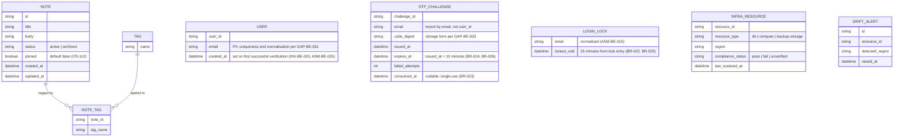

<!-- SECTION: backend.overview | status: DRAFT-UNVERIFIED -->
## 1. Overview

**Responsibility.** `notes_api` is the single backend service for a team note-taking product. It is responsible for:

1. **Application API.** Create, read, update, pin/unpin, tag, archive/unarchive and search team notes, published as a versioned OpenAPI document. [stories.md EP-002, EP-003, EP-004]
2. **Email one-time-code login (CR-116).** A caller requests a one-time code for an email address and verifies it to receive a credential. The service limits resends to more than 3 requests within 10 minutes, expires each code 10 minutes after issue, and locks an email address for 15 minutes after wrong codes. [feedback.md CR-116; requirements.md BR-020 to BR-028; stories.md US-004-03, US-006-06] This is an interface change: consumers must adapt. [feedback.md CR-116; requirements.md NFR-015, NFR-016]
3. **EU data-residency compliance.** Provisioning `notes_api`'s own database, compute and backups in approved EU regions, gating deploys on a residency check, generating a compliance report, enforcing a launch gate, and alerting on post-launch region drift. [stories.md EP-001; requirements.md BR-001 to BR-004, NFR-001 to NFR-004]

**Not responsible for.**

- Rendering any user interface. The web-app surface (stories.md EP-006) is a separate run. This document defines only the API it consumes. [stories.md EP-006]
- Attachment and file-upload endpoints. [requirements.md BR-014]
- Any real-time channel (WebSocket, SSE, polling-push). [requirements.md BR-015]
- Mobile-specific endpoints. [stories.md US-005-01, US-005-04]
- Any login method other than email one-time code. No supplied input names a password, social or SSO login. [feedback.md CR-116]
- Logging and classifying stakeholder feature requests. This is a Product-Manager intake process. [requirements.md BR-017; stories.md US-005-06]

**Change requests in this revision.**

- **CR-112 (retained from the approved revision).** Notes carry a boolean `pinned` flag, default `false`, settable on create and via PATCH, returned in note responses. Pinned notes sort before unpinned notes in list and search results. This is an interface change. [requirements.md BR-018, BR-019, NFR-014; feedback.md CR-112]
- **CR-116 (this change request).** Email one-time-code login as described in capability 2. Note, tag, search and residency behaviour are unchanged. [feedback.md CR-116]
- **Label discrepancy.** This change request is headed `CR-116`. The approved revision labels the same content `CR-115`. Requirements NFR-015 and the approved revision use `CR-113`. Stories US-006-06 uses `CR-114`. The content is the same. This document uses `CR-116`. Recorded as `CON-BE-009` (`CR-115` and `CR-116`), `CON-BE-005` (`CR-113`) and `CON-BE-008` (`CR-114`).

**Stack.** Node.js 20, Express, PostgreSQL 16, hosted on AWS. [platform.md; feedback.md preflight answers]. The approved revision specifies AWS SES for transactional email. The CR-116 text names no transport. `ASM-BE-027`. The approved revision specifies reuse of the application's existing session/token mechanism. The preflight answers do not state this. `ASM-BE-028`.

**Identifier continuity.**

- New identifiers in this revision continue from the highest observed in the approved revision: `GAP-BE-063` onward, `ASM-BE-033` onward, `CON-BE-012` onward, `Q-BE-007` onward. No identifier is reused.
- Carried forward with no text in any supplied document: `GAP-BE-004`, `GAP-BE-005`, `GAP-BE-007`, `GAP-BE-042`, `GAP-BE-043`, `Q-BE-004`. They remain open. No section below depends on them.
- `GAP-BE-045` to `GAP-BE-052` were raised in the approved revision. Their text is not in the supplied excerpt. They remain open and no section below depends on their content.
- **Run mode.** `RUN-CONTEXT` declares `bootstrap`, but `feedback.md` supplies an approved revision and instructs the run to keep what the change request does not touch. The approved revision is the baseline. `ASM-BE-026`.
- Module-level `api-contract` sections (full request, response and error schemas) are not produced here. The `SCHEMA-` IDs for login payloads are deferred to the `auth` module contract.

**Open blocking questions.** `Q-BE-003` (who may verify and receive access) and `Q-BE-005` (AWS region from which SES sends, and the residency of email transmission). Neither answer appears in the CR-116 feedback. Under the composition rules these map to `HALT-BLOCKING-QUESTION`.

**Open Critical contradictions.**

- `CON-BE-003`: registration scope against the shared-workspace default. Touches an authorisation rule.
- `CON-BE-006`: email transmission against BR-001. Touches a PII path, because the email address is personal data sent to a transport whose region is unknown.
- `CON-BE-010`: lockout counting, consecutive wrong codes (BR-027) against cumulative wrong codes (BR-022, BR-025). Changes a lock state machine.

These map to `HALT-CRITICAL-CONTRADICTION`.

**Halting.** The orchestrator decides whether to halt. This document records the work completed. Subsections that depend on an open blocking question or Critical contradiction are marked `BLOCKED` in place.

<!-- /SECTION: backend.overview -->
<!-- SECTION: backend.domain-model | status: DRAFT-UNVERIFIED -->
## 2. Domain model

Three sub-domains are evidenced: the **note-taking domain** (Note, Tag), the **login domain** (User, OTP challenge, login lock), and the **residency-compliance domain** (InfraResource, DriftAlert). The login domain is new in this revision. [feedback.md CR-116] No input relates these sub-domains beyond "notes_api's infrastructure hosts the note-taking data." [requirements.md BR-013]

**Entities.**

- **Note.** Title, body, status (active/archived), `pinned`, created and updated timestamps. [stories.md AC-002-01-01, US-002-02, US-002-04, US-002-05, US-002-06] Title and body are mandatory and non-empty at creation. [requirements.md BR-005]
- **`pinned` (CR-112).** Boolean, `NOT NULL`, default `false`. Settable on create and changeable via PATCH. Pinning does not alter title, body or tags. [requirements.md BR-018; stories.md AC-002-01-01, AC-002-01-02, AC-002-02-02]
- **Tag.** A name, many-to-many with Note through NOTE_TAG. Adding an existing tag is idempotent, with no duplicate entry. [stories.md US-002-03] Tag name format and length: `GAP-BE-009`. Cascade when a tag's last note is archived or deleted: `GAP-BE-016`.
- **User.** A person who has verified an email address. Created on first successful verification, not on code request. [INV-BE-003; ASM-BE-025] No CR-116 input states this rule directly. `email` is personal data. `ASM-BE-019`. Handling policy: `GAP-BE-033`.
- **OTP challenge.** One issued one-time code for one email address, keyed by email because the user may not yet exist. Expiry is 10 minutes from issue. [requirements.md BR-024, BR-026; stories.md US-006-06] Single-use. [requirements.md BR-023; INV-BE-002] Expiry is enforced by INV-BE-004. Code length and character set: `GAP-BE-026`, `GAP-BE-027`. Storage form: `GAP-BE-033`.
- **Login lock.** The lock state for an email address. Entered after wrong codes; lasts 15 minutes. [requirements.md BR-022, BR-025, BR-027; stories.md US-004-03] Keyed by normalised email: `ASM-BE-015`. Whether the wrong-code count is consecutive or cumulative, and whether it resets: `CON-BE-010` (Critical), `GAP-BE-024`.
- **InfraResource.** A provisioned notes_api component (DB, compute, backup storage) with its reported region and compliance status. Unrecognised resource types are flagged `unverified`, never silently omitted. [stories.md AC-001-04-01, AC-001-04-02]
- **DriftAlert.** A record of a post-launch detection of an InfraResource in a non-EU region. [stories.md US-001-06]

**Invariants.** These hold after every operation that touches the named entity.

- **INV-BE-001.** In `GET /notes` and `GET /notes/search`, every pinned note is returned before every unpinned note. Order within each group is unchanged. [requirements.md BR-019] Owned by `notes` for `GET /notes` and by `search` for `GET /notes/search`; both apply the same rule.
- **INV-BE-002.** A one-time code that has been verified successfully is refused on any later verification. [requirements.md BR-023]
- **INV-BE-003.** A User row is created only on successful verification, never on code request. [ASM-BE-025]
- **INV-BE-004.** A code submitted at or after issue plus 10 minutes is rejected as expired. [requirements.md BR-024, BR-026]

**Cardinality and ownership.**

- User and Note have no relationship in the diagram. No input states whether a Note belongs to a user, is private, or is shared. `GAP-BE-003`. The default applied is `Q-BE-001` (class: degradable): notes form a shared team workspace, and any authenticated team member may read and write any note.
- **BLOCKED.** `CON-BE-003` (Critical) calls that default into question. Under CR-116 any holder of an email address that verifies can obtain a credential, so "team member" no longer names a bounded group. Until `Q-BE-003` is answered, the shared-workspace default applies only to users created by a route the human has approved. Note ownership columns and the note-access rule are BLOCKED. See `backend.auth-model`.

**PII.** Personal data now exists in this domain: `USER.email`, `OTP_CHALLENGE.email` and `LOGIN_LOCK.email`, which hold the same value. Note `title` and `body` are free text and may incidentally contain PII. No masking or handling policy is supplied for any of them: `GAP-BE-017` (general PII policy), `GAP-BE-033` (at-rest treatment), `GAP-BE-035` (validation scope for email and code fields). Per core rule 12, no encryption, redaction or retention claim is made in their absence.

<!-- /SECTION: backend.domain-model -->
<!-- SECTION: backend.module-map | status: DERIVED -->
## 3. Module map

| Module | Boundary | Depends on |
|---|---|---|
| `auth` | Email one-time-code login (CR-116): code issuance and delivery, verification, resend limits, lockout, code expiry, user creation on first verification, credential issuance through the existing session/token mechanism. Owns User, OTP_CHALLENGE, LOGIN_LOCK. | external: email transport (`ASM-BE-027`; region BLOCKED on `Q-BE-005`, `CON-BE-006`) |
| `notes` | Note CRUD, pin/unpin via PATCH, tag assignment and removal, archive/unarchive. Owns Note, Tag, NOTE_TAG. | `auth` (caller identity) |
| `search` | Read-only query over Note: keyword, tag filter, pagination, archived-exclusion default, pinned-first ordering. | `notes`, `auth` |
| `residency-compliance` | Provisioning region validation, backup-destination validation, CI/CD residency gate, compliance report, launch-gate status, post-launch drift scan and alerting. Owns InfraResource, DriftAlert. | none at runtime; operates on the infrastructure and CI/CD layer |
| `api-docs` | Publishes the OpenAPI document, including `pinned`, the ordering change, and both login endpoints. Computes the endpoint-coverage metric. Carries the data-residency note and the Scope section. | `notes`, `search`, `auth`, `residency-compliance` |
| `scope-guardrail` | Intercepts every inbound request ahead of routing. Rejects attachment/multipart, WebSocket/SSE-upgrade and mobile-specific patterns with a structured out-of-scope response. Backs the contract test suite. | sits upstream of all modules; cross-cutting |

**Dependency direction.** `search → notes`, `search → auth`, `notes → auth`, `api-docs → notes, search, auth, residency-compliance`, `auth → email transport` (external). Requests flow through `scope-guardrail` first, then `auth` for protected routes, then `notes`, `search` or `api-docs`.

**Guardrail before authentication.** The guardrail runs before authentication, so an out-of-scope call returns its documented response without a credential. `ASM-BE-018`. The response form for excluded paths conflicts across inputs: `CON-BE-007`.

**CR-112 impact on boundaries.** No new module. Pinned-first ordering is applied by `notes` and `search` under INV-BE-001.

**CR-116 impact on boundaries.** `auth` is the new module. It is a new dependency of `notes` and `search`, which previously had no identity dependency. It is the only module that calls the email transport, and that dependency carries the residency question `CON-BE-006`.

<!-- /SECTION: backend.module-map -->
<!-- SECTION: backend.api-surface | status: DRAFT-UNVERIFIED -->
## 4. API surface index

Full contracts (request and response schemas, every error, idempotency, rate limits) belong in the per-module `api-contract` sections, which this document does not produce.

**Versioning.** An endpoint whose request or response shape changes is re-pinned from `@1` to `@2` (`ASM-BE-010`). New endpoints start at `@1` (`ASM-BE-021`). CR-116 changes no shape of existing endpoints, so their pins stay at `@2`. Whether authenticated endpoints should bump because their caller obligation changes: `GAP-BE-037`.

| API ID | Method | Path | Auth | Module | Notes |
|---|---|---|---|---|---|
| `API-AUTH-001@1` | POST | `/auth/otp/send` | unauthenticated; rate-limited | `auth` | **New (CR-116).** Issues a one-time code to an email address and sends it via the email transport. Also the resend path. More than 3 requests within 10 minutes returns 429 and sends no code. [requirements.md BR-021, BR-028; stories.md US-006-06] Whether the initial send counts toward the 3: `CON-BE-011`. Limit key: `Q-BE-006`, default per email (`ASM-BE-029`). Response must not reveal whether an account exists (`ASM-BE-030`). Path: `ASM-BE-013`. Success status and body: `GAP-BE-028`. Behaviour during an active lock: `GAP-BE-063`. Transport failure: `GAP-BE-066`. Transport region: BLOCKED on `Q-BE-005`, `CON-BE-006`. |
| `API-AUTH-002@1` | POST | `/auth/otp/verify` | unauthenticated; subject to lockout | `auth` | **New (CR-116).** Verifies a code for an email address. Wrong, expired or already-used codes are rejected. [requirements.md BR-023, BR-024, BR-026; INV-BE-002, INV-BE-004] Five wrong codes lock the address for 15 minutes; further verification is refused until the lock expires. [requirements.md BR-022, BR-025; stories.md US-004-03] Lock counting: `CON-BE-010` (Critical, BLOCKED). Locked-response status and body: `GAP-BE-038`. Wrong-code and expired-code statuses: `GAP-BE-053`. Unknown-email behaviour: `GAP-BE-065`. On success, creates the User if absent (INV-BE-003) and returns a credential from the existing session/token mechanism (`ASM-BE-028`, `GAP-BE-030`). |
| `API-NOTES-001@2` | POST | `/notes` | authenticated team member (`ASM-BE-031`) | `notes` | **Changed from @1 (CR-112).** Accepts optional `pinned` (boolean, default `false`). Returns `pinned` in the 201 body. Title and body rules unchanged. [stories.md AC-002-01-01, AC-002-01-02; requirements.md BR-005, BR-018] |
| `API-NOTES-002@2` | PATCH | `/notes/{id}` | authenticated team member | `notes` | **Changed from @1 (CR-112).** Accepts optional `pinned`. Partial update: fields not sent are never overwritten. [requirements.md BR-006] Returns `pinned`. Pinning leaves title, body and tags unchanged. [stories.md AC-002-02-02] PATCH, not PUT: `ASM-BE-001`. Concurrent-write policy: `GAP-BE-040`. |
| `API-NOTES-003@2` | GET | `/notes/{id}` | authenticated team member | `notes` | **Changed from @1 (CR-112).** Returns `pinned`, tags and archive status. A missing note returns 404 with no partial data. [stories.md US-002-06] Whether a delete operation exists: `GAP-BE-046`. |
| `API-NOTES-004@2` | GET | `/notes` | authenticated team member | `notes` | **Changed from @1 (CR-112).** Default active-notes list. Pinned-first (INV-BE-001). Base order within each group: `CON-BE-002`. Parameters: `GAP-BE-001`. Page size: `GAP-BE-015`. |
| `API-NOTES-005@1` | POST | `/notes/{id}/tags` | authenticated team member | `notes` | Add tag, idempotent: no duplicate entry on repeat. [stories.md US-002-03] `ASM-BE-002`. |
| `API-NOTES-006@1` | DELETE | `/notes/{id}/tags/{tag}` | authenticated team member | `notes` | Remove tag. `ASM-BE-002`. |
| `API-NOTES-007@1` | POST | `/notes/{id}/archive` | authenticated team member | `notes` | Archive; data retained. [requirements.md BR-007] Repeat archive returns a conflict/error response. Status: `GAP-BE-048`. [stories.md US-002-04] |
| `API-NOTES-008@1` | POST | `/notes/{id}/unarchive` | authenticated team member | `notes` | Restores full prior state, including `pinned`. [stories.md US-002-05; requirements.md BR-008] |
| `API-SEARCH-001@2` | GET | `/notes/search` | authenticated team member | `search` | **Changed from @1 (CR-112).** Keyword (`q`), `tags`, `page`, `limit`, `include_archived`. Returns `pinned`. Pinned-first (INV-BE-001), then relevance. [stories.md US-003-01; requirements.md BR-019] Archived notes excluded by default. [requirements.md BR-009] Returns 503 with a retry-after indication when the search index is unavailable. [stories.md US-003-03] At least one of `q` or `tags` required: `ASM-BE-006`, `CON-BE-001`. |
| `API-APIDOCS-001@1` | GET | `/openapi.{json\|yaml}` (exact path `GAP-BE-008`) | unauthenticated (`ASM-BE-004`) | `api-docs` | Describes `pinned`, the ordering change (NFR-014), and both login endpoints with their 429, expiry and locked-account responses. [stories.md US-004-01, US-004-03] Unsupported `Accept` yields 406 or a documented fallback. [stories.md US-004-01] |

`residency-compliance` and `scope-guardrail` own **no end-user HTTP endpoint** evidenced by any input. Residency behaviour is infrastructure-as-code and pipeline-hook work. Report delivery: `GAP-BE-002`. Excluded-path behaviour is in `backend.error-model` and conflicts across inputs: `CON-BE-007`.

**Consumer obligation under CR-116.** Every authenticated endpoint above requires a credential from `API-AUTH-002@1`. Client integrators must complete the login flow before calling them. [feedback.md CR-116; requirements.md NFR-015] Web-app obligations: `HANDOFF-BE-002`. The web-app must also surface the 429, expired-code and locked-account responses: `HANDOFF-BE-003`. Both are recorded in `HANDOFFS.md`.

<!-- /SECTION: backend.api-surface -->
<!-- SECTION: backend.auth-model | status: DRAFT-UNVERIFIED -->
## 5. Auth model

### 5.1 Authentication: email one-time code (CR-116)

**Flow.**

1. **Send.** The caller submits an email address to `API-AUTH-001@1`. The service issues a code, records an OTP challenge, and sends the code through the email transport. [feedback.md CR-116] If the resend limit is exceeded, the service returns 429 and sends no code. [requirements.md BR-021, BR-028; stories.md US-006-06]
2. **Verify.** The caller submits the email address and the code to `API-AUTH-002@1`.
3. **Success.** On a correct, unexpired, unconsumed code, the service creates the User if none exists for that email, consumes the challenge, and returns a credential. [INV-BE-002, INV-BE-003, INV-BE-004; GAP-BE-041]
4. **Wrong code.** A wrong code increments the challenge's failed-attempt count. At the lock threshold the address is locked for 15 minutes. **BLOCKED:** whether the count is consecutive or cumulative, and whether a success resets it, is `CON-BE-010` (Critical). Resets: `GAP-BE-024`.
5. **Lock.** During a lock, verification is refused with a locked-account response. [requirements.md BR-022] Whether send is also refused: `GAP-BE-063`, `Q-BE-007`.

### 5.2 Actors

| Actor | Kind | Basis |
|---|---|---|
| Anonymous caller | API principal, no credential | [stories.md US-004-01; requirements.md NFR-015] |
| Authenticated team member | API principal, holds a credential from `API-AUTH-002@1` | [stories.md EP-002, EP-003; `ASM-BE-031`] |
| Platform/DevOps Engineer, Release/CI Pipeline Owner, Compliance/Security Auditor, Engineering Lead | Operators of infrastructure and reports. Not API principals. | [stories.md EP-001] |
| Product manager | Process actor for stakeholder intake. Not an API principal. | [requirements.md BR-017] |

No input defines an API role for the operator actors. Access control on the compliance report is not specified: `GAP-BE-002`.

### 5.3 Permission matrix

Legend: **A** allowed; **A\*** allowed, subject to rate limit or lock; **D** denied; **N/A** not an API operation for this actor; **BLOCKED** cannot be stated until the named item resolves.

| Resource | Operation | Anonymous | Team member | Scope |
|---|---|---|---|---|
| Email login | send code (`API-AUTH-001`) | A\* (3 per 10 min) | A\* | `Q-BE-006` for limit key |
| Email login | verify code (`API-AUTH-002`) | A\* (lock applies) | A\* | lock: `CON-BE-010` |
| Note | create, read, update (`API-NOTES-001..003`) | D | A | **BLOCKED** on `CON-BE-003`, `Q-BE-003`, `Q-BE-001` |
| Note | list (`API-NOTES-004`) | D | A | **BLOCKED** on `CON-BE-003` |
| Note tag | add, remove (`API-NOTES-005..006`) | D | A | **BLOCKED** on `CON-BE-003` |
| Note | archive, unarchive (`API-NOTES-007..008`) | D | A | **BLOCKED** on `CON-BE-003` |
| Search | query (`API-SEARCH-001`) | D | A | **BLOCKED** on `CON-BE-003` |
| OpenAPI document | read (`API-APIDOCS-001`) | A (`ASM-BE-004`) | A | none |
| Infrastructure, pipeline, compliance report | provision, gate, report | N/A | N/A | `GAP-BE-002` |

The denial status for unauthenticated calls to protected endpoints is documented as 401/403 for login-flow endpoints. [stories.md US-004-03] The status per endpoint is not stated: `GAP-BE-053`.

### 5.4 Ownership predicate

**BLOCKED.** No input states an ownership predicate. Under the shared-workspace default (`Q-BE-001`, degradable) any team member may act on any note. That default is itself in question under `CON-BE-003` (Critical). Until `Q-BE-003` is answered, no per-note ownership predicate is written, and the rows above remain BLOCKED.

### 5.5 Stated decisions

- **`Q-BE-003`** (blocking): who may verify and receive access.
- **`Q-BE-007`** (degradable): whether the lock refuses send as well as verify. **Default applied:** only verification is refused, as BR-022 literally states. The send path remains subject to the resend limit only. Marked `DRAFT-UNVERIFIED`.

<!-- /SECTION: backend.auth-model -->
<!-- SECTION: backend.data-lifecycle | status: DRAFT-UNVERIFIED -->
## 6. Data lifecycle

| Data | Stored | Retention | At-rest encryption | Deletion | Basis |
|---|---|---|---|---|---|
| Note (title, body, status, pinned, timestamps) | yes | not stated: `GAP-BE-046` | not stated: `GAP-BE-033` | archive retains data; no delete operation evidenced | [requirements.md BR-007, BR-008; `GAP-BE-046`] |
| Tag, NOTE_TAG | yes | follows Note; cascade `GAP-BE-016` | not stated | cascade rule not stated | [stories.md US-002-03] |
| User (email) | yes, personal data | not stated: `GAP-BE-033` | not stated: `GAP-BE-033` | not stated | [INV-BE-003; `ASM-BE-019`] |
| OTP challenge (email, code digest, timestamps) | yes, personal data | expired and consumed challenges: `GAP-BE-064` | storage form of code: `GAP-BE-033` | not stated | [requirements.md BR-023, BR-024] |
| Login lock (email, locked_until) | yes, personal data | not stated: `GAP-BE-064` | not stated | not stated | [requirements.md BR-022] |
| InfraResource, DriftAlert | in infrastructure records; storage location not stated | not stated | not stated | not stated | [stories.md US-001-04, US-001-06] |
| Backups of all database content | yes; must be in EU regions | not stated: `GAP-BE-067` | not stated | not stated | [requirements.md BR-001; stories.md US-001-02] |
| Email transmission (address and code in transit) | leaves the service via email transport | transport retention not stated | not stated | not stated | `CON-BE-006` (Critical), `Q-BE-005` (blocking) |

**Residency.** All notes_api infrastructure, including backups, must be in approved EU regions. [requirements.md BR-001; NFR-001] The email transport is not named in BR-001's enumeration. Whether it falls within "infrastructure" is the open question in `CON-BE-006`.

**BLOCKED.** Any claim that data is encrypted at rest, redacted, or deleted on a schedule. None is supplied. Per core rule 12, no such claim is made.

<!-- /SECTION: backend.data-lifecycle -->
<!-- SECTION: backend.nfr | status: VERIFIED -->
## 7. Non-functional requirements

Only targets with a cited source are stated. Targets with no source are listed as gaps, not assumed.

| Dimension | Target | Scope | Source |
|---|---|---|---|
| Search latency | p95 under 300 ms under typical load | `API-SEARCH-001` | [requirements.md NFR-006; stories.md US-003-03] |
| Search latency under page size | p95 under 300 ms up to page size 100 | `API-SEARCH-001` | [requirements.md NFR-007, Should Have] |
| Search latency at scale | SLA met on a large dataset (example: 100k notes) via indexed lookup. The numeric target is the same p95 above. | `API-SEARCH-001` | [stories.md US-003-03] |
| Availability | 99.9% uptime per month | CRUD and search | [requirements.md NFR-013, Should Have] |
| Drift alert | alert fired within 15 minutes of drift detection | residency drift scan | [requirements.md NFR-003] |
| Drift alert, immediacy | "immediately" | residency drift scan | [stories.md US-001-06]. The 15-minute bound in NFR-003 is adopted as the quantified limit. The unquantified word is not given a tighter reading. |
| Report accuracy | refreshed and 100% accurate at each launch gate check | compliance report | [requirements.md NFR-004] |
| CRUD correctness | 100% functional-test pass rate for create, edit, get, archive, unarchive | `API-NOTES-*` | [requirements.md NFR-005] This is a test-pass target, not a latency target. |
| Scope enforcement | 0 out-of-scope endpoints detected per build | contract suite | [requirements.md NFR-010] |

**Gaps (no supplied source).**

- Login endpoint latency, throughput and concurrency: `GAP-BE-068`.
- Throughput and concurrency for all other endpoints: `GAP-BE-069`.
- Concurrent-write behaviour on `PATCH`: `GAP-BE-040`. The approved revision and US-005-03 specify a "standard last-write/conflict response" with no further definition.

<!-- /SECTION: backend.nfr -->
<!-- SECTION: backend.error-model | status: DRAFT-UNVERIFIED -->
## 8. Error model

**Global error envelope.** Not supplied by any input. The envelope shape, field names and the machine-readable code registry are `GAP-BE-070`. No envelope is assumed here.

**Status-code policy, as stated in the inputs.**

| Status | Condition | Source |
|---|---|---|
| 400 | Validation failure: missing `title` on create; empty or missing `q` and `tags`; invalid tag characters; malformed filter; invalid `include_archived`; negative or non-numeric `page`/`limit` | [stories.md AC-002-01-03, US-003-01 to US-003-06] |
| 400 or 415 | multipart/form-data with a file payload to a note endpoint | [stories.md US-005-02] |
| 401 or 403 | unauthenticated or unauthorised call to a protected endpoint. Documented for login-flow endpoints. Per-endpoint status: `GAP-BE-053`. | [stories.md US-004-03] |
| 404 | non-existent or deleted note; attachment-style path | [stories.md AC-002-02-03, US-002-05, US-002-06, US-005-02] |
| 404 vs scope error | excluded path. Inputs disagree: 404 (US-005-02) against a scope-referencing message, not a bare 404 (BR-016, US-005-04). | `CON-BE-007` |
| 406 | unsupported `Accept` on the OpenAPI document, or a documented default-format fallback | [stories.md US-004-01] |
| 409 or conflict | repeat archive of an archived note. Exact status: `GAP-BE-048`. | [stories.md US-002-04] |
| 429 | resend limit exceeded on send. No code is sent. | [requirements.md BR-021, BR-028; stories.md US-004-03] |
| locked-account response | verification during a lock. Status and body: `GAP-BE-038`. | [requirements.md BR-022, BR-027; stories.md US-004-03] |
| expired / wrong code response | Status: `GAP-BE-053`. | [requirements.md BR-024, BR-026] |
| 503 with retry-after | search index unavailable | [stories.md US-003-03] |

**Machine-readable error codes.** The only code named by an input is `OUT_OF_SCOPE`, given as an example ("e.g."). [stories.md US-005-04] It is not a registry entry. The registry is `GAP-BE-070`.

**Out-of-scope responses.** Required to be documented and to carry a message referencing the scope exclusion. [requirements.md BR-016; stories.md US-005-04] The status for excluded paths conflicts across inputs: `CON-BE-007`.

**Failure of the transport.** The status and whether the challenge is counted: `GAP-BE-066`.

<!-- /SECTION: backend.error-model -->
<!-- SECTION: backend.observability | status: DRAFT-UNVERIFIED -->
## 9. Observability

**Logged.**

- Residency scan results: a pass is logged. [stories.md AC-001-06-01]
- Out-of-scope requests: a stakeholder request is logged and classified by the product manager. This is a manual process, not a system log. [requirements.md BR-017]
- Login events: not specified. Any logging of send or verify attempts is unstated and depends on the PII policy.

**Redacted.** No redaction is stated. Email addresses and codes are personal data or secret material. Per core rule 12, this document claims no redaction. Log redaction rules: `GAP-BE-017`. Logging rules for email and code fields: `GAP-BE-035`.

**Metered.**

- Endpoint coverage percentage of the published spec against implemented endpoints. [stories.md US-004-04; requirements.md BR-012, NFR-008] The measurement method is owned by `api-docs`.
- Rejected out-of-scope request count. [requirements.md BR-017; stories.md US-005-06] Derived from the manual log above.
- Search latency p95. [requirements.md NFR-006] The metering mechanism is not specified.

**Alerts.**

- Post-launch drift: an alert to the DevOps team with resource details, fired immediately, within 15 minutes. [stories.md US-001-06; requirements.md BR-004, NFR-003]
- CI residency gate: the build fails and the deployment is blocked. [stories.md US-001-03; requirements.md BR-002]
- Launch gate: release blocked below 100% EU-verified. [stories.md US-001-05; requirements.md BR-003]
- Contract guardrail: merge blocked on an excluded endpoint pattern. [stories.md US-005-05]
- Documentation build: fails when the Scope section is missing. [stories.md US-005-01]
- OpenAPI spec validation: fails on a type mismatch between code and spec. [stories.md US-004-02]

**Gaps.** No alert is specified for login abuse, lock events, or delivery failures. `GAP-BE-066` covers delivery failure. Lock-event alerting is not specified by any input and is not assumed.

<!-- /SECTION: backend.observability -->
<!-- SECTION: backend.migration-plan | status: DRAFT-UNVERIFIED -->
## 10. Migration plan

No input supplies an existing schema. Whether an existing database holds rows is not stated. `GAP-BE-063` is not used for this; the relevant closing artefact is the current schema state. Reversibility is stated per step on the assumption that the step is applied to an empty table. Where rows exist, reversibility changes as noted.

| Order | Migration | Reversibility | Precondition |
|---|---|---|---|
| 1 | Add `pinned` to Note: boolean, `NOT NULL`, default `false` | reversible: drop column. Pin state is lost on reversal. | [requirements.md BR-018; CR-112] |
| 2 | Create OTP challenge table (email, code digest, issued_at, expires_at, failed_attempts, consumed_at) | reversible: drop table. Loses outstanding challenges. | code digest storage: `GAP-BE-033`; code format: `GAP-BE-026`, `GAP-BE-027` |
| 3 | Create login lock table (email, locked_until) | reversible: drop table. Loses active locks. | lock counting rule: **BLOCKED** on `CON-BE-010` |
| 4 | Create User table (email, created_at) | reversible only before the first verification. After that, drop loses accounts. | normalisation and uniqueness: `GAP-BE-031`; PII treatment: `GAP-BE-033`; creation rule `INV-BE-003` |
| 5 | Note ownership column(s) | **BLOCKED.** Not written. | `CON-BE-003` (Critical), `Q-BE-003`, `Q-BE-001` |
| 6 | Residency records (InfraResource, DriftAlert) | **BLOCKED.** Storage location not stated. | `GAP-BE-002` |

**Ordering rule.** Steps 2 to 4 may run in any order. Step 4 must complete before any verification writes a user row, because `INV-BE-003` requires the row to be created on verification.

**Backups.** Backups must be in EU regions before any step is applied to production data. [requirements.md BR-001] Migration-time backup rule: `GAP-BE-067`.

<!-- /SECTION: backend.migration-plan -->
<!-- SECTION: backend.coverage | status: VERIFIED -->
## 11. Coverage

Every supplied story is listed. Stories in `EP-006` belong to the web-app surface and are listed as out of scope for this run. They are not gaps.

| Story | Epic | Covered by | Status |
|---|---|---|---|
| US-001-01 | EP-001 | BR-001, NFR-001; `residency-compliance`; AC-001-01-01, AC-001-01-02 | covered; module spec not produced |
| US-001-02 | EP-001 | BR-001, NFR-001; `residency-compliance`; AC-001-02-01, AC-001-02-02 | covered; backup-destination validation detail not produced |
| US-001-03 | EP-001 | BR-002, NFR-002; `residency-compliance`; AC-001-03-01 to AC-001-03-03 | covered |
| US-001-04 | EP-001 | NFR-001, NFR-004; `residency-compliance`; AC-001-04-01, AC-001-04-02; report delivery `GAP-BE-002` | partial: delivery open |
| US-001-05 | EP-001 | BR-003; `residency-compliance`; AC-001-05-01, AC-001-05-02 | covered |
| US-001-06 | EP-001 | BR-004, NFR-003; `residency-compliance`; AC-001-06-01, AC-001-06-02 | covered |
| US-002-01 | EP-002 | BR-005, BR-018, NFR-005; `API-NOTES-001@2`; AC-002-01-01 to AC-002-01-03 | covered |
| US-002-02 | EP-002 | BR-006, BR-018; `API-NOTES-002@2`; AC-002-02-01 to AC-002-02-03 | covered |
| US-002-03 | EP-002 | `API-NOTES-005@1`, `API-NOTES-006@1`; cascade `GAP-BE-016` | partial |
| US-002-04 | EP-002 | BR-007; `API-NOTES-007@1`; conflict status `GAP-BE-048` | partial |
| US-002-05 | EP-002 | BR-008; `API-NOTES-008@1` | covered |
| US-002-06 | EP-002 | `API-NOTES-003@2`; delete existence `GAP-BE-046` | covered; delete open |
| US-003-01 | EP-003 | BR-019, INV-BE-001, NFR-006; `API-SEARCH-001@2` | covered; "relevance" base order not specified |
| US-003-02 | EP-003 | BR-010; `API-SEARCH-001@2` | covered |
| US-003-03 | EP-003 | NFR-006, NFR-007, NFR-013; `API-SEARCH-001@2` | covered |
| US-003-04 | EP-003 | BR-010; `API-SEARCH-001@2`; `CON-BE-001` | partial |
| US-003-05 | EP-003 | BR-011, NFR-007; `API-SEARCH-001@2` | covered |
| US-003-06 | EP-003 | BR-009; `API-SEARCH-001@2` | covered |
| US-004-01 | EP-004 | BR-012, NFR-008; `API-APIDOCS-001@1`; login endpoints in spec | covered |
| US-004-02 | EP-004 | BR-012, NFR-008; `API-APIDOCS-001@1` | partial: schema detail deferred to module contracts |
| US-004-03 | EP-004 | BR-012, BR-021, BR-022, NFR-008; `API-AUTH-001@1`, `API-AUTH-002@1`; status detail `GAP-BE-038`, `GAP-BE-053` | partial |
| US-004-04 | EP-004 | BR-012; `api-docs` coverage metric | partial: method not specified |
| US-004-05 | EP-004 | NFR-009; `API-APIDOCS-001@1`; `API-SEARCH-001@2` | partial: examples are a documentation deliverable, not specified here |
| US-004-06 | EP-004 | BR-013, BR-001; `api-docs` data-handling note | covered |
| US-005-01 | EP-005 | BR-014, BR-015, BR-016, NFR-010, NFR-011; `api-docs`, `scope-guardrail` | covered |
| US-005-02 | EP-005 | BR-014; `scope-guardrail`; response form `CON-BE-007` | partial: conflict open |
| US-005-03 | EP-005 | BR-015; `scope-guardrail`; concurrency `GAP-BE-040` | partial |
| US-005-04 | EP-005 | BR-016, NFR-011; `scope-guardrail`; `CON-BE-007` | partial |
| US-005-05 | EP-005 | NFR-010; `scope-guardrail` | covered |
| US-005-06 | EP-005 | BR-017; process owned by the product manager, not the API | not an API behaviour; recorded as a process exclusion |
| US-006-01 | EP-006 | none. Web-app surface. | out of scope for this run |
| US-006-02 | EP-006 | none. Web-app surface. | out of scope for this run |
| US-006-03 | EP-006 | none. Web-app surface. | out of scope for this run |
| US-006-04 | EP-006 | none. Web-app surface. | out of scope for this run |
| US-006-05 | EP-006 | none. Web-app surface. | out of scope for this run |
| US-006-06 | EP-006 | API-AUTH-001@1, API-AUTH-002@1; BR-020 to BR-028; `HANDOFF-BE-002`, `HANDOFF-BE-003`; label `CON-BE-008` | covered on the API side; web-app behaviour is out of scope |

**Uncovered stories.** None are uncovered on the backend side. Partial rows name the open gap that limits coverage.

**Coverage totals.** 36 stories supplied. 24 with a backend obligation (EP-001 to EP-005 and US-006-06). 5 `EP-006` web-only stories listed as out of scope. 1 process-owned story (US-005-06).

<!-- /SECTION: backend.coverage -->
