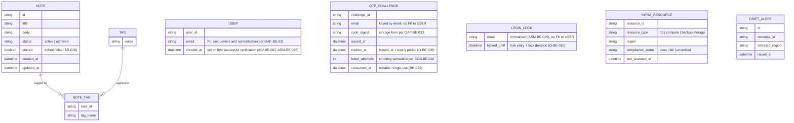

<!-- SECTION: backend.overview | status: DRAFT-UNVERIFIED -->
## 1. Overview

**Responsibility.** `notes_api` is the single backend service for a team note-taking product. It is responsible for:

1. **Application API.** Create, read, edit, pin and unpin, tag, archive, unarchive and search team notes, published as a versioned OpenAPI document. [stories.md EP-002, EP-003, EP-004]
2. **Email one-time-code login (CR-118).** A caller requests a one-time code for an email address. The service emails the code. The caller verifies it to receive a credential. Resends are limited, codes expire, and wrong codes trigger a lockout. [feedback.md CR-118; requirements.md BR-020 to BR-028; stories.md US-004-03, US-006-06] **No numeric limit is set in this revision.** The previous numeric values are withdrawn and must be re-decided. They are tracked as `Q-BE-008`, `Q-BE-009` and `Q-BE-010`. [feedback.md CR-118] This is an interface change: consumers must adapt. [feedback.md CR-118; requirements.md NFR-015]
3. **EU data-residency compliance.** Provisioning `notes_api`'s own database, compute and backups in approved EU regions. Gating deploys on a residency check. Generating a compliance report. Enforcing a launch gate. Alerting on post-launch region drift. [stories.md EP-001; requirements.md BR-001 to BR-004, NFR-001 to NFR-004]

**Not responsible for.**

- Rendering any user interface. The web-app surface (stories.md EP-006) is a separate run. This document defines only the API that surface consumes. [stories.md EP-006]
- Attachment and file-upload endpoints. [requirements.md BR-014]
- Any real-time channel (WebSocket, SSE, polling-push). [requirements.md BR-015]
- Mobile-specific endpoints. [stories.md US-005-01, US-005-04]
- Any login method other than email one-time code. No supplied input names a password, social or SSO login. [feedback.md CR-118]
- Logging and classifying stakeholder feature requests. This is a Product Manager intake process. [requirements.md BR-017; stories.md US-005-06]

**Change requests in this revision.**

- **CR-112 (retained).** Notes carry a boolean `pinned` flag, default `false`, settable on create and via PATCH, returned in note responses. Pinned notes sort before unpinned notes in list and search results. Interface change. [requirements.md BR-018, BR-019, NFR-014; feedback.md CR-112]
- **CR-118 (this change request).** Email one-time-code login as described in capability 2. Note, tag, search and residency behaviour are unchanged. [feedback.md CR-118]
- **Label discrepancy.** The change request is headed `CR-118`. Requirements NFR-015 uses `CR-113`. Stories US-006-06 uses `CR-114`. The approved revision uses `CR-115` and `CR-116` for the same login content. The content is the same. This document uses `CR-118`. Recorded as `CON-BE-013` (`CR-118`), `CON-BE-005` (`CR-113`), `CON-BE-008` (`CR-114`) and `CON-BE-009` (`CR-115`, `CR-116`).

**Stack.** Node.js 20, Express, PostgreSQL 16, hosted on AWS. [platform.md; feedback.md preflight answers] The approved revision specifies AWS SES for transactional email. CR-118 names no transport. `ASM-BE-027`. The approved revision specifies reuse of the application's existing session or token mechanism. The preflight answers do not state this. `ASM-BE-028`.

**Run mode.** `RUN-CONTEXT` declares `bootstrap` and supplies no existing `max_ids`. `feedback.md` carries an approved revision and instructs the run to keep what CR-118 does not touch. The approved revision is treated as the baseline. `ASM-BE-026`.

**Identifier continuity.**

- New identifiers continue from the highest observed in the approved revision: `GAP-BE-071` onward, `ASM-BE-034` onward, `CON-BE-013` onward, `Q-BE-008` onward. No identifier is reused.
- Carried forward with no text in any supplied document: `GAP-BE-004`, `GAP-BE-005`, `GAP-BE-007`, `GAP-BE-042`, `GAP-BE-043`, `Q-BE-004`. They remain open. No section below depends on them.
- `GAP-BE-041` and `GAP-BE-045` to `GAP-BE-052` were raised in the approved revision. Their text is not in the supplied excerpt. They remain open, and no section below depends on their content.
- Module-level `api-contract` sections (full request, response and error schemas) are not produced here. `SCHEMA-` IDs for login payloads are deferred to the `auth` module contract.

**Open blocking questions.**

- `Q-BE-003`: who may verify and receive access.
- `Q-BE-005`: the AWS region from which email is sent, and the residency of email transmission.
- `Q-BE-008`: the resend limit and its window. Re-decision required by CR-118.
- `Q-BE-009`: the code expiry period. Re-decision required by CR-118.
- `Q-BE-010`: the wrong-code threshold and the lock duration. Re-decision required by CR-118.
- `Q-BE-007` is class `blocking` and carries a default: only verification is refused during a lock, and sending remains subject to the resend limit. It is marked `DRAFT-UNVERIFIED`.

Under the composition rules these map to `HALT-BLOCKING-QUESTION`.

**Open Critical contradictions.**

- `CON-BE-003`: registration scope against the shared-workspace default. Touches an authorisation rule.
- `CON-BE-006`: email transmission against BR-001. Touches a PII path, because the email address is personal data sent to a transport whose region is unknown.
- `CON-BE-010`: lock counting. Consecutive wrong codes (BR-027) are set against cumulative wrong codes (BR-022, BR-025). Changes a lock state machine.

These map to `HALT-CRITICAL-CONTRADICTION`.

**Halting.** The orchestrator decides whether to halt. This document records the work completed. Subsections that depend on an open blocking question or Critical contradiction are marked in place.

<!-- /SECTION: backend.overview -->
<!-- SECTION: backend.domain-model | status: DRAFT-UNVERIFIED -->
## 2. Domain model

Three sub-domains are evidenced: the **note-taking domain** (Note, Tag), the **login domain** (User, OTP challenge, login lock) and the **residency-compliance domain** (InfraResource, DriftAlert). The login domain is new in this revision. [feedback.md CR-118] No input relates these sub-domains beyond "notes_api's infrastructure hosts the note-taking data." [requirements.md BR-013]

**Entities.**

- **Note.** Title, body, status (active or archived), `pinned`, created and updated timestamps. [stories.md US-002-01 to US-002-06] Title and body are mandatory and non-empty at creation. [requirements.md BR-005]
- **`pinned` (CR-112).** Boolean, default `false`. Settable on create and changeable via PATCH. Pinning does not alter title, body or tags. [requirements.md BR-018; stories.md AC-002-01-01, AC-002-01-02, AC-002-02-02] Nullability is not stated in any input. The proposed `NOT NULL` is `ASM-BE-034`.
- **Tag.** A name, many-to-many with Note through NOTE_TAG. Adding an existing tag is idempotent, with no duplicate entry. [stories.md US-002-03] Tag name format and length: `GAP-BE-009`. Cascade when a tag's last note is archived or deleted: `GAP-BE-016`.
- **User.** A person who has verified an email address. Created on first successful verification, not on code request. [INV-BE-003; ASM-BE-025] No CR-118 input states this directly. `email` is personal data. `ASM-BE-019`. Handling policy: `GAP-BE-033`.
- **OTP challenge.** One issued one-time code for one email address, keyed by email because the user may not yet exist. Expiry is the period in `Q-BE-009`, measured from issue. [requirements.md BR-024, BR-026] Single-use. [requirements.md BR-023; INV-BE-002] Expiry is enforced by INV-BE-004. Code length and character set: `GAP-BE-026`, `GAP-BE-027`. Storage form: `GAP-BE-033`.
- **Login lock.** The lock state for an email address. Entered after wrong codes and held for the duration in `Q-BE-010`. [requirements.md BR-022, BR-025, BR-027; stories.md US-004-03] Keyed by normalised email: `ASM-BE-015`. Whether the wrong-code count is consecutive or cumulative, and whether it resets: `CON-BE-010` (Critical), `GAP-BE-024`.
- **InfraResource.** A provisioned notes_api component (DB, compute, backup storage) with its reported region and compliance status. Unrecognised resource types are flagged `unverified`, never silently omitted. [stories.md AC-001-04-01, AC-001-04-02]
- **DriftAlert.** A record of a post-launch detection of an InfraResource in a non-EU region. [stories.md US-001-06]

**Invariants.** These hold after every operation that touches the named entity.

- **INV-BE-001.** In `GET /notes` and `GET /notes/search`, every pinned note is returned before every unpinned note. Order within each group is unchanged. [requirements.md BR-019] Owned by `notes` for `GET /notes` and by `search` for `GET /notes/search`. Both apply the same rule.
- **INV-BE-002.** A one-time code that has been verified successfully is refused on any later verification. [requirements.md BR-023]
- **INV-BE-003.** A User row is created only on successful verification, never on code request. [ASM-BE-025]
- **INV-BE-004.** A code submitted at or after issue plus the expiry period in `Q-BE-009` is rejected as expired. [requirements.md BR-024, BR-026]

**Cardinality and ownership.**

- User and Note have no relationship in the diagram. No input states whether a Note belongs to a user, is private, or is shared. `GAP-BE-003`. The default applied is `Q-BE-001` (class: degradable): notes form a shared team workspace, and any authenticated team member may read and write any note.
- **BLOCKED subpart.** `CON-BE-003` (Critical) calls that default into question. Under CR-118 any holder of an email address that verifies can obtain a credential, so "team member" no longer names a bounded group. Until `Q-BE-003` is answered, the shared-workspace default applies only to users created by a route the human has approved. Note ownership columns and the note-access rule are blocked. See `backend.auth-model`.

**PII.** Personal data now exists in this domain: `USER.email`, `OTP_CHALLENGE.email` and `LOGIN_LOCK.email`, which hold the same value. Note `title` and `body` are free text and may incidentally contain PII. No masking or handling policy is supplied for any of them: `GAP-BE-017` (general PII policy), `GAP-BE-033` (at-rest treatment), `GAP-BE-035` (validation scope for email and code fields). No encryption, redaction or retention claim is made in their absence.

<!-- /SECTION: backend.domain-model -->
<!-- SECTION: backend.module-map | status: DERIVED -->
## 3. Module map

| Module | Boundary | Depends on |
|---|---|---|
| `auth` | Email one-time-code login (CR-118): code issuance and delivery, verification, resend limits, lockout, code expiry, user creation on first verification, credential issuance through the existing session/token mechanism. Owns User, OTP_CHALLENGE, LOGIN_LOCK. | external: email transport (`ASM-BE-027`; region blocked on `Q-BE-005`, `CON-BE-006`) |
| `notes` | Note CRUD, pin and unpin via PATCH, tag assignment and removal, archive and unarchive. Owns Note, Tag, NOTE_TAG. | `auth` (caller identity) |
| `search` | Read-only query over Note: keyword, tag filter, pagination, archived-exclusion default, pinned-first ordering. | `notes`, `auth` |
| `residency-compliance` | Provisioning region validation, backup-destination validation, CI/CD residency gate, compliance report, launch-gate status, post-launch drift scan and alerting. Owns InfraResource, DriftAlert. | none at runtime; operates on the infrastructure and CI/CD layer |
| `api-docs` | Publishes the OpenAPI document, including `pinned`, the ordering change, and both login endpoints. Computes the endpoint-coverage metric. Carries the data-residency note and the Scope section. | `notes`, `search`, `auth`, `residency-compliance` |
| `scope-guardrail` | Intercepts every inbound request ahead of routing. Rejects attachment and multipart, WebSocket and SSE-upgrade, and mobile-specific patterns with a structured out-of-scope response. Backs the contract test suite. | sits upstream of all modules; cross-cutting |

**Dependency direction.** `search → notes`, `search → auth`, `notes → auth`, `api-docs → notes, search, auth, residency-compliance`, `auth → email transport` (external). Requests flow through `scope-guardrail` first, then `auth` for protected routes, then `notes`, `search` or `api-docs`.

**Guardrail before authentication.** The guardrail runs before authentication, so an out-of-scope call returns its documented response without a credential. `ASM-BE-018`. The response form for excluded paths conflicts across inputs: `CON-BE-007`.

**CR-118 impact on boundaries.** `auth` is the new module under CR-118. It is a new dependency of `notes` and `search`, which previously had no identity dependency. It is the only module that calls the email transport. That dependency carries the residency question `CON-BE-006`.

<!-- /SECTION: backend.module-map -->
<!-- SECTION: backend.api-surface | status: DRAFT-UNVERIFIED -->
## 4. API surface index

Full contracts (request and response schemas, every error, idempotency, rate limits) belong in the per-module `api-contract` sections, which this document does not produce.

**Versioning.** An endpoint whose request or response shape changes is re-pinned from `@1` to `@2` (`ASM-BE-010`). New endpoints start at `@1` (`ASM-BE-021`). CR-118 changes no shape of existing endpoints, so their pins stay at `@2`. Whether authenticated endpoints should bump because their caller obligation changes: `GAP-BE-037`.

| API ID | Method | Path | Auth | Module | Notes |
|---|---|---|---|---|---|
| `API-AUTH-001@1` | POST | `/auth/otp/send` | unauthenticated; rate-limited | `auth` | **New (CR-118).** Issues a one-time code to an email address and emails it through the transport. Also the resend path. Requests beyond the resend limit return 429 and send no code. [requirements.md BR-021, BR-028; stories.md US-006-06] Limit value and window: `Q-BE-008`. Whether the initial send counts toward the limit: `CON-BE-011`. Limit key: `Q-BE-006`, default per email (`ASM-BE-029`). Response does not reveal whether an account exists (`ASM-BE-030`). Success status and body: `GAP-BE-028`. Behaviour during an active lock: `GAP-BE-063`; `Q-BE-007` default applies. Transport failure: `GAP-BE-066`. Transport region: blocked on `Q-BE-005`, `CON-BE-006`. |
| `API-AUTH-002@1` | POST | `/auth/otp/verify` | unauthenticated; subject to lockout | `auth` | **New (CR-118).** Verifies a code for an email address. Wrong, expired or already-used codes are rejected. [requirements.md BR-023, BR-024, BR-026; INV-BE-002, INV-BE-004] Expiry period: `Q-BE-009`. After the wrong-code threshold, the address is locked and further verification is refused until the lock expires. [requirements.md BR-022, BR-025, BR-027; stories.md US-004-03] Threshold and duration: `Q-BE-010`. Lock counting: `CON-BE-010` (Critical, blocked). Locked-response status and body: `GAP-BE-038`. Wrong-code and expired-code statuses: `GAP-BE-053`. Unknown-email behaviour: `GAP-BE-065`. On success, creates the User if absent (INV-BE-003) and returns a credential from the existing session/token mechanism (`ASM-BE-028`, `GAP-BE-030`). |
| `API-NOTES-001@2` | POST | `/notes` | authenticated team member (`ASM-BE-031`) | `notes` | **Changed from @1 (CR-112).** Accepts optional `pinned` (boolean, default `false`). Returns `pinned` in the 201 body. Title and body rules unchanged. [stories.md AC-002-01-01, AC-002-01-02; requirements.md BR-005, BR-018] |
| `API-NOTES-002@2` | PATCH | `/notes/{id}` | authenticated team member | `notes` | **Changed from @1 (CR-112).** Accepts optional `pinned`. Partial update: fields not sent are never overwritten. [requirements.md BR-006] Returns `pinned`. Pinning leaves title, body and tags unchanged. [stories.md AC-002-02-02] PATCH, not PUT: `ASM-BE-001`. Concurrent-write policy: `GAP-BE-040`. |
| `API-NOTES-003@2` | GET | `/notes/{id}` | authenticated team member | `notes` | **Changed from @1 (CR-112).** Returns `pinned`, tags and archive status. A missing note returns 404 with no partial data. [stories.md US-002-06] Whether a delete operation exists: `GAP-BE-046`. |
| `API-NOTES-004@2` | GET | `/notes` | authenticated team member | `notes` | **Changed from @1 (CR-112).** Default active-notes list. Pinned-first (INV-BE-001). Base order within each group: `CON-BE-002`. Parameters: `GAP-BE-001`. Page size: `GAP-BE-015`. |
| `API-NOTES-005@1` | POST | `/notes/{id}/tags` | authenticated team member | `notes` | Add tag, idempotent: no duplicate entry on repeat. [stories.md US-002-03] `ASM-BE-002`. |
| `API-NOTES-006@1` | DELETE | `/notes/{id}/tags/{tag}` | authenticated team member | `notes` | Remove tag. `ASM-BE-002`. |
| `API-NOTES-007@1` | POST | `/notes/{id}/archive` | authenticated team member | `notes` | Archive; data retained. [requirements.md BR-007] Repeat archive returns a conflict or error response. Status: `GAP-BE-048`. [stories.md US-002-04] |
| `API-NOTES-008@1` | POST | `/notes/{id}/unarchive` | authenticated team member | `notes` | Restores full prior state, including `pinned`. [stories.md US-002-05; requirements.md BR-008] |
| `API-SEARCH-001@2` | GET | `/notes/search` | authenticated team member | `search` | **Changed from @1 (CR-112).** Keyword (`q`), `tags`, `page`, `limit`, `include_archived`. Returns `pinned`. Pinned-first (INV-BE-001), then relevance. [stories.md US-003-01; requirements.md BR-019] Archived notes excluded by default. [requirements.md BR-009] Returns 503 with a retry-after indication when the search index is unavailable. [stories.md US-003-03] At least one of `q` or `tags` required: `ASM-BE-006`, `CON-BE-001`. |
| `API-APIDOCS-001@1` | GET | `/openapi.{json\|yaml}` (exact path `GAP-BE-008`) | unauthenticated (`ASM-BE-004`) | `api-docs` | Describes `pinned`, the ordering change (NFR-014), and both login endpoints with their 429, expiry and locked-account responses. [stories.md US-004-01, US-004-03] Unsupported `Accept` yields 406 or a documented fallback. [stories.md US-004-01] |

`residency-compliance` and `scope-guardrail` own **no end-user HTTP endpoint** evidenced by any input. Residency behaviour is infrastructure-as-code and pipeline-hook work. Report delivery: `GAP-BE-002`. Excluded-path behaviour is in `backend.error-model`, and it conflicts across inputs: `CON-BE-007`.

**Consumer obligation under CR-118.** Every authenticated endpoint above requires a credential from `API-AUTH-002@1`. Client integrators must complete the login flow before calling them. [feedback.md CR-118; requirements.md NFR-015] Web-app obligations carried forward from the approved revision: `HANDOFF-BE-002` (login flow) and `HANDOFF-BE-003` (surface 429, expired-code and locked-account responses). Both must be re-checked against `Q-BE-008` to `Q-BE-010` before delivery, because the numeric values they depend on are withdrawn.

<!-- /SECTION: backend.api-surface -->
<!-- SECTION: backend.auth-model | status: DRAFT-UNVERIFIED -->
## 5. Auth model

### 5.1 Actors

| Actor | Source | Notes |
|---|---|---|
| Anonymous caller | `stories.md` US-004-01, US-006-06 | Can call the two login endpoints and read the OpenAPI document. |
| Authenticated team member | `ASM-BE-031` | The only authenticated role evidenced. No role model beyond this is supplied: `GAP-BE-081`. |
| Platform/DevOps, Release/CI, Engineering Lead, Compliance Auditor, Product Manager | `stories.md` EP-001, EP-005 | Human actors operating infrastructure, pipelines and reports. No API role is evidenced for them. |

### 5.2 Login flow (CR-118)

1. **Send.** The caller submits an email address to `API-AUTH-001@1`. The service issues a code, records an OTP challenge, and emails the code through the transport. [feedback.md CR-118] If the resend limit (`Q-BE-008`) is exceeded, the service returns 429 and sends no code. [requirements.md BR-021, BR-028]
2. **Verify.** The caller submits the email address and the code to `API-AUTH-002@1`. The code is refused if it is wrong, expired (`Q-BE-009`) or already consumed. [requirements.md BR-023, BR-024, BR-026]
3. **Lock.** After the wrong-code threshold (`Q-BE-010`), the address is locked for the lock duration (`Q-BE-010`). Verification is refused until the lock expires. [requirements.md BR-022, BR-025, BR-027] Whether the count is consecutive or cumulative, and whether it resets: `CON-BE-010` (Critical, blocked). Whether a lock also refuses sending: `Q-BE-007`, default applied as stated in section 1.
4. **Success.** The User is created if absent (INV-BE-003). A credential is returned from the existing session or token mechanism. `ASM-BE-028`, `GAP-BE-030`.

**No numeric value is applied anywhere in this flow.** The values from the approved revision are withdrawn by CR-118. Any implementation proceeding before `Q-BE-008`, `Q-BE-009` and `Q-BE-010` are answered is building against an unset parameter.

**Non-enumeration.** The send response must not reveal whether an account exists. `ASM-BE-030`. The same rule applies to verify. `GAP-BE-065`.

**Registration scope.** Who may verify and receive access: `Q-BE-003` (blocking). Critical contradiction with the shared-workspace default: `CON-BE-003`. Until both are resolved, login-created users are not assumed to be team members.

### 5.3 Permission matrix

Ownership predicates are blocked. `GAP-BE-003`, `CON-BE-003`.

| Resource | Operation | Anonymous | Authenticated team member | Ownership predicate |
|---|---|---|---|---|
| OTP challenge | issue (send) | allowed, subject to resend limit (`Q-BE-008`) | not applicable | none |
| OTP challenge | verify | allowed, subject to lock (`Q-BE-010`, `CON-BE-010`) | not applicable | none |
| User | create on first verification | via verify only (INV-BE-003) | not applicable | none |
| Note | create | refused | allowed (`ASM-BE-031`) | blocked (`CON-BE-003`) |
| Note | read, list, search | refused | allowed | blocked (`CON-BE-003`) |
| Note | edit, pin, tag, archive, unarchive | refused | allowed | blocked (`CON-BE-003`) |
| OpenAPI document | read | allowed (`ASM-BE-004`) | allowed | none |
| Out-of-scope routes | any | rejected by guardrail before auth (`ASM-BE-018`) | rejected by guardrail | not applicable |

<!-- /SECTION: backend.auth-model -->
<!-- SECTION: backend.data-lifecycle | status: DRAFT-UNVERIFIED -->
## 6. Data lifecycle

| Data | Stored by | Retention | At-rest treatment | Deletion |
|---|---|---|---|---|
| Note (title, body, status, pinned, timestamps) | `notes` | Not stated beyond archive retention. `GAP-BE-077` covers backup retention only. | Not stated: `GAP-BE-017`. No encryption claim made. | Archive retains data. [requirements.md BR-007] Hard delete: `GAP-BE-046`. |
| Note title and body (free text, may contain PII) | `notes` | As Note. | As Note. | As Note. `GAP-BE-017`. |
| Tag and NOTE_TAG | `notes` | As Note. | Not applicable (not PII). | Cascade on last-note removal: `GAP-BE-016`. |
| User email | `auth` | Not stated. `GAP-BE-033`. | Not stated: `GAP-BE-033`. | Not stated. |
| OTP challenge (email, code digest, timestamps) | `auth` | Not stated after expiry or consumption: `GAP-BE-078`. | Code storage form: `GAP-BE-033`. | Not stated: `GAP-BE-078`. |
| Login lock (email, locked-until) | `auth` | Lasts the lock duration (`Q-BE-010`). | Email is personal data (`ASM-BE-019`). | Not stated: `GAP-BE-078`. |
| InfraResource, DriftAlert | `residency-compliance` | Not stated. Report delivery: `GAP-BE-002`. | Not stated. | Not stated. |
| Backups | infrastructure | Stored in EU-region storage. [stories.md AC-001-02-01] Retention not stated: `GAP-BE-077`. | Not stated. | Not stated. |

**Email transmission.** Each email address is transmitted through a transport whose region is not supplied. `Q-BE-005`, `CON-BE-006` (Critical). The transmitted address is personal data. Until this resolves, no residency claim covers login email.

**Residency statement.** The API documentation must state where archived and active note data is stored and served. [requirements.md BR-013; stories.md US-004-06] Any difference between archived and active storage must be called out. [stories.md US-004-06] This document does not assert the content of that statement. It is an output to be produced and verified.

**Encryption.** No input states that any data is encrypted at rest or in transit beyond what the platform provides. Per the composition rules, no such claim is made.

<!-- /SECTION: backend.data-lifecycle -->
<!-- SECTION: backend.nfr | status: VERIFIED -->
## 7. Non-functional requirements

Every target below is quoted from `requirements.md`. No target is invented. Targets without a supplied source are listed under "Gaps" at the end of this section.

| NFR | Category | Target | Priority | Owning module |
|---|---|---|---|---|
| NFR-001 | Compliance | 100% of infrastructure components EU-verified | Must Have | `residency-compliance` |
| NFR-002 | Compliance | 0 non-EU deploys reach production | Must Have | `residency-compliance` |
| NFR-003 | Availability | Alert fired within 15 minutes of drift detection | Must Have | `residency-compliance` |
| NFR-004 | Compliance | Report refreshed and 100% accurate at each launch gate check | Must Have | `residency-compliance` |
| NFR-005 | Performance | 100% functional-test pass rate for CRUD operations | Must Have | `notes` |
| NFR-006 | Performance | Search p95 latency < 300 ms under typical load | Must Have | `search` |
| NFR-007 | Scalability | Search p95 < 300 ms maintained up to page size 100 | Should Have | `search` |
| NFR-008 | Compliance | 100% endpoint coverage in published spec | Must Have | `api-docs` |
| NFR-009 | Usability | 100% of search and tagging endpoints have example payloads | Should Have | `api-docs` |
| NFR-010 | Compliance | 0 out-of-scope endpoints detected per build, on every CI build | Must Have | `scope-guardrail` |
| NFR-011 | Usability | 100% of out-of-scope calls return documented 4xx with explanatory message | Should Have | `scope-guardrail` |
| NFR-012 | Security | 0 critical injection vulnerabilities per release | Must Have | `notes`, `search` |
| NFR-013 | Availability | 99.9% uptime monthly for CRUD and search | Should Have | `notes`, `search` |
| NFR-014 | Documentation | Pinned field and pinned-first ordering documented as an interface change | Should | `api-docs` |
| NFR-015 | Documentation | Login is an interface change; consumers notified to adapt | Should | `api-docs` |
| NFR-016 | Documentation | Send and verify are additive; existing login methods unchanged; documented; consumers notified | Should | `api-docs` |

**Behavioural requirements tied to NFRs.**

- Search under index unavailability returns 503 with a retry-after indication rather than hanging. [stories.md US-003-03]
- Concurrent PATCH requests to one note receive a standard last-write or conflict response, with no live broadcast and no merge. [stories.md US-005-03] The precise policy is `GAP-BE-040`.

**Gaps.**

- NFR-006 and NFR-007 measure "typical load". No load profile is supplied. `GAP-BE-076`.
- No latency or throughput target exists for login send or verify. `GAP-BE-076`.
- NFR-013 does not name the login endpoints. Whether they fall under 99.9% is not stated. `GAP-BE-076`.
- No concurrency target is supplied. `GAP-BE-040`.

<!-- /SECTION: backend.nfr -->
<!-- SECTION: backend.error-model | status: DRAFT-UNVERIFIED -->
## 8. Error model

### 8.1 Global envelope

The error envelope shape is not supplied. `GAP-BE-074`. The inputs require that every error carry:

- a machine-readable code [stories.md US-005-04, which gives `OUT_OF_SCOPE` as an example];
- a human-readable message [stories.md US-003-01, US-003-05, US-005-04].

No envelope field names are defined here. Any field name would be an invention.

### 8.2 Status-code policy

| Status | Where | Source |
|---|---|---|
| 200 | Successful read or update | stories.md US-002-02, US-002-03, US-003-01 |
| 201 | Successful create | stories.md AC-002-01-01, AC-002-01-02 |
| 400 | Validation error (missing title, invalid `q`, invalid `tags`, negative or non-numeric `page`/`limit`, invalid `include_archived`) | stories.md AC-002-01-03, US-003-01, US-003-02, US-003-05, US-003-06 |
| 401, 403 | Authentication and authorisation failures; documented shapes | stories.md US-004-03 |
| 404 | Missing note. Returns no partial data. | stories.md US-002-06, AC-002-02-03 |
| 406 or documented fallback | Unsupported `Accept` on OpenAPI endpoint | stories.md US-004-01 |
| 409 or equivalent | Repeat archive. Exact status: `GAP-BE-048`. | stories.md US-002-04 |
| 415 or 400 | Multipart upload to a note endpoint | stories.md US-005-02 |
| 429 | Resend limit exceeded on send. Limit: `Q-BE-008`. | requirements.md BR-028; stories.md US-004-03 |
| Locked-account response | Verify during lock. Status and body: `GAP-BE-038`. Duration: `Q-BE-010`. | requirements.md BR-022, BR-027; stories.md US-004-03 |
| Wrong-code and expired-code responses | Status: `GAP-BE-053`. Expiry: `Q-BE-009`. | requirements.md BR-024, BR-026 |
| 503 with retry-after | Search index unavailable | stories.md US-003-03 |
| Out-of-scope response | Structured, referencing scope exclusion, not a bare 404 | stories.md US-005-04; requirements.md BR-016 |

**Conflict.** Attachment paths are required to return 404 [stories.md US-005-02] while excluded calls are required to return a structured out-of-scope response, not a bare 404 [stories.md US-005-04; requirements.md BR-016]. `CON-BE-007`.

### 8.3 Error-code registry

Only one code is evidenced: `OUT_OF_SCOPE`, given as "e.g." in US-005-04. No further machine-readable codes are supplied. Registry completion: `GAP-BE-075`. No code is invented here.

<!-- /SECTION: backend.error-model -->
<!-- SECTION: backend.observability | status: DRAFT-UNVERIFIED -->
## 9. Observability

**Logged, as stated by inputs.**

- Each residency scan logs a pass when all resources are in EU regions. [stories.md AC-001-06-01]
- A post-launch drift detection is sent to the DevOps team immediately, with resource details. [stories.md AC-001-06-02]
- A deploy-time residency failure fails the build and is treated as a failure. [stories.md AC-001-03-02, AC-001-03-03]
- A backup job with an out-of-EU destination fails with a residency-violation error and writes no data. [stories.md AC-001-02-02]
- Out-of-scope requests are counted by a manual Product Manager log, not by the service. [requirements.md BR-017; stories.md US-005-06]

**Redacted.** No input states a redaction rule. `GAP-BE-079`. `ASM-BE-035` (proposed, not sourced): email addresses and one-time codes are not written to logs or artefacts until a redaction rule is supplied.

**Metered.**

- Percentage of infrastructure that is EU-verified. [stories.md AC-001-04-01; requirements.md NFR-001]
- Endpoint coverage percentage in the published spec. [stories.md US-004-04; requirements.md NFR-008]
- Search latency percentiles. [requirements.md NFR-006]
- Rejected out-of-scope requests (manual, see above). [stories.md US-005-01]

**Alerts.**

- Post-launch drift: immediate alert to the DevOps team, within 15 minutes of detection. [stories.md AC-001-06-02; requirements.md NFR-003]
- Search index unavailability: 503 is returned to callers. No internal alert is specified. `GAP-BE-080`.
- Lockout events and login failure rates: no alerting or metering is specified. `GAP-BE-080`.

<!-- /SECTION: backend.observability -->
<!-- SECTION: backend.migration-plan | status: DRAFT-UNVERIFIED -->
## 10. Migration plan

No migration history, applied-state record or existing schema is supplied. `GAP-BE-072`. The ordering below is derived from entity dependencies in section 2. It is not a record of what has been applied.

| Order | Migration | Derivation | Reversibility |
|---|---|---|---|
| M-001 | Add `pinned` boolean to `notes`, default `false`. | CR-112; requirements.md BR-018 | Reversible by dropping the column. Pinned state is lost on rollback. Acceptance policy: `GAP-BE-073`. Applied state: `GAP-BE-072`. |
| M-002 | Create `users`, with `email` as the stored address. Uniqueness and normalisation: `GAP-BE-031`. | INV-BE-003; ASM-BE-025 | Reversible by dropping the table. Rollback after first verification destroys user records. `GAP-BE-073`. |
| M-003 | Create `otp_challenges`, keyed by email, indexed on email and issue time. | Keyed by email (section 2); index serves send and verify lookups (`B8` requirement) | Reversible by dropping the table. Loss of in-flight codes on rollback. `GAP-BE-073`. |
| M-004 | Create `login_locks`, keyed by normalised email. | `ASM-BE-015`; lock duration `Q-BE-010` | Reversible by dropping the table. Rollback releases active locks. `GAP-BE-073`. |
| M-005 | Create residency tables (`infra_resources`, `drift_alerts`). Hosting location: `GAP-BE-002`. | Section 2 | Reversible by dropping the table. `GAP-BE-073`. |

**Ordering constraints.**

- M-001 precedes any endpoint that reads or writes `pinned`. [CR-112]
- M-002 through M-004 precede `API-AUTH-001@1` and `API-AUTH-002@1`.
- M-005 is independent of the note and login migrations.

**Pending decisions that change these migrations.** `Q-BE-003` may change M-002 (who is created as a User). `CON-BE-010` may change M-003 and M-004 (whether a wrong-code counter is a column on `otp_challenges` or a separate lock state). Neither answer is assumed here.

<!-- /SECTION: backend.migration-plan -->
<!-- SECTION: backend.coverage | status: VERIFIED -->
## 11. Coverage

Every supplied story (EP-001 to EP-006, 36 in total) appears below. Stories in EP-006 are the web-app surface. They are listed for their backend dependency only.

| Story | Requirement and criteria | Owning module or API | Status |
|---|---|---|---|
| US-001-01 | BR-001; NFR-001; AC-001-01-01, AC-001-01-02 | `residency-compliance` | covered |
| US-001-02 | BR-001; AC-001-02-01, AC-001-02-02 | `residency-compliance` | covered |
| US-001-03 | BR-002; NFR-002; AC-001-03-01 to AC-001-03-03 | `residency-compliance` | covered |
| US-001-04 | NFR-001, NFR-004; AC-001-04-01, AC-001-04-02 | `residency-compliance` | covered |
| US-001-05 | BR-003; AC-001-05-01, AC-001-05-02 | `residency-compliance` | covered |
| US-001-06 | BR-004; NFR-003; AC-001-06-01, AC-001-06-02 | `residency-compliance` | covered |
| US-002-01 | API-NOTES-001@2; BR-005; INV-BE-001; AC-002-01-01 to AC-002-01-03 | `notes` | covered |
| US-002-02 | API-NOTES-002@2; BR-006; AC-002-02-01 to AC-002-02-03 | `notes` | covered |
| US-002-03 | API-NOTES-005@1, API-NOTES-006@1 | `notes` | covered |
| US-002-04 | API-NOTES-007@1; BR-007; repeat-archive status `GAP-BE-048` | `notes` | covered, detail open |
| US-002-05 | API-NOTES-008@1; BR-008 | `notes` | covered |
| US-002-06 | API-NOTES-003@2 | `notes` | covered |
| US-003-01 | API-SEARCH-001@2; INV-BE-001; NFR-006 | `search` | covered |
| US-003-02 | API-SEARCH-001@2; BR-010 | `search` | covered |
| US-003-03 | API-SEARCH-001@2; NFR-006, NFR-007, NFR-013 | `search` | covered |
| US-003-04 | API-SEARCH-001@2; BR-010; ambiguity `CON-BE-001` | `search` | covered, detail open |
| US-003-05 | API-SEARCH-001@2; BR-011; NFR-007 | `search` | covered |
| US-003-06 | API-SEARCH-001@2; BR-009 | `search` | covered |
| US-004-01 | API-APIDOCS-001@1; BR-012; NFR-008; login endpoints listed (CR-118) | `api-docs` | covered |
| US-004-02 | API-APIDOCS-001@1; BR-012; schemas deferred to module contracts | `api-docs` | covered, schemas deferred |
| US-004-03 | API-APIDOCS-001@1; BR-022, BR-028; 401, 403, 429, locked-account responses | `api-docs` | covered, values open (`Q-BE-008`, `Q-BE-010`) |
| US-004-04 | API-APIDOCS-001@1; NFR-008 | `api-docs` | covered |
| US-004-05 | API-APIDOCS-001@1; NFR-009 | `api-docs` | covered |
| US-004-06 | BR-013; API-APIDOCS-001@1; residency statement | `api-docs` | covered, email transport open (`CON-BE-006`) |
| US-005-01 | API-APIDOCS-001@1 (Scope section); BR-016 | `api-docs`, `scope-guardrail` | covered |
| US-005-02 | BR-014; NFR-010; excluded-route behaviour `CON-BE-007` | `scope-guardrail` | covered, detail open |
| US-005-03 | BR-015; NFR-010; concurrent-write policy `GAP-BE-040` | `scope-guardrail`, `notes` | covered, detail open |
| US-005-04 | BR-016; NFR-011; `OUT_OF_SCOPE` (`GAP-BE-075`) | `scope-guardrail` | covered, registry open |
| US-005-05 | NFR-010; BR-014, BR-015, BR-016 | `scope-guardrail` (CI suite) | covered |
| US-005-06 | BR-017 | Product Manager process; no backend runtime requirement | uncovered by design, `GAP-BE-082` |
| US-006-01 | Backend dependency: API-NOTES-004@2 | web-app surface | backend dependency only |
| US-006-02 | Backend dependency: API-NOTES-001@2, API-NOTES-002@2 | web-app surface | backend dependency only |
| US-006-03 | Backend dependency: API-SEARCH-001@2 | web-app surface | backend dependency only |
| US-006-04 | Backend dependency: API-NOTES-005@1, API-NOTES-006@1 | web-app surface | backend dependency only |
| US-006-05 | Backend dependency: API-NOTES-007@1, API-NOTES-008@1 | web-app surface | backend dependency only |
| US-006-06 | API-AUTH-001@1, API-AUTH-002@1; BR-020 to BR-028; INV-BE-002, INV-BE-004; numeric values open (`Q-BE-008` to `Q-BE-010`); story label `CR-114` (`CON-BE-008`) | `auth` | covered, values open |

**Uncovered.** US-005-06 is a Product Manager intake process and has no backend runtime requirement. `GAP-BE-082`. Closing artefact: confirmation from the Product Manager that the intake log is outside the notes_api surface.

<!-- /SECTION: backend.coverage -->
