<!-- SECTION: backend.overview | status: DRAFT-UNVERIFIED -->
## 1. Overview

**Responsibility.** `notes_api` is the single backend service for a team note-taking product. [stories.md EP-002, EP-003, EP-004; requirements.md BR-013] It is responsible for:

1. **Application API.** Create, read, edit, pin and unpin, tag, archive, unarchive and search team notes, published as a versioned OpenAPI document. [stories.md EP-002, EP-003, EP-004]
2. **Email one-time-code login (CR-119).** A caller requests a one-time code for an email address. The service emails the code. The caller verifies it and receives a credential. Code expiry, resend limits and lockout after repeated wrong codes apply. [feedback.md CR-119; requirements.md BR-020 to BR-028, NFR-015, NFR-016; stories.md US-004-03, US-006-06]
   - **All numeric limits are withdrawn.** CR-119 withdraws the previous numeric limits for code expiry, resend count and window, wrong-code threshold and lock duration. [feedback.md CR-119] The numeric values stated in BR-020, BR-021, BR-022, BR-024, BR-025, BR-026, BR-027 and BR-028, and in US-004-03 and US-006-06, are not used anywhere in this document. They are recorded as `CON-BE-014`.
   - The re-decision is tracked as `Q-BE-008` (resend count and window), `Q-BE-009` (code expiry period) and `Q-BE-010` (wrong-code threshold and lock duration). All three are class `blocking`. [feedback.md CR-119; this document, backend.overview]
   - This is an interface change: consumers must adapt. [feedback.md CR-119; requirements.md NFR-015]
3. **EU data-residency compliance.** Provisioning `notes_api`'s own database, compute and backups in approved EU regions. Gating deploys on a residency check. Generating a compliance report. Enforcing a launch gate. Alerting on post-launch region drift. [stories.md EP-001; requirements.md BR-001 to BR-004, NFR-001 to NFR-004]

**Not responsible for.**

- Rendering any user interface. The web-app surface (EP-006) is a separate run. This document defines only the API that surface consumes. [stories.md EP-006]
- Attachment and file-upload endpoints. [requirements.md BR-014]
- Any real-time channel (WebSocket, SSE, polling-push). [requirements.md BR-015]
- Mobile-specific endpoints. [stories.md US-005-01, US-005-04]
- Any login method other than email one-time code. No supplied input names a password, social or SSO login. [feedback.md CR-119] See `GAP-BE-085`, which concerns NFR-016's reference to "existing login methods".
- Logging and classifying stakeholder feature requests. This is a Product Manager intake process. [requirements.md BR-017; stories.md US-005-06]

**Change requests in this revision.**

- **CR-112 (retained).** Notes carry a boolean `pinned` flag, default `false`, settable on create and via PATCH, returned in note responses. Pinned notes sort before unpinned notes in list and search results. Interface change. [requirements.md BR-018, BR-019, NFR-014; feedback.md CR-112]
- **CR-119 (this change request).** Email one-time-code login as described in capability 2. Note, tag, search and residency behaviour are unchanged, and are carried forward from the approved revision. [feedback.md CR-119]
- **Label discrepancy.** The change request is headed `CR-119`. The approved revision labels the same login content `CR-118`. Requirements NFR-015 uses `CR-113`. Stories US-006-06 uses `CR-114`. The approved revision also uses `CR-115` and `CR-116` for the same content. The content is the same. This document uses `CR-119`. Recorded as `CON-BE-015` (`CR-119`), `CON-BE-013` (`CR-118`), `CON-BE-005` (`CR-113`), `CON-BE-008` (`CR-114`) and `CON-BE-009` (`CR-115`, `CR-116`).

**Stack.** Node.js 20, Express, PostgreSQL 16, hosted on AWS. [platform.md; feedback.md preflight answers] The approved revision specifies AWS SES for transactional email. CR-119 names no transport. `ASM-BE-027`. The approved revision specifies reuse of the application's existing session or token mechanism. The preflight answers do not state this. `ASM-BE-028`. No ORM, migration tool or other library is named by any input. `GAP-BE-089`.

**Run mode.** `RUN-CONTEXT` declares `bootstrap`. `feedback.md` supplies the approved revision as the baseline and instructs the run to keep what CR-119 does not touch. The approved revision is treated as that baseline. `ASM-BE-026`.

**Identifier continuity.**

- New identifiers continue from the highest observed in the approved revision. New in this revision: `GAP-BE-083` to `GAP-BE-092`, `ASM-BE-036` to `ASM-BE-039`, `CON-BE-014` and `CON-BE-015`, `INV-BE-005`, `HANDOFF-BE-004`. No identifier is reused.
- Carried forward unchanged: `GAP-BE-004`, `GAP-BE-005`, `GAP-BE-007`, `GAP-BE-041`, `GAP-BE-042`, `GAP-BE-043`, `GAP-BE-045` to `GAP-BE-052`, `GAP-BE-071` to `GAP-BE-082`, `Q-BE-004`, `HANDOFF-BE-002`, `HANDOFF-BE-003`. Their text is not in the supplied material. No section below depends on their content.
- New in this revision: `GAP-BE-083` (whether a resend invalidates a prior code), `GAP-BE-085` (NFR-016's "existing login methods" are unnamed), `GAP-BE-086` (retention of login records), `GAP-BE-087` (global error envelope), `GAP-BE-088` (login and general throughput targets), `GAP-BE-089` (migration tooling and ORM not named), `GAP-BE-090` (alert delivery mechanism), `GAP-BE-091` (logging of login events), `GAP-BE-092` (access control for the residency report).
- Module-level `api-contract` sections (full request, response and error schemas) are not produced here. `SCHEMA-` IDs for login payloads are deferred to the `auth` module contract.

**Open blocking questions.**

- `Q-BE-003`: who may verify and receive access.
- `Q-BE-005`: the AWS region from which email is sent, and the residency of email transmission.
- `Q-BE-008`: the resend count and its window. Re-decision required by CR-119. The withdrawn values are not used.
- `Q-BE-009`: the code expiry period. Re-decision required by CR-119. The withdrawn value is not used.
- `Q-BE-010`: the wrong-code threshold and the lock duration. Re-decision required by CR-119. The withdrawn values are not used.
- `Q-BE-007` is class `blocking` and carries a default: only verification is refused during a lock, and sending remains subject to the resend limit. The default is `DRAFT-UNVERIFIED`. Its resend limit is itself undetermined by `Q-BE-008`.

Under the composition rules these map to `HALT-BLOCKING-QUESTION`.

**Open Critical contradictions.**

- `CON-BE-003`: registration scope against the shared-workspace default. Touches an authorisation rule.
- `CON-BE-006`: email transmission against BR-001. Touches a PII path, because the email address is personal data sent to a transport whose region is unknown.
- `CON-BE-010`: lock counting. Consecutive wrong codes (BR-027) are set against cumulative wrong codes (BR-022, BR-025). CR-119 says "repeated wrong codes", which fits either reading. Changes a lock state machine. Still open.

These map to `HALT-CRITICAL-CONTRADICTION`.

**Halting.** The orchestrator decides whether to halt. This document records the work completed. Subsections that depend on an open blocking question or Critical contradiction are marked in place.

<!-- /SECTION: backend.overview -->
<!-- SECTION: backend.domain-model | status: DRAFT-UNVERIFIED -->
## 2. Domain model

Three sub-domains are evidenced: the **note-taking domain** (Note, Tag), the **login domain** (User, OTP challenge, send attempt, login lock) and the **residency-compliance domain** (InfraResource, DriftAlert). The login domain is revised in this revision. [feedback.md CR-119] No input relates these sub-domains beyond "notes_api's infrastructure hosts the note-taking data." [requirements.md BR-013]

```mermaid
erDiagram
  NOTE ||--o{ NOTE_TAG : "tagged by"
  TAG  ||--o{ NOTE_TAG : "applied to"
  USER {
    string user_id
    string email "PII; normalisation per GAP-BE-031"
    datetime created_at "set on first successful verification (INV-BE-003, ASM-BE-025)"
  }
  OTP_CHALLENGE {
    string challenge_id
    string email "keyed by email, no FK to USER"
    string code_digest "storage form per GAP-BE-033"
    datetime issued_at
    datetime expires_at "issued_at + expiry period (Q-BE-009)"
    int failed_attempts "counting semantics per CON-BE-010"
    datetime consumed_at "nullable; single-use (INV-BE-002)"
  }
  SEND_ATTEMPT {
    string email "normalised (ASM-BE-015)"
    datetime requested_at "window and count per Q-BE-008; shape per ASM-BE-037"
  }
  LOGIN_LOCK {
    string email "normalised (ASM-BE-015); no FK to USER"
    datetime locked_until "entry + lock duration (Q-BE-010)"
  }
  NOTE {
    string id
    string title
    string body
    string status "active or archived"
    boolean pinned "default false (BR-018)"
    datetime created_at
    datetime updated_at
  }
  TAG {
    string name
  }
  NOTE_TAG {
    string note_id
    string tag_name
  }
  INFRA_RESOURCE {
    string resource_id
    string resource_type "db, compute or backup-storage"
    string region
    string compliance_status "pass, fail or unverified"
    datetime last_scanned_at
  }
  DRIFT_ALERT {
    string id
    string resource_id
    string detected_region
    datetime raised_at
  }
```

**Entities.**

- **Note.** Title, body, status (active or archived), `pinned`, created and updated timestamps. [stories.md US-002-01 to US-002-06] Title and body are mandatory and non-empty at creation. [requirements.md BR-005]
- **`pinned` (CR-112).** Boolean, default `false`. Settable on create and changeable via PATCH. Pinning does not alter title, body or tags. [requirements.md BR-018; stories.md AC-002-01-01, AC-002-01-02, AC-002-02-02] Nullability is not stated in any input. The proposed `NOT NULL` is `ASM-BE-034`.
- **Tag.** A name, many-to-many with Note through NOTE_TAG. Adding an existing tag is idempotent, with no duplicate entry. [stories.md US-002-03] Tag name format and length: `GAP-BE-009`. Cascade when a tag's last note is archived or deleted: `GAP-BE-016`.
- **User.** A person who has verified an email address. Created on first successful verification, not on code request. [INV-BE-003; ASM-BE-025] `email` is personal data. `ASM-BE-019`. Handling policy: `GAP-BE-033`.
- **OTP challenge.** One issued one-time code for one email address, keyed by email because the user may not yet exist. Expiry is the period in `Q-BE-009`, measured from issue. [feedback.md CR-119; requirements.md BR-024, BR-026 (values withdrawn, see `CON-BE-014`)] Single-use. [requirements.md BR-023; INV-BE-002] Expiry is enforced by INV-BE-004. Code length and character set: `GAP-BE-026`, `GAP-BE-027`. Storage form: `GAP-BE-033`. Whether a resend invalidates an earlier unconsumed code: `GAP-BE-083`.
- **Send attempt (new in CR-119 revision).** One record per code request, kept so that a time-windowed resend limit can be evaluated. Its existence follows from "resend limits" in CR-119. Its columns are derived, not confirmed. `ASM-BE-037`. Count and window: `Q-BE-008`. Whether the initial send counts: `CON-BE-011`. Key: `Q-BE-006`, default per email (`ASM-BE-029`).
- **Login lock.** The lock state for an email address. Entered after wrong codes and held for the duration in `Q-BE-010`. [feedback.md CR-119; requirements.md BR-022, BR-025, BR-027 (values withdrawn)] Keyed by normalised email: `ASM-BE-015`. Whether the wrong-code count is consecutive or cumulative, and whether it resets: `CON-BE-010` (Critical, blocked), `GAP-BE-024`.
- **InfraResource.** A provisioned notes_api component (DB, compute, backup storage) with its reported region and compliance status. Unrecognised resource types are flagged `unverified`, never silently omitted. [stories.md AC-001-04-01, AC-001-04-02]
- **DriftAlert.** A record of a post-launch detection of an InfraResource in a non-EU region. [stories.md US-001-06]

**Invariants.** These hold after every operation that touches the named entity.

- **INV-BE-001.** In `GET /notes` and `GET /notes/search`, every pinned note is returned before every unpinned note. Order within each group is unchanged. [requirements.md BR-019] Owned by `notes` for `GET /notes` and by `search` for `GET /notes/search`. Both apply the same rule.
- **INV-BE-002.** A one-time code that has been verified successfully is refused on any later verification. [requirements.md BR-023]
- **INV-BE-003.** A User row is created only on successful verification, never on code request. [ASM-BE-025]
- **INV-BE-004.** A code submitted at or after issue plus the expiry period in `Q-BE-009` is rejected as expired. [feedback.md CR-119] No expiry value is asserted until `Q-BE-009` is answered.
- **INV-BE-005 (new).** While an email address is locked, no verification succeeds, including with a correct code, until the lock expires. [requirements.md BR-022, BR-027; feedback.md CR-119 "lockout"]

**Cardinality and ownership.**

- User and Note have no relationship in the diagram. No input states whether a Note belongs to a user, is private, or is shared. `GAP-BE-003`. The default applied is `Q-BE-001` (class: degradable): notes form a shared team workspace, and any authenticated team member may read and write any note.
- **BLOCKED subpart.** `CON-BE-003` (Critical) calls that default into question. Under CR-119 any holder of an email address that verifies can obtain a credential, so "team member" no longer names a bounded group. Until `Q-BE-003` is answered, the shared-workspace default applies only to users created by a route the human has approved. Note ownership columns and the note-access rule are blocked. See `backend.auth-model`.

**PII.** Personal data exists in this domain: `USER.email`, `OTP_CHALLENGE.email`, `SEND_ATTEMPT.email` and `LOGIN_LOCK.email`, which hold the same value. Note `title` and `body` are free text and may incidentally contain PII. No masking or handling policy is supplied for any of them: `GAP-BE-017` (general PII policy), `GAP-BE-033` (at-rest treatment), `GAP-BE-035` (validation scope for email and code fields). No encryption, redaction or retention claim is made in their absence.

<!-- /SECTION: backend.domain-model -->
<!-- SECTION: backend.module-map | status: DERIVED -->
## 3. Module map

| Module | Boundary | Depends on |
|---|---|---|
| `auth` | Email one-time-code login (CR-119): code issuance and delivery, verification, resend limits, lockout, code expiry, user creation on first verification, credential issuance through the existing session/token mechanism. Owns User, OTP_CHALLENGE, SEND_ATTEMPT, LOGIN_LOCK. | external: email transport (`ASM-BE-027`; region blocked on `Q-BE-005`, `CON-BE-006`) |
| `notes` | Note CRUD, pin and unpin via PATCH, tag assignment and removal, archive and unarchive. Owns Note, Tag, NOTE_TAG. | `auth` (caller identity) |
| `search` | Read-only query over Note: keyword, tag filter, pagination, archived-exclusion default, pinned-first ordering. | `notes`, `auth` |
| `residency-compliance` | Provisioning region validation, backup-destination validation, CI/CD residency gate, compliance report, launch-gate status, post-launch drift scan and alerting. Owns InfraResource, DriftAlert. | none at runtime; operates on the infrastructure and CI/CD layer |
| `api-docs` | Publishes the OpenAPI document, including `pinned`, the ordering change, and both login endpoints. Computes the endpoint-coverage metric. Carries the data-residency note and the Scope section. | `notes`, `search`, `auth`, `residency-compliance` |
| `scope-guardrail` | Intercepts every inbound request ahead of routing. Rejects attachment and multipart, WebSocket and SSE-upgrade, and mobile-specific patterns with a structured out-of-scope response. Backs the contract test suite. | sits upstream of all modules; cross-cutting |

**Dependency direction.** `search → notes`, `search → auth`, `notes → auth`, `api-docs → notes, search, auth, residency-compliance`, `auth → email transport` (external). Requests flow through `scope-guardrail` first, then `auth` for protected routes, then `notes`, `search` or `api-docs`.

**Guardrail before authentication.** The guardrail runs before authentication, so an out-of-scope call returns its documented response without a credential. `ASM-BE-018`. The response form for excluded paths conflicts across inputs: `CON-BE-007`.

**CR-119 impact on boundaries.** `auth` is the module that changed. It is a dependency of `notes` and `search`, which previously had no identity dependency under this revision. It is the only module that calls the email transport. That dependency carries the residency question `CON-BE-006`.

<!-- /SECTION: backend.module-map -->
<!-- SECTION: backend.api-surface | status: DRAFT-UNVERIFIED -->
## 4. API surface index

Full contracts (request and response schemas, every error, idempotency, rate limits) belong in the per-module `api-contract` sections, which this document does not produce.

**Versioning.** An endpoint whose request or response shape changes is re-pinned from `@1` to `@2` (`ASM-BE-010`). New endpoints start at `@1` (`ASM-BE-021`). CR-119 identifies no shape change to the login endpoints. They remain at `@1` on the basis that they have not been published under a contract (`ASM-BE-036`). If any consumer has integrated against `@1`, that assumption fails and both login endpoints re-pin to `@2`. Whether authenticated endpoints should bump because their caller obligation changes: `GAP-BE-037`.

| API ID | Method | Path | Auth | Module | Notes |
|---|---|---|---|---|---|
| `API-AUTH-001@1` | POST | `/auth/otp/send` | unauthenticated; resend-limited | `auth` | **Revised (CR-119).** Issues a one-time code to an email address and emails it through the transport. Also the resend path. Requests beyond the resend limit are refused with 429 and send no code. [requirements.md BR-021, BR-028 (status retained, values withdrawn); stories.md US-004-03] Count and window: `Q-BE-008`. Initial send counts toward the limit: `CON-BE-011`. Limit key: `Q-BE-006`, default per email (`ASM-BE-029`). Response does not reveal whether an account exists (`ASM-BE-030`). Success status and body: `GAP-BE-028`. Whether a resend invalidates an earlier code: `GAP-BE-083`. Behaviour during an active lock: `GAP-BE-063`; `Q-BE-007` default applies. Transport failure: `GAP-BE-066`. Transport region: blocked on `Q-BE-005`, `CON-BE-006`. |
| `API-AUTH-002@1` | POST | `/auth/otp/verify` | unauthenticated; subject to lockout | `auth` | **Revised (CR-119).** Verifies a code for an email address. Wrong, expired or already-used codes are rejected. [requirements.md BR-023, BR-024, BR-026 (expiry value withdrawn); INV-BE-002, INV-BE-004] Expiry period: `Q-BE-009`. After the wrong-code threshold, the address is locked and further verification is refused until the lock expires, including for a correct code (INV-BE-005). [requirements.md BR-022, BR-025, BR-027 (values withdrawn); stories.md US-004-03] Threshold and duration: `Q-BE-010`. Lock counting: `CON-BE-010` (Critical, blocked). Locked-response status and body: `GAP-BE-038`. Wrong-code and expired-code statuses: `GAP-BE-053`. Unknown-email behaviour: `GAP-BE-065`. On success, creates the User if absent (INV-BE-003) and returns a credential from the existing session/token mechanism (`ASM-BE-028`, `GAP-BE-030`). |
| `API-NOTES-001@2` | POST | `/notes` | authenticated team member (`ASM-BE-031`) | `notes` | **Changed from @1 (CR-112).** Accepts optional `pinned` (boolean, default `false`). Returns `pinned` in the 201 body. Title and body rules unchanged. [stories.md AC-002-01-01, AC-002-01-02; requirements.md BR-005, BR-018] |
| `API-NOTES-002@2` | PATCH | `/notes/{id}` | authenticated team member | `notes` | **Changed from @1 (CR-112).** Accepts optional `pinned`. Partial update: fields not sent are never overwritten. [requirements.md BR-006] Returns `pinned`. Pinning leaves title, body and tags unchanged. [stories.md AC-002-02-02] PATCH, not PUT: `ASM-BE-001`. Concurrent-write policy: `GAP-BE-040`. |
| `API-NOTES-003@2` | GET | `/notes/{id}` | authenticated team member | `notes` | **Changed from @1 (CR-112).** Returns `pinned`, tags and archive status. A missing note returns 404 with no partial data. [stories.md US-002-06] Whether a delete operation exists: `GAP-BE-046`. |
| `API-NOTES-004@2` | GET | `/notes` | authenticated team member | `notes` | **Changed from @1 (CR-112).** Default active-notes list. Pinned-first (INV-BE-001). Base order within each group: `CON-BE-002`. Parameters: `GAP-BE-001`. Page size: `GAP-BE-015`. |
| `API-NOTES-005@1` | POST | `/notes/{id}/tags` | authenticated team member | `notes` | Add tag, idempotent: no duplicate entry on repeat. [stories.md US-002-03] `ASM-BE-002`. |
| `API-NOTES-006@1` | DELETE | `/notes/{id}/tags/{tag}` | authenticated team member | `notes` | Remove tag. `ASM-BE-002`. |
| `API-NOTES-007@1` | POST | `/notes/{id}/archive` | authenticated team member | `notes` | Archive; data retained. [requirements.md BR-007] Repeat archive returns a conflict or error response. Status: `GAP-BE-048`. [stories.md US-002-04] |
| `API-NOTES-008@1` | POST | `/notes/{id}/unarchive` | authenticated team member | `notes` | Restores full prior state, including `pinned`. [stories.md US-002-05; requirements.md BR-008] |
| `API-SEARCH-001@2` | GET | `/notes/search` | authenticated team member | `search` | **Changed from @1 (CR-112).** Keyword (`q`), `tags`, `page`, `limit`, `include_archived`. Returns `pinned`. Pinned-first (INV-BE-001), then relevance. [stories.md US-003-01; requirements.md BR-019] Archived notes excluded by default. [requirements.md BR-009] Returns 503 with a retry-after indication when the search index is unavailable. [stories.md US-003-03] At least one of `q` or `tags` required: `ASM-BE-006`, `CON-BE-001`. |
| `API-APIDOCS-001@1` | GET | `/openapi.{json\|yaml}` (exact path `GAP-BE-008`) | unauthenticated (`ASM-BE-004`) | `api-docs` | Describes `pinned`, the ordering change (NFR-014), and both login endpoints with their 429, expiry and locked-account responses. [stories.md US-004-01, US-004-03] Unsupported `Accept` yields 406 or a documented fallback. [stories.md US-004-01] |

`residency-compliance` and `scope-guardrail` own **no end-user HTTP endpoint** evidenced by any input. Residency behaviour is infrastructure-as-code and pipeline-hook work. Report delivery: `GAP-BE-002`. Excluded-path behaviour is in `backend.error-model`, and it conflicts across inputs: `CON-BE-007`.

**Consumer obligation under CR-119.** Every authenticated endpoint above requires a credential from `API-AUTH-002@1`. Client integrators must complete the login flow before calling them. [feedback.md CR-119; requirements.md NFR-015] Web-app obligations: `HANDOFF-BE-002` (login flow) and `HANDOFF-BE-003` (surface 429, expired-code and locked-account responses) are carried forward. Any numeric value in their text is withdrawn by CR-119 and must be re-issued once `Q-BE-008` to `Q-BE-010` are answered. New: `HANDOFF-BE-004`, requiring the web app to read resend, expiry and lock parameters from the server's documented contract and not to hard-code them (see `backend.coverage`, US-006-06).

<!-- /SECTION: backend.api-surface -->
<!-- SECTION: backend.auth-model | status: DRAFT-UNVERIFIED -->
## 5. Auth model

**Actors.**

| Actor | Access path | Source |
|---|---|---|
| Anonymous caller (holds or claims an email address, not yet verified) | `API-AUTH-001@1`, `API-AUTH-002@1`, `API-APIDOCS-001@1` | [feedback.md CR-119] |
| Authenticated team member (holds a credential from verification) | all `notes` and `search` endpoints | [requirements.md BR-006, BR-010; ASM-BE-031] "Team member" is undefined. `CON-BE-003`. |
| Platform/DevOps Engineer | infrastructure and pipeline tooling; no notes_api API access stated | [stories.md US-001-01, US-001-02, US-001-06] |
| Release/CI Pipeline Owner | deployment pipeline residency gate; no API access stated | [stories.md US-001-03] |
| Compliance/Security Auditor | consumes compliance report; access mechanism not stated | [stories.md US-001-04] `GAP-BE-092` |
| Engineering Lead | sign-off on launch gate; access mechanism not stated | [stories.md US-001-05; requirements.md BR-003] `GAP-BE-092` |
| Product Manager | out-of-process intake log; no system access | [requirements.md BR-017] |

**Credential.** The credential issued on successful verification is produced by the existing session or token mechanism. `ASM-BE-028`. Its form, lifetime and revocation: `GAP-BE-030`. No input states how it is presented on subsequent requests.

**Permission matrix.** Rows are operations. Columns are actors with API access. A cell is `allow`, `deny`, or `BLOCKED` where the outcome depends on an open question.

| Resource | Operation | Anonymous | Authenticated member | Ownership predicate |
|---|---|---|---|---|
| OTP challenge | send (`API-AUTH-001@1`) | allow, subject to resend limit (`Q-BE-008`, key `Q-BE-006`) | allow, subject to resend limit | none; keyed by email |
| OTP challenge | verify (`API-AUTH-002@1`) | allow, refused while locked (INV-BE-005, `Q-BE-010`) | allow, refused while locked | none; keyed by email |
| Note | create (`API-NOTES-001@2`) | deny (401) | allow | creator becomes owner: `GAP-BE-003` |
| Note | read (`API-NOTES-003@2`) | deny | **BLOCKED** (`Q-BE-003`, `CON-BE-003`) | **BLOCKED**; default `Q-BE-001` applies only to users created by an approved route |
| Note | update, pin, unpin (`API-NOTES-002@2`) | deny | **BLOCKED** (as above) | **BLOCKED** |
| Note | tag add and remove (`API-NOTES-005@1`, `API-NOTES-006@1`) | deny | **BLOCKED** (as above) | **BLOCKED** |
| Note | archive and unarchive (`API-NOTES-007@1`, `API-NOTES-008@1`) | deny | **BLOCKED** (as above) | **BLOCKED** |
| Note | list (`API-NOTES-004@2`) | deny | allow, scope BLOCKED as above | **BLOCKED** |
| Search | query (`API-SEARCH-001@2`) | deny | allow, scope BLOCKED as above | **BLOCKED** |
| OpenAPI document | read (`API-APIDOCS-001@1`) | allow (`ASM-BE-004`) | allow | none |
| Residency report and launch gate | read and sign-off | not an API resource | not an API resource | `GAP-BE-092` |

**Why note access is BLOCKED.** Under CR-119, any holder of an email address that verifies can obtain a credential. [feedback.md CR-119] The shared-workspace default (`Q-BE-001`) was stated for a bounded team. Whether that bound still holds depends on `Q-BE-003`, which asks who may verify and receive access. `CON-BE-003` is Critical because it changes an authorisation rule. Until it is resolved, no note-access predicate is written. The default is applied only to users created by a route the human has approved.

**Authorisation on the login flow itself.** Rate and lockout controls are authorisation-adjacent. Their keys and values are `Q-BE-006`, `Q-BE-008`, `Q-BE-010`. Under `Q-BE-007`'s default, a lock refuses verification only. Sending remains subject to the resend limit, whose value is undetermined.

<!-- /SECTION: backend.auth-model -->
<!-- SECTION: backend.data-lifecycle | status: DRAFT-UNVERIFIED -->
## 6. Data lifecycle

| Store | Contents | Created | Lifetime | Deleted when | At-rest treatment |
|---|---|---|---|---|---|
| Note, Tag, NOTE_TAG | title, body, tags, `pinned`, status, timestamps | on create | indefinite, per the archive rule | archive never deletes (BR-007). Hard delete: `GAP-BE-046` | not stated; `GAP-BE-017` |
| User | email, created_at | on first successful verification (INV-BE-003) | indefinite | not stated; `GAP-BE-086` | not stated; `GAP-BE-033` |
| OTP_CHALLENGE | email, code_digest, issued_at, expires_at, failed_attempts, consumed_at | on send | until expiry (`Q-BE-009`) or consumption | not stated; `GAP-BE-086` | code storage form `GAP-BE-033` |
| SEND_ATTEMPT | email, requested_at | on each send request | the resend window (`Q-BE-008`) | not stated; `GAP-BE-086` | not stated; `GAP-BE-033` |
| LOGIN_LOCK | email, locked_until | on threshold breach (`Q-BE-010`) | lock duration | not stated; `GAP-BE-086` | not stated; `GAP-BE-033` |
| Credential | session or token | on successful verification | `GAP-BE-030` | `GAP-BE-030` | `GAP-BE-030` |
| InfraResource, DriftAlert, compliance report | region, compliance status, detected region, report content | on scan or alert | not stated; `GAP-BE-086` | not stated; `GAP-BE-086` | not stated; `GAP-BE-017` |

**Deletion.** The only deletion rule supplied is that archive never deletes underlying data. [requirements.md BR-007] Unarchive restores full prior state. [requirements.md BR-008] All other deletion is `GAP-BE-046` or `GAP-BE-086`.

**Backups.** All notes_api infrastructure, including backups, must be provisioned in approved EU regions. [requirements.md BR-001] Login tables are part of the database, so their backups are covered by that rule. The region in which email leaves the system is not covered: `CON-BE-006`.

**Encryption.** No input states that any stored item is encrypted at rest. No claim is made. `GAP-BE-017`, `GAP-BE-033`.

**Derived lifecycle of login records.** Codes expire, are consumed, or are superseded. Locks expire. Send attempts age out of their window. Each of these ends a record's useful life, but none states when the row is removed. `GAP-BE-086`.

<!-- /SECTION: backend.data-lifecycle -->
<!-- SECTION: backend.nfr | status: VERIFIED -->
## 7. Non-functional requirements

Every target below is taken from a supplied input. Targets with no supplied source are listed as gaps, not invented.

| Area | Target | Source | Applies to |
|---|---|---|---|
| Search latency | p95 < 300 ms under typical load | [requirements.md NFR-006; stories.md US-003-03] | `API-SEARCH-001@2` |
| Search latency at scale | p95 < 300 ms maintained up to page size 100 | [requirements.md NFR-007] | `API-SEARCH-001@2` |
| Search latency at scale | SLA met on a large dataset (100k notes) via indexed lookup | [stories.md US-003-03] | `API-SEARCH-001@2`; index mechanism not specified |
| Availability | 99.9% uptime monthly for CRUD and search | [requirements.md NFR-013] | `notes`, `search` |
| Alert latency | drift alert fired within 15 minutes of detection | [requirements.md NFR-003] | `residency-compliance` |
| Deploy gate | 0 non-EU deploys reach production | [requirements.md NFR-002] | pipeline gate |
| Residency coverage | 100% of infrastructure components EU-verified | [requirements.md NFR-001] | `residency-compliance` |
| Report accuracy | report refreshed and 100% accurate at each launch gate check | [requirements.md NFR-004] | `residency-compliance` |
| CRUD correctness | 100% functional-test pass rate, zero data loss | [requirements.md NFR-005] | `notes` |
| Injection | 0 critical injection vulnerabilities per release | [requirements.md NFR-012] | `notes`, `search` |
| Spec coverage | 100% of implemented endpoints in published spec | [requirements.md NFR-008, BR-012] | `api-docs` |
| Out-of-scope guard | 0 out-of-scope endpoints detected per CI build | [requirements.md NFR-010] | `scope-guardrail` |
| Out-of-scope response | 100% of out-of-scope calls return documented 4xx with explanation | [requirements.md NFR-011] | `scope-guardrail` |
| Interface change | pinned field and ordering documented as interface change | [requirements.md NFR-014] | `api-docs` |
| Interface change | consumers notified that login flow requires adaptation | [requirements.md NFR-015; feedback.md CR-119] | `api-docs`, delivery |
| Additive change | login endpoints are additive; existing login methods unchanged | [requirements.md NFR-016] | `auth`; `GAP-BE-085` |

**Not stated.** Login latency, login throughput, general throughput, and concurrency targets are not supplied. `GAP-BE-088`. Concurrent-write policy: `GAP-BE-040`. Search-result page size default and maximum: `GAP-BE-015`.

**Explicitly not set.** No resend-limit, expiry, threshold or lock-duration target is set. Those are `Q-BE-008`, `Q-BE-009` and `Q-BE-010`. They are not NFRs; they are product decisions under CR-119.

<!-- /SECTION: backend.nfr -->
<!-- SECTION: backend.error-model | status: DRAFT-UNVERIFIED -->
## 8. Error model

**Global error envelope.** Not supplied by any input. `GAP-BE-087`. Until it is, no field names, nesting or structure are asserted. Requirements that refer to "error structure" (US-004-03) and to "a structured error code with a human-readable reason" (US-005-04) are satisfied in form only, pending that gap.

**Status-code policy.** Each status below is cited to the input that states it. Statuses whose numeric parameters are withdrawn retain their status code.

| Condition | Status | Source |
|---|---|---|
| Resource created | 201 | [stories.md AC-002-01-01, AC-002-01-02] |
| Read or update succeeded | 200 | [stories.md US-002-02, US-002-06] |
| Validation failed (missing title, bad parameter) | 400 | [stories.md AC-002-01-03, US-003-01, US-003-05] |
| Unauthenticated | 401 | [stories.md US-004-03] |
| Forbidden | 403 | [stories.md US-004-03] |
| Note not found | 404, no partial data | [stories.md AC-002-02-03, US-002-06] |
| Repeat archive | conflict or error; exact status `GAP-BE-048` | [stories.md US-002-04] |
| Unsupported `Accept` on spec endpoint | 406, or a documented fallback | [stories.md US-004-01] |
| Multipart or file payload to note endpoint | 400 or 415; no file content persisted | [stories.md US-005-02] |
| Attachment path requested | 404 | [stories.md US-005-02]. Conflicts with the structured response below: `CON-BE-007` |
| Out-of-scope call | structured response with a code such as `OUT_OF_SCOPE` and a reason | [stories.md US-005-04; requirements.md BR-016] |
| WebSocket or SSE upgrade | rejected, standard error status | [stories.md US-005-03] |
| Search index unavailable | 503 with retry-after | [stories.md US-003-03] |
| OTP send beyond resend limit | 429; no code sent | [requirements.md BR-028; stories.md US-004-03] values withdrawn, status retained |
| OTP verify while locked | locked-account response; status `GAP-BE-038` | [requirements.md BR-022, BR-027] values withdrawn |
| OTP verify, wrong or expired code | statuses `GAP-BE-053` | [requirements.md BR-023, BR-024] |
| OTP verify, unknown email | `GAP-BE-065` | |
| Transport failure during send | `GAP-BE-066` | |

**Machine-readable error-code registry.** Only one code is evidenced: `OUT_OF_SCOPE`, given as an example in US-005-04. The registry is otherwise empty. A full registry requires `GAP-BE-087`. Codes for authentication, lockout, resend-limit and expiry conditions are not supplied.

**Conflict.** The attachment path returns 404 by one input and a structured out-of-scope response by another. `CON-BE-007`. This section does not choose.

<!-- /SECTION: backend.error-model -->
<!-- SECTION: backend.observability | status: DRAFT-UNVERIFIED -->
## 9. Observability

**Logged.** Only what inputs state.

- Each residency scan logs a pass when all resources remain in EU regions. [stories.md AC-001-06-01]
- A residency violation at backup configuration produces a residency violation error. [stories.md AC-001-02-02] Whether it is logged is not stated.
- Launch-gate status is recorded at each launch checklist review. [stories.md AC-001-05-01, AC-001-05-02] Record location: not stated.

**Not specified.** Login event logging (send, verify, lockout, resend-limit refusal): `GAP-BE-091`. Logging policy in general, including redaction: `GAP-BE-017`. This document does not assert any redaction behaviour. The service must not write a credential, a one-time code, or a code digest to any log. This is a recommendation, not a supplied fact, and is not attributed to any input.

**Redaction.** No input supplies a redaction rule for email addresses, note content or codes. None is asserted.

**Metered.**

- Endpoint coverage: percentage of implemented endpoints present in the published spec. [requirements.md BR-012; stories.md US-004-04] Computed by `api-docs`.
- Search p95 latency. [requirements.md NFR-006]
- Out-of-scope rejections are counted by the Product Manager intake log, not by the service. [requirements.md BR-017; stories.md US-005-06] This is a process metric, not a service metric.
- Residency coverage percentage and launch-gate state. [requirements.md NFR-001, NFR-004]

**Alerts.**

- Post-launch non-EU resource detection: alert sent to the DevOps team immediately, with resource details. [stories.md AC-001-06-02] Latency: within 15 minutes. [requirements.md NFR-003] Delivery mechanism: `GAP-BE-090`.
- Search degradation: the API returns 503 with retry-after. [stories.md US-003-03] Whether an operator alert is raised is not stated. `GAP-BE-090`.
- No alert for login events is specified. Lockout and resend-limit events are not stated as alerting conditions. `GAP-BE-091`.

<!-- /SECTION: backend.observability -->
<!-- SECTION: backend.migration-plan | status: DRAFT-UNVERIFIED -->
## 10. Migration plan

No migration tool is named by any input. `GAP-BE-089`. The sequence below is derived from the domain model in section 2. Each migration is additive. Reversibility follows from that and is stated as an assumption, `ASM-BE-038`.

| Order | Migration | Change | Reversibility |
|---|---|---|---|
| M-01 | notes: add `pinned` | boolean, default `false`, `NOT NULL` per `ASM-BE-034` | reversible: drop column. Rolling back destroys all `pinned` values. |
| M-02 | users | create table: `user_id`, `email` (unique after normalisation `GAP-BE-031`), `created_at` | reversible: drop table. Rolling back destroys all verified accounts. |
| M-03 | otp_challenges | create table; index on `email` and `expires_at` | reversible: drop table. Rolling back destroys outstanding codes. |
| M-04 | send_attempts | create table; index on `email` and `requested_at` (`ASM-BE-037`) | reversible: drop table. Rolling back resets resend windows. |
| M-05 | login_locks | create table; key `email` | reversible: drop table. Rolling back clears active locks. |
| M-06 | residency tables (infra_resources, drift_alerts) | create tables, if the residency module is database-backed; not stated | reversible: drop tables. Rolling back destroys scan history. |

**Ordering rule.** M-02 precedes M-03 and M-04 and M-05 because the email key is normalised against the user table definition. M-01 is independent. M-06 is independent of login.

**Existing tables.** Notes, tags and note-tag tables are carried from the approved revision and are not re-migrated here.

**Irreversible steps.** None are identified. Destructive rollback is named per step above, and is not a reversibility failure.

**Constraint.** `ASM-BE-038` assumes no production login data exists before the first deployment of M-02 through M-05. If it does, rollback of those steps destroys live state, and this plan must be re-stated.

<!-- /SECTION: backend.migration-plan -->
<!-- SECTION: backend.coverage | status: VERIFIED -->
## 11. Coverage

Every story supplied is listed. Stories in the EP-006 web-app epic are not answered by this document; their backend dependency is shown and their web-app coverage belongs to that surface's run.

| Story | Covered by | Status |
|---|---|---|
| US-001-01 | BR-001; NFR-001; `residency-compliance`. Infrastructure-as-code, no API. | covered |
| US-001-02 | BR-001; `residency-compliance`. Backup validation is pipeline work. | covered |
| US-001-03 | BR-002; NFR-002; pipeline hook. | covered |
| US-001-04 | NFR-004; `residency-compliance`. Delivery of report: `GAP-BE-002`. | covered in part |
| US-001-05 | BR-003; launch gate. Sign-off by Engineering Lead. | covered |
| US-001-06 | BR-004; NFR-003; drift scan. Alert mechanism: `GAP-BE-090`. | covered in part |
| US-002-01 | `API-NOTES-001@2`; CR-112; BR-005; BR-018. | covered |
| US-002-02 | `API-NOTES-002@2`; BR-006; CR-112. | covered |
| US-002-03 | `API-NOTES-005@1`, `API-NOTES-006@1`; `ASM-BE-002`. | covered |
| US-002-04 | `API-NOTES-007@1`; BR-007. Repeat-archive status: `GAP-BE-048`. | covered in part |
| US-002-05 | `API-NOTES-008@1`; BR-008. | covered |
| US-002-06 | `API-NOTES-003@2`. | covered |
| US-003-01 | `API-SEARCH-001@2`; INV-BE-001; BR-019. | covered |
| US-003-02 | `API-SEARCH-001@2` tag filter; BR-010. | covered |
| US-003-03 | NFR-006; NFR-007; `API-SEARCH-001@2` 503 response. Index mechanism unspecified. | covered in part |
| US-003-04 | `API-SEARCH-001@2`; BR-010. | covered |
| US-003-05 | `API-SEARCH-001@2`; BR-011. Default and maximum page size: `GAP-BE-015`. | covered in part |
| US-003-06 | `API-SEARCH-001@2`; BR-009. | covered |
| US-004-01 | `API-APIDOCS-001@1`. Exact path: `GAP-BE-008`. | covered |
| US-004-02 | Schemas deferred to module contracts (section 4). | covered in part |
| US-004-03 | `API-AUTH-001@1`, `API-AUTH-002@1` error set; section 8. Numeric values withdrawn; `Q-BE-008` to `Q-BE-010`. | covered in part |
| US-004-04 | BR-012; `api-docs` coverage metric. | covered |
| US-004-05 | NFR-009; `api-docs`. Example payloads are a module-contract concern. | covered in part |
| US-004-06 | BR-013; `api-docs`. | covered |
| US-005-01 | `api-docs` Scope section. | covered |
| US-005-02 | BR-014; `scope-guardrail`. Status conflict: `CON-BE-007`. | covered |
| US-005-03 | BR-015; `scope-guardrail`. Concurrent-write policy: `GAP-BE-040`. | covered in part |
| US-005-04 | BR-016; `scope-guardrail`. Status conflict: `CON-BE-007`. | covered in part |
| US-005-05 | NFR-010; `scope-guardrail`. | covered |
| US-005-06 | Product Manager intake process. Not a system requirement. | **uncovered by this surface**: BR-017 assigns it to a process, not to `notes_api` |
| US-006-01 | Web-app surface. Backend dependency: `API-NOTES-004@2`. | not answered here |
| US-006-02 | Web-app surface. Backend dependency: `API-NOTES-001@2`, `API-NOTES-002@2`. | not answered here |
| US-006-03 | Web-app surface. Backend dependency: `API-SEARCH-001@2`. | not answered here |
| US-006-04 | Web-app surface. Backend dependency: `API-NOTES-005@1`, `API-NOTES-006@1`. | not answered here |
| US-006-05 | Web-app surface. Backend dependency: `API-NOTES-007@1`, `API-NOTES-008@1`. | not answered here |
| US-006-06 | Web-app surface. Backend dependency: `API-AUTH-001@1`, `API-AUTH-002@1`. The web app must not hard-code withdrawn values: `HANDOFF-BE-004`. | not answered here; backend side covered in part |

**Uncovered.** One story is uncovered by this surface: US-005-06, which is a process requirement (`GAP-BE-092` does not apply; it is recorded under BR-017). Five EP-006 stories are web-app work, and their backend dependencies are listed above.

**Stories answered by this document.** 30 of 36 are covered in whole or in part by this surface. 5 are web-app work. 1 is a process requirement outside the system.

<!-- /SECTION: backend.coverage -->
