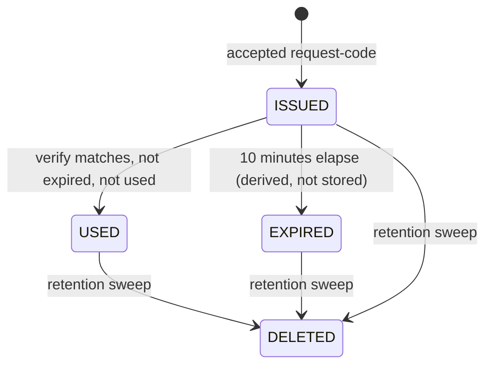

<!-- SECTION: backend.auth.frontmatter | status: VERIFIED -->
## Frontmatter

```yaml
id: auth
surface: backend
spec_mode: NOT-APPLICABLE
doc_status: DRAFT
blocked_by: [Q-BE-001, Q-BE-003]
scope: [API-AUTH-015365, API-AUTH-592570]
```

`blocked_by` lists the two blocking questions that stop parts of this module. `Q-BE-001` is who may request, verify or receive a code (BR-030). `Q-BE-003` is what a successful verify issues. `Q-BE-002` (note ownership) does not block this module.
<!-- /SECTION: backend.auth.frontmatter -->
<!-- SECTION: backend.auth.purpose | status: VERIFIED -->
## Purpose

**Responsibility.** `auth` owns email one-time-code login (US-006-06; BR-020 to BR-033; NFR-015 to NFR-019). It:

- issues a 6-digit numeric code for an email address (BR-029) through `API-AUTH-015365`, and sends it by email;
- limits requests to 3 per rolling 10 minutes per email (BR-021, BR-028);
- verifies a submitted code through `API-AUTH-592570`, with these rules:
  - a code expires 10 minutes after issue (BR-020, BR-024, BR-026);
  - a code is single use (BR-023);
  - 5 wrong codes lock verification for 15 minutes (BR-022, BR-025, BR-027);
- answers each refusal with the status the requirements give (BR-033);
- keeps and deletes its three record kinds (NFR-019).

**Not responsible for:**

- What a successful verify issues: credential type, lifetime, transport and refresh (`Q-BE-003`). Until it is decided, this module specifies that a code was accepted and nothing about what follows.
- Deciding who may request or receive a code (`Q-BE-001`, BR-030).
- Whether `notes` or `search` require a credential, and the note-ownership predicate (`Q-BE-002`, `Q-BE-003`; `backend.auth-model` is BLOCKED).
- The global error envelope and the registry. They are defined in `backend.error-model`, and this module only uses its codes.
- Publishing the OpenAPI document and the data-residency note (`contract-docs`).
- The login and code-entry screens and their error copy (web_app).
- Operating the transactional email service. This module only calls it (NFR-017).
- Existing login methods, which NFR-016 says "remain unchanged". No input describes them (`GAP-BE-007`).
- Four web_app handoffs (`HANDOFF-WEBAPP-263975`, `HANDOFF-WEBAPP-452996`, `HANDOFF-WEBAPP-500592`, `HANDOFF-WEBAPP-732181`) were listed for this run but their contents were not supplied. They are therefore not satisfied here (`GAP-BE-001`).
<!-- /SECTION: backend.auth.purpose -->
<!-- SECTION: backend.auth.data-model | status: DRAFT-UNVERIFIED -->
## Data model

Three tables, named by NFR-019 ("code challenges, send attempts and account locks"). They correspond to migrations 004 to 006 in `backend.migration-plan`, and the store is PostgreSQL 16 (`platform.md`).

Conventions are in `ASM-BE-117`:

- Surrogate keys are `bigint` identity columns and are never exposed.
- Every timestamp is `timestamptz`, stored and compared in UTC.
- Every `email` value is stored trimmed and lower-cased.
- All three tables are keyed by email address, because no account entity exists (project `ASM-BE-002`).

### `login_code_challenges`

| Column | Type | Null | Default | Constraint |
|---|---|---|---|---|
| `id` | bigint identity | NOT NULL | generated | PRIMARY KEY |
| `email` | text | NOT NULL | none | **PII** |
| `code` | char(6) | NOT NULL | none | CHECK `code ~ '^[0-9]{6}$'` (BR-029); **credential-like** |
| `issued_at` | timestamptz | NOT NULL | database `now()` | none |
| `used` | boolean | NOT NULL | `false` | none |

- **Expiry is derived, not stored.** A challenge is expired when `now() >= issued_at + 10 minutes` (`ASM-BE-004` in the project spec).
- **Foreign keys.** None, so no `ON DELETE` behaviour applies.
- **At-rest treatment.** Encryption, hashing or redaction of `email` and `code` is not stated by any input, so no claim is made (`GAP-BE-006`).

| Index | Serves |
|---|---|
| `(email, code, issued_at DESC)` | Verify lookup: the most recent challenge for this email with this code (`ASM-BE-120`). |
| `(issued_at)` | Retention sweep: delete where `issued_at` is older than the cutoff. |

### `login_send_attempts`

One row per **accepted** request-code call. Refused calls write no row (project `ASM-BE-005`).

| Column | Type | Null | Default | Constraint |
|---|---|---|---|---|
| `id` | bigint identity | NOT NULL | generated | PRIMARY KEY |
| `email` | text | NOT NULL | none | **PII** |
| `requested_at` | timestamptz | NOT NULL | database `now()` | none |

| Index | Serves |
|---|---|
| `(email, requested_at DESC)` | Resend limit: count rows for an email with `requested_at > now() - 10 minutes`. |
| `(requested_at)` | Retention sweep. |

### `account_locks`

One row per email that has had at least one counted wrong code (`ASM-BE-119`).

| Column | Type | Null | Default | Constraint |
|---|---|---|---|---|
| `email` | text | NOT NULL | none | PRIMARY KEY; **PII** |
| `failed_count` | smallint | NOT NULL | `0` | CHECK `failed_count BETWEEN 0 AND 5` |
| `locked_until` | timestamptz | NULL | `NULL` | CHECK `locked_until IS NULL OR failed_count = 5` |
| `updated_at` | timestamptz | NOT NULL | database `now()` | Retention clock |

| Index | Serves |
|---|---|
| PRIMARY KEY `(email)` | Lock check and counter update, per email. |
| `(updated_at)` | Retention sweep. |

**Time source.** Every comparison uses the database clock (`ASM-BE-118`).
<!-- /SECTION: backend.auth.data-model -->
<!-- SECTION: backend.auth.state-machine | status: DRAFT-UNVERIFIED -->
## State machine

Three independent state sets exist.

### Code challenge



- **Terminal states:** `USED`, `EXPIRED`, `DELETED`. `USED` is stored (`used = true`); `EXPIRED` is computed.
- A challenge that is `USED` and also past 10 minutes stays `USED`. Precedence is used before expired (project `ASM-BE-007`).
- After `DELETED`, the same code is treated as unknown. Verifying it returns invalid (401) and counts as a wrong code (see `GAP-BE-123`).

| Transition | Trigger | Guard |
|---|---|---|
| (none) → `ISSUED` | `API-AUTH-015365` accepted | Fewer than 3 accepted attempts for the email in the rolling 10 minutes; input valid; email delivered (`ASM-BE-122`). |
| `ISSUED` → `USED` | `API-AUTH-592570` | Not locked; most recent challenge with equal code; `used = false`; `now() < issued_at + 10 minutes`. Done as one atomic compare-and-set. |
| `ISSUED` → `EXPIRED` | time | `now() >= issued_at + 10 minutes`. |
| any → `DELETED` | retention sweep | Older than the retention period (`backend.auth.jobs`). |

### Account verification state, per email

| State | Meaning |
|---|---|
| `OPEN(n)`, n = 0..4 | `failed_count = n` and no active lock. |
| `LOCKED` | `failed_count = 5` and `now() < locked_until`. |

| Transition | Trigger | Guard / effect |
|---|---|---|
| `OPEN(n)` → `OPEN(n+1)` | verify outcome invalid (401) | n+1 < 5. Increment atomically. |
| `OPEN(4)` → `LOCKED` | the 5th invalid verify | That request still returns 401. `locked_until = now() + 15 minutes` (`ASM-BE-121`). |
| `OPEN(n)` → `OPEN(0)` | successful verify | Counter reset (project `ASM-BE-005`). |
| `LOCKED` → `OPEN(0)` | `now() >= locked_until` observed | Reset `failed_count` to 0 and clear `locked_until`. |
| `LOCKED` → `LOCKED` | any verify | Refused with 423. No counter change, and the lock is not extended. |

- **Terminal states:** none. The account state is cyclic, and the row is removed only by retention.
- **Request-code never changes this state.** It is not refused during a lock (BR-032).

### Resend window (derived)

The state is `ACCEPTING` while the count of attempts with `requested_at > now() - 10 minutes` is below 3. Otherwise it is `RATE_LIMITED`, and a request is refused with 429 `OTP_RATE_LIMITED`. Nothing is stored for this state.

### Illegal transitions

Illegal transitions are the refusals below. For the exact status and code names, see `backend.error-model`.

| Attempted | Status | Code |
|---|---|---|
| Verify while `LOCKED` | 423 | `OTP_ACCOUNT_LOCKED` |
| Verify a `USED` challenge | 409 | `OTP_CODE_ALREADY_USED` |
| Verify an `EXPIRED` challenge | 410 | `OTP_CODE_EXPIRED` |
| Verify a code that matches nothing | 401 | `OTP_CODE_INVALID` |
| Request while `RATE_LIMITED` | 429 | `OTP_RATE_LIMITED` |
<!-- /SECTION: backend.auth.state-machine -->
<!-- SECTION: backend.auth.requirements | status: BLOCKED -->
## Requirements

**BLOCKED.** the run did not produce this section for module `auth`. Nothing has been written in its place.

This section is required by the surface's template and was not produced. It is emitted blocked rather than omitted: a missing section is invisible, a blocked one is a work item.
<!-- /SECTION: backend.auth.requirements -->
<!-- SECTION: backend.auth.api-contract | status: VERIFIED -->
## Api contract

_Rendered by DevAgent from the operation records._

| id | method | path | module | success | errors | summary |
|---|---|---|---|---|---|---|
| `API-AUTH-015365` | POST | `/auth/request-code` | `auth` | 202 | 400, 429, 500 | Request a 6-digit one-time login code, emailed to the supplied address. Limited to 3 requests per rolling 10 minutes per email; not refused during an account lock (BR-032). |
| `API-AUTH-592570` | POST | `/auth/verify-code` | `auth` | 200 | 400, 401, 409, 410, 423, 500 | Verify a one-time login code. Codes expire 10 minutes after issue and are single use. Five wrong codes lock verification for 15 minutes. Precedence: lock, then used, then expired, then invalid. |

### `API-AUTH-015365` — POST `/auth/request-code`

Request a 6-digit one-time login code, emailed to the supplied address. Limited to 3 requests per rolling 10 minutes per email; not refused during an account lock (BR-032).

**Request:** 
- `email` (string, required): Email address to which the one-time login code is sent. PII; always masked in examples and logs.
**Response:** 
- `message` (string): Human-readable confirmation that a code was issued and emailed. Never contains the code or an unmasked email address.

### `API-AUTH-592570` — POST `/auth/verify-code`

Verify a one-time login code. Codes expire 10 minutes after issue and are single use. Five wrong codes lock verification for 15 minutes. Precedence: lock, then used, then expired, then invalid.

**Request:** 
- `email` (string, required): Email address the code was issued to. PII; always masked in examples and logs.
- `code` (string, required): The 6-digit numeric one-time code received by email.
**Response:** 
- `verified` (boolean): True when the code was accepted and consumed. What credential a successful verify issues (type, lifetime, transport) is undecided and blocked on Q-BE-003, so no credential field is defined.
<!-- /SECTION: backend.auth.api-contract -->
<!-- SECTION: backend.auth.invariants | status: DRAFT-UNVERIFIED -->
## Invariants

- **INV-BE-101.** A challenge transitions from `used = false` to `used = true` at most once, and never back.
- **INV-BE-102.** For any email and any instant, the number of `login_send_attempts` rows with `requested_at` in the preceding 10 minutes is at most 3.
- **INV-BE-103.** `failed_count` is between 0 and 5, and `locked_until` is non-null only when `failed_count = 5`.
- **INV-BE-104.** While `now() < locked_until` for an email, no verify for it succeeds, and none changes `failed_count` or `locked_until`.
- **INV-BE-105.** No verify succeeds at or after `issued_at + 10 minutes` of the matched challenge (`ASM-BE-004`).
- **INV-BE-106.** Every stored `code` is exactly six numeric characters.
- **INV-BE-107.** A refused request (400, 415, 423, 429, or any refusal other than 401) creates no challenge or send-attempt row. Only a 401 verify changes `failed_count`, and only a success resets it.
- **INV-BE-108.** A code value appears only in the challenge row and the outgoing email. It never appears in a response, log entry, metric label or error body.
- **INV-BE-109.** Every `email` in the three tables is stored in normalised form (`ASM-BE-117`), so one address maps to one lock row and one resend window.
<!-- /SECTION: backend.auth.invariants -->
<!-- SECTION: backend.auth.authorization | status: BLOCKED -->
## Authorization

**BLOCKED.** The role permission matrix and the eligibility predicate cannot be written without inventing an authorisation rule. It needs `Q-BE-001` (who may request, verify or receive a code) and `Q-BE-003` (what verify issues, which sets how the other modules authorise). `backend.auth-model` is BLOCKED for the same reason.

What follows from the operations themselves (DERIVED):

| Operation | Caller | Authentication required |
|---|---|---|
| `API-AUTH-015365` | any unauthenticated client | No. The operation exists to obtain access, so it cannot require the credential it leads to. |
| `API-AUTH-592570` | any unauthenticated client | No, for the same reason. |

- **No roles are defined for this module.** None of the supplied inputs names a role for login.
- **Ownership predicate.** No resource is user-scoped here. Challenges, send attempts and locks are keyed by the email supplied in the request. A caller shows control of an address only by presenting a valid, unexpired, unused code issued to it.
- **Abuse limits.** The only limits specified are per email (3 requests per 10 minutes; 5 wrong codes). No per-client or per-network limit is stated (`GAP-BE-124`).

**Would unblock.** A clean BR-030 and the post-verify credential decision.
<!-- /SECTION: backend.auth.authorization -->
<!-- SECTION: backend.auth.jobs | status: DRAFT-UNVERIFIED -->
## Jobs

**Retention sweep** (BE-AUTH-FR-017; NFR-019; migration 008).

| Table | Delete where | Period |
|---|---|---|
| `login_code_challenges` | `issued_at` older than period | 1 day |
| `login_send_attempts` | `requested_at` older than period | 1 day |
| `account_locks` | `updated_at` older than period | 5 days |

- **Periods** follow `ASM-BE-011` in the project spec, because the NFR-019 units are garbled (`GAP-BE-004`).
- **Schedule.** The run frequency is not stated (`GAP-BE-125`).
- **Idempotency.** The sweep is a predicate delete, so a re-run or overlapping run is harmless. A failed run is retried at the next tick, and no idempotency key is needed.
- **Effect on verify.** The sweep removes the evidence for 409 and 410. A used or expired code submitted after deletion returns 401 and counts as a wrong code (`GAP-BE-123`).
- **No unlock job.** A lock ends by comparison with `locked_until` at request time (BE-AUTH-FR-010).

**Request idempotency.**
- No idempotency key exists in any input.
- `API-AUTH-015365` is not idempotent: each accepted call issues a new code and uses one of the 3 allowances. The earlier unexpired codes stay valid (project `ASM-BE-008`).
- A replay of a successful `API-AUTH-592570` returns 409.
- The web_app should therefore avoid duplicate submits and automatic retries of the request-code call (`GAP-BE-127`).

**Retries.** The module retries nothing. Email delivery retries are unstated (`GAP-BE-121`).
<!-- /SECTION: backend.auth.jobs -->
<!-- SECTION: backend.auth.test-plan | status: DRAFT-UNVERIFIED -->
## Test plan

All time-dependent tests use a controllable clock for the boundaries in `ASM-BE-118`.

**Unit**
- `code_is_six_numeric_chars`: leading zeros kept; the format check rejects 5 or 7 digits and non-digits.
- `verify_code_precedence_matrix`: every combination of locked, used, expired and unknown gives the status in BE-AUTH-FR-011.
- `failed_count_only_changes_on_401_and_success`.
- `request_code_window_rolls_at_ten_minutes`: boundaries at 9m59s and 10m00s.
- `verify_code_expired_at_ten_minutes`: boundaries at 9m59s and 10m00s.
- `verify_code_lock_lifts_after_fifteen_minutes`.
- `email_normalisation_maps_case_variants_to_one_key` (`ASM-BE-117`).

**Integration** (PostgreSQL 16, email service stubbed)
- `request_code_accepts_and_emails_code` and `request_code_fourth_in_window_is_429`, including that the refused call writes no rows.
- `request_code_allowed_while_locked`.
- `verify_code_fifth_wrong_locks_for_fifteen_minutes` and `verify_code_correct_code_during_lock_is_423`.
- `verify_code_second_use_is_409` and `verify_code_concurrent_only_one_wins`.
- `concurrent_requests_never_exceed_limit` and `concurrent_wrong_codes_cap_at_five`.
- `request_code_delivery_failure_persists_nothing`.
- `retention_sweep_deletes_only_expired_records`, plus the post-deletion behaviour in `GAP-BE-123`.
- `logs_contain_no_code_or_unmasked_email`: scan captured logs, metrics and responses for the issued code and the raw email.

**Contract**
- Both operations appear in the published OpenAPI document (`contract-docs`, BR-012, NFR-008).
- Every status and registry code in the outcome table (BE-AUTH-FR-001 to FR-015) is declared on its operation. If an operation record omits one, the contract test fails (`GAP-BE-120`).
- No response schema contains a code field outside the verify request, and no response echoes the issued code.
- US-006-06's three acceptance criteria are each exercised by a named test above: FR-003, FR-006 and FR-009.
<!-- /SECTION: backend.auth.test-plan -->
<!-- SECTION: backend.auth.gaps | status: VERIFIED -->
## Gaps, contradictions and assumptions

No new `Q-` was minted. The blocking questions that affect this module are `Q-BE-001` and `Q-BE-003`, defined in the project spec. Project-level items relied on here are `GAP-BE-001`, `-002`, `-003`, `-004`, `-006`, `-007` and `-011`, `CON-BE-001`, and the project `ASM-BE-003`, `-004`, `-005`, `-007`, `-008`, `-011` and `-014`.

### Gaps

| ID | Missing | Degrades | Done instead | Closing artefact |
|---|---|---|---|---|
| `GAP-BE-120` | The previous rendering of the two operation records listed only 400 and 415 as errors, but this module specifies 401, 409, 410, 423, 429 and 500 as well. | `backend.auth.api-contract`; the contract test | The statuses are specified here and cited from BR-033 and BR-028. | Operation records that list every status in BE-AUTH-FR-001 to FR-015. |
| `GAP-BE-121` | Email delivery failure, bounce and retry behaviour. | BE-AUTH-FR-015 | `ASM-BE-122`: 500 and nothing persisted. | An email-delivery requirement. |
| `GAP-BE-122` | Whether a successful verify, or a newer code, invalidates other outstanding codes for the email. | BE-AUTH-FR-007; `ASM-BE-125` | A success consumes only the matched challenge (`ASM-BE-125`; project `ASM-BE-008`). | A decision on outstanding codes. |
| `GAP-BE-123` | No time window on the wrong-code count. After deletion of a used or expired challenge, resubmitting its code counts as wrong. | `backend.auth.state-machine`; `backend.auth.jobs` | Count is cumulative until a success or a lock ending, and is bounded in practice by the 5-day lock retention. | A statement of the counting window. |
| `GAP-BE-124` | No per-client or per-network limit on code requests or verification attempts. Whether the response reveals if an address is eligible or known is unstated. | `backend.auth.authorization` | Only the per-email limits are specified. | Abuse-control and enumeration requirements; BR-030 (`Q-BE-001`). |
| `GAP-BE-125` | Retention sweep frequency. | `backend.auth.jobs` | Frequency left to the implementer. | An operational requirement. |
| `GAP-BE-126` | Email address validity rules and maximum length. | BE-AUTH-FR-014 | "Valid email" is taken from the operation record; no length is stated. | A validation requirement. |
| `GAP-BE-127` | Outbound need for the web_app: the request-code call is not idempotent, so a double submit or an automatic retry uses up the 3-per-10-minutes allowance. The web_app should prevent duplicate submits and not retry that call automatically. | `backend.auth.jobs` | Stated here only. | The web_app spec addressing it. |

### Contradiction

| ID | Claims | Reading used and consequence |
|---|---|---|
| `CON-BE-104` | The `feedback.md` answer says "Max 3 **resends** per 10 minutes". BR-021 and BR-028 say "resend" but BR-032 and US-006-06 say "more than 3 **requests** within 10 minutes", and the `feedback.md` question asks for "code requests per email". | **Non-critical.** Reading used: 3 requests in total, counting the first (BR-032, US-006-06, the question text, and the operation record). If the other reading holds (1 request + 3 resends), the limit becomes 4 per window and INV-BE-102 and the 429 boundary change. |

### Assumptions

| ID | Assumption | What would confirm it |
|---|---|---|
| `ASM-BE-117` | Storage conventions: `email` is trimmed and lower-cased before storage and comparison; surrogate keys are `bigint` identity; timestamps are `timestamptz` in UTC. No input states them. | The platform owner. |
| `ASM-BE-118` | All time comparisons use the database clock. A send attempt counts while `requested_at > now() - 10 minutes`. A lock is active while `now() < locked_until`. | The requirements owner. |
| `ASM-BE-119` | `account_locks` holds the running `failed_count`, `locked_until` and `updated_at`, one row per email. NFR-019 names locks but no counter store. | The requirements owner. |
| `ASM-BE-120` | Verify matches the most recently issued challenge whose code equals the submitted code, then applies used, expired, success. | The requirements owner. |
| `ASM-BE-121` | The 5th wrong code returns 401 itself and starts the lock; the lock applies from the next request. | BR-022 and BR-033 wording. |
| `ASM-BE-122` | The challenge and send attempt are written in one transaction, held under the per-email serialisation, with the email sent before commit. A delivery failure rolls back and returns 500 `INTERNAL_ERROR`. | An email-delivery requirement (`GAP-BE-121`). |
| `ASM-BE-123` | Codes come from a cryptographically secure random source, uniform over 000000 to 999999. BR-029 states only the format. | The security owner. |
| `ASM-BE-124` | A missing field or a code that is not six digits returns 400 and is not counted toward the lock. | The requirements owner. |
| `ASM-BE-125` | A successful verify consumes only the matched challenge (`GAP-BE-122`). | A decision on outstanding codes. |
<!-- /SECTION: backend.auth.gaps -->
