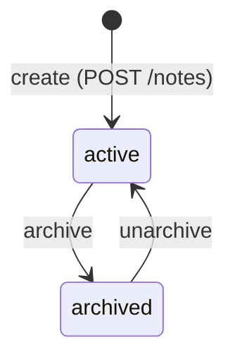

<!-- SECTION: backend.notes.frontmatter | status: VERIFIED -->
## Frontmatter

```yaml
id: notes
surface: backend
spec_mode: NOT-APPLICABLE
doc_status: DRAFT
blocked_by: [CON-BE-003, Q-BE-003, GAP-BE-052]
scope: [API-NOTES-232390, API-NOTES-045877, API-NOTES-847551]
```
<!-- /SECTION: backend.notes.frontmatter -->
<!-- SECTION: backend.notes.purpose | status: VERIFIED -->
## Purpose

**Responsibility.** This module owns the Note, Tag and NOTE_TAG entities. [project `backend.module-map`] It creates a note from a title, a body and an optional pinned flag. It reads a note by id, edits its title and body, and pins and unpins it. Per US-002-03 to US-002-05 it also adds and removes tags, archives and unarchives notes. [stories.md US-002-01 to US-002-06] It takes caller identity from `auth` and issues no credential. [project `backend.module-map`]

**Not responsible for.**

- Authenticating callers or issuing credentials. That is `auth`, including the email one-time-code sign-in of CR-125. CR-125 does not change this module. [project `backend.module-map`; feedback.md CR-125]
- Keyword search, tag-filtered search, pagination and archived exclusion by default. That is `search`. [requirements.md BR-009, BR-010, BR-011]
- Attachments, real-time channels, mobile-specific endpoints and the scope guardrail. [requirements.md BR-014, BR-015; project `backend.module-map`]
- Storage region, infrastructure and the residency gate. [project `residency-compliance`]
- Any user interface. [stories.md EP-006]

**Boundary on the list operation.** The project spec assigns `GET /notes` to this module (INV-BE-001). No operation record for it was supplied, so this module refers to it in FR-023 and does not specify it. `GAP-BE-062`.

**Revision.** The `pinned` flag, its default of `false`, and its settability on create and PATCH are CR-112. [requirements.md BR-018; feedback.md CR-112]

<!-- /SECTION: backend.notes.purpose -->
<!-- SECTION: backend.notes.data-model | status: DRAFT-UNVERIFIED -->
## Data model

Table and column names follow the project domain model. [project `backend.domain-model`] Types are PostgreSQL 16 types. [platform.md]

**Table `note`**

| Column | Type | Null | Default | Constraint and notes |
|---|---|---|---|---|
| `id` | identifier; type not stated | NOT NULL | server-assigned (`ASM-BE-054`) | primary key; unique (`INV-BE-058`); type `GAP-BE-061` |
| `title` | text | NOT NULL | none | non-empty (`INV-BE-051`); length limit `GAP-BE-054` |
| `body` | text | NOT NULL | none | non-empty at creation (BR-005); length limit `GAP-BE-054` |
| `status` | text | NOT NULL | `'active'` (`ASM-BE-056`) | CHECK `status IN ('active','archived')` |
| `pinned` | boolean | NOT NULL | `false` | BR-018; NOT NULL is the project proposal `ASM-BE-034` |
| `created_at` | timestamp with time zone | NOT NULL | set on insert | never updated (`INV-BE-057`); zone `ASM-BE-057` |
| `updated_at` | timestamp with time zone | NOT NULL | set on insert | set on every successful mutation (`ASM-BE-055`) |

**Table `tag`**

| Column | Type | Null | Default | Constraint and notes |
|---|---|---|---|---|
| `name` | text | NOT NULL | none | primary key; format and length `GAP-BE-009`; case `GAP-BE-067` |

**Table `note_tag`**

| Column | Type | Null | Default | Constraint and notes |
|---|---|---|---|---|
| `note_id` | same type as `note.id` | NOT NULL | none | FK to `note.id`, ON DELETE RESTRICT (`ASM-BE-058`) |
| `tag_name` | text | NOT NULL | none | FK to `tag.name`, ON DELETE RESTRICT (`ASM-BE-058`) |

- Primary key `(note_id, tag_name)`. A duplicate pair cannot be stored, so a repeated tag add is a no-op. This implements US-002-03 AC2.
- Index on `(tag_name)`. It serves the tag filter in search. The search module owns that query. The design of this index and of any index on `note.status` or `note.pinned` is `GAP-BE-068`.
- Cardinality is many-to-many between note and tag, through `note_tag`. [project `backend.domain-model`]
- Archiving keeps `note_tag` rows. [requirements.md BR-007]
- Tag rows that lose their last note: `GAP-BE-016` (project).

**Indexes for the operations in scope.** The primary key on `note.id` serves GET and PATCH by id.

**Deletion.** No operation in this module removes a note or tag row (`ASM-BE-052`). Retention and purge: `GAP-BE-101` (project).

<!-- /SECTION: backend.notes.data-model -->
<!-- SECTION: backend.notes.state-machine | status: DRAFT-UNVERIFIED -->
## State machine

`status` has two states. `pinned` is not a state. It is an independent boolean that PATCH sets in either status, subject to `GAP-BE-058`.



| From | To | Trigger | Guard | Effect |
|---|---|---|---|---|
| (none) | `active` | POST `/notes` succeeds | title and body non-empty | `pinned` from payload, else `false` |
| `active` | `archived` | archive (no operation record, `GAP-BE-052`) | note exists | `status` only (`INV-BE-055`) |
| `archived` | `active` | unarchive (no operation record, `GAP-BE-052`) | note exists | `status` only; all data kept (BR-008) |

**Terminal states.** None. Nothing in the inputs removes a note, so no state is terminal.

**Illegal transitions.**

- Archive of an already-archived note: refused with a conflict or error response, nothing modified (US-002-04 AC2). Status code `GAP-BE-107`.
- Unarchive of an active note: not specified. `GAP-BE-059`.
- Any transition on an unknown id: 404, nothing modified (US-002-05 AC2, AC-002-02-03).
- Edit or pin while `archived`: not specified. `GAP-BE-058`.

<!-- /SECTION: backend.notes.state-machine -->
<!-- SECTION: backend.notes.requirements | status: DRAFT-UNVERIFIED -->
## Requirements

Each requirement traces to a supplied story or criterion. Where an operation has no record, the requirement states its API as none and cites the gap.

### BE-NOTES-FR-001: create with defaults
- **Given** an authenticated caller and a payload with a non-empty title and body and no `pinned` value
- **When** POST `/notes` is called
- **Then** the response is 201 with a server-assigned `id`, `status` `active`, `pinned` `false`, and equal `created_at` and `updated_at`. The note is persisted.
- **Traces to.** US-002-01; AC-002-01-01; BR-005; BR-018
- **Verification.** `test_create_returns_201_with_defaults` (planned)
- **API.** `API-NOTES-232390`

### BE-NOTES-FR-002: create pinned
- **Given** an authenticated caller and a valid payload with `pinned` `true`
- **When** POST `/notes` is called
- **Then** the response is 201 and the stored note has `pinned` `true`
- **Traces to.** US-002-01; AC-002-01-02; BR-018
- **Verification.** `test_create_pinned_persists_true` (planned)
- **API.** `API-NOTES-232390`

### BE-NOTES-FR-003: create without title
- **Given** a payload with no `title`
- **When** POST `/notes` is called
- **Then** the response is 400 with a validation error and no row is inserted. The error body is `GAP-BE-106`.
- **Traces to.** US-002-01; AC-002-01-03; BR-005
- **Verification.** `test_create_missing_title_400_no_row` (planned)
- **API.** `API-NOTES-232390`

### BE-NOTES-FR-004: create with empty or null title or body
- **Given** a payload whose `title` or `body` is empty or null
- **When** POST `/notes` is called
- **Then** the response is 400 and no row is inserted. Whitespace-only values: `GAP-BE-054`.
- **Traces to.** BR-005
- **Verification.** `test_create_empty_or_null_400` (planned)
- **API.** `API-NOTES-232390`

### BE-NOTES-FR-005: create with non-boolean pinned
- **Given** a payload whose `pinned` is not a boolean
- **When** POST `/notes` is called
- **Then** the response is 400 and no row is inserted (`ASM-BE-051`)
- **Traces to.** BR-018
- **Verification.** `test_create_non_boolean_pinned_400` (planned)
- **API.** `API-NOTES-232390`

### BE-NOTES-FR-006: read an existing note
- **Given** an existing note, whether `active` or `archived`
- **When** GET `/notes/{id}` is called
- **Then** the response is 200 with the full note: `id`, `title`, `body`, `status`, `pinned`, tags, `created_at`, `updated_at`. An archived note returns `status` `archived` and its data intact.
- **Traces to.** US-002-06 AC1; BR-007
- **Verification.** `test_get_returns_full_note_incl_archived` (planned)
- **API.** `API-NOTES-045877`

### BE-NOTES-FR-007: read an unknown note
- **Given** an id with no row
- **When** GET `/notes/{id}` is called
- **Then** the response is 404 with no note fields in the body. "Deleted" in US-002-06 is treated as this case (`ASM-BE-052`).
- **Traces to.** US-002-06 AC2
- **Verification.** `test_get_unknown_404_no_partial_data` (planned)
- **API.** `API-NOTES-045877`

### BE-NOTES-FR-008: edit title or body
- **Given** an existing note and a valid new title or body
- **When** PATCH `/notes/{id}` is called
- **Then** the response is 200 with the updated note. `updated_at` advances. `created_at` is unchanged.
- **Traces to.** US-002-02 AC1; AC-002-02-01; `ASM-BE-055`
- **Verification.** `test_patch_title_body_updates_and_timestamps` (planned)
- **API.** `API-NOTES-847551`

### BE-NOTES-FR-009: partial update semantics
- **Given** an existing note
- **When** PATCH is called with `body` only
- **Then** `title`, `pinned` and `status` are unchanged
- **Traces to.** BR-006
- **Verification.** `test_patch_leaves_unsent_fields_unchanged` (planned)
- **API.** `API-NOTES-847551`

### BE-NOTES-FR-010: edit to empty title or body
- **Given** an existing note
- **When** PATCH sets `title` or `body` to empty or null
- **Then** the response is 400 and nothing is modified (`ASM-BE-053`). Confirmation: `GAP-BE-057`.
- **Traces to.** BR-005 (stated for creation only); INV-BE-051
- **Verification.** `test_patch_empty_title_400_no_change` (planned)
- **API.** `API-NOTES-847551`

### BE-NOTES-FR-011: pin via PATCH
- **Given** an existing note with `pinned` `false`
- **When** PATCH is called with `pinned` `true` and no other field
- **Then** the response is 200, `pinned` is `true`, and `title`, `body`, tags and `status` are unchanged
- **Traces to.** AC-002-02-02; BR-018; INV-BE-053
- **Verification.** `test_pin_changes_only_pinned` (planned)
- **API.** `API-NOTES-847551`

### BE-NOTES-FR-012: unpin via PATCH
- **Given** an existing note with `pinned` `true`
- **When** PATCH is called with `pinned` `false`
- **Then** the response is 200 and `pinned` is `false`. No other field changes.
- **Traces to.** BR-018; INV-BE-053
- **Verification.** `test_unpin_changes_only_pinned` (planned)
- **API.** `API-NOTES-847551`

### BE-NOTES-FR-013: PATCH with non-boolean pinned
- **Given** an existing note
- **When** PATCH is called with a non-boolean `pinned`
- **Then** the response is 400 and nothing is modified (`ASM-BE-051`)
- **Traces to.** BR-018
- **Verification.** `test_patch_non_boolean_pinned_400` (planned)
- **API.** `API-NOTES-847551`

### BE-NOTES-FR-014: PATCH unknown id
- **Given** an id with no row
- **When** PATCH `/notes/{id}` is called
- **Then** the response is 404 and no data is modified
- **Traces to.** US-002-02 AC3; AC-002-02-03
- **Verification.** `test_patch_unknown_404_no_write` (planned)
- **API.** `API-NOTES-847551`

### BE-NOTES-FR-015: archive an active note
- **Given** an active, existing note
- **When** archive is called (no operation record, `GAP-BE-052`)
- **Then** the response is 200, `status` is `archived`, and title, body, tags and `pinned` are intact
- **Traces to.** US-002-04 AC1; BR-007
- **Verification.** `test_archive_keeps_data` (planned)
- **API.** none (`GAP-BE-052`)

### BE-NOTES-FR-016: archive an archived note
- **Given** an already archived note
- **When** archive is called again
- **Then** the response is a conflict or error response, and nothing is modified. Status code: `GAP-BE-107`.
- **Traces to.** US-002-04 AC2
- **Verification.** `test_archive_twice_refused_no_change` (planned)
- **API.** none (`GAP-BE-052`)

### BE-NOTES-FR-017: unarchive an archived note
- **Given** an archived note
- **When** unarchive is called
- **Then** the response is 200, `status` is `active`, and all prior data is preserved
- **Traces to.** US-002-05 AC1; BR-008
- **Verification.** `test_unarchive_restores_active_with_data` (planned)
- **API.** none (`GAP-BE-052`)

### BE-NOTES-FR-018: unarchive an unknown id
- **Given** an id with no row
- **When** unarchive is called
- **Then** the response is 404
- **Traces to.** US-002-05 AC2
- **Verification.** `test_unarchive_unknown_404` (planned)
- **API.** none (`GAP-BE-052`)

### BE-NOTES-FR-019: add a tag
- **Given** an existing note and a tag name meeting `GAP-BE-009`
- **When** a tag is added
- **Then** the response is 200 and the note's tags include the new tag
- **Traces to.** US-002-03 AC1
- **Verification.** `test_add_tag_appears_on_note` (planned)
- **API.** none (`GAP-BE-052`)

### BE-NOTES-FR-020: add an existing tag again
- **Given** a note that already has the tag
- **When** the same tag is added
- **Then** the response is 200 and no duplicate `note_tag` row exists
- **Traces to.** US-002-03 AC2; INV-BE-053 (primary key)
- **Verification.** `test_add_existing_tag_no_duplicate` (planned)
- **API.** none (`GAP-BE-052`)

### BE-NOTES-FR-021: remove a tag
- **Given** a note that carries a tag
- **When** the tag is removed
- **Then** the note no longer carries the tag. Retention of the `tag` row: `GAP-BE-016`.
- **Traces to.** US-002-03 (story only; no criterion supplied, `GAP-BE-052`)
- **Verification.** `test_remove_tag_detaches_only` (planned)
- **API.** none (`GAP-BE-052`)

### BE-NOTES-FR-022: unauthenticated call
- **Given** a request with no credential
- **When** any operation in this module is called
- **Then** the response is 401, nothing is read or written, and the body is `GAP-BE-106`. 403 is reserved for the blocked ownership rule.
- **Traces to.** US-004-03 (401 and 403 documented); `ASM-BE-031`
- **Verification.** `test_no_credential_401_all_ops` (planned)
- **API.** `API-NOTES-232390`, `API-NOTES-045877`, `API-NOTES-847551`

### BE-NOTES-FR-023: pinned-first ordering in the list
- **Given** the list operation exists (`GAP-BE-062`)
- **When** the list is returned
- **Then** every pinned note precedes every unpinned note, and order within each group is unchanged
- **Traces to.** BR-019; project INV-BE-001
- **Verification.** `test_list_pinned_first_stable` (planned)
- **API.** none (`GAP-BE-062`)

**Coverage of owned stories.** US-002-01: FR-001 to FR-005. US-002-02: FR-008 to FR-014. US-002-03: FR-019 to FR-021, all blocked by `GAP-BE-052`. US-002-04: FR-015, FR-016. US-002-05: FR-017, FR-018. US-002-06: FR-006, FR-007.

<!-- /SECTION: backend.notes.requirements -->
<!-- SECTION: backend.notes.api-contract | status: VERIFIED -->
## Api contract

_Rendered by DevAgent from the operation records._

| id | method | path | module | success | errors | summary |
|---|---|---|---|---|---|---|
| `API-NOTES-232390` | POST | `/notes` | `notes` | 201 | 400, 401 | Create a note with a title, a body and an optional pinned flag. |
| `API-NOTES-045877` | GET | `/notes/{id}` | `notes` | 200 | 401, 404 | Read a single note by id. |
| `API-NOTES-847551` | PATCH | `/notes/{id}` | `notes` | 200 | 401, 404 | Edit a note's title or body, and pin or unpin it by setting the pinned flag. Pinning does not change title, body or tags (BR-018; AC-002-02-02). |

### `API-NOTES-232390` — POST `/notes`

Create a note with a title, a body and an optional pinned flag.

**Request:** 
- `title` (string, required): Mandatory and non-empty at creation (BR-005; AC-002-01-03).
- `body` (string, required): Mandatory and non-empty at creation (BR-005).
- `pinned` (boolean): Defaults to false when omitted (BR-018; AC-002-01-01, AC-002-01-02).
**Response:** 
- `id` (string, required): Note identifier (Note entity, backend.domain-model).
- `title` (string, required): Note title.
- `body` (string, required): Note body.
- `status` (string, required): active or archived (Note entity, backend.domain-model).
- `pinned` (boolean, required): Pinned flag (BR-018).
- `created_at` (string, required): Creation timestamp (Note entity). Timezone handling not stated (GAP-BE-107 family; not specified).
- `updated_at` (string, required): Last update timestamp (Note entity).

### `API-NOTES-045877` — GET `/notes/{id}`

Read a single note by id.

**Request:** none
**Response:** 
- `id` (string, required): Note identifier (Note entity, backend.domain-model).
- `title` (string, required): Note title.
- `body` (string, required): Note body.
- `status` (string, required): active or archived (Note entity, backend.domain-model).
- `pinned` (boolean, required): Pinned flag (BR-018).
- `created_at` (string, required): Creation timestamp (Note entity).
- `updated_at` (string, required): Last update timestamp (Note entity).

### `API-NOTES-847551` — PATCH `/notes/{id}`

Edit a note's title or body, and pin or unpin it by setting the pinned flag. Pinning does not change title, body or tags (BR-018; AC-002-02-02).

**Request:** 
- `title` (string): New title when editing (AC-002-02-01).
- `body` (string): New body when editing (AC-002-02-01).
- `pinned` (boolean): true pins the note, false unpins it (BR-018; AC-002-02-02).
**Response:** 
- `id` (string, required): Note identifier (Note entity, backend.domain-model).
- `title` (string, required): Note title after the edit.
- `body` (string, required): Note body after the edit.
- `status` (string, required): active or archived (Note entity, backend.domain-model).
- `pinned` (boolean, required): Pinned flag after the update (BR-018).
- `created_at` (string, required): Creation timestamp (Note entity).
- `updated_at` (string, required): Last update timestamp (Note entity).
<!-- /SECTION: backend.notes.api-contract -->
<!-- SECTION: backend.notes.invariants | status: DRAFT-UNVERIFIED -->
## Invariants

These hold after every operation in this module.

- **INV-BE-051.** Every stored note has a non-empty title and body. Enforced at creation by BR-005 and on update by `ASM-BE-053`. Verified by FR-004 and FR-010.
- **INV-BE-052.** `pinned` is a boolean and is never null. It defaults to `false` when omitted on create. Verified by FR-001 and the NOT NULL constraint test. Source: BR-018; `ASM-BE-034`.
- **INV-BE-053.** A pin or unpin changes only `pinned`. Title, body, tags and status are unchanged. Adding a tag that already exists creates no second row, by the `note_tag` primary key. Sources: AC-002-02-02; BR-018; US-002-03 AC2.
- **INV-BE-054.** A PATCH leaves every field it does not contain unchanged. Source: BR-006.
- **INV-BE-055.** Archive and unarchive change `status` only. They delete no row and alter no content, tag or `pinned` value. Sources: BR-007; BR-008.
- **INV-BE-056.** An operation that is refused or returns 404 writes no row. Sources: AC-002-01-03; AC-002-02-03; US-002-06 AC2.
- **INV-BE-057.** `created_at` is set once and never changes. `updated_at` is not earlier than `created_at` and advances on each successful mutation. Sources: AC-002-01-01; AC-002-02-01; `ASM-BE-055`.
- **INV-BE-058.** Note ids are unique, and no operation in this module reuses an id or removes a row. Sources: `ASM-BE-052`; `ASM-BE-054`.

The project invariant INV-BE-001 (pinned-first ordering in `GET /notes`) applies to the list operation, which has no record here (`GAP-BE-062`).
<!-- /SECTION: backend.notes.invariants -->
<!-- SECTION: backend.notes.authorization | status: DRAFT-UNVERIFIED -->
## Authorization

No input defines a role beyond "authenticated team member" (`ASM-BE-031`). No admin or per-note role is specified.

| Operation | No credential | Authenticated caller | Notes |
|---|---|---|---|
| POST `/notes` (`API-NOTES-232390`) | 401; nothing persisted (FR-022) | allowed | ownership rule blocked (below) |
| GET `/notes/{id}` (`API-NOTES-045877`) | 401 (FR-022) | allowed; archived notes readable | ownership rule blocked |
| PATCH `/notes/{id}` (`API-NOTES-847551`) | 401 (FR-022) | allowed | ownership rule blocked |
| Add or remove tag, archive, unarchive | no operation record | no operation record | `GAP-BE-052` |
| List (`GET /notes`) | no operation record | no operation record | `GAP-BE-062` |

**Identity source.** This module consumes caller identity from `auth`. It does not verify credentials. The credential form is `Q-BE-012` (project).

**Ownership predicate: BLOCKED.** No predicate is defined. The subpart is blocked by `CON-BE-003` (Critical) and `Q-BE-003` (project). The shared-workspace default, `Q-BE-001`, applies only to users created by a route the human has approved (project `backend.overview`). Until those are answered, this module checks that the caller is authenticated and applies no per-note check. Do not add a per-note check on assumption.
<!-- /SECTION: backend.notes.authorization -->
<!-- SECTION: backend.notes.jobs | status: DERIVED -->
## Jobs

**Scheduled work.** None. No input describes a sweep, background job or scheduled operation for notes.

**Retention and purge.** Not specified. `GAP-BE-101` (project).

**Idempotency.**

| Operation | Behaviour on retry | Source |
|---|---|---|
| POST `/notes` | Not idempotent. No key is defined, so a retried create stores a second note. | `GAP-BE-064` |
| PATCH `/notes/{id}` | Setting the same values leaves data unchanged. `updated_at` still advances. | `ASM-BE-055` |
| Add tag | Idempotent, by the `note_tag` primary key. | US-002-03 AC2 |
| Archive | Not idempotent. The second call is refused. | US-002-04 AC2; status `GAP-BE-107` |
| Unarchive, repeated | Not specified. | `GAP-BE-059` |
<!-- /SECTION: backend.notes.jobs -->
<!-- SECTION: backend.notes.test-plan | status: DERIVED -->
## Test plan

**Unit.** Validation of title, body and `pinned` (FR-003 to FR-005, FR-010, FR-013). Partial-update merge (FR-009). Status transitions and refusal of illegal ones (state machine). Tag add idempotence (FR-020).

**Integration.**

- Constraints: CHECK on `status`, NOT NULL and default on `pinned`, primary key on `note_tag` (INV-BE-052, INV-BE-053).
- A 404 or 400 leaves all rows unchanged, by snapshot comparison (INV-BE-056).
- Archive and unarchive preserve tags and `pinned` (INV-BE-055).
- `updated_at` advances on each successful mutation and never precedes `created_at` (INV-BE-057).

**Contract.** Once `api-contract` is rendered: 201, 200, 400, 401 and 404 response bodies conform to the records. Every note response includes `pinned`. GET returns tags and archive status. Tests are generated from the rendered contract, not written against this document.
<!-- /SECTION: backend.notes.test-plan -->
<!-- SECTION: backend.notes.gaps | status: VERIFIED -->
## Gaps, contradictions and assumptions

No `Q-` is minted for this module. Questions are recorded here as `GAP-` items with their closing artefact.

**Identifiers.** `GAP-BE-053`, `063`, `065`, `066`, `083`, `085`, `089` and `100` to `107` are defined by the project spec and are not re-minted here.

### Gaps

| ID | Summary | Degrades | Closing artefact |
|---|---|---|---|
| GAP-BE-052 | No operation records for add tag, remove tag, archive or unarchive. US-002-02 tag editing is also unplaced. | FR-015 to FR-021; tag and archive sections of `api-contract` | Operation records for each, and whether PATCH carries tags |
| GAP-BE-054 | Title and body length limits, character set and whitespace-only handling are not supplied. US-004-02 asks for title length constraints with no value. | FR-004; INV-BE-051; `note` table | Limits and whitespace rule |
| GAP-BE-055 | Handling of unknown fields and of a PATCH with no fields is not stated. | FR-009, FR-013 | Rule |
| GAP-BE-057 | Confirmation that a PATCH setting empty title or body is refused. BR-005 says "at creation" only. | FR-010 | Confirmation (default `ASM-BE-053`) |
| GAP-BE-058 | Edit and pin on archived notes are not stated. | state machine; FR-011, FR-012 | Rule |
| GAP-BE-059 | Unarchive of an active note, and repeated unarchive, are not stated. | state machine; FR-017; jobs | Rule |
| GAP-BE-060 | US-005-03 names "a standard last-write/conflict response" for concurrent PATCH without defining it. | FR-008, FR-011 | Concurrency rule and conflict response |
| GAP-BE-061 | Note id type and the response to a malformed id (400 or 404) are not stated. | `note.id`; FR-006, FR-007, FR-014 | Id scheme and malformed-id rule |
| GAP-BE-062 | List operation `GET /notes` has no record. US-006-01 and project INV-BE-001 need it. | FR-023; module boundary | Operation record |
| GAP-BE-064 | POST `/notes` has no idempotency key. A retry creates a duplicate. | jobs; FR-001 | Key, or confirmation that retries duplicate |
| GAP-BE-067 | Tag name case handling. Distinct from the format gap `GAP-BE-009`. | `tag.name` | Rule |
| GAP-BE-068 | Index design for `note.status` and `note.pinned` is not specified. Search owns the query. | data model | Query plan from `search` |

**Cited project gaps (not re-minted):** `GAP-BE-009` (tag format and length), `GAP-BE-016` (tag cascade), `GAP-BE-017` and `GAP-BE-033` (PII in title and body, and at-rest treatment), `GAP-BE-101` (retention), `GAP-BE-106` (error envelope), `GAP-BE-107` (archive-conflict status).

### Contradictions

| ID | Severity | Summary | Consequence of each reading | Resolution in this spec |
|---|---|---|---|---|
| CON-BE-051 | non-critical | US-002-02 AC1 and AC2 name "PUT/PATCH". The records supplied contain PATCH only. | If PUT is required, its replace semantics conflict with partial update (BR-006) unless defined. If PATCH is the only verb, the story's PUT wording is unmet. | PATCH, which AC-002-02-02 uses as a partial update. Closing: confirmation of whether PUT exists. |

**Critical contradiction affecting this module (project).** `CON-BE-003` (ownership against the shared-workspace default). See `backend.notes.authorization`.

### Assumptions

| ID | Assumption | Basis | Closing artefact |
|---|---|---|---|
| ASM-BE-051 | A non-boolean `pinned` on create or PATCH is refused with 400 and nothing is written. | Validation applied to every typed field, as in AC-002-01-03 | Confirmation under `GAP-BE-055` |
| ASM-BE-052 | No delete operation for notes is in scope. "Deleted" in US-002-06 AC2 is treated as never-existing. | No input describes a delete; BR-007 keeps data | Confirmation that no hard delete exists |
| ASM-BE-053 | PATCH setting `title` or `body` to empty or null is refused with 400 and nothing is modified. | BR-005 applied to every stored value | `GAP-BE-057` |
| ASM-BE-054 | The note id is server-assigned at creation and opaque to clients. | AC-002-01-01 "unique ID" | `GAP-BE-061` |
| ASM-BE-055 | Every successful mutation, including pin and unpin, sets `updated_at`. | AC-002-02-01 "updated timestamp" | Confirmation |
| ASM-BE-056 | A new note has status `active`. | US-002-04 archives an "active, existing note"; the create record carries no status | Confirmation |
| ASM-BE-057 | Timestamps are stored timezone-aware, in UTC. | None supplied; the project spec requires a stated timezone | Confirmation |
| ASM-BE-058 | `note_tag` foreign keys use ON DELETE RESTRICT. | No delete is in scope (`ASM-BE-052`), so the choice has no visible effect | Confirmation when deletion is specified |
| ASM-BE-059 | POST `/notes` creates no tag rows. Tags are attached by the tag operations. | The create record carries title, body and `pinned` only | `GAP-BE-052` |

**Project assumptions used:** `ASM-BE-031` (authenticated team member), `ASM-BE-034` (`pinned` NOT NULL), `INV-BE-001` (pinned-first ordering).
<!-- /SECTION: backend.notes.gaps -->
